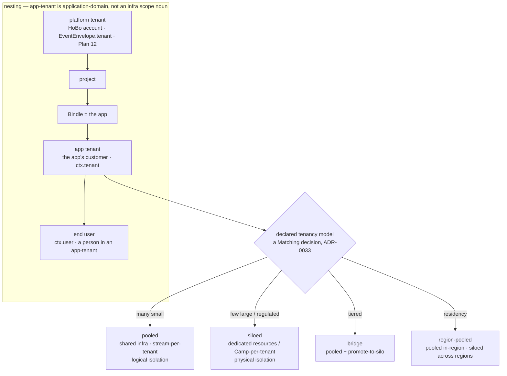
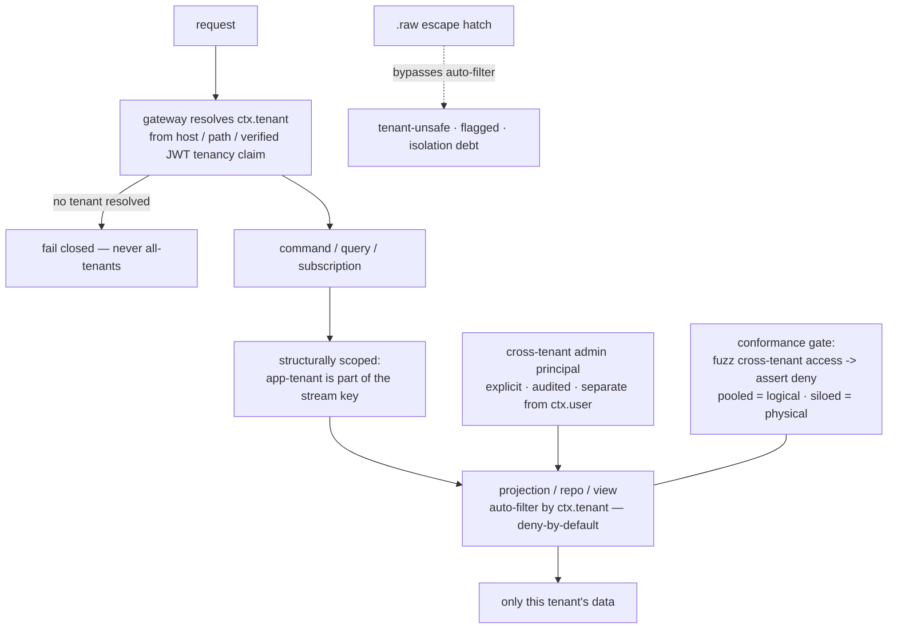

# Multi-Tenant Applications: app-tenant model, tenancy spectrum & isolation by construction

This capability doc specifies how a developer builds and operates a **multi-tenant application** *on* HoBo — a SaaS whose own customers are tenants. HoBo is already a multi-tenant platform with a deep isolation model ([Plan 12](./security-networking.md#plan-12)); this plan **exposes that machinery one level up** as a first-class app capability — *tenancy as a capability* — while being scrupulously honest that the app developer's tenant is a **different thing** from HoBo's own platform tenant, with isolation guarantees that depend on the **declared tenancy model**.

> **Two tenants, never conflated.** The **platform tenant** ([Plan 12](./security-networking.md#plan-12), `EventEnvelope.tenant`, `spiffe://yard/<tenant>/…`) is the **HoBo account/org** — HoBo's own hard isolation boundary, which app developers rarely touch. The **app tenant** (this plan) is **the developer's customer** — a tenant of the SaaS they built. They **nest**: `platform-tenant ⊇ project ⊇ Bindle (the app) ⊇ app-tenant ⊇ end-user`. An app-tenant is an **application-domain partition the developer declares and HoBo enforces**, *not* a sixth infra scope noun in `Bindle ⊂ Camp ⊂ Yard ⊂ Junction` ([ADR-0026](./adr/01-architecture-core.md#adr-0026)).

## Plan 50

**Plan 50 — Multi-tenant applications**

> **Relationship to existing surfaces.** End-user auth ([Plan 6 §6.7](./ai-native-agent-auth.md#plan-06)/[ADR-0038](./adr/02-identity-security.md#adr-0038)) gives `ctx.user` (a person); this plan adds **`ctx.tenant`** (the customer org that person belongs to) and the per-tenant isolation/routing/config/quota/residency/lifecycle/observability that a real SaaS needs. It reuses Matching ([ADR-0033](./adr/05-config-matching-environments.md#adr-0033)), the data plane ([Plan 32](./data-plane.md#plan-32)), the policy plane + `.allow()` ([Plan 29](./contracts-policy-flags.md#plan-29)/[Plan 21](./authoring-resources-wiring.md#plan-21)), domains/DNS ([ADR-0035](./adr/07-portability-extensibility.md#adr-0035)), flags ([ADR-0044](./adr/04-governance-verification.md#adr-0044)), metering ([ADR-0039](./adr/04-governance-verification.md#adr-0039)), residency/erasure ([ADR-0040](./adr/05-config-matching-environments.md#adr-0040)/[ADR-0060](./adr/04-governance-verification.md#adr-0060)), and the operations surfaces ([Plan 49](./dashboards-status-availability.md#plan-49)) — almost no new runtime.

### A. The app-tenant model ([ADR-0079](./adr/02-identity-security.md#adr-0079))

- **`AppTenant` is a first-class, event-sourced entity.** A tenant of the app is an [aggregate](./sdk-api.md#plan-02) on its own stream (`tenant:<id>`) with a lifecycle (§E), so "who is a tenant, since when, in what state, where their data lives" is auditable + replayable like everything else.
- **`ctx.tenant` is the resolved app-tenant for a request.** It is derived at the gateway from **the verified end-user's `tenancy` claim** ([ADR-0038](./adr/02-identity-security.md#adr-0038) — the `auth` contract already carries a tenancy claim) **and/or routing** (subdomain/custom-domain/path, §D). `ctx.tenant` sits alongside `ctx.user` (the person) and `ctx.identity` (the workload SVID) — one principal model, three views.
- **Cross-tenant access is a distinct, audited principal — never the default end-user path.** App-developer staff/support who legitimately see across tenants act as an explicit **cross-tenant-admin** principal (a role in the policy plane, [Plan 29](./contracts-policy-flags.md#plan-29)/[ADR-0074](./adr/02-identity-security.md#adr-0074)); every cross-tenant read/write is gated + emitted as an audit fact. An ordinary `ctx.user` can **only** ever reach their own `ctx.tenant`.

### B. The tenancy-model spectrum — declared, with honest per-model guarantees ([ADR-0079](./adr/02-identity-security.md#adr-0079))

The app **declares a tenancy model**; HoBo realizes it through **Matching** ([ADR-0033](./adr/05-config-matching-environments.md#adr-0033)), so the model — and a per-tenant override — is a **resolved config recorded in `match.Decided`**, not app code. The guarantee is **stated per model**, never blanket:

| Model | How it maps to HoBo | Isolation guarantee | Use when |
|---|---|---|---|
| **Pooled** *(default)* | shared resources; **stream-per-tenant** + tenant-scoped projections ([Plan 32](./data-plane.md#plan-32)) | **logical** — enforced by construction (§C); noisy-neighbor **bounded** by per-tenant quotas (§F), not eliminated | many small tenants; cost-sensitive |
| **Siloed** | dedicated resources/schema, or a **Camp-per-tenant** (a provider-specific stack, [ADR-0026](./adr/01-architecture-core.md#adr-0026)) | **physical** — a resource/Camp boundary; strongest | few large / regulated tenants; **bounded** (Camp-per-tenant doesn't scale to 100k) |
| **Bridge / tiered** | most tenants pooled; specific tenants **promoted to silo** — a per-tenant Matching decision | per-tenant: logical or physical by tier | a long tail pooled + a few that need a silo (plan/regulatory) |
| **Region-pooled** | pooled **within** a region/Camp, siloed **across** regions ([ADR-0040](./adr/05-config-matching-environments.md#adr-0040)) | logical in-region; physical across regions | per-tenant **residency** (a single global pool can't honor it) |

**Promotion is a config change, not a rewrite.** Moving a tenant pooled → siloed (e.g. it grew, or bought an "isolated" plan) re-runs Matching for that tenant + a gated data migration ([ADR-0032](./adr/03-data-plane.md#adr-0032): export the tenant's streams → provision the silo → import → cut over), the same machinery a cross-cloud move uses — the app code is unchanged because access is always via `ctx.tenant`.

### C. Isolation by construction — the load-bearing safety story ([ADR-0080](./adr/02-identity-security.md#adr-0080))

The #1 multi-tenant failure is the cross-tenant data leak ("forgot the `WHERE tenant_id`"). HoBo's answer is **structural, not disciplinary** — a developer cannot leak across tenants by omission:

1. **The app-tenant is part of the aggregate/stream key** (stream-per-tenant). A fold/command is therefore *structurally* tenant-scoped — you **cannot fold another tenant's stream by accident**, because the key you don't have, you can't read.
2. **The projection/`repo`/`view` auto-filter is the platform's, deny-by-default.** Tenant scoping is applied **by HoBo at the data-access boundary** ([Plan 32](./data-plane.md#plan-32) — where `.allow()`/tenant scoping already compose), not by a hand-written predicate. A tenant-scoped read with **no resolved `ctx.tenant` fails closed** — it never silently returns all tenants. The dangerous default (return-everything) is impossible.
3. **`.allow()` + policy carry the tenant predicate** ([Plan 29](./contracts-policy-flags.md#plan-29)/[Plan 21](./authoring-resources-wiring.md#plan-21)); a record-level rule ("a user reads only their tenant's orders") is a policy decision, not handler code. Cross-tenant access requires the explicit cross-tenant-admin principal (§A).
4. **`.raw(driver => …)` is tenant-unsafe and flagged.** The raw escape hatch ([Plan 32](./data-plane.md#plan-32)) bypasses the auto-filter, so a raw query is **counted as tenant-isolation debt** in the same report that flags it as portability debt ([ADR-0024](./adr/07-portability-extensibility.md#adr-0024)) — surfaced, never silent.
5. **A cross-tenant-leak conformance gate** ([ADR-0080](./adr/02-identity-security.md#adr-0080)) is the enforcement: a fuzzer attempts cross-tenant reads/writes across every surface (command, query, subscription, search, projection) and asserts **deny-by-default**; a siloed model additionally asserts **physical** separation (distinct resources/Camp). **Honest guarantee:** pooled is **logical** isolation (HoBo-enforced; the residual surface is a HoBo bug or a raw escape — hence the gate + raw-flagging); siloed is **physical** isolation (a resource/Camp boundary). The doc never claims pooled gives physical isolation.

### D. Per-tenant routing ([ADR-0035](./adr/07-portability-extensibility.md#adr-0035))

A tenant is reachable by **subdomain** (`acme.app.com`), **custom domain** (`status.acme.com` / the tenant's own domain), or **path** (`app.com/t/acme`). The **gateway resolves the tenant** from the host/path (or the verified JWT tenancy claim) into `ctx.tenant` before any handler runs. Wildcard + per-tenant certs ride the existing ACME DNS-01 machinery ([ADR-0035](./adr/07-portability-extensibility.md#adr-0035), wildcard-capable, secretless); a tenant bringing **its own domain** is an `domain` resource scoped to that tenant. For siloed/region-pooled tenants, routing also selects the tenant's Camp/region.

### E. Tenant lifecycle ([ADR-0079](./adr/02-identity-security.md#adr-0079))

A first-class lifecycle, event-sourced as the **app-tenant `tenant.*` family** (distinct from the platform tenant, which has no lifecycle — it is an infra boundary):
- **Provision / onboard** — `tenant.Provisioned`: pooled = a tenant record + its per-tenant **forgetting key** (§G); siloed = provision the tenant's resources / Camp via Matching.
- **Suspend / resume** — `tenant.Suspended`/`tenant.Resumed`: a non-paying/abusive tenant is gated off (policy obligation) without data loss.
- **Offboard** — `tenant.Offboarded`: stop serving; retain per policy until export/erase.
- **Export** — `tenant.Exported`: a portable dump of the tenant's streams + projections (the tenant's data is *theirs*; no lock-in, consistent with [ADR-0024](./adr/07-portability-extensibility.md#adr-0024)).
- **Erase / delete** — `tenant.Erased`: **per-tenant crypto-shred** — destroy that tenant's forgetting key + tombstone, so the tenant's data becomes unreadable **without rewriting the forward-only log** ([ADR-0051](./adr/03-data-plane.md#adr-0051)/[ADR-0060](./adr/04-governance-verification.md#adr-0060)); projections rebuild excluding the tenant. Right-to-erasure for a whole tenant, not just a user.

### F. Per-tenant config, flags, quotas & metering

- **Config + feature flags per tenant** — flag targeting ([ADR-0044](./adr/04-governance-verification.md#adr-0044)) already keys on principal claims; **`ctx.tenant` is a targeting dimension**, so a flag/`%`-rollout/kill-switch can be per-tenant (a tenant-specific config or a staged rollout to one tenant first).
- **Quotas + noisy-neighbor control** — per-tenant **rate/concurrency/resource quotas** + the runaway-spend circuit-breaker ([ADR-0039](./adr/04-governance-verification.md#adr-0039)/[ADR-0076](./adr/04-governance-verification.md#adr-0076) R5 blast-radius), so one pooled tenant can't starve others (bounded, not eliminated — silo removes it entirely).
- **Per-tenant metering & showback (not billing)** — `MeteringView` ([ADR-0039](./adr/04-governance-verification.md#adr-0039)) gains **app-tenant as a rollup dimension**, so the developer sees cost/usage **per their customer** — *showback*, the input they need to run *their own* billing. **HoBo does not bill the app's tenants** — per-tenant invoicing/subscriptions/plans-as-products are the developer's business concern and stay **out of scope** ([ADR-0064](./adr/08-scope-and-requirements.md#adr-0064)). The boundary: **isolation/routing/config/quota/showback/residency/lifecycle/observability = in; charging money to tenants = out.**

### G. Per-tenant residency & observability

- **Residency per tenant** ([ADR-0040](./adr/05-config-matching-environments.md#adr-0040)/[ADR-0060](./adr/04-governance-verification.md#adr-0060)) — a tenant pinned to a region/Camp; enforced at `can-deploy` **and** runtime (cross-Camp replication of a residency-tagged tenant's data is blocked/region-pinned, [Plan 12](./security-networking.md#plan-12)). Per-tenant residency forces the **region-pooled or siloed** model (a single global pool can't honor it) — stated, not silently broken.
- **Per-tenant observability & status** ([Plan 49](./dashboards-status-availability.md#plan-49)) — the operations dashboard and a **per-tenant slice / status page** (a tenant's uptime, dependent-service health, incidents that touched them, and — for siloed tenants — the architecture-availability estimate). Per-tenant SLOs ([ADR-0045](./adr/04-governance-verification.md#adr-0045)) let the developer offer (and observe) a tenant-specific reliability target.

### Events ([Plan 11](./event-model.md#plan-11))

- **App-tenant lifecycle** — `tenant.Provisioned` · `tenant.Suspended` · `tenant.Resumed` · `tenant.Offboarded` · `tenant.Exported` · `tenant.Erased` (per-tenant crypto-shred). *Explicitly the **app's** customer tenant — distinct from the platform `tenant` envelope field, which has no lifecycle.*
- **The app-tenant scoping dimension** is the **stream key** + an indexed projection scope (§C), and **cross-tenant access** is audited via `policy.Decided` (the cross-tenant-admin grant). Model selection/promotion ride `match.Decided`/`migration.*` — **no new event types** for those.

### Verification ([Plan 9](./verification.md#plan-09))

- **Cross-tenant-leak gate (the critical one):** a fuzzer attempts cross-tenant access on every surface (command/query/subscription/search/projection) under an ordinary `ctx.user`; **all must deny** (deny-by-default), including a query with **no** resolved tenant (fails closed, not all-tenants). A `.raw()` query is reported as tenant-unsafe.
- **Model-guarantee test:** a **siloed** tenant's data lives on physically separate resources/Camp (assert no shared store); a **pooled** tenant is logically isolated under the auto-filter; a **region-pooled** tenant's data never crosses its region (reuses the residency runtime test).
- **Lifecycle test:** `tenant.Erased` (crypto-shred) makes the tenant's data unreadable on replay without rewriting the log; a rebuilt projection excludes the erased tenant; `tenant.Exported` round-trips the tenant's streams.
- **Cross-tenant-admin test:** a cross-tenant read succeeds **only** under the explicit admin principal and **only** with a `policy.Decided` audit fact; an ordinary `ctx.user` is denied.

### Scope / YAGNI

- **In scope:** the app-tenant model + `ctx.tenant`, the declared tenancy-model spectrum (pooled/siloed/bridge/region-pooled) over Matching, isolation-by-construction + the conformance gate, per-tenant routing/config/flags/quotas/showback/residency/lifecycle/observability — all over existing planes.
- **Out of scope** (the [ADR-0064](./adr/08-scope-and-requirements.md#adr-0064) boundary): **per-tenant billing/subscriptions/invoicing/plans-as-a-product** (the developer's business — HoBo gives them showback + quotas, not a billing engine); a tenant **self-service admin UI** beyond the events/API (the developer builds it, or generates it via the UI layer [ADR-0056](./adr/06-ai-generation-operators.md#adr-0056)); cross-tenant **analytics** beyond an OLAP sink ([ADR-0052](./adr/03-data-plane.md#adr-0052)).

### Iteration hooks

- **Tenant-group / hierarchy** (a tenant with sub-tenants / departments) — defer; today an app-tenant is flat within an app.
- **Per-tenant schema/customization** (a tenant adding fields) — interacts with the WIT-record canonical schema ([ADR-0051](./adr/03-data-plane.md#adr-0051)); deferred to the generated-stack/patchability path ([ADR-0057](./adr/07-portability-extensibility.md#adr-0057)).
- **Automatic pooled→siloed promotion triggers** (promote on a usage/SLA threshold) — the mechanism exists (Matching + migration); the *policy* of when to auto-promote is a later refinement.
