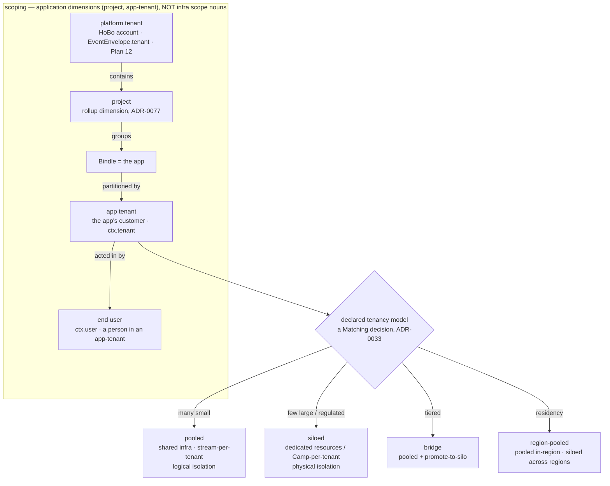
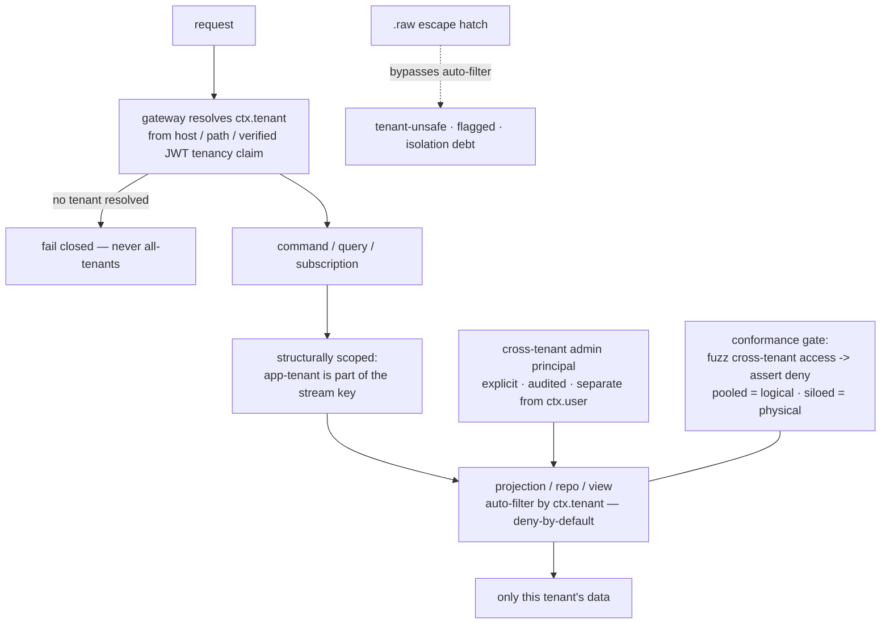

# Multi-Tenant Applications: app-tenant model, tenancy spectrum & isolation by construction

This capability doc specifies how a developer builds and operates a **multi-tenant application** *on* HoBo — a SaaS whose own customers are tenants. HoBo is already a multi-tenant platform with a deep isolation model ([Plan 12](./security-networking.md#plan-12)); this plan **exposes that machinery one level up** as a first-class app capability — *tenancy as a capability* — while being scrupulously honest that the app developer's tenant is a **different thing** from HoBo's own platform tenant, with isolation guarantees that depend on the **declared tenancy model**.

> **Two tenants, never conflated — and enforced at two distinct points.** The **platform tenant** ([Plan 12](./security-networking.md#plan-12), `EventEnvelope.tenant`, `spiffe://yard/<tenant>/…`) is the **HoBo account/org** — HoBo's own hard isolation boundary, enforced at the **envelope level + store partitioning**, which app developers rarely touch. The **app tenant** (this plan) is **the developer's customer** — a tenant of the SaaS they built, enforced at the **`streamId` prefix + the projection auto-filter** *within* one platform tenant (`ctx.tenant`). They are **two axes, not one chain**: infra containment is `Bindle ⊂ Camp ⊂ Yard ⊂ Junction` ([ADR-0026](./adr/01-architecture-core.md#adr-0026)); **project** and **app-tenant** are **application/organizational dimensions** ([ADR-0077](./adr/04-governance-verification.md#adr-0077): project is a *non-containment* rollup dimension). The whole picture: an **app-tenant** is a partition **within one app (Bindle)**, which belongs to a **project** (a rollup dimension) **inside one platform tenant**, and an **end-user** acts within an app-tenant. An app-tenant is an **application-domain partition the developer declares and HoBo enforces**, *not* a sixth infra scope noun. The two scopings **compose**: an app-tenant leak can neither cross nor be masked by platform-tenant scoping (a conformance assertion, §C).

## Plan 50

**Plan 50 — Multi-tenant applications**

> **Relationship to existing surfaces.** End-user auth ([Plan 6 §6.7](./ai-native-agent-auth.md#plan-06)/[ADR-0038](./adr/02-identity-security.md#adr-0038)) gives `ctx.user` (a person); this plan adds **`ctx.tenant`** (the customer org that person belongs to) and the per-tenant isolation/routing/config/quota/residency/lifecycle/observability that a real SaaS needs. It reuses Matching ([ADR-0033](./adr/05-config-matching-environments.md#adr-0033)), the data plane ([Plan 32](./data-plane.md#plan-32)), the policy plane + `.allow()` ([Plan 29](./contracts-policy-flags.md#plan-29)/[Plan 21](./authoring-resources-wiring.md#plan-21)), domains/DNS ([ADR-0035](./adr/07-portability-extensibility.md#adr-0035)), flags ([ADR-0044](./adr/04-governance-verification.md#adr-0044)), metering ([ADR-0039](./adr/04-governance-verification.md#adr-0039)), residency/erasure ([ADR-0040](./adr/05-config-matching-environments.md#adr-0040)/[ADR-0060](./adr/04-governance-verification.md#adr-0060)), and the operations surfaces ([Plan 49](./dashboards-status-availability.md#plan-49)) — almost no new runtime.

### A. The app-tenant model ([ADR-0079](./adr/02-identity-security.md#adr-0079))

- **`AppTenant` is a first-class, event-sourced entity.** A tenant of the app is an [aggregate](./sdk-api.md#plan-02) on its own stream (`tenant:<id>`) with a lifecycle (§E), so "who is a tenant, since when, in what state, where their data lives" is auditable + replayable like everything else.
- **`ctx.tenant` is the resolved app-tenant for a unit of work — and it has a defined source in *every* context, not just requests.** On the **request path** it is resolved at the gateway from the verified end-user's `tenancy` claim ([ADR-0038](./adr/02-identity-security.md#adr-0038)) and/or routing (§D). For **async / system contexts** (a workflow/saga step, a `topic`/`queue` subscriber, a cron, an agent run) where there is no inbound request or `ctx.user`, the tenant is **captured at enqueue/schedule time and propagated like `causationId`** ([Plan 11](./event-model.md#plan-11)) — a scheduled job for tenant `acme` carries `acme` as audited context. For a **projection fold**, the tenant is **derived from the event's `streamId` prefix** (§C), not from ambient context. **An async unit with no captured tenant fails closed** (it cannot default to all-tenants), the same invariant as a request. `ctx.tenant` sits alongside `ctx.user` (the person) and `ctx.identity` (the workload SVID) — one principal model, multiple views.
- **Cross-tenant access is an explicit multi-tenant *scope token*, never "unresolved."** App-developer staff/support who legitimately span tenants act as a **cross-tenant-admin** role ([Plan 29](./contracts-policy-flags.md#plan-29)/[ADR-0074](./adr/02-identity-security.md#adr-0074)) carrying an **explicit `ctx.tenants` set (or `*`) granted by a `policy.Decided`** — a *different code path* from an unresolved `ctx.tenant` (which fails closed, §C). This separation is deliberate: "fail-closed-on-unresolved" and "audited-admin-breadth" must not be the same path, or a bug that drops the tenant would read as admin. Every cross-tenant read/write is gated + emitted as an audit fact; an ordinary `ctx.user` reaches **only** its own `ctx.tenant`.

### B. The tenancy-model spectrum — declared, with honest per-model guarantees ([ADR-0079](./adr/02-identity-security.md#adr-0079))

The app **declares a tenancy model**; HoBo realizes it through **Matching** ([ADR-0033](./adr/05-config-matching-environments.md#adr-0033)), so the model — and a per-tenant override — is a **resolved config recorded in `match.Decided`**, not app code. The guarantee is **stated per model**, never blanket:

| Model | How it maps to HoBo | Isolation guarantee | Use when |
|---|---|---|---|
| **Pooled** *(default)* | shared resources; **stream-per-tenant** + tenant-scoped projections ([Plan 32](./data-plane.md#plan-32)) | **logical** — enforced by construction (§C); noisy-neighbor **bounded** by per-tenant quotas (§F), not eliminated | many small tenants; cost-sensitive |
| **Siloed** | dedicated resources/schema, or a **Camp-per-tenant** (a provider-specific stack, [ADR-0026](./adr/01-architecture-core.md#adr-0026)) | **physical** — a resource/Camp boundary; strongest | few large / regulated tenants; **bounded** (Camp-per-tenant doesn't scale to 100k) |
| **Bridge / tiered** | most tenants pooled; specific tenants **promoted to silo** — a per-tenant Matching decision | per-tenant: logical or physical by tier | a long tail pooled + a few that need a silo (plan/regulatory) |
| **Region-pooled** | pooled **within** a region/Camp, siloed **across** regions ([ADR-0040](./adr/05-config-matching-environments.md#adr-0040)) | logical in-region; physical across regions | per-tenant **residency** (a single global pool can't honor it) |

**Promotion is a config change, not a rewrite — with a defined zero-loss cutover.** Moving a tenant pooled → siloed (e.g. it grew, or bought an "isolated" plan) re-runs Matching for that tenant and migrates its data; the app code is unchanged because access is always via `ctx.tenant`. But re-keying *one tenant's streams out of a shared, append-only, single-writer log* is **not** the blue/green managed-store move ([ADR-0032](./adr/03-data-plane.md#adr-0032)) verbatim — a naïve "export while the source keeps writing" lands a stale `seq` and loses/duplicates events at cutover. So the per-tenant cutover protocol is explicit: **(1)** `tenant.Suspended` **freezes the tenant's aggregates** (suspends writes — fencing, [ADR-0053](./adr/03-data-plane.md#adr-0053)); **(2) drain** in-flight commands to a **quiescent `seq`**; **(3) export** the tenant's streams + **import** into the silo; **(4) fence the old streams** (a higher fence token so a stray writer can't append); **(5)** `tenant.Resumed` against the silo. A migration conformance test asserts **zero lost or duplicated events across the cut** (the source's quiescent `seq` equals the silo's imported head). Only the *one tenant* is briefly write-frozen; co-located pooled tenants are unaffected.

### C. Isolation by construction — the load-bearing safety story ([ADR-0080](./adr/02-identity-security.md#adr-0080))

The #1 multi-tenant failure is the cross-tenant data leak ("forgot the `WHERE tenant_id`"). HoBo's answer is **structural, not disciplinary** — a developer cannot leak across tenants by omission:

1. **The app-tenant is a *prefix* of the `streamId`, not a change to the aggregate model.** `streamId` is already the aggregate key (`order:01H…`, [ADR-0053](./adr/03-data-plane.md#adr-0053): one aggregate = one stream). For a multi-tenant app the key grammar is **`<app-tenant>/<aggregateType>:<id>`** (e.g. `acme/order:01H…`) — the app-tenant **partitions the keyspace**; it is **not** the platform `EventEnvelope.tenant` field. One aggregate is still exactly one stream and **per-aggregate optimistic `seq` semantics are unchanged** ([ADR-0053](./adr/03-data-plane.md#adr-0053)); tenancy multiplies *which* streams exist, not how a single stream serializes. A fold/command is therefore *structurally* tenant-scoped — you **cannot fold another tenant's stream by accident**, because a key with a different tenant prefix is one you weren't handed.
2. **The projection/`repo`/`view` auto-filter is the platform's, deny-by-default — and composes with, never substitutes for, platform-tenant scoping.** Tenant scoping is applied **by HoBo at the data-access boundary** ([Plan 32](./data-plane.md#plan-32) — where `.allow()`/tenant scoping already compose), not by a hand-written predicate. A tenant-scoped read with **no resolved `ctx.tenant` fails closed** — it never silently returns all tenants. **Two distinct enforcement points, both applied:** the **platform-tenant** filter operates on `EventEnvelope.tenant` (envelope-level + store partitioning, [Plan 12](./security-networking.md#plan-12)); the **app-tenant** filter operates on the `streamId` prefix + `ctx.tenant` (this plan) *inside* one platform tenant. Conformance asserts they **compose**: an app-tenant leak can neither cross a platform-tenant boundary nor be *masked* by it (a query satisfying the platform filter is still app-tenant-filtered). The dangerous default (return-everything) is impossible at either layer.
3. **`.allow()` + policy carry the tenant predicate** ([Plan 29](./contracts-policy-flags.md#plan-29)/[Plan 21](./authoring-resources-wiring.md#plan-21)); a record-level rule ("a user reads only their tenant's orders") is a policy decision, not handler code. Cross-tenant access requires the explicit cross-tenant-admin principal (§A).
4. **`.raw(driver => …)` is *denied by default* on a pooled store, not merely flagged.** The raw escape hatch ([Plan 32](./data-plane.md#plan-32)) bypasses the auto-filter, and on a **pooled** (shared) store a raw query is an *active cross-tenant read* — flagging-as-debt would be detective, not preventive, silently downgrading "by construction" the moment anyone uses the hatch everyone eventually uses. So on a pooled store **`.raw()` is denied** unless the developer supplies an **explicit hand-scoped tenant predicate the gate verifies** (or runs as the cross-tenant-admin principal); it remains freely available on a **siloed** store (the silo *is* the tenant boundary). Either way it is surfaced as tenant-isolation debt alongside the portability-debt flag ([ADR-0024](./adr/07-portability-extensibility.md#adr-0024)) — never silent.
5. **A cross-tenant-leak conformance gate** ([ADR-0080](./adr/02-identity-security.md#adr-0080)) is the enforcement, with a **defined oracle so it actually runs:** seed **two tenants A and B with distinct sentinel records**; then under an ordinary `ctx.user` of A, every surface — command, query, **subscription**, **search**, projection — querying for **B's sentinel must deny/return-empty**, *and* (positive control) **A's own sentinel must be present** — so an implementation that denies everything because it is broken **cannot pass**. The no-resolved-tenant case must fail closed (not all-tenants). A siloed model additionally asserts **physical** separation (distinct resources/Camp). **Search is covered explicitly** because vector/graph/hybrid search runs as a **`step` with a developer-declared predicate** ([Plan 32](./data-plane.md#plan-32)), not the platform auto-filter — so the **search index must be tenant-partitioned** (a separate index/namespace per app-tenant *or* a non-bypassable platform-injected tenant filter at the `hobo:search` port), and the gate fuzzes the *step/search* path specifically. **Reactive subscriptions are covered too:** `ctx.tenant` + tenant-lifecycle state are part of the **subscription read-set** ([Plan 32](./data-plane.md#plan-32)), so `tenant.Suspended`/`tenant.Erased` or a mid-session tenancy-claim change **recompute and re-scope/close** the subscription — a gate case opens a live subscription, changes the principal's tenant, and asserts the next push is re-scoped, never a stale cross-tenant deliver. **Honest guarantee:** pooled is **logical** isolation (HoBo-enforced; residual surface = a HoBo bug or a hand-scoped raw escape — hence the gate); siloed is **physical** isolation (a resource/Camp boundary). The doc never claims pooled gives physical isolation.

### D. Per-tenant routing ([ADR-0035](./adr/07-portability-extensibility.md#adr-0035))

A tenant is reachable by **subdomain** (`acme.app.com`), **custom domain** (`status.acme.com` / the tenant's own domain), or **path** (`app.com/t/acme`). The **gateway resolves the tenant** from the host/path (or the verified JWT tenancy claim) into `ctx.tenant` before any handler runs. Wildcard + per-tenant certs ride the existing ACME DNS-01 machinery ([ADR-0035](./adr/07-portability-extensibility.md#adr-0035), wildcard-capable, secretless); a tenant bringing **its own domain** is an `domain` resource scoped to that tenant. For siloed/region-pooled tenants, routing also selects the tenant's Camp/region.

### E. Tenant lifecycle ([ADR-0079](./adr/02-identity-security.md#adr-0079))

A first-class lifecycle, event-sourced as the **app-tenant `tenant.*` family** (distinct from the platform tenant, which has no lifecycle — it is an infra boundary):
- **Provision / onboard** — `tenant.Provisioned`: pooled = a tenant record + its per-tenant **forgetting key** (§G); siloed = provision the tenant's resources / Camp via Matching.
- **Suspend / resume** — `tenant.Suspended`/`tenant.Resumed`: a non-paying/abusive tenant is gated off (policy obligation) without data loss.
- **Offboard** — `tenant.Offboarded`: stop serving; retain per policy until export/erase.
- **Export** — `tenant.Exported`: a portable dump of the tenant's streams + projections (the tenant's data is *theirs*; no lock-in, consistent with [ADR-0024](./adr/07-portability-extensibility.md#adr-0024)).
- **Erase / delete** — `tenant.Erased`: **per-tenant crypto-shred via a key hierarchy.** [ADR-0051](./adr/03-data-plane.md#adr-0051)'s forgetting key is **per-subject**; a whole-tenant erase is **not** "encrypt the entire stream under one tenant key" (that would make *every* field shred-eligible and trip ADR-0051's rule that **aggregate invariants must not depend on shreddable fields**). Instead a **tenant key envelops the tenant's per-subject keys**: erasing a tenant **destroys the tenant key → all wrapped per-subject keys become unrecoverable in one act** (equivalently, a batch-destroy of the tenant's subject keys). **Routing/identity fields stay cleartext** — the `streamId` tenant prefix, aggregate ids, and the non-PII keys invariants check are *not* encrypted, only PII fields are — so **aggregate invariants survive** an erase (they never depended on shreddable content, per ADR-0051) while the PII decrypts to tombstones. Result: right-to-erasure for a whole tenant **without rewriting the forward-only log** ([ADR-0060](./adr/04-governance-verification.md#adr-0060)); projections rebuild excluding the tenant. *Key-management note: per-tenant + per-subject keys at scale is the honest operational cost (KMS/HSM, [ADR-0027](./adr/02-identity-security.md#adr-0027)).*

### F. Per-tenant config, flags, quotas & metering

- **Config + feature flags per tenant** — flag targeting ([ADR-0044](./adr/04-governance-verification.md#adr-0044)) already keys on principal claims; **`ctx.tenant` is a targeting dimension**, so a flag/`%`-rollout/kill-switch can be per-tenant (a tenant-specific config or a staged rollout to one tenant first).
- **Quotas + noisy-neighbor control — honest about which axes are bounded.** Per-tenant **rate/concurrency quotas** + the runaway-spend circuit-breaker ([ADR-0039](./adr/04-governance-verification.md#adr-0039)/[ADR-0076](./adr/04-governance-verification.md#adr-0076) R5 blast-radius) bound the **request-path** noise a pooled tenant can inflict. But rate/concurrency quotas do **not** by themselves bound **shared-projection rebuild cost, shared-sink IOPS/storage, connection-pool exhaustion**, or the fact that a hot tenant's hot aggregate serializes writers on one stream's `seq` ([ADR-0053](./adr/03-data-plane.md#adr-0053)). So pooled additionally carries **per-tenant quotas on those axes** — a **per-tenant projection-lag budget**, a **per-tenant connection-pool partition**, and a **per-tenant sink-storage cap** — and the model-guarantee test exercises a **storage/connection-exhaustion** neighbor, not only a rate neighbor. The honest bottom line: pooled noisy-neighbor is **bounded across these named axes, not eliminated** — **silo removes it entirely** (dedicated resources/Camp).
- **Per-tenant metering & showback (not billing)** — `MeteringView` ([ADR-0039](./adr/04-governance-verification.md#adr-0039)) gains **app-tenant as a rollup dimension**, so the developer sees cost/usage **per their customer** — *showback*, the input they need to run *their own* billing. **HoBo does not bill the app's tenants** — per-tenant invoicing/subscriptions/plans-as-products are the developer's business concern and stay **out of scope** ([ADR-0064](./adr/08-scope-and-requirements.md#adr-0064)). The boundary: **isolation/routing/config/quota/showback/residency/lifecycle/observability = in; charging money to tenants = out.**

### G. Per-tenant residency & observability

- **Residency per tenant** ([ADR-0040](./adr/05-config-matching-environments.md#adr-0040)/[ADR-0060](./adr/04-governance-verification.md#adr-0060)) — a tenant pinned to a region/Camp; enforced at `can-deploy` **and** runtime (cross-Camp replication of a residency-tagged tenant's data is blocked/region-pinned, [Plan 12](./security-networking.md#plan-12)). **The replication backbone is made app-tenant-aware:** ADR-0040 selects a replication topology (single-writer-Camp / pinned-single-Camp) **per stream**, and because the app-tenant is a `streamId` prefix (§C.1), the topology is **selected per app-tenant stream-prefix** — so one residency-pinned tenant's streams stay region-pinned while a co-located non-pinned tenant's streams replicate normally, *within the same pooled Bindle*. Where an engine can't replicate at stream granularity, residency pinning **forces the tenant's streams to a separately-replicated unit** — i.e. it pushes that tenant toward **region-pooled or siloed** (a single global pool can't honor it). A residency test asserts one tenant's stream is pinned while a co-located tenant's replicates. Stated, not silently broken.
- **Per-tenant observability & status** ([Plan 49](./dashboards-status-availability.md#plan-49)) — the operations dashboard and a **per-tenant slice / status page** (a tenant's uptime, dependent-service health, incidents that touched them, and — for siloed tenants — the architecture-availability estimate). Per-tenant SLOs ([ADR-0045](./adr/04-governance-verification.md#adr-0045)) let the developer offer (and observe) a tenant-specific reliability target.

### Events ([Plan 11](./event-model.md#plan-11))

- **App-tenant lifecycle** — `tenant.Provisioned` · `tenant.Suspended` · `tenant.Resumed` · `tenant.Offboarded` · `tenant.Exported` · `tenant.Erased` (per-tenant crypto-shred). *Explicitly the **app's** customer tenant — distinct from the platform `tenant` envelope field, which has no lifecycle.*
- **The app-tenant scoping dimension** is the **stream key** + an indexed projection scope (§C), and **cross-tenant access** is audited via `policy.Decided` (the cross-tenant-admin grant). Model selection/promotion ride `match.Decided`/`migration.*` — **no new event types** for those.

### Verification ([Plan 9](./verification.md#plan-09))

- **Cross-tenant-leak gate (the critical one) — with a positive control:** seed tenants **A** and **B** with distinct **sentinel** records; under an ordinary `ctx.user` of A, every surface (command/query/**subscription**/**search**/projection) querying B's sentinel **denies/returns-empty** *and* A's own sentinel is **present** (so an all-deny-because-broken impl fails); a query with **no** resolved tenant **fails closed** (not all-tenants); the platform-tenant and app-tenant filters **compose** (no leak masked by platform scoping). A `.raw()` query on a pooled store is **denied** unless hand-scoped.
- **Search-path test:** the vector/graph search **`step`** is tenant-partitioned (separate index/namespace or platform-injected filter) — a search for B's sentinel under A denies even without a developer predicate.
- **Subscription re-eval test:** open a live subscription, then `tenant.Suspended`/`Erased` or change the principal's tenancy claim → the next push is **re-scoped/closed**, never a stale cross-tenant deliver.
- **Async-context test:** a workflow/saga/cron/topic-subscriber with **no captured tenant fails closed**; one with a captured `ctx.tenant` scopes correctly; a projection fold derives tenant from the `streamId` prefix.
- **Model-guarantee + noisy-neighbor test:** a **siloed** tenant's data lives on physically separate resources/Camp (assert no shared store); a **pooled** tenant is logically isolated under the auto-filter; a **storage/connection-exhaustion** neighbor (not only a rate neighbor) cannot breach another pooled tenant's projection-lag/connection/storage quota; a **region-pooled** tenant's data never crosses its region.
- **Lifecycle + migration test:** `tenant.Erased` (tenant-key crypto-shred) makes the tenant's PII unreadable on replay without rewriting the log, while aggregate invariants (over non-PII keys) still hold; a rebuilt projection excludes the erased tenant; `tenant.Exported` round-trips the tenant's streams; a **pooled→siloed cutover** loses/duplicates **zero events** (source quiescent `seq` == silo imported head).
- **Cross-tenant-admin test:** a cross-tenant read succeeds **only** under the explicit `ctx.tenants` admin token (a distinct path from unresolved) and **only** with a `policy.Decided` audit fact; an ordinary `ctx.user` is denied.

### Scope / YAGNI

- **In scope:** the app-tenant model + `ctx.tenant`, the declared tenancy-model spectrum (pooled/siloed/bridge/region-pooled) over Matching, isolation-by-construction + the conformance gate, per-tenant routing/config/flags/quotas/showback/residency/lifecycle/observability — all over existing planes.
- **Out of scope** (the [ADR-0064](./adr/08-scope-and-requirements.md#adr-0064) boundary): **per-tenant billing/subscriptions/invoicing/plans-as-a-product** (the developer's business — HoBo gives them showback + quotas, not a billing engine); a tenant **self-service admin UI** beyond the events/API (the developer builds it, or generates it via the UI layer [ADR-0056](./adr/06-ai-generation-operators.md#adr-0056)); cross-tenant **analytics** beyond an OLAP sink ([ADR-0052](./adr/03-data-plane.md#adr-0052)).
