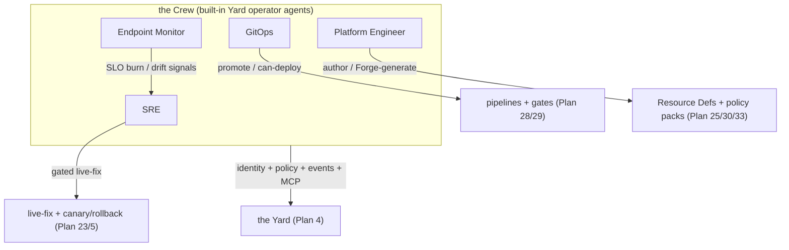
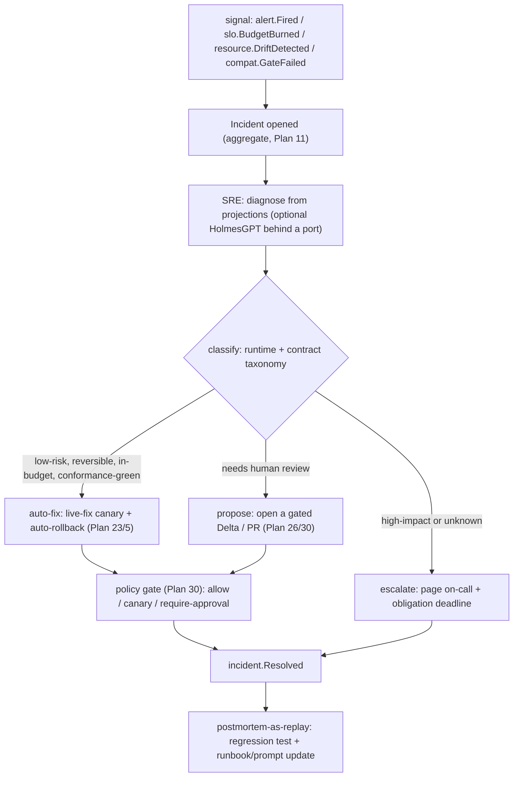

# Operator Agents & SRE

This capability doc consolidates Plan 40, Plan 44 of the HoBo design suite.

## Plan 40

**Plan 40 — Operator Agents (the Crew)**

> **Disambiguation (one word, four meanings — now resolved):** **Operator Agent** = an autonomous principal in the Crew (this plan). **Agents-as-users** = *external/customer* agents acting on a developer's behalf ([Plan 6](./ai-native-agent-auth.md#plan-06)). The **`agent()` primitive** = the SDK runtime building block both use ([Plan 2](./sdk-api.md#plan-02)). The **[Relay](./platform-engineering.md#plan-28)** = the outbound network proxy (formerly mis-named "the HoBo Agent"), *not* an agent at all. The **[Forge](./forge-generated-stack.md#plan-33)** = a generation *pipeline*, not a principal.

### Why built-in (batteries-included), not just skills
HoBo is AI-native: the operations a platform team does — triage incidents, watch endpoints, drive delivery, author platform rules — are exactly what an agent can do against HoBo's event-sourced, MCP-complete surface. Rather than leave each team to wire its own, HoBo **ships the Crew as built-in Yard services** ([ADR-0054](./adr/06-ai-generation-operators.md#adr-0054)): opinionated, audited, policy-gated out of the box, while still **pluggable** — each agent's "brain" is an **engine behind a port** (built-in default; optional externals like HolmesGPT), and each is disableable / overridable per Yard. They are the AI-native realization of goals "AI SRE / AI GitOps / AI policy enforcement."

### The shared model (every Crew member)
- **Principal identity.** Each agent is a named workload with an **SVID** and **per-agent policy** ([Plan 6](./ai-native-agent-auth.md#plan-06)/[Plan 30](./contracts-policy-flags.md#plan-30)): scoped capabilities, **spend caps**, and **high-risk → require-approval** gates (destroy/prod/over-budget resolve via a dashboard/Slack hook). Least-privilege by `.allow()` ([Plan 21](./authoring-resources-wiring.md#plan-21)).
- **Event-sourced runs.** Every observation, decision, tool call, token grant, and approval is an event ([Plan 11](./event-model.md#plan-11)) → replayable, auditable ("why did the SRE agent roll back at 02:14?"), and resumable.
- **MCP-surfaced.** Each agent exposes its actions as MCP tools ([Plan 6 §MCP](./ai-native-agent-auth.md#plan-06)) so a human or an external agent can invoke, inspect, or override it — same identity/token model.
- **Engines behind ports.** The reasoning engine is a `*-engine` port with a built-in default and optional external providers (never on the SDK surface) — consistent with `training-engine`/`policy-engine`/`contract-engine` ([ADR-0025](./adr/06-ai-generation-operators.md#adr-0025)/[Plan 30](./contracts-policy-flags.md#plan-30)/[Plan 29](./contracts-policy-flags.md#plan-29)).
- **Human-in-the-loop by default for write actions.** Read/diagnose is autonomous; mutations ride the policy plane's effects/obligations (auto / canary-with-auto-rollback / require-approval), keyed by blast radius + environment ([Plan 5](./reliability-observability-cost.md#plan-05)/[Plan 30](./contracts-policy-flags.md#plan-30)).



### The roster
| Operator Agent | Owns | Composes (existing) | Optional external engine | Surfaces / events |
|---|---|---|---|---|
| **SRE** | incident detection → root-cause → **gated remediation** | live-fix ([Plan 23](./forge-generated-stack.md#plan-23)), observability ([Plan 14](./reliability-observability-cost.md#plan-14)), drift + canary/auto-rollback ([Plan 5](./reliability-observability-cost.md#plan-05)), chaos findings ([ADR-0047](./adr/04-governance-verification.md#adr-0047)) | **HolmesGPT** behind a port ([technologies/holmesgpt-sre-agent.md](../../technologies/holmesgpt-sre-agent.md)) | MCP `diagnose`/`heal`; rides `incident.*`/live-fix + `policy.Decided` |
| **Endpoint Monitor** | synthetic probes, health/SLO watch, drift surfacing | SLO/alerting ([ADR-0045](./adr/04-governance-verification.md#adr-0045)), observability ([Plan 14](./reliability-observability-cost.md#plan-14)), drift ([Plan 5](./reliability-observability-cost.md#plan-05)) | external synthetic-check provider behind a port | emits `slo.BudgetBurned`/`alert.*`/drift → **feeds SRE** |
| **GitOps** | drive *when/what* deploys; promotion across env-groups | pipelines + publishers ([Plan 28](./platform-engineering.md#plan-28)), `can-deploy` ([Plan 29](./contracts-policy-flags.md#plan-29)), env-group saga ([ADR-0028](./adr/05-config-matching-environments.md#adr-0028)) | external GitOps controller (Argo/Flux) as publisher | MCP `promote`/`rollback`; rides `pipeline.*`/`deployment.*` |
| **Platform Engineer** | author + **Forge-generate** Resource Definitions/Packs + policy packs | Matching ([Plan 25](./platform-engineering.md#plan-25)), packs ([Plan 27](./platform-engineering.md#plan-27)), policy ([Plan 30](./contracts-policy-flags.md#plan-30)), Forge ([Plan 33](./forge-generated-stack.md#plan-33)) | — (Forge is the engine) | MCP `propose-definition`/`propose-pack`; AI counterpart to the human persona ([ADR-0019](./adr/08-scope-and-requirements.md#adr-0019)) |

> **The SRE operator has a deep-dive.** Its full model — the **Incident** aggregate + `incident.*` events, the diagnose → classify → **auto-fix / propose / escalate** decision tree, the runtime+contract **failure-taxonomy → safe-fix** map, declarative **runbooks**, MTTD/MTTR SLOs, on-call escalation, and postmortem-as-replay — is **[Plan 44](./operators-sre.md#plan-44)** ([ADR-0058](./adr/06-ai-generation-operators.md#adr-0058)).

### Events
Crew run lifecycle reuses the durable-agent run model ([Plan 11](./event-model.md#plan-11) `run.*`); add a thin **`crew.*`** family for roster-level facts: `crew.AgentDispatched` (which operator, why — the triggering signal), `crew.ActionProposed` (action + blast radius + policy decision ref), `crew.ActionApplied`/`crew.ActionDenied` (ride `policy.Decided`), `crew.HandoffRequested` (one operator escalates to another or to a human). Domain remediation/promotion facts ride the existing `incident.*`/live-fix and `pipeline.*`/`deployment.*` families — **no per-agent event silos**.

### Verification
- A simulated SLO breach → **Endpoint Monitor** emits burn → **SRE** is dispatched (`crew.AgentDispatched`), diagnoses from projections, proposes a fix; a **prod** fix requires approval (`policy.Decided` → `crew.ActionApplied` only after approve), a **low-risk** fix auto-applies as a canary and auto-rolls-back on regression — all replayable.
- **GitOps** promotes staging→prod only when `can-deploy` is green; a skew blocks with a precise reason ([Plan 29](./contracts-policy-flags.md#plan-29)).
- Each agent's `CredentialAudit` ([Plan 14](./reliability-observability-cost.md#plan-14)) answers "what did this operator access, with which token, when?".
- Swapping the SRE engine to HolmesGPT (or disabling an operator) is a per-Yard config change; the deterministic core is unaffected.

### Scope (v1) & YAGNI
- **v1:** the four operators as built-in Yard services on the shared model (identity/policy/events/MCP/engine-behind-port); read/diagnose autonomous, writes gated; built-in engines + the HolmesGPT (SRE) reference adapter.
- **Deferred:** multi-agent planning/negotiation beyond `crew.HandoffRequested`; agent-authored *new* operators; third-party operators (ride `@hobo/agent-skills`, [Plan 1](./architecture.md#plan-01)).

### Iteration hooks
- Whether operators are always-on services vs dispatched-on-signal (cost vs latency); per-operator concurrency/lease model (an operator is itself a single-writer [actor](./sdk-api.md#plan-02)).
- The collective-name "Crew" is a proposal (glossary convention); the formal term is "Operator Agents."
- How much the **Platform Engineer** operator may auto-merge vs always-propose (ties [ADR-0048](./adr/06-ai-generation-operators.md#adr-0048) persisted-patch gating).

## Plan 44

**Plan 44 — SRE: incident management, runbooks & self-healing**

> **Why this exists.** HoBo had the pieces — alerting/SLO ([ADR-0045](./adr/04-governance-verification.md#adr-0045)), pipelines ([Plan 28](./platform-engineering.md#plan-28)), live-fix ([Plan 23](./forge-generated-stack.md#plan-23)), drift + auto-rollback ([Plan 5](./reliability-observability-cost.md#plan-05)), chaos ([ADR-0047](./adr/04-governance-verification.md#adr-0047)) — but no incident model (`incident.*` was a dangling reference), no enumerated runtime failure→fix playbook, an opaque SRE operator, and no first-class runbook. This plan closes those gaps.

### The Incident aggregate
An **Incident** is an [aggregate](./sdk-api.md#plan-02) (an actor; [ADR-0053](./adr/03-data-plane.md#adr-0053)) on stream `incident:<id>` — single-writer, **rebuildable from the log**. It is the **command point** that correlates the loose signals (`alert.Fired`, `slo.BudgetBurned`, `resource.DriftDetected`, `compat.GateFailed`, `spend.CircuitTripped`) into one governed object: `{ id, severity, impact, status, timeline, causedBy (causation/correlation chain), owner }`. Lifecycle events ([Plan 11](./event-model.md#plan-11)): `Opened → Triaged → RootCauseIdentified → RemediationProposed → RemediationApplied|Failed → Resolved → PostmortemFiled`, plus `SLABreached` on MTTD/MTTR overrun. Correlation uses the envelope's existing `correlationId`/`causationId` ([Plan 11](./event-model.md#plan-11)) — multiple alerts fold into **one** incident, not N pages.

### The SRE operator decision tree
The SRE operator ([Plan 40](./operators-sre.md#plan-40)) is no longer opaque. On a signal it runs: **diagnose** (read projections; optional **HolmesGPT** engine behind a port, [technologies/holmesgpt-sre-agent.md](../../technologies/holmesgpt-sre-agent.md)) → **classify** (the taxonomy below) → **decide** one of three branches, each policy-gated + event-sourced:

- **auto-fix** when the fix is **low-risk, reversible, within blast-radius + spend budget, and conformance-green** → applied as a live-fix canary with auto-rollback ([Plan 23](./forge-generated-stack.md#plan-23)/[Plan 5](./reliability-observability-cost.md#plan-05)).
- **propose** when ambiguous or prod → open a gated **Delta/PR** ([Plan 26](./platform-engineering.md#plan-26)/[Plan 30](./contracts-policy-flags.md#plan-30)); a human approves.
- **escalate** when high-impact or unclassifiable → page **on-call** (below). Each decision is `crew.ActionProposed`/`crew.ActionApplied` + `policy.Decided` + the `incident.*` fact — fully replayable ("why did SRE auto-fix at 02:14?").

### Runtime failure-taxonomy → safe-fix map
One table unifies the scattered taxonomies (Plan 5 runtime classes + Plan 23/29 contract classes). **Live-fix is the *applier*; this is the *classifier*.**
| Failure class | Signal | Canonical safe-fix strategy |
|---|---|---|
| **Transient** (429/503, blip) | error-rate spike, retries | retry w/ backoff; circuit-break the dep ([Plan 5](./reliability-observability-cost.md#plan-05)) |
| **Provider-degraded / region** | provider error-rate, latency | fail over Camp/region; widen canary hold ([ADR-0035](./adr/07-portability-extensibility.md#adr-0035)) |
| **Capacity-exhausted** | saturation, queue depth | scale (Workload Profile); shed load; backpressure |
| **Durable-but-recoverable** (node crash) | run interrupted | replay-resume the saga ([Plan 11](./event-model.md#plan-11)/[Plan 5](./reliability-observability-cost.md#plan-05)) |
| **Partial failure** (mid-saga) | step failed | compensate in reverse-dep order ([Plan 5](./reliability-observability-cost.md#plan-05)) |
| **Poison message** | repeated consumer failure | dead-letter + quarantine; loosen/repair handler |
| **Drift** (out-of-band change) | `resource.DriftDetected` | resync to desired Set; or propose ([Plan 5](./reliability-observability-cost.md#plan-05)) |
| **Split-brain / state divergence** | lease/fencing conflict | fence + reconcile from owner ([ADR-0040](./adr/05-config-matching-environments.md#adr-0040)) |
| **Contract skew** (producer broke consumer) | `compat.GateFailed` | dual-publish window / deploy-order / shim ([Plan 29](./contracts-policy-flags.md#plan-29)) |
| **Semantic drift** (trained method) | eval regression | revert to champion; keep candidate in shadow ([Plan 23](./forge-generated-stack.md#plan-23)) |
| **Security anomaly** | live-scan finding ([Plan 12](./security-networking.md#plan-12)) | rotate credential; tighten `.allow()`; bump dep |
| **Runaway spend** | `spend.CircuitTripped` | halt spend-incurring actions; require approval ([ADR-0039](./adr/04-governance-verification.md#adr-0039)) |
| **Cost-induced degradation** | `spend.DegradationRequired` | shed QoS by priority through `costAvailabilityProfile` tiers; SRE proposes cost-efficient remediation, gated ([ADR-0066](./adr/04-governance-verification.md#adr-0066)) |
Each strategy is reversible + gated; an unclassifiable failure → escalate (never silent action). Cost-induced degradation is a first-class incident class: the SRE operator handles it by *proposing* cost-efficient remediation (e.g. *"hold 99% to stay under budget while the leak is fixed"*) as a gated obligation, and **postmortem-by-replay shows exactly which load was shed and when** ([ADR-0066](./adr/04-governance-verification.md#adr-0066)).

### Declarative runbooks
The missing first-class concept. A **runbook** codifies response: **trigger** (alert / SLO-burn / drift / incident-severity) → **diagnosis steps** (MCP queries the SRE runs) → **gated fix actions** (each blast-radius-bounded). Runbooks are **event-sourced** (`runbook.*`), **versioned + signed** like Resource Packs ([Plan 27](./platform-engineering.md#plan-27)), and **built on the Pipelines engine** ([Plan 28](./platform-engineering.md#plan-28)) — the incident-response sibling of deploy pipelines (same triggers/rules/gated-steps model, different triggers + actions). HolmesGPT runbooks / StackStorm are **optional engines behind the port** ([technologies/stackstorm.md](../../technologies/stackstorm.md)).
```ts
defineRunbook("high-5xx-on-api", {
  on: { alert: "api.5xx-burst", severity: ">=SEV2" },
  diagnose: ["tail_logs api", "get_drift api", "slo_status api.availability"],   // MCP reads
  fix: [
    { when: "provider-degraded", do: "failover", camp: "prod-azure", gate: "auto" },
    { when: "capacity-exhausted", do: "scale", to: { min: 6 }, gate: "auto" },
    { when: "unknown",            do: "escalate", to: "on-call" },
  ],
});
```
The SRE operator *executes* runbooks; a runbook with no matching `fix` escalates. `hobo runbook exec --incident <id>`.

### MTTD / MTTR as SLOs
SRE performance is measured as code ([Plan 14](./reliability-observability-cost.md#plan-14)/[ADR-0045](./adr/04-governance-verification.md#adr-0045)): `sre.mttd` (signal → `crew.AgentDispatched`) and `sre.mttr` (`incident.Opened` → `incident.Resolved`) are **OpenSLO SLOs with error budgets**. Burn is a **policy input**: MTTR-SLO burn can **freeze risky deploys** or **require a deeper postmortem** (a `can-deploy` dimension), exactly like availability-SLO burn. `incident.SLABreached` fires on overrun.

### On-call & escalation (lean)
Escalation is modeled as a **policy obligation with a deadline** — resolving the open Plan 30 hook. `incident.Opened` (SEV≥threshold) creates an obligation: *notify on-call, require ack within N minutes*; **unsatisfied-by-deadline → escalate** up the ladder ([Plan 30](./contracts-policy-flags.md#plan-30) obligations + [ADR-0045](./adr/04-governance-verification.md#adr-0045) routing). The **on-call** is a receiver/principal; PagerDuty/OpsGenie/Slack are receiver providers behind the alerting port. No rotation-calendar machinery in v1 (deferred).

### Postmortem-as-replay
The incident's event stream **is** the timeline, so a **blameless postmortem** is generated from the replay (what fired, what SRE decided, which gate, MTTD/MTTR, what fixed it). A failed remediation or a chaos finding becomes a **permanent regression test** (the [ADR-0047](./adr/04-governance-verification.md#adr-0047)/[Plan 23](./forge-generated-stack.md#plan-23) pattern); the postmortem's findings feed **candidate runbook / SRE-prompt updates**, promoted through the same gated, eval'd path as any generated artifact ([Plan 41](./forge-generated-stack.md#plan-41)).

### Events & ports
- **New:** `incident.*` + `runbook.*` ([Plan 11](./event-model.md#plan-11), defined there). **Reused:** `crew.*` ([Plan 40](./operators-sre.md#plan-40)), `policy.Decided` ([Plan 30](./contracts-policy-flags.md#plan-30)), `alert.*`/`slo.*` ([ADR-0045](./adr/04-governance-verification.md#adr-0045)), live-fix + `resource.DriftDetected` ([Plan 23](./forge-generated-stack.md#plan-23)/[Plan 5](./reliability-observability-cost.md#plan-05)), `chaos.*` ([ADR-0047](./adr/04-governance-verification.md#adr-0047)).
- **Ports/engines behind ports:** the SRE reasoning engine (built-in default; **HolmesGPT** optional), the runbook engine (built-in Pipelines; **StackStorm** optional), alert receivers (PagerDuty/OpsGenie/Slack). No new SDK surface for app developers.

### Verification
- A simulated provider-degradation: alert → **one** `incident.Opened` (multiple alerts correlate), SRE classifies *provider-degraded* → auto-fix failover (low-risk) applied as a canary, `incident.Resolved`, postmortem generated by replay — all event-sourced.
- A prod contract skew (`compat.GateFailed`): SRE *proposes* (not auto), opens a gated Delta with the shim fix; approval required.
- An unclassifiable SEV1: SRE *escalates*; on-call obligation unsatisfied by deadline → escalates up; `incident.SLABreached` if MTTR SLO burns.
- A runbook with no matching `fix` escalates; `hobo runbook exec` is replayable.

### Scope (v1) & YAGNI
- **v1:** the Incident aggregate + `incident.*`/`runbook.*`; the SRE decision tree; the failure-taxonomy→fix map; declarative runbooks on the Pipelines engine; MTTD/MTTR SLOs; obligation-deadline escalation; postmortem-as-replay.
- **Deferred:** on-call rotation calendars + paging-vendor specifics; a richer runbook authoring DSL ([Hobo Code](./authoring-resources-wiring.md#plan-38) future); building HolmesGPT/StackStorm adapters.

### Iteration hooks
- How much cross-operator handoff (`crew.HandoffRequested`) the SRE drives (SRE→GitOps to ship a fix; SRE→Platform Engineer to change a definition).
- Auto-fix confidence thresholds + blast-radius defaults per failure class (tuning the decision tree).
- Whether runbooks and deploy pipelines share one `definePipeline`/`defineRunbook` core or stay distinct surfaces.
