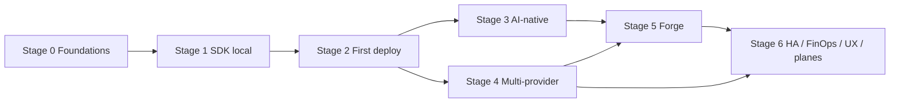

# HoBo — v1 build plan (every stage, every step)

> Part of the [HoBo Design Plan Suite](../README.md). This expands the [v1 delivery plan](../08-roadmap.md) into a stepwise, executable breakdown. The stages below are the **dependency-ordered build sequence of the single v1** ([ADR-0063](../adr/ADR-0063-single-v1-scope.md)) — **not** separate release versions; everything here is v1. Each stage doc lists objective, dependencies, **numbered workstreams + steps**, deliverables, acceptance gates (tests), and risks. Docs only — these describe *what to build*, not code.

## Build stages
| Stage | Theme | Doc |
|---|---|---|
| **0** | Foundations (monorepo, core contracts, WIT, local runtime, conformance) | [`P0-foundations.md`](./P0-foundations.md) |
| **1** | SDK on the local runtime (IfC authoring + runtime + components) | [`P1-sdk-local.md`](./P1-sdk-local.md) |
| **2** | First real deploy (one provider, Yard) | [`P2-first-deploy.md`](./P2-first-deploy.md) |
| **3** | AI-native core (identity, registry, Capability Manifest, agents, MCP) | [`P3-ai-native.md`](./P3-ai-native.md) |
| **4** | Multi-provider + wiring depth | [`P4-multi-provider.md`](./P4-multi-provider.md) |
| **5** | Forge (AI-generated providers + implementations) | [`P5-forge.md`](./P5-forge.md) |
| **6** | HA, FinOps, UX & completeness planes | [`P6-ha-finops-ux.md`](./P6-ha-finops-ux.md) |

> Filenames keep their `P0…P6` slugs to avoid link churn; read `Pn` as **build stage n of v1**.

## Dependency flow

## How to read a stage doc
- **Objective / Depends on** — the one-line goal and prerequisites.
- **Workstreams** — numbered; each contains ordered **steps** with the packages ([Plan 1](../01-monorepo.md)) and design docs they realize.
- **Deliverables** — the concrete artifacts the stage produces.
- **Acceptance gate** — tests that must pass to call the stage done ([Plan 9](../09-verification-open-questions.md)); every stage gate is part of the v1 definition of done.
- **Risks / iteration hooks** — what could go wrong and what's a follow-up enhancement within v1.

## Conventions used across stages
- **port = WIT interface** ([Plan 20](../20-wasm-wasi-runtime.md), reference: [Plan 24](../24-wit-interfaces-reference.md)) · **provider = capability provider** · **bind = link** · **service = wasm component (default), OCI-container fallback**.
- Every adapter ships against `@hobo/conformance`; examples double as E2E fixtures.
- Each stage is independently demoable and commits behind it must keep prior acceptance gates green (no regressions).
