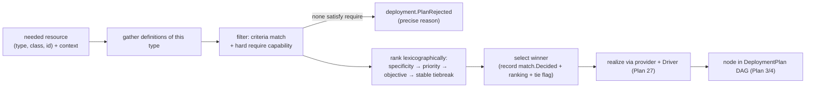
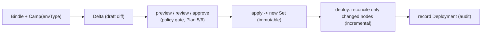
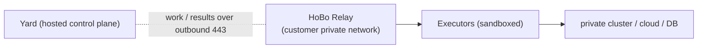
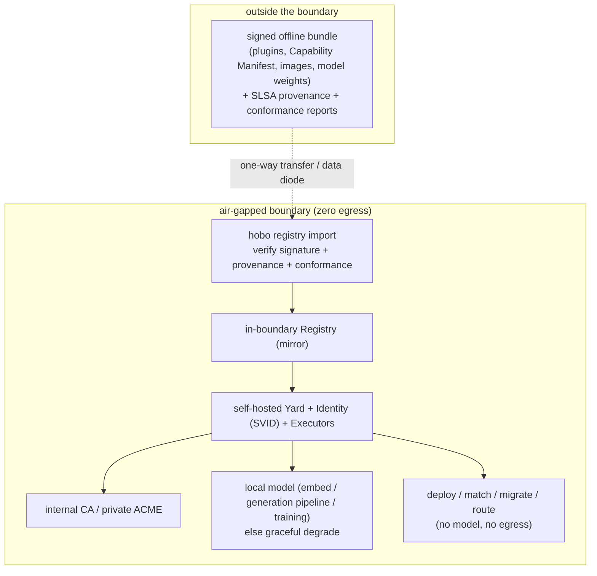

# Platform Engineering: Matching, Environments, Drivers & GitOps

This capability doc covers how platform engineers shape HoBo deploys: Resource Definitions & Matching, environments (Camps, Deployment Sets & Deltas), the Driver taxonomy (Resource Packs & Workload Profiles), and reach (the Relay, GitOps publisher & Pipelines).

## Plan 25

### Why this exists
Developers declare *what* they need (a `database`, IfC-style with `.allow()`, [Plan 21](./authoring-resources-wiring.md#plan-21)). Platform engineers declare *how* it's realized — and crucially, **differently per environment**: managed-HA Postgres in prod, a cheap in-cluster Postgres in an ephemeral preview. A **Resource Definition** is that rule; **Matching** picks the right one for the deploy context. This is **dynamic configuration management**: the *same Bindle* resolves to different infra without app edits.

### A Resource Definition
For an abstract port (`type` + optional `class`), a definition says which **provider + driver + options + co-provisioned resources** realize it, plus the **matching criteria** that select it. Definitions are **WIT-interface-typed** ([Plan 20](./wasm-runtime-wit.md#plan-20)) and may be **AI-generated** ([Plan 23](./generated-stack.md#plan-23)).
```ts
// platform/resource-defs.ts — authored by platform engineers (TS; YAML form also supported)
import { defineResource } from "@hobo/sdk";
import { aws } from "@hobo/provider-aws";

export const postgresProdHa = defineResource({
  type: "database", engine: "postgres", class: "ha",   // the port it satisfies
  provider: aws,
  driver: "terraform",                                   // Plan 27 driver taxonomy
  with: aws.rds({ instanceClass: "db.r6g.large", multiAz: true }),
  match: { envType: "production", resourceClass: "ha" }, // criteria (Plan: specificity below)
});

export const postgresEphemeral = defineResource({
  type: "database", engine: "postgres",
  driver: "container",                                   // in-cluster Postgres for cheap previews
  with: { image: "postgres:16" },
  match: { envType: "ephemeral" },
});

// projection sinks are definitions too — this is the data-architect-autonomy knob (Plan 39)
export const ticketsSinkProd = defineResource({
  type: "projection-sink", paradigm: "relational",       // SQL / document / kv / graph / vector / lake / olap
  provider: aws, driver: "terraform",
  with: aws.rds({ instanceClass: "db.r6g.large" }),
  mapping: "./projections/tickets.mapping",              // WIT-record fields → backend columns (Plan 39/ADR-0050)
  match: { envType: "production", resourceId: "tickets" },
});
```
A **`projection-sink`** definition is how a data architect places a developer's read model on a backend **without touching app code** ([Plan 32](./data-plane.md#plan-32)/[ADR-0050](./adr/03-data-plane.md#adr-0050)): the `paradigm` is a matching dimension, and the `mapping` declares how the read-model WIT record lands in that backend. The developer owns the logical record + queries; the architect owns the mapping + sink — the autonomy split *is* this Matching boundary.

### Matching (specificity-scored selection)
For a needed resource in context `{ envType, app, env, tenant, resourceType, resourceClass, resourceId }`, the Planner gathers all definitions of that `type`, keeps those whose criteria fully match, **scores by specificity**, and selects the highest (ties → next-most-specific). Criteria dimensions: `envType` · `app` · `env` · `resourceClass` · `resourceId` (+ `tenant`).
```
match: {}                                              # score 0  (catch-all)
match: { envType: "production" }                       # score 1
match: { envType: "production", resourceClass: "ha" }  # score 2
match: { envType: "production", app: "shop", resourceClass: "ha" }  # score 3  (wins)
```
**HoBo twist — auditable matching.** The winning definition, its score, and the rejected candidates are recorded as a **`match.Decided`** event ([Plan 11](./data-plane.md#plan-11)) → a replayable answer to "*why did this resource land on this infra?*" (a gap in Humanitec's opaque selection). The dashboard renders it ([Plan 7](./developer-experience.md#plan-07)).



### The selection algorithm — deterministic, on-path ([ADR-0033](./adr/01-architecture-core.md#adr-0033), [ADR-0088](./adr/01-architecture-core.md#adr-0088))
Selection is a **pure function** of `(catalog snapshot, deploy context, objective setting)` — and, for the credit-aware **`maximize-credits`** objective, of the **pinned `CreditLedgerView@seq` recorded into the decision** ([ADR-0071](./adr/01-architecture-core.md#adr-0071) §3). No clock, RNG, network, or model is read **live on the path**: the time-dependent credit/budget/free-tier state is captured as a *pinned input*, not sampled at decision time, so selection stays unit-testable without a cloud and **identical on replay** (the determinism property [Plan 9](./generated-stack.md#plan-09) asserts of the Planner). The pipeline:
1. **Gather** all definitions of the requested `type`.
2. **Filter** to candidates whose criteria match the context **and** whose provider satisfies the resource's hard **`require`** capabilities (`Capability.satisfies` ([Plan 4](./control-plane.md#plan-04)) = `full` → accept; `prefer` may degrade with a `PlanWarning`; `require` miss → reject). If none satisfy `require` → **`deployment.PlanRejected`** with a precise, agent-correctable reason.
3. **Rank lexicographically:** (a) **specificity score** (above) → (b) an **explicit `priority`** (optional integer on a definition, for deliberate platform override) → (c) the **default objective** (soft; configurable `cost`|`latency`|`single-provider`|`carbon`|`maximize-credits` per Yard/Camp, **default = min-cost within constraints** — [Plan 5](./reliability-observability-cost.md#plan-05); the credit-aware `maximize-credits` mode is the **Dispatcher**, [ADR-0071](./adr/01-architecture-core.md#adr-0071)) → (d) a **stable deterministic tiebreak** (definition id, lexicographic).
4. **Record** the winner + full ranking + rejected candidates + the objective used + a **tie flag** + the **catalog content-hash** in `match.Decided`.

**True ties never block.** If candidates are equal on specificity, `priority`, *and* objective, the stable tiebreak (definition id, lexicographic) still yields a deterministic winner, and a `PlanWarning` + tie flag is recorded so a platform engineer can add an explicit `priority` to disambiguate. **The tiebreak is stable only within a catalog snapshot:** because Resource Definitions are auto-generatable and Pack-importable, adding/renaming a definition can change which of two equal-scoring candidates wins on the next plan — so `match.Decided` records the **catalog content-hash**, making a winner change **attributable to a catalog change** rather than appearing as nondeterminism.

HOBO-55 pins the exact scoring vector in [ADR-0088](./adr/01-architecture-core.md#adr-0088): specificity is a grouped `0..3` score over environment, ownership, and resource groups, with a deterministic detail vector (`resourceId`, `resourceClass`, `tenant`, `app`, `env`, `envType`) before priority/objective/id. Its executable golden vectors live in [`../../src/draft/matching-specificity-vectors`](../../src/draft/matching-specificity-vectors).

**AI/solvers are advisory, off the deploy path.** `hobo plan` may *surface* a cheaper alternative; the **generation pipeline** may *generate* candidate definitions ([Plan 23](./generated-stack.md#plan-23)); an LLM may *suggest* definitions at authoring time — none select at deploy time, so replay + `match.Decided` stay honest. A constraint solver / LLM selector on-path is not part of the model ([ADR-0033](./adr/01-architecture-core.md#adr-0033)).

### Mapping is sugar over default definitions
A Camp's inline mapping ([Plan 2](./sdk-api.md#plan-02)) is **not** a separate system — it **compiles to default Resource Definitions**:
- `defaultProvider: azure` → a `match: {}` definition per port on Azure.
- `tiers: { saas: azure, edge: cloudflare }` → definitions matched by service model.
- `bindings: { "shop.db": azure.cosmos({...}) }` → a definition matched by `resourceId: "shop.db"`.
So a solo dev writes the one-liner and never sees definitions; a platform team adds explicit definitions (with classes + env-type matching) that win by specificity. **Precedence** = pure matching score (explicit definitions naturally outscore the `{}` defaults).

**Where the `{}` defaults come from — the provider ships them.** Each provider package ships a **default Resource Definition** per capability it supports: its `equivalence` map (abstract port → that cloud's resource class) plus `realize()` ([Plan 4](./control-plane.md#plan-04)), and `.register(provider)` registers them. So a Camp that declares only a **cloud + IaC** matches the *entire* generated manifest with **zero** per-resource config; `defineResource`/`bindings`/`tiers` exist to **override** a default, never to bootstrap the mapping. The same holds for an AI-generated provider: conformance proves its built-in Definitions satisfy each claimed port before it is signed and registered. And declaring a Camp at all is optional: once you've **approved default providers** *and* **enabled inferred-Camp approval** (a toggle, or a policy that passes — [ADR-0074](./adr/02-identity-security.md#adr-0074); off by default), the cloud **infers** a Camp and auto-places/rebalances the Bindle across them (the Dispatcher, [ADR-0071](./adr/01-architecture-core.md#adr-0071)) with no human in the loop — that pair is the happy path. A Camp **pins** placement/residency, or reaches a provider outside the approved set, when inference shouldn't decide.

### Resource classes
`class` (`standard`/`ha`/`encrypted`/…) is declared on the resource ([Plan 21](./authoring-resources-wiring.md#plan-21)) and is a first-class matching dimension, so one logical port can have several platform realizations.

### Co-provisioning & the graph
A definition may declare co-provisioned resources (e.g. a bucket + its IAM policy); these become extra nodes/edges in the DeploymentPlan DAG with output flow via placeholders ([Plan 21](./authoring-resources-wiring.md#plan-21)). The Planner ([Plan 4](./control-plane.md#plan-04)) consumes definitions; the Orchestrator ([Plan 4](./control-plane.md#plan-04)) executes the graph.

### AI-generated definitions
Given a backend's Capability Manifest + a target context, the **generation pipeline** ([Plan 6](./ai-native-agent-auth.md#plan-06)/[Plan 23](./generated-stack.md#plan-23)) can generate candidate Resource Definitions (and bundle them as **Resource Packs**, below), validated sandboxed against conformance — so platform breadth isn't human-bottlenecked.

### Environments: Camps with an environment type
A **Camp** ([Plan 2](./sdk-api.md#plan-02)) is a **provider-specific deployment target** — one environment on one provider/cloud — that also hosts the durable runtime. Its **environment type** (`development`/`staging`/`production`/`ephemeral`/custom) is the **primary matching dimension** above: the same Bindle resolves to different infra on a `production` Camp vs an `ephemeral` one, purely via specificity. A multi-cloud `production` is **several Camps under one Yard** ([Plan 4](./control-plane.md#plan-04)), which holds the cross-provider policy. A Camp can be **cloned** from one with a prior successful deploy through the platform SDK/dashboard/MCP surface, producing a draft Delta to tweak and ship (`env.Cloned`, [Plan 11](./data-plane.md#plan-11)).
```ts
// a camp() object's inline mapping
camps: {
  prod:    { envType: "production" },
  staging: { envType: "staging" },
  preview: { envType: "ephemeral", ttl: "72h" },   // ephemeral defaults
}
```
**Ephemeral / preview environments** are per-PR Camps, created on PR open (by CI or a Pipeline, below) and reaped by **auto-TTL**, each with isolated event streams ([Plan 12](./security-networking.md#plan-12)). Mapping **cheap variants** to `envType: ephemeral` (in-cluster DB, scale-to-zero wasm, shared cluster) makes previews cheap by construction ([Plan 5](./reliability-observability-cost.md#plan-05)).

**Request-level isolation (sandbox lanes) — the cheaper default for previews & branch testing ([ADR-0076](./adr/02-identity-security.md#adr-0076)).** Cloning a whole Camp per PR is the heavy option; the default is a **sandbox lane** over a **shared baseline** environment (the bridge-to-Kubernetes model): a lane = a **signed, principal/tenant-bound lane token** (not a bare header) + a set of **boundary-mode** overrides ([Plan 9](./generated-stack.md#plan-09)/[Plan 23](./generated-stack.md#plan-23)). The token is **enforced fail-closed at every membrane hop and on the `EventEnvelope.lane` for async** — requests/events carrying it route to the lane's **forked** services (a `hobo dev --fork` build via the Relay (below), or a branch deploy), everything else stays baseline, and a hop/subscriber that can't prove in-lane provenance **denies rather than leaking onto the baseline**. A fork must **satisfy the boundary contract at lane join** (a runtime check, distinct from deploy-time `can-deploy`, [Plan 29](./contracts-policy-flags.md#plan-29)); **baseline aggregates fork-on-touch** so a lane write never appends the real stream ([Plan 32](./data-plane.md#plan-32)). Concretely, fork-on-touch is **not** contending for the baseline's single-writer lease: a touched aggregate folds the baseline stream up to the fork point, then appends the lane's events to a **separate lane-scoped stream id** (`lane:<id>:<aggregateKey>`) **with its own lease** — reads are a **read-through merge** (baseline-up-to-fork-point ⊕ lane tail), and a **lane request never takes the baseline single-writer lease**, so a concurrent baseline writer is unaffected. **No fork event is ever delivered to a baseline subscriber/saga** (the `EventEnvelope.lane` deny-by-default filter, [ADR-0076](./adr/02-identity-security.md#adr-0076) R1), and a **choreography saga is lane-scoped** — a baseline saga never reacts to a lane event and vice-versa. **Real external side effects default to `mock`/`record`** (a `live` grant is itself gated, [ADR-0076](./adr/02-identity-security.md#adr-0076) R3); the lane runs under a **resource budget** + isolation tier ([ADR-0012](./adr/02-identity-security.md#adr-0012)) so a bad fork can't degrade the baseline; read-through honors data-classification ([ADR-0060](./adr/02-identity-security.md#adr-0060)). A lane is **tenant-scoped**, has a **TTL**, and reap **drains in-flight requests + fails/migrates running sagas** before discarding the overlay; lane cost is a metering dimension ([ADR-0039](./adr/02-identity-security.md#adr-0039)). A **preview environment** is then either a sandbox lane (the default) or a full ephemeral Camp, each with a preview URL; the same lanes carry **self-healing experiments** and **lane-bounded chaos** ([ADR-0076](./adr/02-identity-security.md#adr-0076)).

### Deployment Sets (immutable) + Deltas (mutable)
HoBo produces a **manifest IR** per deploy ([Plan 21](./authoring-resources-wiring.md#plan-21)); Sets and Deltas are the two halves of that model, as **projections over the event log** ([Plan 11](./data-plane.md#plan-11)) rather than bespoke tables — so promote/rollback/preview inherit replay + audit for free:
- **Deployment Set** = the immutable, content-addressed resolved configuration of a Camp at a point in time. Recorded as `set.Created`. A stateful resource's **cross-Camp replication topology** (single-writer / active-active-eventual / pinned, [ADR-0040](./adr/01-architecture-core.md#adr-0040)) is part of this resolved config, selected like any other matching dimension.
- **Deployment Delta** = a mutable, reviewable **diff** (add/update/remove resources or workloads) against the current Set. Deltas combine, preview, approve, then **apply** to produce a new Set (`delta.Opened` / `delta.Updated` / `delta.Applied`).



Because `match.Decided` (above) is part of the same record, "why did preview get the cheap DB?" is always answerable.

The M0 projection contract is pinned by the executable HOBO-50 proof in
[`proofs/hobo-50-deployment-set-delta`](./proofs/hobo-50-deployment-set-delta/index.md):
it folds `set.Created` + `delta.*`, verifies stable Set content addressing, computes
add/update/remove diffs, rejects overlapping Deltas and absent-resource references, and treats an
environment group as Yard-level orchestration over member Camps rather than a new config layer.

### The `can-deploy` gate, promote, rollback, incremental
Applying a Delta or promoting a Set runs the **Gatekeeper** ([Plan 29](./contracts-policy-flags.md#plan-29)/[Plan 29](./contracts-policy-flags.md#plan-29)) against the **versions already running in the target Camp** (read from the event log): contracts-compatible (`compat.GatePassed/Failed`) AND policy-allows — with **obligations** that can *reshape* the rollout (e.g. "allow but require canary" forces a canary) — AND evals/conformance/cost. Incompatible producer/consumer skew blocks the promote with a precise reason + suggested fixes (shim, deploy-order, migration window). **App-data schema migrations compose here:** when a Delta changes a `sql` resource's schema, its **expand/backfill/contract** phases ([Plan 32](./data-plane.md#plan-32)) are gated saga steps in *this* flow — each phase passes the same `can-deploy` check, and a **destructive contract phase that would break a still-running version is blocked** (`compat.GateFailed`). Schema migration and code rollout are gated together, not in separate pipelines.

- **Promote** = apply the Set running in one Camp as a Delta against another (e.g. staging → prod), gated.
- **Rollback** = re-apply a previous Set; stateful resources keep state ([Plan 5](./reliability-observability-cost.md#plan-05)). **Rollback is gated against the *target revision's* schema expectations, and a completed `contract` phase is a boundary.** Because a destructive `contract` phase has already dropped the old shape, re-applying a prior Set whose code expects that shape would break — so a Set whose schema has **passed `contract` is not freely rollbackable past that boundary**: the rollback runs the **same `compat` gate** against the prior Set's schema expectations and **blocks** if they no longer hold, requiring a **compensating `expand`** (re-add the shape) first. Rollback before/within `expand`/`backfill` is safe; only the post-`contract` direction carries this constraint — stated rather than implied by "keeps state."
- **Incremental deploy** = the Orchestrator's ResourceActors diff the new Set vs observed and reconcile **only changed nodes** ([Plan 4](./control-plane.md#plan-04)) — fast, low-blast-radius.

All of these are sequences of events → time-travel, audit, and DR-as-replay for free.

### Drivers (generalizing HoBo's IaC adapters)
HoBo's `IacProvider` ([Plan 4](./control-plane.md#plan-04)) becomes one **Driver** among a taxonomy. A Resource Definition names a driver; a capability provider uses it to realize the resource.

| Driver | Realizes via | Notes |
|---|---|---|
| **`terraform`** | Pulumi Automation API / OpenTofu | primary; any provider; per-resource state ([Plan 4](./control-plane.md#plan-04)) |
| **`template`** | render manifests/config (Go-template/CUE) | K8s manifests, config files, CRDs |
| **`echo`** | none — **adopt an externally-managed/BYO resource** | pass declared connection info through as outputs; HoBo reads, doesn't provision (gap-filler) |
| **`container`** | run arbitrary provisioning in a **Firecracker Executor** | Pulumi/CFN/scripts; HoBo already sandboxes Executors ([Plan 4](./control-plane.md#plan-04)) |
| **`custom-webhook`** | call a self-hosted HTTP service | signed (SVID) request; returns outputs + optional manifests; any stack |

```ts
export interface Driver {
  id: "terraform" | "template" | "echo" | "container" | "custom-webhook";
  provision(input: { context: MatchContext; inputs: unknown; oldState?: unknown })
    : Promise<{ outputs: Record<string, unknown>; manifests?: unknown[]; state?: unknown }>;
  destroy(input: { context: MatchContext; state: unknown }): Promise<void>;
  refresh?(input: { context: MatchContext; state: unknown }): Promise<DriftReport>;
}
```
Drivers run inside sandboxed Executors with short-lived scoped creds ([Plan 12](./security-networking.md#plan-12)); outputs flow back as events and into placeholders ([Plan 21](./authoring-resources-wiring.md#plan-21)). `echo` resources are read-only by default (drift behavior is an iteration hook).

### Resource Packs & Workload Profiles
A **Resource Pack** is a shareable, versioned bundle of Resource Definitions for a common need (e.g. "AWS data tier", "in-cluster preview stack"). Packs live in the **Registry** ([Plan 6](./ai-native-agent-auth.md#plan-06)) with provenance + conformance reports, can be imported and customized by matching, and can be **AI-generated** from a backend's Capability Manifest and certified sandboxed ([Plan 23](./generated-stack.md#plan-23)). `hobo add <pack>` installs one.

**Scopes are distributable too, not just definitions.** The scope objects themselves are first-class **listings** ([ADR-0062](./adr/07-portability-extensibility.md#adr-0062)): an org ships a **preconfigured Camp/Yard/Junction** — or a **side-loaded Bindle** — as an npm package or a structured git repo that exports the constructed scope (signed + certified like any listing), so a team runs `npm i @acme/yard-prod` (or `hobo add`) and imports a golden topology instead of re-authoring it. A Yard — including the **hosted HoBo cloud** — can publish a **pre-approved catalog** of these (providers, scopes, packs) that production policy may require ([ADR-0074](./adr/02-identity-security.md#adr-0074)); the hosted cloud ships one by default so a Bindle deploys with zero platform setup.

A **Workload Profile** declares **how a service is realized** on a target — the realization HoBo chooses for a `service`/`web` resource:
- `wasm-component` (default, [Plan 20](./wasm-runtime-wit.md#plan-20)) · `container` (OCI fallback) · `serverless-function` · `vm`/`microvm` ([Plan 21](./authoring-resources-wiring.md#plan-21)).
- Platform engineers define custom profiles (e.g. a Dapr profile, a batch-job profile); the profile influences the manifest/Set the deploy produces ([Plan 21](./authoring-resources-wiring.md#plan-21)) and which provider compute port is used.
- Selected by the resource (default per target) or pinned via `.with(...)`.

**Placeholders / output references** align to Humanitec syntax and HoBo's lazy references ([Plan 21](./authoring-resources-wiring.md#plan-21)) — resource outputs `${resources.<type>.<class>#<id>.outputs.<name>}` and context `${context.app|env|envType|res.id|class|type}` — resolved at deploy from the resolved graph; unresolved refs fail planning with a precise error.

### The HoBo Relay (deploy into private networks)
A hosted Yard can't reach a customer's private cluster/cloud. The **HoBo Relay** is a lightweight proxy inside that network:
- **Outbound-only reverse tunnel:** the Relay dials the Yard over **TCP 443** (no inbound ports, no exposed endpoints); TLS + authenticated with an SVID ([Plan 6](./ai-native-agent-auth.md#plan-06)).
- **Executors run behind the Relay:** IaC/build/driver execution happens inside the private network; **credentials never leave it**; the Yard sends work + receives `exec.*`/outputs over the tunnel.
- One Relay can serve multiple clusters/targets, routing by target id — enabling regulated/sovereign deploys ([Plan 12](./security-networking.md#plan-12)) and self-hosted parity.


### Air-gapped / sovereign mode (fully disconnected) ([ADR-0036](./adr/07-portability-extensibility.md#adr-0036))
The Relay is the *connected-private* path. A **fully disconnected / sovereign** environment has no path out at all, so air-gap is a **first-class self-hosted Yard profile**: the whole control plane (Yard + Registry + Identity + Executors + runtime + optional models) runs **inside the boundary with zero egress**.
- **Artifacts enter via signed offline bundle import** (`hobo registry import <bundle>`): provider plugins, Capability Manifest, Resource Packs, base images, and optional model weights, each with **SLSA provenance + conformance reports**, **verified in-boundary against the same trust boundary** as the live Registry (signature + provenance + conformance) — one-way-transfer (sneakernet / data diode) friendly; the in-boundary Registry serves the mirror, **no live crawl**. Recorded as `registry.BundleImported` ([Plan 11](./data-plane.md#plan-11)).
- **In-boundary trust roots + local models, graceful degradation:** Identity issues SVIDs locally; certs use an **internal CA / private ACME** ([ADR-0035](./adr/07-portability-extensibility.md#adr-0035)); secrets via **in-boundary KMS/HSM** ([ADR-0027](./adr/02-identity-security.md#adr-0027)); `embed`/generation pipeline/`"use training"` use **local models when provisioned, else degrade** (generation pipeline→human-authored only, training→static, `embed`→BYO vectors, [ADR-0034](./adr/03-data-plane.md#adr-0034)); telemetry/live-evals stay in-boundary (no phone-home). The **deterministic core (deploy/match/migrate/route) needs no model or egress**, so air-gapped deploys work fully.

| Capability | Normal (connected) | Air-gapped substitute |
|---|---|---|
| Registry (Capability Manifest/plugins/packs) | crawl `/.well-known/capability-manifest/` | **signed offline bundle import** → in-boundary mirror |
| Images | public registry pull | mirrored in-boundary OCI registry (bundle) |
| TLS certs | ACME → Let's Encrypt | **internal CA / private ACME** ([ADR-0035](./adr/07-portability-extensibility.md#adr-0035)) |
| Identity / secrets | provider KMS | already in-boundary; **in-boundary KMS/HSM** ([ADR-0027](./adr/02-identity-security.md#adr-0027)) |
| `embed` / generation pipeline / `"use training"` | hosted models | **local model**, else BYO / human-authored / static |
| Telemetry / live-evals | hosted sinks | **in-boundary OTel collector**, no phone-home |
| Deploy / match / migrate / route | — | **zero egress, no model — always works** |



> Air-gap is a **single in-boundary Yard**; multi-Yard **federation** (multi-region/regulatory) is out of scope ([Q20](./generated-stack.md#plan-09)).

### GitOps publisher mode
Beyond direct apply, a Camp can use a **GitOps publisher**: the Yard writes the resolved **Deployment Set** as manifests/CRs to a Git repo/branch, and **Argo CD / Flux** sync it to the cluster. It's just another **publisher** target ([Plan 21](./authoring-resources-wiring.md#plan-21)) — the resolution/matching/event-sourcing pipeline is unchanged; only the final apply step differs. Supports standalone, GitOps, or hybrid; the Relay can supply runtime data back.

### Pipelines (rule-based automation + approval gates)
**Pipelines** sit above the deployment sagas ([Plan 5](./reliability-observability-cost.md#plan-05)) and policy gates ([Plan 6](./ai-native-agent-auth.md#plan-06)) to automate *when* deploys happen. The same engine powers **incident-response runbooks** — the SRE sibling of deploy pipelines, with alert/SLO-burn/drift triggers and gated *fix* actions ([Plan 40](./operators-sre.md#plan-40)); StackStorm/HolmesGPT are optional engines behind that port.
- **Triggers:** **artifact** (a new image/component version matching a rule), **deploy-request** (a Delta opened), **schedule/cron**, and **API/MCP**.
- **Rules (if-then):** e.g. *"new component from `main` → deploy to `staging`"*; *"tag `v*` → open a prod Delta requiring approval"*. Flexible match/exclude on artifact + branch.
- **Steps/jobs:** run in order (`needs`) or parallel; can run tests, wait for health, call external CI, notify Slack/Teams, and **gate on approval** (a `createHook` resolved in the dashboard).
- **Where CI jobs & builds run is cost-routed.** A step's CI job runs on a **`runner`** provider and a build runs on a **`build-machine`** ([Plan 4](./control-plane.md#plan-04)) — both selected per job by the **Dispatcher** ([ADR-0071](./adr/01-architecture-core.md#adr-0071)) by **effective marginal cost** across **only the registered** providers (self-hosted/GitHub/Blacksmith/Depot), so HoBo burns free credits/budgets before paying and rotates as each is exhausted. The pick is deterministic + recorded (`dispatch.Decided`, [Plan 11](./data-plane.md#plan-11)); the default runner/build-machine is the Executors behind the Relay (above). Pin a specific provider via `.with(...)` to opt out of routing.
- **Concurrency:** per-pipeline locks; bounded concurrent runs.
- Every trigger/step/gate is an event (`pipeline.Triggered`/`pipeline.StepCompleted`/`pipeline.GateApproved`, [Plan 11](./data-plane.md#plan-11)) → replayable, auditable automation.
```ts
// platform/pipelines.ts (illustrative)
definePipeline("promote-staging", {
  on: { artifact: { component: "api", branch: "main" } },
  steps: [
    { run: "deploy", camp: "staging" },
    { gate: "approval", to: "production" },     // resolves via dashboard hook
    { run: "deploy", camp: "prod", strategy: "canary" },
  ],
});
```
