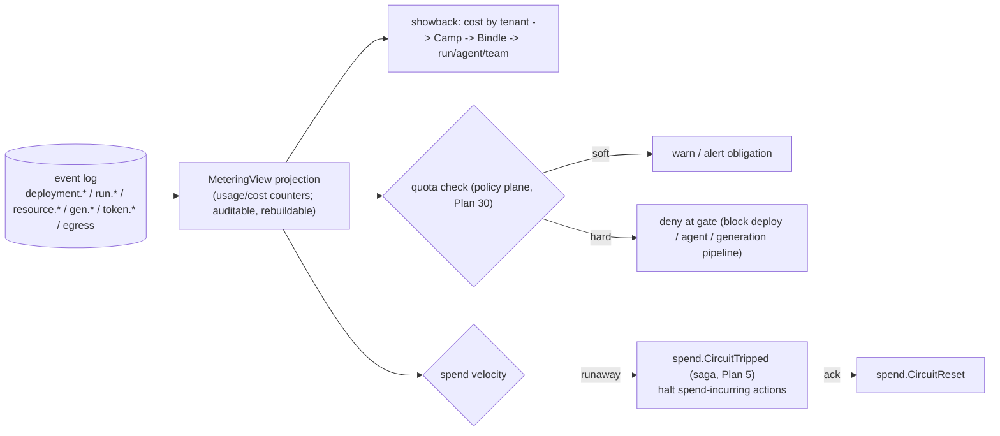

# Reliability, Observability & Cost

This capability doc unifies reliability/HA, observability, and cost/FinOps as one operational story: the same event log, saga machinery, and policy plane that keep HoBo available also make it observable and keep its spend safe.

## Plan 05

> **Pipelines & incremental deploys (Humanitec parity):** **Pipelines** + approval gates ([Plan 25](./platform-engineering.md#plan-25)) run atop the same gated-saga + canary/rollback machinery here. **Incremental deploys** (reconcile only changed nodes via Deltas→Sets, [Plan 25](./platform-engineering.md#plan-25)) shrink blast radius and rollout time.

> **Runtime/AI integration.** AI **live-fix** ([Plan 23](./generated-stack.md#plan-23)) applies through the same gated deployment-saga + canary/auto-rollback machinery here; a failing trace becomes a permanent regression test. Wasm components' fast restart improves recovery time vs containers.

### Epic reference implementation

The PLAN-05 reference implementation lives under [`../../src/draft/epic-proofs/reliability-observability-cost-finops/README.md`](../../src/draft/epic-proofs/reliability-observability-cost-finops/README.md). It synthesizes the telemetry/SLO, FinOps budget, saga compensation, and Golden Suite chaos POCs into four executable vertical slices with mocked service boundaries and Pact fixtures. **HOBO-660** adds the S6-05 observability drift loop draft POC at [`../../src/draft/technical-proofs/s6-05-observability-drift-loop-contract/README.md`](../../src/draft/technical-proofs/s6-05-observability-drift-loop-contract/README.md) (OTLP export, SLO burn alerts, drift heal loop). Run it with:

```bash
npm.cmd --prefix src/draft/epic-proofs/reliability-observability-cost-finops run simulate
```

### Failure taxonomy (what we design against)
| Class | Example | Strategy |
|---|---|---|
| **Transient** | provider 429/503, network blip | retry with capped exponential backoff + jitter, within a budget |
| **Durable-but-recoverable** | Yard node crash mid-deploy | event-log replay → resume exactly where it left off |
| **Partial failure** | resource 3 of 5 failed | saga compensation (rollback already-created resources) |
| **Poison** | malformed plan, fatal provider error | mark `Failed(fatal)`, stop retrying, surface to human/agent |
| **Drift** | someone changed infra out-of-band | periodic resync detects + reconciles (auto or proposed) |
| **Split-brain** | two Yard leaders | leases + fencing tokens; quorum writes reject stale leader |

> **The SRE operator extends this taxonomy.** [Plan 40](./operators-sre.md#plan-40) unifies these *runtime* classes with the *contract* classes ([Plan 23](./generated-stack.md#plan-23)/[Plan 29](./contracts-policy-flags.md#plan-29)) into one **failure-taxonomy → safe-fix** map and a documented auto-fix/propose/escalate decision tree; **live-fix is the applier, the taxonomy is the classifier**.

### Exactly-once *effects* over at-least-once delivery
HoBo never assumes the queue delivers once. Instead:
1. Every command/step carries an **idempotency key** (`meta.idempotencyKey`).
2. The EventStore append is **conditional on expected `seq`** (optimistic concurrency) and **dedups on idempotency key** — a replayed message that already produced its effect appends nothing.
3. External side effects (provider API calls) pass the idempotency key through to the provider where supported (e.g. AWS client tokens, Stripe idempotency keys); where unsupported, the ResourceActor checks observed state (`refresh()`) before acting.

Result: at-least-once queue + conditional append + step memoization ⇒ **EventStore-append effects happen effectively-once** even across retries and replays. (Same guarantee Vercel Workflows gives for steps, extended to infra operations.) **This is scoped honestly across the wRPC membrane** (see §Exactly-once below): an effect that lands *inside a provider* (a `wasi:keyvalue` SET, a payment) is **at-least-once**, made effectively-once only when the **provider adapter forwards the idempotency key** (a named conformance obligation) — a non-idempotent provider op with no key support can double-apply on retry-after-ambiguous-failure. "Exactly-once" therefore means *for HoBo's own append effects*, not unconditionally across every provider call.

### Saga compensation algorithm
For a deployment DAG `G`:
1. Track the set `P` of resources that reached `Provisioned`, in topological order.
2. On a failure that crosses the deployment's **no-go threshold** (configurable: e.g. any fatal, or N transient exhaustions), emit `deployment.RolledBack`.
3. Each resource in `P` runs its compensation (`IacProvider.destroy` of just its slice) in **reverse topological order**, driven by choreography (each waits for its dependents to compensate first).
4. Compensations are themselves idempotent + retryable; a compensation that fails escalates to `needs-human` rather than looping forever.
5. The original failure + every compensation is in the event log → the dashboard shows exactly what was rolled back and why.

Partial-success deployments are allowed when the Bindle marks resources `optional` — those failures don't trigger rollback of required resources.

### Actor availability: single-writer leases + fencing
Each grain key (ResourceActor, app actors) has at most one active instance:
- **Lease:** activating an actor acquires a lease in the Camp's runtime ActorHost (`key → ownerNode, leaseId, expiry`). Renewed via heartbeat.
- **Fencing token:** the lease carries a monotonically increasing `fenceToken`; every event append by the actor includes it. The EventStore rejects appends with a `fenceToken` lower than the latest seen → a partitioned old owner cannot corrupt state even if it thinks it still holds the lease. **This is a contract clause of the `EventStore`/`ActorHost` port, not an assumption about one backend:** since the runtime is swappable (`runtime-temporal`/`runtime-restate`/`runtime-cloudflare`/`runtime-postgres`, each with its own concurrency model), **"conditional append rejects a lower `fenceToken` *and* a lower-than-expected `seq`" is a mandatory, named `@hobo/conformance` durable-store assertion** ([Plan 9](./generated-stack.md#plan-09); the [generation pipeline seam table](./generated-stack.md#plan-23) "lease/fencing" row) — a backend that accepts a stale-fenced append fails conformance and **cannot back HoBo state**, so single-writer safety can't silently regress under a backend swap.
- **Failover:** lease expiry (missed heartbeats) lets another node acquire the key with a higher `fenceToken`; it replays the stream (from the latest snapshot) to rebuild state and resume. **Recovery time ≈ lease TTL + replay-of-tail.**
- **Placement:** consistent-hashing of keys across nodes with bounded load; rebalanced on membership change (actor-key placement only — service-component instance scheduling is the `component-host` scheduler seam, [ADR-0108](./adr/01-architecture-core.md#adr-0108)).

### Control-plane HA
- **Event store replication:** the source of truth is replicated (synchronous quorum for the control-plane streams). Adapter-specific: `runtime-postgres` → synchronous replicas; built-in engine → Raft log. **Hosting the Yard's *own* control-plane log is a gated precondition, not an open choice:** a backend may back control-plane streams **only if it passes a `@hobo/conformance` assertion for linearizable, quorum-fenced append** (the split-brain-safety precondition); the "built-in Raft vs delegate to the store" question is an implementation detail *of an eligible backend*, never a reason a non-linearizable store could silently host the control plane. Backends that can't meet it may still host *app* data under the labeled bounded-staleness/[ADR-0040](./adr/01-architecture-core.md#adr-0040) topologies, just not the Yard's authoritative log.
- **Cross-Camp app-state replication** reuses this same backbone with **declared topologies** ([ADR-0040](./adr/01-architecture-core.md#adr-0040)): single-writer-Camp (owner writes; other Camps consume a replicated read-stream into bounded-staleness projections), active-active-eventual (CRDT), or pinned — surfaced via the **labeled bounded-staleness reads** below.
- **Leader election** only for *singletons* (e.g. the drift scheduler, membership coordinator) via the same lease mechanism or an external Raft (the built-in engine ships a small Raft; `runtime-*` adapters can delegate to the backing store's primitives).
- **Stateless tier** (Gateway, Planner, Executors) scales horizontally behind a load balancer; any node can serve because all state is in the log/projections.
- **Split-brain safety:** all writes are quorum + fenced, so a minority partition cannot commit. Reads from a stale projection are bounded-staleness and labeled as such in the API.

### Deployment strategies as reusable saga templates
Rollout strategy is a property of a `service`/`web` resource, implemented as a parameterized saga the ResourceActor runs. **These strategies are the built-in default of the Harness's *delivery* leg (OpenDelivery, [ADR-0083](./adr/02-identity-security.md#adr-0083)); Argo Rollouts / Flagger / Spinnaker are per-Camp adapters behind the same `hobo:delivery` port** (the deploy gate decides *whether* to ship; the Harness decides *how* it rolls out, emitting `rollout.*`):
- **Recreate** — stop old, start new (dev default).
- **Blue/green** — provision green fully, health-gate, flip the router (provider `gateway` port), keep blue for fast rollback, reap after soak.
- **Canary** — shift `x%` traffic, watch health signals for `t`, auto-advance or auto-rollback on regression. Steps + gates are events → fully auditable/replayable.
- **Progressive** — staged canary (1%→10%→50%→100%) with gates between stages.
- **Automated rollback** (Flagger-style) — a rollout step's metric/SLO analysis (OTEL) composing SLO error-budget burn ([ADR-0045](./adr/02-identity-security.md#adr-0045)) + continuous [Golden-suite](./adr/02-identity-security.md#adr-0082) failure; a breach auto-rolls-back as a policy obligation, else promotes.

Health signals come from the data plane (the Camp's runtime metrics/streams) and/or provider health checks; the gate is a `step` with a timeout and a rollback compensation.

### Provider resilience controls
- **Circuit breaker per (provider, region, operation):** open after a failure-rate threshold; half-open probes; protects against hammering a degraded provider. *(The same breaker pattern is reused as a **spend** circuit-breaker — opened on runaway cost velocity to halt spend-incurring actions, see §Cost & FinOps below; [ADR-0039](./adr/02-identity-security.md#adr-0039).)*
- **Retry budgets** (not just per-call retries): a token-bucket cap on total retries per deployment so a flapping provider can't cause unbounded work.
- **Bulkheads / concurrency caps** per tenant and per provider on the Executor pool (backpressure; one tenant's storm can't starve others).
- **Timeouts** at every external boundary, with the operation classified retryable/fatal on expiry.

### Drift detection & self-healing
- **Periodic resync:** the drift scheduler (a leader-elected singleton) enqueues a `refresh()` for each live resource on an interval (with jitter). Divergence emits `resource.DriftDetected` → DriftView projection.
- **Policy per resource:** `heal` (auto-reconcile back to desired), `propose` (open a diff for human/agent approval), or `ignore` (annotated exceptions).
- Event-driven drift (provider change webhooks, where available) supplements polling.

### Disaster recovery
- **RPO:** bounded by event-store replication lag (≈0 for synchronous quorum; configurable for cheaper async tiers).
- **RTO:** rebuild a fresh Yard from the replicated log — `hobo up ./platform --restore <log>` replays all streams and rehydrates projections + actors. Because the Yard is event-sourced, **DR is just replay**, exercised continuously by the same code path that powers normal recovery.
- **Backups:** periodic log snapshots to object storage in a second region; audit streams (`token.*`, `resource.*`) retained per compliance policy.

### Targets (to ratify with the user)
| Metric | Initial target |
|---|---|
| Control-plane availability | 99.9% (single region), 99.95% (multi-region) |
| Deploy resume after node loss | < 30s (lease TTL + tail replay) |
| RPO | ~0 (sync quorum) / ≤ 5s (async tier) |
| RTO (full Yard rebuild) | < 15 min from replicated log |

### Runtime/IfC/AI integration
- **AI live-fix as a gated saga.** A failing trace or SLO/health breach triggers an AI-proposed fix, validated sandboxed + replayed, then applied through the **same canary/blue-green saga + auto-rollback** machinery above; the failing trace is retained as a permanent regression test ([Plan 23](./generated-stack.md#plan-23)). Live-fix adds no new failure class — it reuses *compensation* and *deployment-strategy* mechanics.
- **Faster recovery with wasm.** Components' ms-scale cold start shortens actor failover and rollout/rollback windows vs containers, improving the "deploy resume after node loss" target ([Plan 20](./wasm-runtime-wit.md#plan-20)). Failover is a property of the Camp's **`component-host`** ([ADR-0031](./adr/01-architecture-core.md#adr-0031)): the **wasm-in-container default** restarts the component like any container (re-placed by the same lease/fencing machinery above), while the **wasmCloud-lattice** adapter can additionally **migrate late-bound links across hosts** without redeploy — a stronger failover that apps opt into per Camp.
- **Exactly-once effects — scoped honestly across the membrane.** At-least-once `link.Called` invocations carry idempotency keys. Where the link's effect is an **EventStore append**, HoBo dedups → exactly-once *effects* (as for steps/IaC, [Plan 11](./data-plane.md#plan-11)). But a link to a **provider component's export** (e.g. a `wasi:keyvalue` SET on a Redis provider on another lattice host, or a payment call) lands its effect **in the provider, which has no view of HoBo's dedup table** — so across the membrane it is **at-least-once**, made effectively-once only when the **provider adapter forwards the idempotency key** (AWS client tokens / Stripe keys; a **conformance obligation** on the adapter) or the caller does `refresh()`-before-act (above). For a non-idempotent provider op with no key support, retry-after-ambiguous-failure can double-apply — stated, not hidden.
- **Cost-driven graceful degradation as a reliability strategy.** Cost pressure is an availability lever that **composes** with canary/auto-rollback + drift above ([ADR-0039](./adr/02-identity-security.md#adr-0039)): rather than hard-failing on a budget breach, it sheds QoS **by priority** through ordered degradation tiers (scale-to-zero non-critical, feature-flag shed, request-priority `503`+`Retry-After`) before the runaway-spend breaker trips as a last resort — "availability through cost controls," not cost-vs-availability. The cost-side mechanics live below.

### Observability

Reliability and observability share one substrate: the event log *is* the observability layer, and reliability signals (health, drift, SLO burn, spend) flow back as alerts and policy inputs.

> **Runtime/IfC integration.** Cross-WIT-boundary calls (`link.Called` / stub recordings, [Plan 11](./data-plane.md#plan-11)) are a first-class trace stream — they drive both the **link/trace dashboard views** ([Plan 7](./developer-experience.md#plan-07)) and the AI **implement → auto-evolve → live-fix** loop ([Plan 23](./generated-stack.md#plan-23)).

#### Four pillars (three standard + one HoBo-native)
1. **Traces** — OpenTelemetry spans across deploys, workflows, steps, actor messages, and provider calls.
2. **Metrics** — control-plane and data-plane time series.
3. **Logs** — structured, correlated logs (`ctx.log`) streamed live.
4. **Provenance / replay** — the event log itself: every fact, ordered and replayable, so you can reconstruct *exactly* what happened and re-run it. This is the differentiator.

#### Tracing
- Every command/event carries `meta.traceparent` (W3C trace context) in its [envelope](./data-plane.md#plan-11), so a deploy or a run is one distributed trace from the Gateway through ResourceActors, Executors, and provider APIs.
- `step()` and actor message handlers auto-create spans; provider SDK calls are instrumented in the adapters.
- Export via OTLP to any backend (Tempo/Jaeger/Honeycomb/Datadog) — HoBo emits, it doesn't lock you into a backend.

#### The Run Inspector (the marquee view)
Derived purely from `run.*` / `actor.*` / `saga.*` events ([Plan 11](./data-plane.md#plan-11)), the inspector shows a workflow/step/actor/saga timeline with, per step: inputs, output, attempts/retries, duration, and the memoized result used on replay. Because it's event-sourced you can:
- **Time-travel:** view state as-of any event; scrub the timeline.
- **Replay/diff:** re-run a workflow against current code and diff the step outcomes (regression hunting).
- **Causality:** follow `causationId`/`correlationId` to see why a step ran.
This mirrors and extends Vercel's run observability, and is the data-plane analog of the deploy timeline.

#### Metrics catalog (initial)
**Control plane:** deploy success rate, plan→deployed latency, reconcile loop latency, executor queue depth/saturation, provider error rate (per provider/region/op), circuit-breaker state, drift count, token grants/min; plus IfC-collection metrics (resources/links per manifest) and AI generation/certification rates.
**Data plane (via the Camp's runtime):** workflow start/complete/fail rates, step retry rates, actor activations/passivations, queue lag, app RED metrics (rate/errors/duration) for `service`/`web`; plus **wasm runtime** metrics — component cold-start, instances per host (density), link call latency/error rate per `(import, provider)`.

#### Logs
- `ctx.log` is structured and auto-tagged with `tenant`, `runId`, `resource`, `traceId`.
- Live tail via the Camp's runtime `streams` (`hobo logs` / dashboard) without waiting for completion; historical logs exported to the tenant's chosen sink.

#### SLOs & alerting
- Built-in SLOs (e.g. deploy success rate, control-plane availability from the reliability targets above) with burn-rate alerts.
- **Observed availability has a design-time sibling: architecture-derived availability** ([Plan 49](./developer-experience.md#plan-49)/[ADR-0078](./adr/02-identity-security.md#adr-0078)). The **`AvailabilityView`** *estimates* downtime by composing declared provider SLAs through the dependency graph (serial multiplies → fewer 9s; redundant sets [ADR-0040](./adr/01-architecture-core.md#adr-0040) compose parallel → more 9s; each network hop a failure domain), and is shown **next to the observed SLO number** so the estimate-vs-actual gap is a reliability signal; it also feeds the `availabilitySlo` floor below so an architecture that *can't* meet its floor warns at `can-deploy`. These roll up per project/environment on the **operations dashboard + status pages** ([Plan 49](./developer-experience.md#plan-49)).
- Alert routing is a provider capability (`email`/webhook/PagerDuty); high-risk policy gates ([Plan 6](./ai-native-agent-auth.md#plan-06)) can post to the same channels for human approval.

##### SLO-as-code + error-budget gating + an AlertManager-style model ([ADR-0045](./adr/02-identity-security.md#adr-0045))
- **SLO-as-code:** SLOs/SLIs/objectives/error-budgets are **declared** ([OpenSLO](../standards/openslo.md)-aligned; SLI source behind a port) and versioned as part of the resolved Set ([Plan 25](./platform-engineering.md#plan-25)), computed from the telemetry above.
- **Error budgets gate:** burn-rate + remaining budget is a **policy input** — a policy ([Plan 29](./contracts-policy-flags.md#plan-29)) can **freeze deploys / require approval** when the budget burns (a `can-deploy` dimension, [Plan 29](./contracts-policy-flags.md#plan-29)) and an obligation can **auto-revert** a rollout or feature flag ([ADR-0044](./adr/02-identity-security.md#adr-0044)). Events `slo.Declared`/`slo.BudgetBurned`.
- **Alerting model:** alerts derive from SLO burn + health/drift/spend through an **[AlertManager](../technologies/prometheus-alertmanager.md)-style** model — **grouping, dedup, silencing, inhibition, a routing tree**, and notification **receivers as providers** — all **event-sourced** (`alert.*`) so "why did (or didn't) this page" replays.
- **Boundary export ([ADR-0046](./adr/02-identity-security.md#adr-0046)):** telemetry exports **OTLP-native**; events export **CloudEvents**-compatible; the audit log exports to **OCSF** for SIEM.

#### Observability for agents (closing the loop)
- Agents read the same projections over MCP (`inspect_run`, `tail_logs`, `get_drift`) so an autonomous operator agent can diagnose its own deploy, see why a step failed, and self-correct — the operational analog of Lakebed's "agent discovers the contract."
- The `CredentialAudit` projection answers "what did this agent access, with which token, when?" for security review.

#### WIT-boundary signals
- **WIT-boundary call trace** (`link.Called` + stub recordings, [Plan 11](./data-plane.md#plan-11)) is a first-class stream: it drives the dashboard **link map + trace views** ([Plan 7](./developer-experience.md#plan-07)) and is the **test oracle** for AI implement → auto-evolve → live-fix ([Plan 23](./generated-stack.md#plan-23)).

#### AI-method telemetry & training-capture signals
`"use training"` semantic functions ([Plan 23](./generated-stack.md#plan-23)) need richer, AI-shaped telemetry than RED metrics, so HoBo layers **[OpenInference](https://github.com/Arize-ai/openinference) semantic conventions on top of OTel**:
- **OpenInference spans** — every trainable-method (and agent/LLM/tool/retriever) call emits an OpenInference span (inputs, outputs, messages, token counts, model, latency) as a child of the same W3C trace as the enclosing run/deploy. OpenInference is OTel-native and transport-agnostic, so these export to the tenant's own backend (Phoenix/Tempo/Datadog) **and** feed HoBo's trajectory store — one emit, no lock-in.
- **Trajectory = training data.** The span tree for one invocation + I/O + the **reward** attached by live-evals + run/agent correlation is a *trajectory* — the unit the `training-engine` consumes ([Plan 23](./generated-stack.md#plan-23)). Trajectories ride the event log, so training is replayable and auditable. Sensitive payloads are per-run encrypted ([Plan 12](./security-networking.md#plan-12)).
- **Live-evals as a telemetry stream.** Rubric scores computed online on live/shadow traffic (quality/faithfulness/calibration/cost/latency) are first-class metrics: they drive champion-vs-challenger dashboards, raise drift alerts/SLO burn on a champion regression, and *are* the optimizer's objective. `eval.Ran`/`eval.GateFailed` are events ([Plan 11](./data-plane.md#plan-11)).
- **Metrics-catalog additions.** Per trainable method: invocation rate, eval scores (per rubric dimension), champion/challenger deltas, token/cost per call, shadow-traffic share, candidate-proposed/promoted/rejected counts, time-since-last-promotion.

### Cost & FinOps

Cost rides the same machinery again: it is metered as an event-sourced projection, surfaced through the observability views above, and enforced through the same policy plane and circuit-breaker pattern as reliability. HoBo charges no money and ships no billing ([ADR-0064](./adr/07-portability-extensibility.md#adr-0064)) — this is FinOps (visibility + safety), not billing.

> **Matching by environment type (Humanitec parity):** **Matching by environment type** ([Plan 25](./platform-engineering.md#plan-25)/[Plan 25](./platform-engineering.md#plan-25)) is a primary cost lever — platform engineers map cheap variants (in-cluster DB, scale-to-zero wasm, shared cluster) to `ephemeral`/`development` and managed-HA to `production`, so previews are cheap by construction.

> **Contracts & policy (gates):** the **cost estimate is a gate dimension** in the Gatekeeper ([Plan 29](./contracts-policy-flags.md#plan-29)) — a policy ([Plan 29](./contracts-policy-flags.md#plan-29)) can deny over-budget plans or *allow with an obligation* ("within budget X", "require approval above $Y"), with the decision recorded as an event.

#### Cost is a first-class input, not a report
HoBo treats cost as a signal that flows through planning, deployment, runtime, and governance:
- **Plan-time estimate** — `hobo plan` returns a projected cost for the DeploymentPlan before anything is provisioned (the agent/dev sees the bill first).
- **Provider selection** — when multiple providers fully satisfy a port, the Planner optimizes per a configurable objective (`cost`|`latency`|`single-provider`|`carbon`|`maximize-credits`, [ADR-0033](./adr/01-architecture-core.md#adr-0033)/[ADR-0071](./adr/01-architecture-core.md#adr-0071)) per a tenant setting ([Plan 4](./control-plane.md#plan-04)).
- **Runtime observability** — live cost/egress annotations on the topology graph and run inspector (the observability views above): budget breaches raise alerts/policy gates.
- **Governance** — budgets + spend caps as policy gates, including for agents ([Plan 6](./ai-native-agent-auth.md#plan-06)).

#### Cost signals (`cost.json` in Capability Manifest)
Each provider publishes machine-readable price/region signals as part of its Capability Manifest ([Plan 6](./ai-native-agent-auth.md#plan-06)):
```jsonc
{
  "currency": "USD",
  "unitPrices": {
    "compute.container.vcpu_hour": 0.04,
    "compute.container.gb_hour": 0.004,
    "database.pg.flex.instance_hour": { "small": 0.06, "medium": 0.12 },
    "objectStore.gb_month": 0.021,
    "egress.gb": { "same_region": 0.0, "cross_region": 0.02, "internet": 0.09 }
  },
  "freeTier": { "objectStore.gb_month": 5 },
  "regions": ["us-east","eu-west"]
}
```
These are estimates (real bills vary); HoBo reconciles estimates against actual provider billing where an API exists, and records the delta.

#### The Planner cost model
- For a candidate plan, sum each resource's projected cost from `cost.json` × an expected-usage profile (defaults per port, overridable in the Bindle), plus **egress** across each `bind` edge given its connectivity tier ([Plan 12](./security-networking.md#plan-12)).
- Objective is configurable per Yard/Camp: `cost` | `latency` | `single-provider` | `carbon`, **default = min-cost within constraints** ([ADR-0033](./adr/01-architecture-core.md#adr-0033)). It is the **soft tiebreak** in the deterministic Matching rank (specificity → explicit `priority` → objective → stable tiebreak, [Plan 25](./platform-engineering.md#plan-25)) — applied lexicographically, not as an on-path solver. The chosen rationale is recorded in `match.Decided` + on `deployment.Planned` (auditable "why this provider").
- Cross-cloud hops are penalized by their egress cost so the Planner naturally colocates bound resources unless explicitly told otherwise.

#### The Dispatcher: credit/budget-aware cost routing ([ADR-0071](./adr/01-architecture-core.md#adr-0071))
Min-cost over static `cost.json` is only half the story across clouds: free tiers, promo credits, and committed budgets make "cheapest" **deplete and reset over time**. The **Dispatcher** ([ADR-0071](./adr/01-architecture-core.md#adr-0071), canonical) generalizes the deterministic selector ([ADR-0033](./adr/01-architecture-core.md#adr-0033)): a **`CreditLedgerView`** projection folds per-provider free-tier allotments/reset windows + credits + budget caps + spend-to-date off the existing log (`meter.*`/`spend.*` + `credit.*`, [Plan 11](./data-plane.md#plan-11)) into an **effective marginal cost** (`0` while free headroom remains, list price after), which the **`maximize-credits`** objective ranks by — so credit/budget rotation across the **registered** set is emergent, reservation-CAS'd against double-spend, hysteresis-bounded. **Determinism is preserved by pinning the ledger snapshot into the decision input:** effective marginal cost depends on wall-clock reset windows + running spend-to-date, so the decision reads a **`CreditLedgerView` snapshot at a specific `seq`, captured into the deploy/dispatch context and recorded in `match.Decided`/`dispatch.Decided`**. The selection is therefore a **pure function of `(catalog snapshot, context, objective, ledger@seq)`** — it replays identically against that pinned ledger snapshot, rather than re-reading a now-different live ledger. It feeds the budgets/circuit-breaker + `costAvailabilityProfile` below. (Mechanism, decision points, determinism, and limits are specified once in [ADR-0071](./adr/01-architecture-core.md#adr-0071); the FinOps cost signals it consumes are below.)

#### Budgets, caps & guardrails
- **Camp/tenant budgets** — soft (alert) and hard (block deploys that would exceed) thresholds; breaches raise alerts and can require human approval.
- **Agent spend caps** — `agent({ policy: { spendCapUsd } })` bounds what an autonomous agent can provision; exceeding it triggers a policy gate (approve/deny) rather than silent spend ([Plan 6](./ai-native-agent-auth.md#plan-06)).
- All budget/cap decisions are events → the audit trail shows who approved which spend.

#### Metering, quota & showback — cost attribution ([ADR-0039](./adr/02-identity-security.md#adr-0039))
Cost attribution + quota safety reuse the event log + policy plane rather than adding a separate system.
- **Metering = an event-sourced projection.** A **`MeteringView`** folds **usage/cost counters** from the log HoBo already keeps (`deployment.*`, `run.*`, `resource.*`, `gen.*`, `token.*`, egress) across a small dimension set — **control-plane operations · runtime-compute-seconds · storage-GB · egress-GB · generation runs**. No new instrumentation; auditable, replayable, rebuildable from zero ([Plan 11](./data-plane.md#plan-11)) so **every cost figure traces to facts**.
- **Quotas + runaway-spend circuit-breaker run through the policy plane** ([Plan 29](./contracts-policy-flags.md#plan-29)). A counter crossing a threshold → `policy.Decided`: **soft** = warn/alert obligation; **hard** = deny at the gate (block deploy / agent provisioning / generation pipeline run). Excess spend **velocity** trips a **durable spend circuit-breaker** — a saga obligation reusing the resilience-breaker pattern above — halting spend-incurring actions until acknowledged (`spend.CircuitTripped`/`spend.CircuitReset`). **Agent spend-caps** (above, [Plan 6](./ai-native-agent-auth.md#plan-06)) generalize to **tenant / Camp** quotas.
- **Showback (visibility, not money).** Cost is attributed **tenant → Camp → Bindle → run/agent/team** (from the owning principal on every event) and surfaced as **showback** — OSS-core and self-hostable like the rest of the platform.



#### Cost-driven graceful degradation & availability ([ADR-0039](./adr/02-identity-security.md#adr-0039))
Cost is also an **availability lever** (the reliability framing above): cost controls **shed quality-of-service gracefully** before they ever hard-stop, and provisioning optimizes cost **within** an availability floor — *"hold 99.9% within $5k,"* not "pick one."
- **`costAvailabilityProfile` per Camp/Bindle.** A declarative profile binds a **budget** to an **`availabilitySlo`** ([ADR-0045](./adr/02-identity-security.md#adr-0045)) with **ordered degradation tiers** (`nominal`→`reduced`→`minimal`, each capping a budget fraction + an SLO + what it sheds). Resources/handlers carry a **`priority`/criticality** label (`critical`|`standard`|`low`); tiers shed lowest-priority load first (`strategy: shed-low-priority-first | degrade-all | fail-closed`).
- **Spend velocity is a policy input.** The `MeteringView`'s real-time **spend velocity** feeds the policy plane ([Plan 29](./contracts-policy-flags.md#plan-29)) — a decision asks *"at this velocity, do we cross tier N before period end?"* and yields `allow` · **`allow-degraded`** + obligation · `deny`/`fail-closed`.
- **Graceful degradation is a durable saga, not a halt.** Crossing a tier emits **`spend.DegradationRequired`**; the **SRE operator** ([Plan 40](./operators-sre.md#plan-40)) + runtime enforce it by composing existing levers — **scale-to-zero** non-critical workloads (wasm economics, below), **feature-flag shed** ([Plan 29](./contracts-policy-flags.md#plan-29)), **cache-TTL increase / expensive-query shed**, **request-priority shedding** (an honest `503` + `Retry-After` to low-priority callers, never a silent hang), and **canary hold**. Recovery emits **`spend.DegradationRolledBack`** (`spend.DegradationApplied` records each enforced step). The **runaway-spend circuit-breaker becomes the last resort** *after* graceful tiers are exhausted — degradation is the path *to* it, not a synonym for it.
- **SLO-bounded Planner objective.** The Planner objective ([ADR-0033](./adr/01-architecture-core.md#adr-0033)) becomes *"minimize cost **subject to** the availability floor"* — the cheapest realization that still meets `availabilitySlo`, not unbounded min-cost; the cost **and** the SLO rationale are recorded in `match.Decided`/`deployment.Planned`. Cost-induced degradation is a first-class **incident class** ([Plan 40](./operators-sre.md#plan-40)): the SRE operator may *propose* cost-efficient remediation as a gated obligation, and postmortem-by-replay shows exactly what was shed.

#### Optional dimensions
- **Carbon/sustainability** — providers may publish region carbon intensity alongside cost; the Planner objective can include a carbon term.
- **Commitment optimization** — surface savings-plan/reserved-capacity opportunities from observed steady-state usage (advisory, never auto-purchased without approval).

#### Runtime cost inputs
- **Wasm economics.** Ms cold starts + tiny footprint enable higher instance **density** and **scale-to-zero**, materially changing per-workload cost — a Planner input alongside the `cost.json` signals above. The OCI-container fallback keeps the existing per-resource pricing ([Plan 20](./wasm-runtime-wit.md#plan-20)).
- **Cross-link egress.** `link.Called` paths that cross providers/regions feed the egress term of the cost model exactly like `bind` edges ([Plan 12](./security-networking.md#plan-12)).
- **AI cost optimization.** Auto-evolution can take **cost** as an objective, proposing cheaper implementations/providers validated against recorded traces before a gated promotion ([Plan 23](./generated-stack.md#plan-23)).
