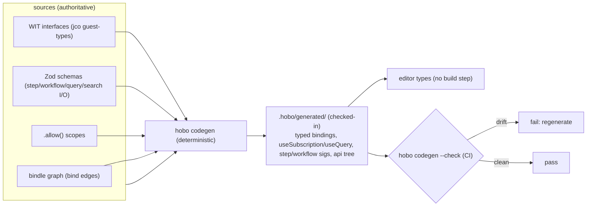

# SDK / API Design

## Plan 02

The SDK is four cooperating layers. Each lower layer is usable on its own; higher layers add ergonomics. The "feels like Vercel Workflows" surface = Layer 4 primitives + Layer 3 topology. **Design tenet:** the *agnostic* path is the default and the shortest; provider-specific power is always one `.with(...)` away.

> **Reference architecture:** the epic rollup at [`sdk-authoring-ifc-bindles`](../../src/draft/epic-proofs/sdk-authoring-ifc-bindles/README.md) composes this SDK surface with IfC collection, manifest/upcaster checks, generated type output, provider-option debt markers, and mocked Pact-covered service boundaries. It is the current executable reference for SDK authoring behavior, not a production `@hobo/bindles` implementation.

> **Runtime & authoring (Nitric/WASM/Aspire).** Three properties layer on this model:
> - **Authoring is IfC-default** ([Plan 21](./authoring-resources-wiring.md#plan-21)): you declare resources inline with `.allow(...)` and HoBo collects them by running the component; the explicit `bindle()` topology below is the **advanced/escape-hatch** mode.
> - **Ports are WIT interfaces** and **services are wasm/wasi components by default** ([Plan 20](./wasm-runtime-wit.md#plan-20)); the typed clients shown here are generated from those interfaces (OCI-container fallback for non-wasm workloads).
> - **The SDK is a thin wrapper over the runtime** ([ADR-0069](./adr/01-architecture-core.md#adr-0069)): ergonomic TS over the generated WIT bindings / wRPC client. It holds **no cloud logic** — all behavior lives behind the WIT ports in the runtime + providers ([Plan 20](./wasm-runtime-wit.md#plan-20)). Any Component-Model-capable language can host the same app; the TS surface is one binding among equals, not the source of truth.
> - **The SDK is WIT-first** ([ADR-0072](./adr/01-architecture-core.md#adr-0072)): the SDK's *own* surface — the runtime **primitives** (`workflow`/`step`/`actor`/`saga`/`agent`/`command`/`subscribe`) plus the capability/data clients — is a canonical **`hobo:sdk` WIT package** ([Plan 20](./wasm-runtime-wit.md#plan-20)). Each language SDK is **built against WIT** (`wit-bindgen`/jco → mechanical bindings) **+ a thin idiom layer** that adds language-native ergonomics and **nothing else** (the Layer 3/4 fluent surface + IfC collection below *is* that idiom layer, lowering to the same bindings + manifest IR). The idiom layer is **conformance-gated** (`@hobo/conformance/sdk` proves it adds no semantics) and may be hand-authored **or** generated by the **SWE operator** ([Plan 40](./operators-sre.md#plan-40)) from the WIT — so `@hobo/bindles` (TS) is the *first* idiom layer over the `hobo:sdk` contract, not the contract itself. (The npm `@hobo/sdk` is a separate package — the operator SDK for configuring & self-hosting a HoBo cloud.)
> - **Bindings adopt Aspire-style references + a manifest IR** ([Plan 21](./authoring-resources-wiring.md#plan-21)).

> **Resource Definitions & Matching (Humanitec parity).** The **Yard's provider** ships default Resource Definitions; platform engineers override with explicit, context-matched definitions + resource **classes** ([Plan 25](./platform-engineering.md#plan-25) / [yard-first-placement](./adr/yard-first-placement.md)). A Camp may carry **provider-neutral** `resourceMappings` (class/resolver/properties **within** the Yard provider) — **not** Camp-owned cloud pins. Legacy Camp fields `defaultProvider` / `tiers` / `bindings` are **rejected at parse** by `camp()`; migration uses `parseLegacyCampMappings` only when provider IDs already equal the enclosing Yard. Camps have **environment types** ([Plan 25](./platform-engineering.md#plan-25)). Resources accept a `class` (`standard`/`ha`/…). HoBo also **imports a Score file** as a workload-spec input (interop), like importing an Aspire manifest.

---

### Layer 1 — the Camp runtime (durable runtime ports)
A **Camp** provides the durable runtime substrate via these **runtime ports** — a superset of the usual Storage+Queue+Streamer, adding actors + a deterministic clock.

```ts
// @hobo/core
export interface Runtime {       // the durable runtime a Camp supplies
  events:  EventStore;   // append-only log; append/read/subscribe, optimistic concurrency
  queue:   Queue;        // at-least-once enqueue/handle; dedup by idempotency key
  streams: Streamer;     // realtime read/write per run (run.readable)
  actors:  ActorHost;    // virtual-actor placement, single-writer leases + fencing
  clock:   Clock;        // deterministic time + durable timers (sleep/cron)
  // Messaging (topic / wasi:messaging) is a Camp capability export, not a
  // separate primary service — see ADR-0138 unified Messaging port + Kafka /
  // optional Dapr realizations. ActorHost may be native or dapr-placed.
}

export interface EventStore {
  append(streamId: string, events: EventInput[], opts: { expectedSeq: number }): Promise<void>;
  read(streamId: string, fromSeq?: number): AsyncIterable<EventEnvelope>;
  subscribe(filter: StreamFilter, handler: (e: EventEnvelope) => Promise<void>): Subscription;
  snapshot(streamId: string, state: unknown, seq: number): Promise<void>;
}
export interface ActorHost {
  acquire(key: string): Promise<Lease>;           // single-writer lease + fenceToken
  state<S>(key: string): DurableState<S>;          // backed by the actor's event stream
}
```
**Provided by the Camp** after the Camp is attached to (or inferred under) a **Yard** — the Yard owns the provider; the Camp supplies the durable runtime backend under that Yard. **The same app code runs regardless of the runtime backend** (`HOBO_RUNTIME` env or Camp config). Built-in `@hobo/runtime-local` (SQLite/filesystem) remains the deterministic fallback/oracle; **`@hobo/runtime-rivet`** is the preferred compatible ActorHost resolver (actor-local journal + durable inbox) when Matching evidence is current; production backends also include `runtime-postgres`, `runtime-temporal`, `runtime-restate`, `runtime-cloudflare`; optional **`@hobo/runtime-dapr`** for Dapr-backed ActorHost + pub/sub when a Camp opts in ([ADR-0138](./adr/01-architecture-core.md#adr-0138)) — in-process wasm remains the component-host default ([ADR-0031](./adr/01-architecture-core.md#adr-0031)). Celld is a future independent Durable Objects resolver, not a topology noun. Durable messaging backends include **`@hobo/provider-kafka`** (native Kafka / Redpanda / MSK / Confluent) exporting `wasi:messaging`. This seam is what makes durability portable and gives replay everywhere ([Plan 11](./data-plane.md#plan-11)).

> **Runtime vs Providers** (a key distinction): the **Camp runtime** backs the *data-plane runtime* of your app (durable state, queues, timers). A **Provider** ([Layer 2](#layer-2--providers-infra-capability-ports)) provisions *infrastructure* (databases, compute, buckets). **The Yard owns CloudProvider (infra) selection**; a Camp is **provider-neutral until attached** and **infers** that provider from its Yard ([yard-first-placement](./adr/yard-first-placement.md)). Independently of which cloud the Yard chose, a Camp may still prefer a **runtime backend** under that Yard (e.g. Azure Yard + Temporal runtime, or AWS Yard + `runtime-postgres`). Camps **do not** author cloud/infra provider pins — re-home across clouds via **Trails**/Yard attachment. *"Runtime" has three senses — the `@hobo/runtime` SDK-primitives package, the `Runtime` interface, and the `runtime-*` backends; see the [glossary](./index.md#glossary--naming-thematic-all-tunable).*

---

### Layer 2 — Providers (infra capability ports)
Capabilities are grouped by service model. Each is a **port**; providers implement subsets and advertise them via Capability Manifest ([Plan 6](./ai-native-agent-auth.md#plan-06)).

```ts
// service-model taxonomy (illustrative)
PaaS:  compute() web() function() cron() queue() topic() gateway()
SaaS:  database() cache() objectStore() secrets() vector() search() auth() email()
CaaS:  containerService() image()        // image built via build-* adapters
IaaS:  vm() microVm() network() volume()  // microVm via Firecracker adapter
```
A **Provider** binds these ports to a backend and declares *how* it realizes them (which IaC/build adapter it uses under the hood). Full interfaces and the resolution/Planner algorithm live in [Plan 4](./control-plane.md#plan-04). The `vector()`/`search()` primitives are specified as a single unified `search` port (text + vector + hybrid, with an `embed` capability) in [Plan 32](./data-plane.md#plan-32); the `auth()` primitive (**end-user** sign-in/sessions, distinct from agent auth) is specified in [Plan 6](./ai-native-agent-auth.md#plan-06) — a verified `ctx.user` flows in `ctx` alongside `ctx.identity`.

---

### Layer 3 — Topology (first-class scope objects: bindle · camp · yard · junction)

> **S1-15 production (HOBO-605):** `@hobo/bindles/wiring`, `@hobo/bindles/topology`, `@hobo/camps`, `@hobo/yards`, and `@hobo/runtime-local` binding resolver implement offline local Camp dev. Draft POC: [`s1-15-bind-wiring-topology-contract`](../../src/draft/technical-proofs/s1-15-bind-wiring-topology-contract/README.md).

**Topology is optional.** Given the platform team's **approved default providers** ([ADR-0062](./adr/07-portability-extensibility.md#adr-0062)), the cloud **infers** a Camp under a selected/inferred **Yard** and auto-places/**rebalances** the Bindle (the Dispatcher, [ADR-0071](./adr/01-architecture-core.md#adr-0071)); an inferred Camp is **approved by policy, not automatically** — an admin enables auto-approval or sets a passing policy ([ADR-0074](./adr/02-identity-security.md#adr-0074)). You build a Camp/Yard/Junction only to **pin** placement, residency, or cross-cloud wiring (or to reach a provider outside the approved set). When you do, the topology scopes are **first-class SDK objects, constructed and composed programmatically** ([ADR-0011](./adr/01-architecture-core.md#adr-0011)) — not `*.config.ts` files. A **`bindle()`** is the provider-agnostic app (resources + bindings); a **`camp()`** is a **provider-neutral** deployment target (runtime-backend preference + camp-local constraints) until attached; a **`yard()`** is **provider-specific**, **owns provider selection**, and composes Camps under that one provider (its cross-Camp policy + control plane); a **`junction()`** connects Yards **across clouds** for the multi-cloud / hybrid case, **inferring the cross-cloud connectivity plane** (tier/peering + `hobo:dns`) from the member Yards' manifests so each Yard realizes its own half. **Camps can move between Yards via Trails** — Trails own the cross-cloud re-home recipe, not Camp-local provider pins ([yard-first-placement ADR](./adr/yard-first-placement.md), [ADR-0134](./adr/02-identity-security.md#adr-0134)). You build them in code and wire them together — the same values flow into deploy. By default a Camp needs only a **runtime preference** (and optional resource-mapping overrides); the **Yard's provider** supplies the Provider's built-in (default) Resource Definitions that match every port in the Bindle's manifest automatically. The mapping styles below are **overrides under the selected Yard provider** for when you want explicit control:

```ts
import { camp } from "@hobo/camps";
import { yard } from "@hobo/yards";
import { junction } from "@hobo/junctions";
import { azure } from "@hobo/provider-azure";
import { aws } from "@hobo/provider-aws";
import { cloudflare } from "@hobo/provider-cloudflare";
import { postgresRuntime } from "@hobo/runtime-postgres";

// Camp is provider-neutral: runtime preference + optional resourceMappings under the Yard.
// Provider is authored on the Yard; Camp infers it on attach.
// Do NOT pass defaultProvider / tiers / bindings — camp() rejects those at parse.
const prod = camp("prod", {
  runtime: postgresRuntime({ url: process.env.DATABASE_URL }),   // durable runtime backend preference
  // Optional within-Yard overrides (no provider field — Yard fixes cloud):
  resourceMappings: [
    { selector: { resourceName: "shop.db" }, properties: { consistency: "session" }, require: [], prefer: [] },
    { selector: { resourceName: "shop.api" }, properties: { cpu: 512, memory: 1024 }, require: [], prefer: [] },
  ],
});

// Yard owns provider selection: it composes Camps under ONE provider + that provider's cross-Camp policy
const azureYard = yard("azure", { provider: azure({ region: "eastus" }), camps: [prod /*, more Azure-region Camps */] });

// a Junction connects provider-specific Yards across clouds (multi-cloud / hybrid)
export default junction("shop", { yards: [azureYard /*, awsYard, … */] });
```

```ts
// the app topology (the "what") — the provider-agnostic Bindle
import { bindle } from "@hobo/bindles";
import type { OrderEvent } from "./shared/types";
import shopApi from "./src/api";
import shopSite from "./src/site";

export default bindle("shop", (b) => {
  const db = b.data();                              // SaaS data port
  const orders = b.queue<OrderEvent>();             // PaaS queue port

  const api = b
    .api(() => shopApi.run())
    .dependsOn(db, orders)                          // typed bindings injected at runtime via ctx
    .with(aws.fargate({ autoscale: { min: 1, max: 10 } }));

  const site = b.web(() => shopSite.render()).dependsOn(api);

  return { db, orders, api, site };
});
```
**Resolution order** per port under the selected Yard ([Plan 4 §Planner](./control-plane.md#plan-04) / [Plan 25](./platform-engineering.md#plan-25)): explicit platform `defineResource` definitions (by specificity) → Camp `resourceMappings` (provider-neutral, within-Yard) → Yard provider **built-in default** Resource Definitions. Historical Camp fields `bindings` → `tiers` → `defaultProvider` are **not live authoring**; `camp()` rejects them — use `resourceMappings` or `parseLegacyCampMappings` only when migrating under a known Yard provider id.

#### Binding & injection mechanics
`dependsOn(db)` does three things at deploy time and one at runtime:
- **Deploy:** records a dependency edge (db must provision before api — drives the DAG in [Plan 4](./control-plane.md#plan-04)); requests the right scoped credential for api→db; wires connection info as the resource's env/secret refs (never plaintext in the Bindle).
- **Runtime:** `ctx.bindings.db` is a **provider-agnostic typed client** whose concrete driver is chosen by the resolved provider (e.g. a `SqlClient` over `pg` for RDS/Flexible Server/Neon). The app imports nothing provider-specific.
```ts
// src/api/index.ts
import { handler } from "@hobo/runtime";
export default handler(async (req, ctx) => {
  const rows = await ctx.bindings.db.query("select 1");  // raw access (driver chosen by provider; non-portable, flagged)
  await ctx.bindings.orders.send({ id: "o1" });          // typed queue client
});
```
> **Domain data goes through the persistence-agnostic data plane, not raw `.query()`.** App domain data is **event-sourced by default** ([Plan 32](./data-plane.md#plan-32)/[ADR-0050](./adr/03-data-plane.md#adr-0050)): writes are `command(...)`→`ctx.emit(event)`, reads are `repo<T>(...)`/`view(...)` over **projections** the architect maps onto SQL/NoSQL/KV/graph/vector. Raw `ctx.bindings.db.query("…")` above is the **escape hatch** — provider-namespaced/typed to the resolved driver (a dialect leak fails to compile) and **flagged non-portable** by `can-deploy`/`hobo doctor`; raw writes are allowed only on adopted **authoritative-external** stores ([ADR-0041](./adr/07-portability-extensibility.md#adr-0041)).

---

### Layer 4 — Runtime primitives (actors, workflows, steps, sagas, agents)
This is the Vercel-feel surface. Both **directive** sugar and **wrapper** form are supported (the directive compiles to the wrapper; same semantics).

> **Reference implementation (draft POC):** [`src/draft/technical-proofs/hobo-runtime-ts-primitives/`](../../src/draft/technical-proofs/hobo-runtime-ts-primitives/) (HOBO-600) implements the wrapper-form primitives below over draft runtime-port mocks; public signatures match this section. Production `@hobo/runtime` / `@hobo/events` promotion is blocked on S1-01/S1-05/S1-06.

```ts
import { workflow, step, actor, sleep, cron, start, createHook } from "@hobo/runtime";
import { saga } from "@hobo/events";

// step: full Node access, retried, result memoized in the event log
export const reserveInventory = step(async (orderId: string) => {
  return { reserved: true };
}, { retries: 5, timeout: "30s" });

// durable workflow: deterministic + replayable (directive form)
export async function checkout(order: Order) {
  "use workflow";
  await reserveInventory(order.id);
  await sleep("10s");                          // durable timer (survives restarts)
  using approval = createHook<{ ok: boolean }>(); // pause for external signal
  const decision = await approval;
  if (!decision.ok) return { status: "rejected" as const };
  await chargePayment(order);
  return { status: "confirmed" as const };
}

// virtual actor / grain: durable single-writer state per key, backed by Runtime.actors
export const Cart = actor("Cart", {
  state: () => ({ items: [] as Item[] }),
  on: {
    addItem: (ctx, item: Item) => ctx.state.items.push(item),
    checkout: async (ctx) => { await start(checkout, ctx.snapshot()); },
  },
});

// choreography saga: react to events, emit next events / compensations (no central coordinator)
export const fulfillment = saga("fulfillment")
  .on("OrderConfirmed", async (e, ctx) => ctx.emit("ShipmentRequested", { orderId: e.orderId }))
  .on("ShipmentFailed",  async (e, ctx) => ctx.emit("PaymentRefundRequested", { orderId: e.orderId }))
  .compensate("PaymentCharged", async (e, ctx) => ctx.emit("PaymentRefundRequested", e));
```

#### Complete primitive catalog
| Primitive | Purpose | Durability semantics |
|---|---|---|
| `step(fn, opts?)` | side-effecting unit | runs once; result memoized; auto-retry per `opts` |
| `workflow(fn)` / `"use workflow"` | deterministic orchestration | replays over memoized steps; seeded RNG/clock |
| `subscribe(m)` (default) / `query(fn)`+`"use query"` (snapshot) | **reactive read** — subscribe to a **materialization** (RX observable folded from event types), or take a one-shot snapshot | replays to `seq` then pushes live at a consistent `seq`; clients `useSubscription()` (default) / `useQuery()` (sugar) ([Plan 32](./data-plane.md#plan-32)/[ADR-0050](./adr/03-data-plane.md#adr-0050)). **Reactivity is not unconditional:** a `subscribe` over a sink with no `change-feed` capability is typed **`reactive: false`** ([ADR-0052](./adr/03-data-plane.md#adr-0052) §3) — it serves the snapshot but won't live-push, and `hobo doctor`/`can-deploy` **flag** a live view bound to a non-reactive sink (the same surfacing as a non-portable `.raw()`), so the degrade is visible at author time, never a silent surprise. The native log-backed materialization is always reactive (the default). |
| `command(type, fn)` | **domain write** = command→aggregate→event | runs in its **aggregate (actor) boundary**: checks invariants vs `ctx.state` (write-model fold), then `ctx.emit` under optimistic `seq`; `step`-class (idempotent); returns its `seq` ([Plan 32](./data-plane.md#plan-32)/[ADR-0053](./adr/03-data-plane.md#adr-0053)) |
| `projection<T>(name, def)` | **read model** = fold event streams → read-model record | per-event-type `on:` fold (deterministic, query-class); rebuildable-from-zero; sink chosen by the architect via Matching ([Plan 32](./data-plane.md#plan-32)/[Plan 25](./platform-engineering.md#plan-25)) |
| `repo<T>(name)` / `view(name)` | **persistence-agnostic snapshot/point/search read** over a materialization's sink cache (the default read is `subscribe`, [ADR-0050](./adr/03-data-plane.md#adr-0050)) | backend-neutral by logical name; `repo` = entity get/find (point lookup), `view().where().order().paginate()` = snapshot/search (cursor pagination); `.raw(driver=>…)` escape hatch flagged non-portable ([Plan 32](./data-plane.md#plan-32)) |
| `actor(name, def)` | stateful single-writer entity (grain); **the aggregate / write-model boundary** commands write through ([ADR-0053](./adr/03-data-plane.md#adr-0053)) | state = folded event stream; lease + fencing |
| `saga(name)` | event-driven process manager | choreography; compensations; correlation-keyed |
| `agent(name, def)` | durable AI agent | tools-as-steps; replayable; identity-injected ([Plan 6](./ai-native-agent-auth.md#plan-06)) |
| `training(fn, opts)` / `"use training"` | **AI-rewritable semantic function** | baseline body; HoBo optimizes prompt/code vs a rubric from OTel/OpenInference trajectories + live-evals; gated promotion ([Plan 23](./generated-stack.md#plan-23)) |
| `sleep(d)` / `cron(expr)` | durable timers | scheduled via Runtime.clock; survive restarts |
| `createHook<T>()` | pause until external resume | token-addressable; multi-event via async iterator |
| `createWebhook()` | hook with auto HTTP routing | provider `gateway` wires the URL |
| `getWritable<T>()` | stream output to clients | per-run stream; `run.readable` on the other side |
| `start(wf, args, opts?)` | fire-and-forget a run | returns `{ runId, readable }`; typed against `wf` |
| `emit(type, data)` | publish a domain event | appended to the event store; drives choreography sagas |
| `signal(actorKey, msg)` | message an actor | enqueued; at-least-once; idempotent by key |

#### Trainable methods (`"use training"`)
A fourth directive joins `"use workflow"`/`"use step"`: **`"use training"`** marks a method as an **AI-rewritable semantic function** — HoBo continuously optimizes its prompt/code against a rubric, from real recorded executions. The body is the baseline (often a `stub()`); the optimizer may rewrite it.

**Three declaration syntaxes, each complete on its own** (never combined in one declaration; all lower to the same manifest facts):

1. **Verbose** — `training(fn, opts)` / `training.define(opts)`: explicit groundings, usable publicly or internally. Canonical.
2. **DI-style decorator** — `@trainable(opts)`: sugar over the verbose form. Like a DI container, decorating registers the trainable eagerly at instance construction and it is **resolvable by injection token** (`resolveTrainable(token)`); the method body is the **initial implementation** the optimizer improves.
3. **Bare marker** — a one-line `"use training"` directive with **no author-supplied bindings**: the tooling **infers and generates** them (`training.infer` at runtime; `hobo stub` scans source and generates the registrations).

```ts
import { training } from "@hobo/runtime";

/**
 * @intent Classify a support ticket; `critical` ONLY for security/outage/production impact.
 * @invariant output.category ∈ KnownCategories; `rationale` must not contain PII.
 */
export const classifyTicket = training(
  async (t: Ticket): Promise<Classification> => llm.classify(t),     // baseline
  {
    intent: "Route tickets; critical only for security/outage/prod impact.",
    contract: ClassificationContract,                                 // Zod I/O + invariants (Plan 29)
    rubric: { categoryCorrect: 0.92, urgencyCalibrated: 0.90, piiSafe: 1.0 }, // eval (Plan 23)
  },
);
// directive form is equivalent:  export async function classifyTicket(t: Ticket) { "use training"; ... }
```

**Empty implementations (`training.define`) and per-param/output metadata ([ADR-0125](./adr/03-data-plane.md#adr-0125)).** A trainable method can be declared with **no body at all** — signature + grounding only. The callable is immediately servable, backed by a contract-derived stub ([ADR-0076](./adr/02-identity-security.md#adr-0076) `mock` mode) until the engine synthesizes an initial implementation through the cold-start generation path ([ADR-0010](./adr/03-data-plane.md#adr-0010)). Per-parameter and per-output metadata (descriptions, examples) ride the **contract** — never a side channel — and lower to manifest facts + CUE constraints:

```ts
export const summarizeIncident = training.define({
  intent: "One-paragraph incident summary for the status page; no blame, no internal names.",
  contract: IncidentSummaryContract,        // typed I/O + invariants (Plan 29)
  params: { incident: { description: "Resolved incident record, PII-redacted" } },
  output: { summary: { description: "Customer-safe prose, <= 3 sentences" } },
  rubric: { factual: 1.0, tone: 0.9, concise: 0.85 },
});
// callable now (stub baseline records specification-by-example traces);
// the training loop grows it into a real implementation against those traces.
```

**Syntax 2 — the DI-style `@trainable(opts)` class-method decorator** (TC39 stage-3 + `Symbol.metadata`, never `experimentalDecorators`): sugar over the wrapper form, lowering to byte-identical manifest facts (conformance-asserted). Constructing the class registers the trainable eagerly — DI-container semantics — and a **symbol token** as the id lets a test suite resolve the *same* instance (`resolveTrainable(token)`) and bind it to specific evals, so one example table doubles as unit tests **and** the live-training eval suite. The wrapper/`training.define` stay canonical because decorators cannot annotate free functions ([ADR-0125](./adr/03-data-plane.md#adr-0125)).

```ts
import { resolveTrainable, trainable } from "@hobo/runtime";

export const ClassifyTicket = Symbol("classifyTicket");   // injection token

class SupportDesk {
  @trainable({
    token: ClassifyTicket,
    intent: "Route tickets; critical only for security/outage/prod impact.",
    contract: ClassificationContract,
    rubric: { categoryCorrect: 0.92, urgencyCalibrated: 0.90, piiSafe: 1.0 },
  })
  async classifyTicket(t: Ticket): Promise<Classification> {
    // Initial implementation the optimizer improves. Named outputs are the
    // rubric's training surface:
    return {
      category: t.subject.includes("down") ? "outage" : "general", // ← categoryCorrect
      urgency: t.fromVip ? "high" : "normal",                      // ← urgencyCalibrated
      rationale: "keyword baseline; echoes no customer data",      // ← piiSafe
    };
  }
}

// In a test/eval suite: resolve by the SAME token — the assertions below are
// the eval cases the live-training loop reuses.
const classify = resolveTrainable<Ticket, Classification>(ClassifyTicket);
```

**Syntax 3 — the bare `"use training"` marker** (the `"use workflow"` ergonomic): one line, **no** intent/contract/rubric bound at the declaration. The bindings are **inferred and generated** — intent from the name or a leading comment, a synthesized `inferred://<methodRef>` contract ref, a default exact-match rubric (`training.infer(fn)`; `hobo stub` scans source for marked functions and generates the registrations). The grounding lint reports these as `inferred` info findings, not errors; explicit groundings can be added later by migrating to syntax 1 or 2 without changing behavior.

```ts
export async function draftStatusUpdate(i: Incident): Promise<StatusUpdate> {
  "use training";
  // One-paragraph status update; no blame, no internal names.  ← becomes the inferred intent
  return {
    summary: `${i.service} degraded for ${i.durationMinutes}m; mitigated.`,
    tone: "calm",
  };
}
```

**Syntax 0 — declared components: `@component` classes on the builders (the primary greenfield door).** The three function-level syntaxes above are the *lowering target*, not the surface most app developers reach for first. A component is declared as a **`@component` class** whose **`@operation` methods** carry the groundings — intent, a **shaped contract** (inline `input` + `output` schemas, or a contract `ref`; the shape is never optional), and an **optional rubric** (absent → the gate's default exact-match rubric over examples/traces). The method body is the baseline the optimizer improves; a `stub()` body declares **code to be generated**. Every component builder (`b.api`, `b.web`, `b.service`) accepts the decorated class directly:

```ts
import { component, operation, param, stub } from "@hobo/runtime";

@component({ intent: "Public storefront API: ranked feed, cart, checkout." })
class Storefront {
  @operation({
    intent: "Order photos to maximize dwell without burying brand-new sellers.",
    contract: {
      input: RankInput, output: z.array(Photo),              // the shape — required
      forbiddenOutputs: ["output[0] is nsfw"],
    },
    params: { input: param("Candidate photos with engagement signals") },
    rubric: { dwellLift: 0.80, newSellerShare: 0.75 },       // optional — sharpens promotion
  })
  rankFeed = stub<RankInput, Photo[]>();                      // no implementation: generate it

  @operation({
    intent: "Turn a priced cart into an order exactly once.",
    contract: { input: Cart, output: Order },
  })
  async checkout(cart: Cart): Promise<Order> {
    "use training";                                           // hand-written baseline, AI-maintained
    return submitOrder(cart);
  }
}

const api = b.api(Storefront).dependsOn(catalog);
```

**The granular form — every decorator optional.** The options object is itself sugar-decomposable: `@intent(text)` and `@returns(text)` annotate a method one grounding at a time, `@description(text)` annotates a parameter, and a **bare `@trainable`** on the class composes whatever was declared — anything missing is inferred (intent from the method name, a synthesized `decl://<Class>.<method>` contract ref, the default exact-match rubric). The same class body can also be **ambient**:

```ts
@trainable
export declare class Program {
  @intent("Produce a simple hello-world program")
  @returns("Hello World! or Hello, <name>! when supplied")
  trainableMethod(
    @description("Optional person to greet")
    name?: string,
  ): string;
}
```

Two mechanical realities govern how this executes. (1) An ambient `declare class` is erased at compile time — no decorator ever runs — so the ambient form is honored **statically**: `scanDeclaredTrainables` (the `hobo stub` source-scanning path) parses the class, takes the **TypeScript signature as the declared shape**, and `generateDeclaredRegistrations` emits the grounded registrations into `src/_generated/`: one `defineGrounding({...})` call per operation, imported from `@hobo/runtime`, where `defineGrounding` is `training.define` under the name ts-autocode-grounding's emitter writes ([ADR-0128](./adr/01-architecture-core.md#adr-0128)); every identity in it is derived from the scanned class and method names, none is typed by hand. (2) TC39 stage-3 decorators have no parameter decorators, so `@description` in parameter position compiles only in projects that opt into legacy `experimentalDecorators` — every granular decorator is **dual-mode** (detects stage-3 vs legacy call shapes at runtime), and stage-3 projects pass the identical `description(text)` value through a `params:` map instead. This repo compiles stage-3 only ([ADR-0125](./adr/03-data-plane.md#adr-0125)); per-parameter/output metadata always lowers through the contract, never a side channel — the day TC39 ships parameter decorators, `@description` is already one. Each operation lowers to a trainable manifest fact (a **signature-only** one when the body is a stub) bound to the owning resource's stableId: servable immediately from the contract-derived stub baseline ([ADR-0076](./adr/02-identity-security.md#adr-0076) `mock` mode), grown into a real implementation by the cold-start generation path ([ADR-0010](./adr/03-data-plane.md#adr-0010)), promoted only through the conformance + eval + policy gate — a declared **rubric is the eval lens's policy input**, not advisory metadata. Escalation is per-operation (stub → `"use training"` body → plain hand-maintained method) and never changes the manifest shape. **Internality rule:** declared components and the bare `"use training"` directive are the two doors app developers normally use; `training()` / `training.define()` / `@trainable` stay public for library authors and test suites but are documented as what the sugar compiles to. Delivery is staged in [`docs/plans/0007`](../plans/0007-declarative-resource-codegen.md).

What the developer provides is **intent + contract + rubric** (the semantic grounding that makes code rewritable). What HoBo does — capture OTel/[OpenInference](https://github.com/Arize-ai/openinference) trajectories, score them with **live-evals**, run an optimizer, and promote a candidate only through the conformance + eval + policy gate — is the **training pipeline in [Plan 23](./generated-stack.md#plan-23)**. The optimizer is an **engine behind a WIT port** (built-in default; Microsoft Agent Lightning / Trace as optional *internal* providers) and is **never part of this SDK surface** ([ADR-0025](./adr/03-data-plane.md#adr-0025)): swapping it is a config change, not an app-code change.

#### Error handling & retries
```ts
import { FatalError, RetryableError } from "@hobo/runtime";
export const charge = step(async (o: Order) => {
  if (o.total <= 0) throw new FatalError("invalid total");          // no retry
  const res = await fetch(...);
  if (res.status >= 500) throw new RetryableError("upstream", { retries: 3 });
  return res.json();
});
```
- Default: steps retry 3× with capped exponential backoff + jitter. `FatalError` stops immediately; `RetryableError` overrides the budget. Exhausted retries surface as `run.StepFailed` and (in workflows) propagate as a catchable error so the workflow can compensate.
- Idempotency keys are auto-derived per step call site + args, overridable, and passed to providers that support them ([Plan 5](./reliability-observability-cost.md#plan-05)).

#### The provider-specific options pattern (the core promise)
- `.with(provider.option({...}))` on any resource — **fully typed by the provider package**, additive, inert for other providers.
- Stack multiple providers on one resource so a single Bindle targets many clouds with no edits:
```ts
const db = b.data()
  .with(aws.rds({ multiAz: true }),
        azure.flexibleServer({ haMode: "zoneRedundant" }),
        neon.serverless({ autoscale: true }));   // only the resolved provider's block applies
```
- **`prefer` / `require` qualifiers:** `b.data({ engine: "postgres", require: "managed" })` fails planning if no resolved provider offers managed Postgres; `prefer` degrades gracefully (e.g. to a container Postgres) with a warning event.

#### Type ergonomics
- **Scope of "type-safe end-to-end" (stated honestly).** Types flow end-to-end **across the agnostic path** — bindings, workflow/step signatures, `useQuery()`/search results, provider `.with()` options. **Two declared exceptions:** (1) the **`.raw(driver => …)`** escape hatch returns untyped rows by design (and is flagged non-portable); (2) IfC resource collection is **run-to-collect** (it executes code to discover the resource graph, [authoring](./authoring-resources-wiring.md#plan-21)), so a resource declared only on a branch the collection run didn't hit would be missing from the generated types — therefore a **`can-deploy` collection-coverage gate fails when collection cannot prove it observed all declared resources** (static-analysis confirmation supplements it, required for non-TS guests). So "type-safe end-to-end" is true for the agnostic surface, with the raw hatch and collection-coverage as explicit, gated exceptions — not an unqualified guarantee.
- Bindings flow end-to-end: `b.api(...).dependsOn(db)` types `ctx.bindings.db` as that resource's client type.
- `start(checkout, order)` is checked against the workflow signature; hooks/streams are generic (`createHook<T>()`, `getWritable<UIMessageChunk>()`).
- Provider option types are exported by each provider package, so autocomplete on `.with(aws.…)` shows only valid knobs for that provider/resource pairing (conditional types keyed on the port).

#### Generated code (`_generated/`) ([ADR-0037](./adr/01-architecture-core.md#adr-0037))
The end-to-end types above aren't hand-written — they're **generated**, deterministically, from four authoritative sources and checked into the repo:

- **Output (committed `.hobo/generated/`, or `src/_generated/`):** typed `ctx.bindings.<name>` clients, typed `useSubscription()`/`useQuery()`/search results ([Plan 32](./data-plane.md#plan-32)/[Plan 32](./data-plane.md#plan-32)), typed workflow/step signatures, typed `.with()` options, and a typed **`api` function-tree** reference (the Convex `_generated/` analog).
- **When:** `hobo dev` regenerates on change (watch); `hobo build` regenerates + fails on drift; `hobo new` scaffolds it; `hobo codegen --check` is the CI drift gate ([Plan 7](./developer-experience.md#plan-07)). Checked-in = reviewable diffs + editor types with **no build step** + works offline/air-gap ([ADR-0036](./adr/07-portability-extensibility.md#adr-0036)). Every command has an MCP equivalent for agents ([Plan 6](./ai-native-agent-auth.md#plan-06)).

---

### Local development & testing
- **`hobo dev`** runs the Bindle against a **local Camp** (`@hobo/runtime-local`) with an in-process Provider mock layer: resources resolve to local equivalents (Postgres in a container, a local object store, an in-memory queue) so the agnostic path runs with zero cloud. Replay/inspection work offline (mirrors Lakebed's instant-onboarding strength, full CLI in [Plan 7](./developer-experience.md#plan-07)).
- **Test runtime:** `@hobo/runtime-local` exposes a deterministic test mode — drive time (`clock.advance`), assert emitted events, and **replay a run to assert identical final state** (the determinism test). Providers have fakes from `@hobo/conformance` so unit tests never hit a cloud.
```ts
import { testRuntime } from "@hobo/runtime-local/testing";
test("checkout is durable", async () => {
  const w = testRuntime();
  const run = await w.start(checkout, sampleOrder);
  await w.resumeHook(run, { ok: true });
  await w.clock.advance("10s");
  expect(await w.replay(run)).toEqual(await w.state(run)); // replay == live
});
```

### Versioning (Bindles & workflows)
- **Bindle versions** are immutable, content-addressed; deploys reference a version; promote/rollback move a Camp's pointer (events `bindle.VersionPublished`, `deployment.Promoted`).
- **Workflow versioning** follows the Vercel model: in-flight runs complete on the deployment they started on; `start(wf, args, { deploymentId: "latest" })` opts new runs onto the newest code. Determinism across versions is preserved by pinning a run to its code version; breaking changes use explicit upgrade boundaries.
