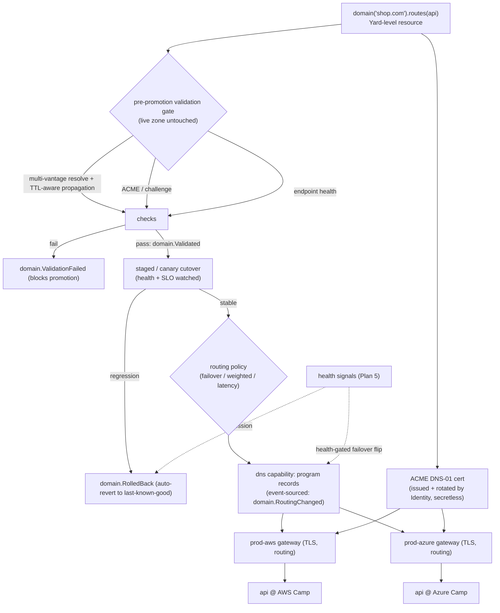
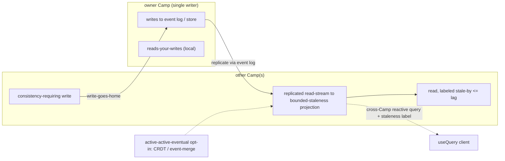

# Security, Multi-Tenancy & Networking

This capability doc consolidates Plan 12, Plan 13 of the HoBo design suite.

## Plan 12

**Plan 12 — Security & multi-tenancy**

> **Posture: secure-by-default, zero-trust, defense-in-depth ([ADR-0023](./adr/02-identity-security.md#adr-0023)).** Every principal (human, agent, workload) authenticates and is authorized on every call — no ambient trust, no implicit network perimeter. Controls layer so one bypass is not a breach: keyless federation removes most secrets, the policy plane default-denies what remains, encryption protects data at rest, rate-limits cap blast radius, the wasm sandbox contains code, and **continuous scanning/monitoring** catches regressions. Controls **map to recognized industry standards** so adopters can assess them against their own frameworks.

> **The Relay:** the **HoBo Relay** ([Plan 28](./platform-engineering.md#plan-28)) keeps cloud credentials inside the customer's network — outbound-only TCP 443 reverse tunnel, SVID-authenticated, no inbound; Executors run behind it. This unlocks regulated/air-gapped/sovereign deploys without the Yard ever connecting into the private network.

> **Policy plane (gates):** the governance rules here are expressed as **policy packs** — signed, versioned resources evaluated by the **policy plane** ([Plan 30](./contracts-policy-flags.md#plan-30)). Decisions can carry **obligations** (require signed+attested artifact / encryption / approved region for a data classification), tracked to completion as events. Supply-chain attestation and data-classification/region constraints become gate dimensions, not prose.

> **Runtime isolation (WASM).** **WASM capability security** ([Plan 20](./wasm-runtime-wit.md#plan-20)) is a runtime isolation layer: deny-by-default, unforgeable handles, and `.allow()`-scoped links ([Plan 21](./authoring-resources-wiring.md#plan-21)) mean a component (incl. Forge-generated ones) can only touch what it's explicitly linked to — the sandbox for AI-generated providers/implementations ([Plan 23](./forge-generated-stack.md#plan-23)).

> **Isolation tiers.** Default multi-tenancy isolates tenants *within one Yard* (per-tenant streams/keys/pools, below). For **extreme isolation** (sovereign/regulated tenants, air-gap [ADR-0036](./adr/07-portability-extensibility.md#adr-0036)) a tenant gets a **wholly separate Yard**; sovereign Yards interoperate only via a **`Junction`** peer federation (trust + signed artifacts, no shared state — [ADR-0043](./adr/07-portability-extensibility.md#adr-0043)), so the isolation boundary is the Yard itself.

### Threat model (who/what we defend against)
| Asset | Threats | Primary mitigations |
|---|---|---|
| **Provider credentials** | theft, over-broad scope, long-lived leakage | keyless OIDC federation by default; short-lived, resource-scoped tokens; no static secrets at rest; every issuance audited |
| **Tenant data & event streams** | cross-tenant read/write, replay leakage | per-tenant isolation of streams/keys/pools; tenant claim enforced at the Gateway and in the store |
| **Executors (run IaC + builds)** | malicious/compromised provider code, supply-chain | Firecracker isolation, no ambient creds, no egress except the scoped target, ephemeral |
| **Forge plugins (AI-generated)** | exfiltration, backdoors, prompt injection in source docs | sandboxed conformance run with no egress; signed provenance; capability-scoped; human gate for high-trust |
| **The Yard itself** | privilege escalation, tampering with history | append-only log + fencing tokens; least-privilege services; immutable audit; quorum writes |
| **Agents** | confused-deputy, runaway spend/destroy | scoped SVIDs; policy gates on high-risk actions; spend caps; full replay |

### Multi-tenancy isolation model
A **tenant** is the hard isolation boundary. Isolation applies across four dimensions:
1. **Data** — event streams are namespaced and (optionally) encrypted per tenant; projections enforce the tenant claim; a query can never fold another tenant's stream. Sharding can be per-tenant logs for large tenants.
2. **Compute** — Executor pools are partitioned per tenant (and bulkheaded per provider) so one tenant's workload/storm can't observe or starve another's ([Plan 5](./reliability-observability-cost.md#plan-05)).
3. **Credentials** — SVIDs and brokered provider tokens are scoped to the tenant; a tenant's federation trust is established only with that tenant's provider accounts.
4. **Network** — data-plane resources of different tenants never share a trust domain; mTLS identities are tenant-scoped ([Plan 13](./security-networking.md#plan-13)).

**Deployment tiers:** self-host = single-tenant (the whole Yard is one trust domain); hosted = multi-tenant on the same code with the boundaries above. A "dedicated" tier can pin a tenant to isolated infra.

### Identity & authorization
- **Authentication:** humans via OIDC (SSO); agents/workloads via SVIDs ([Plan 6](./ai-native-agent-auth.md#plan-06)).
- **Authorization:** ABAC over `(principal, tenant, port, resource, action)` evaluated at the Gateway and again at the broker. Roles are sugar over attributes (owner/maintainer/deployer/viewer/agent).
- **Policy gates** for high-risk actions (destroy, prod, spend > cap) — auto / require-approval (a resolvable hook) / deny. Policy is versioned and event-sourced (decisions are auditable facts).

### Secrets management
> Full model + SDK surface: [Plan 31 — Configuration & secretless secrets](./authoring-resources-wiring.md#plan-31). Summary below.
- **Goal: no static secrets (secretless-first).** Config/secret declarations resolve to *references per Camp*, not values; the runtime reaches bound resources via a brokered short-lived token (no secret at all) or fetches a genuine secret from the provider's `secrets` port at use time.
- **When secrets are unavoidable** (a provider with no federation, the bounded `api-key` escape hatch): stored with envelope encryption (KMS-backed DEK/KEK), never in the Bindle or the plaintext log; access is itself an audited `token.Used`.
- **Per-run encryption:** sensitive step inputs/outputs in the event log are encrypted with a per-run key (so log access ≠ payload access), decryptable on demand for the run owner — mirrors the Vercel `getEncryptionKeyForRun` model.

### Supply-chain security (plugins & images)
- **Plugins** (human or Forge): signed; carry SLSA-style provenance + the conformance report; the Registry refuses unsigned/unverified plugins; consumers can pin versions and require a trust level.
- **Images**: built reproducibly (Dagger), scanned, and referenced by digest; provenance attached.
- **Dependencies**: SBOMs generated in CI; vuln scanning gates publishing.
- **Air-gapped supply chain** ([ADR-0036](./adr/07-portability-extensibility.md#adr-0036)): in a zero-egress/sovereign Yard, plugins/Capability Manifest/packs/images/model weights enter only via a **signed offline bundle** (`hobo registry import`) verified against this **same** signature + SLSA-provenance + conformance trust boundary (a tampered bundle is refused; `registry.BundleImported` audits it). Trust roots stay in-boundary: Identity issues SVIDs locally, certs via an **internal CA / private ACME** ([ADR-0035](./adr/07-portability-extensibility.md#adr-0035)), secrets via in-boundary KMS/HSM, and no telemetry phone-home.

### Continuous / live security scanning & remediation
Security runs **continuously, not just as a deploy-time gate** — a loop owned by the **SRE / security operator** ([Plan 40](./operators-sre.md#plan-40)), with controls **mapped to recognized industry standards** ([ADR-0023](./adr/02-identity-security.md#adr-0023)) so adopters can map findings to their own compliance frameworks:
- **Live scanning.** Dependency/image vuln scans + SBOM checks run continuously in CI *and* in production (not only at publish); the **policy plane** ([Plan 30](./contracts-policy-flags.md#plan-30)) treats a newly-disclosed CVE in a *running* Set like a contract break — it can warn, block the next deploy, or trip an obligation. Provider config/drift is watched for security regressions ([Plan 5](./reliability-observability-cost.md#plan-05) drift).
- **Live remediation.** A finding triggers the same classify → propose-fix → sandbox-validate → policy-gated apply loop as live-fix ([Plan 23](./forge-generated-stack.md#plan-23)) — e.g. bump a vulnerable dep, rotate a leaked credential, tighten an over-broad `.allow()` — auto for low-risk, **require-approval** for prod ([Plan 30](./contracts-policy-flags.md#plan-30)).
- **Normalized signal.** Findings + decisions emit as events and export as **OCSF** ([ADR-0046](./adr/04-governance-verification.md#adr-0046)) to a SIEM; the SRE operator and Endpoint Monitor ([Plan 40](./operators-sre.md#plan-40)) consume them. This is the security face of the self-healing reflex ([Plan 41](./forge-generated-stack.md#plan-41)).

### Audit & compliance
- The event log *is* the audit log: who (principal/SVID), what (event), when (clock), why (causation/correlation), and — for credentials — every grant/use/revoke.
- **SIEM export via OCSF** ([ADR-0046](./adr/04-governance-verification.md#adr-0046)): security-relevant events (`token.*`, `identity.*`, `policy.Decided`, `domain.Cert*`, `registry.BundleImported`, `flag.Changed`, …) map to **[OCSF](../../standards/ocsf.md)** classes via an exporter/projection (no change to how they're stored), so the audit trail drops straight into an enterprise SIEM.
- Retention: audit streams (`token.*`, `resource.*`, policy decisions) retained per policy and never compacted; runtime streams have shorter retention.
- Data residency: a tenant can constrain regions; the Planner enforces it ([Plan 3](./control-plane.md#plan-03)) and residency violations are rejected at plan time.
- **Metering/billing data is tenant-scoped.** The `MeteringView` + showback attribution ([Plan 16](./reliability-observability-cost.md#plan-16)/[ADR-0039](./adr/04-governance-verification.md#adr-0039)) are projections over the same per-tenant-isolated streams, so usage/cost data inherits the tenant isolation above — no cross-tenant metering leakage.

### Runtime isolation layer (WASM, integrated)
- **Wasm capability sandbox = a fifth isolation dimension** alongside data / compute / credentials / network: deny-by-default, unforgeable handles, and `.allow()`-scoped **links** ([Plan 20](./wasm-runtime-wit.md#plan-20)/[Plan 21](./authoring-resources-wiring.md#plan-21)). A component — including a Forge-generated one — can reach *only* what it is explicitly linked to.
- **`.allow()` is the single grant.** One declaration scopes least-privilege IAM **+** the wasm capability link **+** the brokered token, so the three enforcement layers can't drift apart.
- **AI-generated code is contained.** Forge runs in this sandbox + Firecracker with **no egress** during conformance; promotion requires per-WIT-interface conformance + signed provenance ([Plan 23](./forge-generated-stack.md#plan-23)), keeping the threat-model row "Forge plugins" fully mitigated for *implementations* too, not just providers.

### Iteration hooks
- Encryption granularity (per-tenant vs per-stream vs per-run) and KMS strategy.
- ABAC policy engine choice (typed TS vs Rego/CEL) — shared with [Plan 6](./ai-native-agent-auth.md#plan-06) guardrails.
- Trust tiers for Forge plugins and the human-certification threshold.
- Compliance targets to design toward (SOC2/ISO/FedRAMP) and what each implies for the log.

## Plan 13

**Plan 13 — Networking & connectivity**

> **The Relay:** the **HoBo Relay** ([Plan 28](./platform-engineering.md#plan-28)) is the control-plane→private-network path (outbound reverse tunnel, no inbound), distinct from the data-plane connectivity tiers below. Multi-cluster routing is by target id; one Relay can serve several private targets.

### The problem
When one Bindle's `api` is on AWS and its `db` is on Azure (or its edge is on Cloudflare), HoBo must wire secure, low-latency, identity-aware connectivity across trust domains — without the developer thinking about VPCs, peering, or certificates. The agnostic path must "just connect."

### Logical connectivity from `bind`
A `bind: { db }` edge is the only thing the developer writes; HoBo derives the network wiring from it:
- **Service identity:** every service/resource gets a workload identity (SVID, [Plan 6](./ai-native-agent-auth.md#plan-06)) — `spiffe://<tenant>/<bindle>/<resource>`. This is the unit of authn/authz, independent of IP/DNS.
- **Endpoint resolution:** `ctx.bindings.db` resolves to a logical endpoint; the actual address is injected from the resolved provider's outputs at deploy time and can change without app edits.
- **Authorization:** the dependent is granted least-privilege access to exactly its bound dependency (security-group/firewall rules or mesh policy generated by the provider's `realize()`).

### Connectivity tiers (Planner-selected, override via `.with(...)`)
1. **Same provider + region (preferred):** native private networking (VPC/VNet, security groups). Cheapest, lowest latency. The Planner colocates bound resources here by default ([Plan 3](./control-plane.md#plan-03)).
2. **Same provider, cross-region:** provider backbone + private peering where available.
3. **Cross-provider, private:** provider interconnects (PrivateLink/Private Service Connect/Private Link) provisioned via IaC where the equivalence class supports it; otherwise an **encrypted overlay**.
4. **Cross-provider, overlay mesh:** a HoBo-managed WireGuard/eBPF overlay (Tailscale/Cilium-ClusterMesh-style) joining resources into one logical network with mesh policy. Default fallback when native private peering isn't available.
5. **Public + mTLS:** last resort — public endpoints with **mutual TLS keyed by the workload SVIDs**, so even on the public internet only authorized identities connect.

**mTLS-by-default between services:** regardless of tier, service-to-service traffic authenticates with SVIDs (zero-trust). Certificates are issued/rotated by Identity; apps don't manage them.

### Ingress / the `gateway` port
- The `gateway()` capability provides TLS termination, routing, and traffic-splitting. It's what blue/green and canary rollouts flip ([Plan 5](./reliability-observability-cost.md#plan-05)).
- Custom domains + managed certs are a provider capability; `web()`/`service()` attach to a gateway by binding.
- WAF/rate-limit/DDoS are provider-specific `.with(...)` options on the gateway.

### Custom domains & multi-cloud ingress ([ADR-0035](./adr/07-portability-extensibility.md#adr-0035))
DNS is high-blast-radius and slow to recover — an unvalidated change can blackhole a domain for a TTL window. So **no DNS change ever promotes without passing an automated validation gate, and every cutover is health-checked and self-rolling-back.** A custom domain is a **first-class, Yard-level resource** — declared IfC-style, owned at the Yard (which holds cross-provider topology, [ADR-0026](./adr/01-architecture-core.md#adr-0026)) so **one domain fronts the member Camps** of an environment group ([ADR-0028](./adr/05-config-matching-environments.md#adr-0028)):
```ts
import { domain } from "@hobo/sdk";
export const site = domain("shop.com")
  .routes(api)                          // bind to a service/gateway
  .routing("failover");                 // failover | weighted | latency | geo
```

**Mandatory pre-promotion DNS validation gate (`domain.Validated` / `domain.ValidationFailed`).** Before any record reaches the live zone, HoBo provisions the change against a staging/shadow path and runs an automated suite — **the live zone is untouched until every check passes; any failure blocks promotion** and leaves production as-is:
- **Multi-vantage resolution** — the target resolves correctly from several independent vantage points/resolvers (not just one), guarding against split-horizon or partial-propagation surprises.
- **TTL-aware propagation** — HoBo waits out the relevant TTL and confirms the new value has actually propagated, rather than assuming.
- **ACME / challenge** — the DNS-01 challenge (or provider cert challenge) completes and the cert is issuable/valid for the name before traffic depends on it.
- **Endpoint health checks** — the candidate target gateways/Camps return healthy on the domain's health path.
- A failed check emits `domain.ValidationFailed` (naming the check that failed) and the promotion is rejected; the live zone never changed.

**Health-checked staged / canary cutover with automatic rollback.** Once validation passes, cutover is **staged, never big-bang**: traffic shifts to the new target incrementally (canary `%` / weighted), continuously watched against health + SLO signals ([Plan 5](./reliability-observability-cost.md#plan-05)). On any regression the cutover **auto-reverts to the last-known-good routing** (`domain.RolledBack` with the reason) — no operator in the loop. `domain.CutoverStarted` → `domain.RoutingChanged` (success) | `domain.RolledBack` (regression) are the auditable facts.

- **Routing across Camps is policy-driven DNS**, programmed via a provider-agnostic **`dns` capability**: `failover` (active-passive, health-gated), `weighted` (canary/split), `latency`/`geo` (nearest Camp). **Failover follows health-gated best practice** — a flip happens only on a sustained health-signal failure of the active target and only to a target the validation gate has cleared. It reuses the env-group saga ([ADR-0028](./adr/05-config-matching-environments.md#adr-0028)) + the blue/green gateway flip + health signals ([Plan 5](./reliability-observability-cost.md#plan-05)); each routing decision is an event (`domain.RoutingChanged` → auditable "why traffic went to `prod-aws`").
- **Certs are ACME DNS-01 by default**, issued + auto-rotated by Identity ([Plan 6](./ai-native-agent-auth.md#plan-06)/[Plan 31](./authoring-resources-wiring.md#plan-31)) with **no static secret** — DNS-01 works cross-cloud + wildcard because HoBo controls the zone. **Provider-managed certs** (ACM / App Service / Google-managed) and an **internal CA / private ACME** for air-gapped Yards ([ADR-0036](./adr/07-portability-extensibility.md#adr-0036)) are per-Camp cert adapters; the cert source is irrelevant to the validation gate, which checks issuability for the name regardless.
- The `gateway` keeps doing TLS termination + routing + traffic-split + provider `.with()` WAF/rate-limit; the `domain` sits **above** it, routing across Camps.



### Cross-Camp state consistency ([ADR-0040](./adr/05-config-matching-environments.md#adr-0040))
When a Bindle spans Camps ([ADR-0028](./adr/05-config-matching-environments.md#adr-0028)), HoBo does **not** silently make state strongly consistent across clouds (CAP). Each piece of cross-Camp state declares a **replication topology** (resolved config, [Plan 26](./platform-engineering.md#plan-26)): **single-writer-Camp** (default), **active-active-eventual** (CRDT/event-merge, opt-in), or **pinned-single-Camp**.
- **Replication backbone = the event log.** The owning Camp writes; other Camps consume a replicated read-stream into **bounded-staleness projections** ([Plan 11](./event-model.md#plan-11)/[Plan 5](./reliability-observability-cost.md#plan-05)). Provider-backed stores default to single-writer + cross-Camp read over the connectivity tiers above; active-active-eventual (CRDT/event-merge) is the opt-in topology.
- **Honest surface:** non-owner reads are **labeled** stale-by ≤ replication lag; **reads-your-writes** holds in the writer Camp; **consistency-requiring writes "go home"** to the owner; cross-Camp reactive queries ([Plan 32](./data-plane.md#plan-32)) carry the staleness label.



### DNS & naming
- Each Camp gets a namespace; resources have stable logical names (`shop.api`). HoBo manages records on the resolved provider's DNS (or a HoBo-managed zone), abstracted behind logical endpoints so app code never hardcodes hosts.
- Internal service discovery uses the SVID/identity layer, not DNS round-robin, so it works across providers.

### Egress, cost & latency feedback to the Planner
- Cross-provider/cross-region data paths incur egress $ and latency; the connectivity tier chosen feeds back into the Planner's colocation objective and the cost model ([Plan 16](./reliability-observability-cost.md#plan-16)).
- The dashboard's topology graph annotates each `bind` edge with its connectivity tier + estimated egress, so a developer can *see* when a mapping choice created an expensive cross-cloud hop.

### Data-plane vs control-plane traffic
- **Control-plane** (Yard ↔ Executors ↔ providers) is separate from **data-plane** (app ↔ app, app ↔ db). The Yard is never on the app's request path ([Plan 10](./architecture.md#plan-10)).
- Executors reach providers over the scoped-token path only; they are not part of any tenant's data-plane network.

### Iteration hooks
- Overlay mesh technology choice (WireGuard userspace vs eBPF/Cilium vs a SaaS like Tailscale) and who operates it in self-host.
- How aggressively to auto-colocate vs honor explicit cross-cloud intent.
- Service-mesh depth (do we ship a sidecar/mesh, or rely on provider-native + mTLS libraries?).
- Private-interconnect coverage per provider equivalence class.
