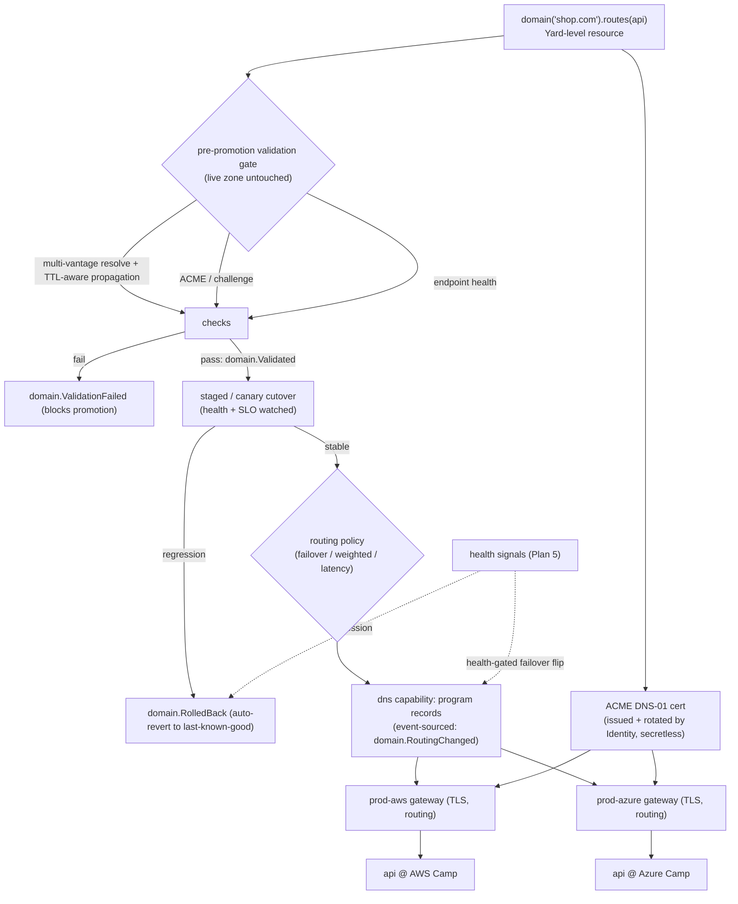
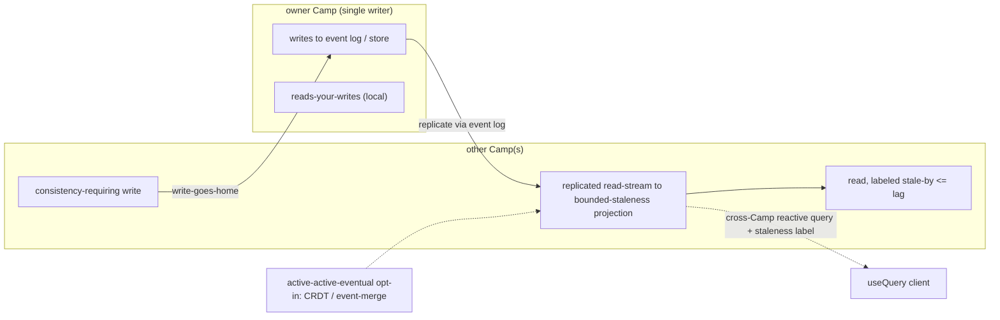
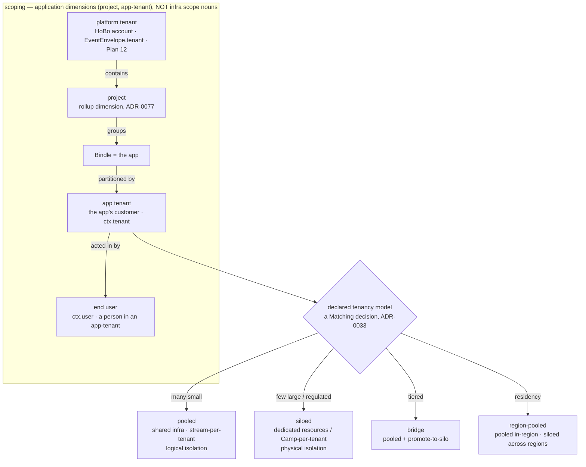
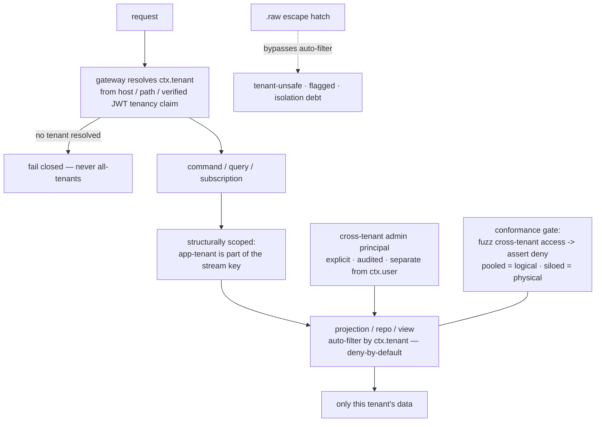

# Security, Multi-Tenancy & Networking

This capability doc covers HoBo's security and multi-tenancy posture together with the networking and connectivity model that enforces it across trust domains.

## Plan 12

> **Posture: secure-by-default, zero-trust, defense-in-depth ([ADR-0023](./adr/02-identity-security.md#adr-0023)).** Every principal (human, agent, workload) authenticates and is authorized on every call — no ambient trust, no implicit network perimeter. Controls layer so one bypass is not a breach: keyless federation removes most secrets, the policy plane default-denies what remains, encryption protects data at rest, rate-limits cap blast radius, the wasm sandbox contains code, and **continuous scanning/monitoring** catches regressions. Controls **map to recognized industry standards** so adopters can assess them against their own frameworks.

> **The Relay:** the **HoBo Relay** ([Plan 25](./platform-engineering.md#plan-25)) keeps cloud credentials inside the customer's network — outbound-only TCP 443 reverse tunnel, SVID-authenticated, no inbound; Executors run behind it. This unlocks regulated/air-gapped/sovereign deploys without the Yard ever connecting into the private network.

> **Policy plane (gates):** the governance rules here are expressed as **policy packs** — signed, versioned resources evaluated by the **policy plane** ([Plan 29](./contracts-policy-flags.md#plan-29)). Decisions can carry **obligations** (require signed+attested artifact / encryption / approved region for a data classification), tracked to completion as events. Supply-chain attestation and data-classification/region constraints become gate dimensions, not prose.

> **Runtime isolation (WASM).** **WASM capability security** ([Plan 20](./wasm-runtime-wit.md#plan-20)) is a runtime isolation layer: deny-by-default, unforgeable handles, and `.allow()`-scoped links ([Plan 21](./authoring-resources-wiring.md#plan-21)) mean a component (incl. Forge-generated ones) can only touch what it's explicitly linked to — the sandbox for AI-generated providers/implementations ([Plan 23](./forge-generated-stack.md#plan-23)).

> **Isolation tiers.** Default multi-tenancy isolates tenants *within one Yard* (per-tenant streams/keys/pools, below). For **extreme isolation** (sovereign/regulated tenants, air-gap [ADR-0036](./adr/07-portability-extensibility.md#adr-0036)) a tenant gets a **wholly separate Yard**; sovereign Yards interoperate only via a **`Junction`** peer federation (trust + signed artifacts, no shared state — [ADR-0043](./adr/07-portability-extensibility.md#adr-0043)), so the isolation boundary is the Yard itself.

### Threat model (who/what we defend against)
| Asset | Threats | Primary mitigations |
|---|---|---|
| **Provider credentials** | theft, over-broad scope, long-lived leakage | keyless OIDC federation by default; short-lived, resource-scoped tokens; no static secrets at rest; every issuance audited |
| **Tenant data & event streams** | cross-tenant read/write, replay leakage | per-tenant isolation of streams/keys/pools; tenant claim enforced at the Gateway and in the store |
| **Executors (run IaC + builds)** | malicious/compromised provider code, supply-chain | Firecracker isolation, no ambient creds, no egress except the scoped target, ephemeral |
| **Forge plugins (AI-generated)** | exfiltration, backdoors, prompt injection in source docs | sandboxed conformance run with no egress; signed provenance; capability-scoped; human gate for high-trust |
| **The Yard itself** | privilege escalation, tampering with history | append-only log + fencing tokens; least-privilege services; immutable audit; quorum writes |
| **Agents** | confused-deputy, runaway spend/destroy | scoped SVIDs; policy gates on high-risk actions; spend caps; full replay |

### Multi-tenancy isolation model
> **Which "tenant"?** This section is HoBo's **platform tenant** — the **HoBo account/org** using the platform (`EventEnvelope.tenant`, `spiffe://yard/<tenant>/…`), HoBo's own hard isolation boundary. The developer's **own customers** (when they build a multi-tenant SaaS *on* HoBo) are **app tenants** (`ctx.tenant`) — a separate, application-domain concept covered in [Plan 50](#plan-50)/[ADR-0079](./adr/02-identity-security.md#adr-0079)/[ADR-0080](./adr/02-identity-security.md#adr-0080), which **reuses the machinery below one level up**. They are **two axes, not one chain**: infra containment is `Bindle ⊂ Camp ⊂ Yard ⊂ Junction` ([ADR-0026](./adr/01-architecture-core.md#adr-0026)); the ownership/rollup axis is `platform-tenant ⊇ project ⊇ app-tenant ⊇ end-user`, where **project** is a *non-containment* rollup dimension ([ADR-0077](./adr/04-governance-verification.md#adr-0077)) and an app-tenant is a partition **within one Bindle**.

A **(platform) tenant** is the hard isolation boundary. Isolation applies across four dimensions:
1. **Data** — event streams are namespaced and (optionally) encrypted per tenant; projections enforce the tenant claim; a query can never fold another tenant's stream. Sharding can be per-tenant logs for large tenants.
2. **Compute** — Executor pools are partitioned per tenant (and bulkheaded per provider) so one tenant's workload/storm can't observe or starve another's ([Plan 5](./reliability-observability-cost.md#plan-05)).
3. **Credentials** — SVIDs and brokered provider tokens are scoped to the tenant; a tenant's federation trust is established only with that tenant's provider accounts.
4. **Network** — data-plane resources of different tenants never share a trust domain; mTLS identities are tenant-scoped ([networking](#networking--connectivity)).

**Deployment tiers:** self-host = single-tenant (the whole Yard is one trust domain); hosted = multi-tenant on the same code with the boundaries above. A "dedicated" tier can pin a tenant to isolated infra.

### Identity & authorization
- **Authentication:** humans via OIDC (SSO); agents/workloads via SVIDs ([Plan 6](./ai-native-agent-auth.md#plan-06)).
- **Authorization:** ABAC over `(principal, tenant, port, resource, action)` evaluated at the Gateway and again at the broker. Roles are sugar over attributes (owner/maintainer/deployer/viewer/agent).
- **Org governance over HoBo's own surface ([ADR-0074](./adr/02-identity-security.md#adr-0074)).** The same ABAC/policy plane governs not just deployed infra but **HoBo's own control-plane actions** (register a provider, change policy, set the Dispatcher objective, run the Forge, approve a Delta, read audit…) via a `hobo:*` admin action/resource taxonomy. Orgs bind principals to **RBAC roles** (Org-Admin · Security/Policy-Admin · Platform-Engineer · Deployer · Operator-Supervisor · Auditor + custom) via **SSO/SCIM** ([ADR-0038](./adr/02-identity-security.md#adr-0038)), and set **mandatory policy rules (deny-ceilings)** (per-rule `mandatory|default`, default mandatory) at the **Yard/Junction** that lower scopes can only further-restrict, never widen. The Crew operators are principals under the same RBAC.
- **Policy gates** for high-risk actions (destroy, prod, spend > cap) — auto / require-approval (a resolvable hook) / deny. Policy is versioned and event-sourced (decisions are auditable facts).

### Secrets management
> Full model + SDK surface: [Plan 31 — Configuration & secretless secrets](./authoring-resources-wiring.md#plan-21). Summary below.
- **Goal: no static secrets (secretless-first).** Config/secret declarations resolve to *references per Camp*, not values; the runtime reaches bound resources via a brokered short-lived token (no secret at all) or fetches a genuine secret from the provider's `secrets` port at use time.
- **When secrets are unavoidable** (a provider with no federation, the bounded `api-key` escape hatch): stored with envelope encryption (KMS-backed DEK/KEK), never in the Bindle or the plaintext log; access is itself an audited `token.Used`.
- **Per-run encryption:** sensitive step inputs/outputs in the event log are encrypted with a per-run key (so log access ≠ payload access), decryptable on demand for the run owner — mirrors the Vercel `getEncryptionKeyForRun` model.

### Supply-chain security (plugins & images)
- **Plugins** (human or Forge): signed; carry SLSA-style provenance + the conformance report; the Registry refuses unsigned/unverified plugins; consumers can pin versions and require a trust level.
- **Images**: built reproducibly (Dagger), scanned, and referenced by digest; provenance attached.
- **Dependencies**: SBOMs generated in CI; vuln scanning gates publishing.
- **Air-gapped supply chain** ([ADR-0036](./adr/07-portability-extensibility.md#adr-0036)): in a zero-egress/sovereign Yard, plugins/Capability Manifest/packs/images/model weights enter only via a **signed offline bundle** (`hobo registry import`) verified against this **same** signature + SLSA-provenance + conformance trust boundary (a tampered bundle is refused; `registry.BundleImported` audits it). Trust roots stay in-boundary: Identity issues SVIDs locally, certs via an **internal CA / private ACME** ([ADR-0035](./adr/07-portability-extensibility.md#adr-0035)), secrets via in-boundary KMS/HSM, and no telemetry phone-home.

### Continuous / live security scanning & remediation
Security runs **continuously, not just as a deploy-time gate** — a loop owned by the **SRE / security operator** ([Plan 40](./operators-sre.md#plan-40)), with controls **mapped to recognized industry standards** ([ADR-0023](./adr/02-identity-security.md#adr-0023)) so adopters can map findings to their own compliance frameworks:
- **Live scanning.** Dependency/image vuln scans + SBOM checks run continuously in CI *and* in production (not only at publish); the **policy plane** ([Plan 29](./contracts-policy-flags.md#plan-29)) treats a newly-disclosed CVE in a *running* Set like a contract break — it can warn, block the next deploy, or trip an obligation. Provider config/drift is watched for security regressions ([Plan 5](./reliability-observability-cost.md#plan-05) drift).
- **Live remediation.** A finding triggers the same classify → propose-fix → sandbox-validate → policy-gated apply loop as live-fix ([Plan 23](./forge-generated-stack.md#plan-23)) — e.g. bump a vulnerable dep, rotate a leaked credential, tighten an over-broad `.allow()` — auto for low-risk, **require-approval** for prod ([Plan 29](./contracts-policy-flags.md#plan-29)).
- **Normalized signal.** Findings + decisions emit as events and export as **OCSF** ([ADR-0046](./adr/04-governance-verification.md#adr-0046)) to a SIEM; the SRE operator and Endpoint Monitor ([Plan 40](./operators-sre.md#plan-40)) consume them. This is the security face of the self-healing reflex ([Plan 23](./forge-generated-stack.md#plan-23)).

### Audit & compliance
- The event log *is* the audit log: who (principal/SVID), what (event), when (clock), why (causation/correlation), and — for credentials — every grant/use/revoke.
- **SIEM export via OCSF** ([ADR-0046](./adr/04-governance-verification.md#adr-0046)): security-relevant events (`token.*`, `identity.*`, `policy.Decided`, `domain.Cert*`, `registry.BundleImported`, `flag.Changed`, …) map to **[OCSF](../../standards/ocsf.md)** classes via an exporter/projection (no change to how they're stored), so the audit trail drops straight into an enterprise SIEM.
- Retention: audit streams (`token.*`, `resource.*`, policy decisions) retained per policy and never compacted; runtime streams have shorter retention.
- Data residency: a tenant can constrain regions; the Planner enforces it ([Plan 4](./control-plane.md#plan-04)) and residency violations are rejected at plan time. **Plan-time placement is necessary but not sufficient — runtime replication is gated too:** because cross-Camp replication streams an owner Camp's state into other Camps' bounded-staleness projections ([ADR-0040](./adr/05-config-matching-environments.md#adr-0040)), a replicated read-stream could otherwise carry residency-tagged data across a region boundary at *runtime*. So the **replication topology selection itself passes the residency policy gate** ([ADR-0060](./adr/04-governance-verification.md#adr-0060)): a cross-Camp read-stream of residency-constrained data is **blocked or region-pinned**, not just the initial resource placement — residency holds at runtime, not only at plan time.
- **Metering/billing data is tenant-scoped.** The `MeteringView` + showback attribution ([Plan 5](./reliability-observability-cost.md#plan-05)/[ADR-0039](./adr/04-governance-verification.md#adr-0039)) are projections over the same per-tenant-isolated streams, so usage/cost data inherits the tenant isolation above — no cross-tenant metering leakage.

### Runtime isolation layer (WASM, integrated)
- **Deny-by-default is structural, not a policy toggle ([ADR-0069](./adr/01-architecture-core.md#adr-0069)/[ADR-0023](./adr/02-identity-security.md#adr-0023)).** Capability is granted by **linking + `.allow()`**, never by ambient reachability: the membrane is **wRPC**, which only routes **linked** interfaces, and capability handles are deny-by-default. An imported interface with no link / no `.allow()` grant **cannot be invoked** — an un-granted capability call fails at the membrane, it isn't merely refused downstream.
- **Wasm capability sandbox = a fifth isolation dimension** alongside data / compute / credentials / network: deny-by-default, unforgeable handles, and `.allow()`-scoped **links** ([Plan 20](./wasm-runtime-wit.md#plan-20)/[Plan 21](./authoring-resources-wiring.md#plan-21)). A component — including a Forge-generated one — can reach *only* what it is explicitly linked to.
- **`.allow()` is the single grant.** One declaration scopes least-privilege IAM **+** the wasm capability link **+** the brokered token, so the three enforcement layers can't drift apart.
- **The dev auth bypass does not weaken deny-by-default ([ADR-0070](./adr/02-identity-security.md#adr-0070)).** `hobo dev`'s contract-asserted dev principal ([Plan 6](./ai-native-agent-auth.md#plan-06)/[Plan 6](./ai-native-agent-auth.md#plan-06)) bypasses *authentication* only — it still obtains capabilities solely via linking + `.allow()`. Bypassing authentication never bypasses authorization: an unlinked/un-granted call from the dev principal fails exactly as it would in prod. **One honest gap: dev exercises link/`.allow()` authorization, not broker-*token-scope* enforcement** — a dev `secretRef` resolves from `.env.local`/keychain/prompt ([authoring](./authoring-resources-wiring.md#plan-21)) with no broker, so the prod path where a brokered SVID token is scoped to `(resource, verbs)` isn't exercised locally. To close it, `hobo verify`/CI runs an opt-in mode against **stubbed brokered tokens**, so a token-scope denial (a call outside the granted `(resource, verbs)`) surfaces before prod rather than only at `hobo dev` link-time.
- **AI-generated code is contained.** Forge runs in this sandbox + Firecracker with **no egress** during conformance; promotion requires per-WIT-interface conformance + signed provenance ([Plan 23](./forge-generated-stack.md#plan-23)), keeping the threat-model row "Forge plugins" fully mitigated for *implementations* too, not just providers.

### Networking & connectivity

The zero-trust posture above is enforced on the wire. When one Bindle's `api` is on AWS and its `db` is on Azure (or its edge is on Cloudflare), HoBo wires secure, low-latency, identity-aware connectivity across trust domains — without the developer thinking about VPCs, peering, or certificates. The agnostic path must "just connect," and every hop authenticates by workload identity rather than network position. The Relay (above) is the control-plane→private-network path (outbound reverse tunnel, no inbound), distinct from the data-plane connectivity tiers here; multi-cluster routing is by target id, and one Relay can serve several private targets.

#### Logical connectivity from `bind`
A `bind: { db }` edge is the only thing the developer writes; HoBo derives the network wiring from it:
- **Service identity:** every service/resource gets a workload identity (SVID, [Plan 6](./ai-native-agent-auth.md#plan-06)) — `spiffe://<tenant>/<bindle>/<resource>`. This is the unit of authn/authz, independent of IP/DNS.
- **Endpoint resolution:** `ctx.bindings.db` resolves to a logical endpoint; the actual address is injected from the resolved provider's outputs at deploy time and can change without app edits.
- **Authorization:** the dependent is granted least-privilege access to exactly its bound dependency (security-group/firewall rules or mesh policy generated by the provider's `realize()`).

#### Connectivity tiers (Planner-selected, override via `.with(...)`)
1. **Same provider + region (preferred):** native private networking (VPC/VNet, security groups). Cheapest, lowest latency. The Planner colocates bound resources here by default ([Plan 4](./control-plane.md#plan-04)).
2. **Same provider, cross-region:** provider backbone + private peering where available.
3. **Cross-provider, private:** provider interconnects (PrivateLink/Private Service Connect/Private Link) provisioned via IaC where the equivalence class supports it; otherwise an **encrypted overlay**.
4. **Cross-provider, overlay mesh:** a HoBo-managed WireGuard/eBPF overlay (Tailscale/Cilium-ClusterMesh-style) joining resources into one logical network with mesh policy. Default fallback when native private peering isn't available.
5. **Public + mTLS:** last resort — public endpoints with **mutual TLS keyed by the workload SVIDs**, so even on the public internet only authorized identities connect.

**mTLS-by-default between services:** regardless of tier, service-to-service traffic authenticates with SVIDs (zero-trust). Certificates are issued/rotated by Identity; apps don't manage them.

#### Ingress / the `gateway` port
- The `gateway()` capability provides TLS termination, routing, and traffic-splitting. It's what blue/green and canary rollouts flip ([Plan 5](./reliability-observability-cost.md#plan-05)).
- Custom domains + managed certs are a provider capability; `web()`/`service()` attach to a gateway by binding.
- WAF/rate-limit/DDoS are provider-specific `.with(...)` options on the gateway.

#### Custom domains & multi-cloud ingress ([ADR-0035](./adr/07-portability-extensibility.md#adr-0035))
DNS is high-blast-radius and slow to recover — an unvalidated change can blackhole a domain for a TTL window. So **no DNS change ever promotes without passing an automated validation gate, and every cutover is health-checked and self-rolling-back.** A custom domain is a **first-class, Yard-level resource** — declared IfC-style, owned at the Yard (provider-global, cross-Camp, [ADR-0026](./adr/01-architecture-core.md#adr-0026)) so **one domain fronts the member Camps** of an environment group ([ADR-0028](./adr/05-config-matching-environments.md#adr-0028)); cross-cloud domains fronting Camps in different providers' Yards are federated by the Junction ([ADR-0043](./adr/07-portability-extensibility.md#adr-0043)):
```ts
import { domain } from "@hobo/sdk";
export const site = domain("shop.com")
  .routes(api)                          // bind to a service/gateway
  .routing("failover");                 // failover | weighted | latency | geo
```

**Mandatory pre-promotion DNS validation gate (`domain.Validated` / `domain.ValidationFailed`).** Before any record reaches the live zone, HoBo provisions the change against a staging/shadow path and runs an automated suite — **the live zone is untouched until every check passes; any failure blocks promotion** and leaves production as-is:
- **Multi-vantage resolution** — the target resolves correctly from several independent vantage points/resolvers (not just one), guarding against split-horizon or partial-propagation surprises.
- **TTL-aware propagation** — HoBo waits out the relevant TTL and confirms the new value has actually propagated, rather than assuming.
- **ACME / challenge** — the DNS-01 challenge (or provider cert challenge) completes and the cert is issuable/valid for the name before traffic depends on it.
- **Endpoint health checks** — the candidate target gateways/Camps return healthy on the domain's health path.
- A failed check emits `domain.ValidationFailed` (naming the check that failed) and the promotion is rejected; the live zone never changed.

**Health-checked staged / canary cutover with automatic rollback.** Once validation passes, cutover is **staged, never big-bang**: traffic shifts to the new target incrementally (canary `%` / weighted), continuously watched against health + SLO signals ([Plan 5](./reliability-observability-cost.md#plan-05)). On any regression the cutover **auto-reverts to the last-known-good routing** (`domain.RolledBack` with the reason) — no operator in the loop. `domain.CutoverStarted` → `domain.RoutingChanged` (success) | `domain.RolledBack` (regression) are the auditable facts.

- **Routing across Camps is policy-driven DNS**, programmed via a provider-agnostic **`dns` capability**: `failover` (active-passive, health-gated), `weighted` (canary/split), `latency`/`geo` (nearest Camp). **Failover follows health-gated best practice** — a flip happens only on a sustained health-signal failure of the active target and only to a target the validation gate has cleared. It reuses the env-group saga ([ADR-0028](./adr/05-config-matching-environments.md#adr-0028)) + the blue/green gateway flip + health signals ([Plan 5](./reliability-observability-cost.md#plan-05)); each routing decision is an event (`domain.RoutingChanged` → auditable "why traffic went to `prod-aws`").
- **Certs are ACME DNS-01 by default**, issued + auto-rotated by Identity ([Plan 6](./ai-native-agent-auth.md#plan-06)/[Plan 21](./authoring-resources-wiring.md#plan-21)) with **no static secret** — DNS-01 works cross-cloud + wildcard because HoBo controls the zone. **Provider-managed certs** (ACM / App Service / Google-managed) and an **internal CA / private ACME** for air-gapped Yards ([ADR-0036](./adr/07-portability-extensibility.md#adr-0036)) are per-Camp cert adapters; the cert source is irrelevant to the validation gate, which checks issuability for the name regardless.
- The `gateway` keeps doing TLS termination + routing + traffic-split + provider `.with()` WAF/rate-limit; the `domain` sits **above** it, routing across Camps.



#### Cross-Camp state consistency ([ADR-0040](./adr/05-config-matching-environments.md#adr-0040))
When a Bindle spans Camps ([ADR-0028](./adr/05-config-matching-environments.md#adr-0028)), HoBo does **not** silently make state strongly consistent across clouds (CAP). Each piece of cross-Camp state declares a **replication topology** (resolved config, [Plan 25](./platform-engineering.md#plan-25)): **single-writer-Camp** (default), **active-active-eventual** (CRDT/event-merge, opt-in), or **pinned-single-Camp**.
- **Replication backbone = the event log.** The owning Camp writes; other Camps consume a replicated read-stream into **bounded-staleness projections** ([Plan 11](./data-plane.md#plan-11)/[Plan 5](./reliability-observability-cost.md#plan-05)). Provider-backed stores default to single-writer + cross-Camp read over the connectivity tiers above; active-active-eventual (CRDT/event-merge) is the opt-in topology.
- **Honest surface:** non-owner reads are **labeled** stale-by ≤ replication lag; **reads-your-writes** holds in the writer Camp; **consistency-requiring writes "go home"** to the owner; cross-Camp reactive queries ([Plan 32](./data-plane.md#plan-32)) carry the staleness label.



#### DNS & naming
- Each Camp gets a namespace; resources have stable logical names (`shop.api`). HoBo manages records on the resolved provider's DNS (or a HoBo-managed zone), abstracted behind logical endpoints so app code never hardcodes hosts.
- Internal service discovery uses the SVID/identity layer, not DNS round-robin, so it works across providers.

#### Egress, cost & latency feedback to the Planner
- Cross-provider/cross-region data paths incur egress $ and latency; the connectivity tier chosen feeds back into the Planner's colocation objective and the cost model ([Plan 5](./reliability-observability-cost.md#plan-05)).
- The dashboard's topology graph annotates each `bind` edge with its connectivity tier + estimated egress, so a developer can *see* when a mapping choice created an expensive cross-cloud hop.

#### Data-plane vs control-plane traffic
- **Control-plane** (Yard ↔ Executors ↔ providers) is separate from **data-plane** (app ↔ app, app ↔ db). The Yard is never on the app's request path ([Plan 10](./architecture.md#plan-10)).
- Executors reach providers over the scoped-token path only; they are not part of any tenant's data-plane network.

## Plan 50

**Plan 50 — Multi-tenant applications**

> **Relationship to existing surfaces.** End-user auth ([Plan 6 §6.7](./ai-native-agent-auth.md#plan-06)/[ADR-0038](./adr/02-identity-security.md#adr-0038)) gives `ctx.user` (a person); this plan adds **`ctx.tenant`** (the customer org that person belongs to) and the per-tenant isolation/routing/config/quota/residency/lifecycle/observability that a real SaaS needs. It reuses Matching ([ADR-0033](./adr/05-config-matching-environments.md#adr-0033)), the data plane ([Plan 32](./data-plane.md#plan-32)), the policy plane + `.allow()` ([Plan 29](./contracts-policy-flags.md#plan-29)/[Plan 21](./authoring-resources-wiring.md#plan-21)), domains/DNS ([ADR-0035](./adr/07-portability-extensibility.md#adr-0035)), flags ([ADR-0044](./adr/04-governance-verification.md#adr-0044)), metering ([ADR-0039](./adr/04-governance-verification.md#adr-0039)), residency/erasure ([ADR-0040](./adr/05-config-matching-environments.md#adr-0040)/[ADR-0060](./adr/04-governance-verification.md#adr-0060)), and the operations surfaces ([Plan 49](./developer-experience.md#plan-49)) — almost no new runtime.

### A. The app-tenant model ([ADR-0079](./adr/02-identity-security.md#adr-0079))

- **`AppTenant` is a first-class, event-sourced entity.** A tenant of the app is an [aggregate](./sdk-api.md#plan-02) on its own stream (`tenant:<id>`) with a lifecycle (§E), so "who is a tenant, since when, in what state, where their data lives" is auditable + replayable like everything else.
- **`ctx.tenant` is the resolved app-tenant for a unit of work — and it has a defined source in *every* context, not just requests.** On the **request path** it is resolved at the gateway from the verified end-user's `tenancy` claim ([ADR-0038](./adr/02-identity-security.md#adr-0038)) and/or routing (§D). For **async / system contexts** (a workflow/saga step, a `topic`/`queue` subscriber, a cron, an agent run) where there is no inbound request or `ctx.user`, the tenant is **captured at enqueue/schedule time and propagated like `causationId`** ([Plan 11](./data-plane.md#plan-11)) — a scheduled job for tenant `acme` carries `acme` as audited context. For a **projection fold**, the tenant is **derived from the event's `streamId` prefix** (§C), not from ambient context. **An async unit with no captured tenant fails closed** (it cannot default to all-tenants), the same invariant as a request. `ctx.tenant` sits alongside `ctx.user` (the person) and `ctx.identity` (the workload SVID) — one principal model, multiple views.
- **Cross-tenant access is an explicit multi-tenant *scope token*, never "unresolved."** App-developer staff/support who legitimately span tenants act as a **cross-tenant-admin** role ([Plan 29](./contracts-policy-flags.md#plan-29)/[ADR-0074](./adr/02-identity-security.md#adr-0074)) carrying an **explicit `ctx.tenants` set (or `*`) granted by a `policy.Decided`** — a *different code path* from an unresolved `ctx.tenant` (which fails closed, §C). This separation is deliberate: "fail-closed-on-unresolved" and "audited-admin-breadth" must not be the same path, or a bug that drops the tenant would read as admin. Every cross-tenant read/write is gated + emitted as an audit fact; an ordinary `ctx.user` reaches **only** its own `ctx.tenant`.



### B. The tenancy-model spectrum — declared, with honest per-model guarantees ([ADR-0079](./adr/02-identity-security.md#adr-0079))

The app **declares a tenancy model**; HoBo realizes it through **Matching** ([ADR-0033](./adr/05-config-matching-environments.md#adr-0033)), so the model — and a per-tenant override — is a **resolved config recorded in `match.Decided`**, not app code. The guarantee is **stated per model**, never blanket:

| Model | How it maps to HoBo | Isolation guarantee | Use when |
|---|---|---|---|
| **Pooled** *(default)* | shared resources; **stream-per-tenant** + tenant-scoped projections ([Plan 32](./data-plane.md#plan-32)) | **logical** — enforced by construction (§C); noisy-neighbor **bounded** by per-tenant quotas (§F), not eliminated | many small tenants; cost-sensitive |
| **Siloed** | dedicated resources/schema, or a **Camp-per-tenant** (a provider-specific stack, [ADR-0026](./adr/01-architecture-core.md#adr-0026)) | **physical** — a resource/Camp boundary; strongest | few large / regulated tenants; **bounded** (Camp-per-tenant doesn't scale to 100k) |
| **Bridge / tiered** | most tenants pooled; specific tenants **promoted to silo** — a per-tenant Matching decision | per-tenant: logical or physical by tier | a long tail pooled + a few that need a silo (plan/regulatory) |
| **Region-pooled** | pooled **within** a region/Camp, siloed **across** regions ([ADR-0040](./adr/05-config-matching-environments.md#adr-0040)) | logical in-region; physical across regions | per-tenant **residency** (a single global pool can't honor it) |

**Promotion is a config change, not a rewrite — with a defined zero-loss cutover.** Moving a tenant pooled → siloed (e.g. it grew, or bought an "isolated" plan) re-runs Matching for that tenant and migrates its data; the app code is unchanged because access is always via `ctx.tenant`. But re-keying *one tenant's streams out of a shared, append-only, single-writer log* is **not** the blue/green managed-store move ([ADR-0032](./adr/03-data-plane.md#adr-0032)) verbatim — a naïve "export while the source keeps writing" lands a stale `seq` and loses/duplicates events at cutover. So the per-tenant cutover protocol is explicit: **(1)** `tenant.Suspended` **freezes the tenant's aggregates** (suspends writes — fencing, [ADR-0053](./adr/03-data-plane.md#adr-0053)); **(2) drain** in-flight commands to a **quiescent `seq`**; **(3) export** the tenant's streams + **import** into the silo; **(4) fence the old streams** (a higher fence token so a stray writer can't append); **(5)** `tenant.Resumed` against the silo. A migration conformance test asserts **zero lost or duplicated events across the cut** (the source's quiescent `seq` equals the silo's imported head). Only the *one tenant* is briefly write-frozen; co-located pooled tenants are unaffected.

### C. Isolation by construction — the load-bearing safety story ([ADR-0080](./adr/02-identity-security.md#adr-0080))

The #1 multi-tenant failure is the cross-tenant data leak ("forgot the `WHERE tenant_id`"). HoBo's answer is **structural, not disciplinary** — a developer cannot leak across tenants by omission:



1. **The app-tenant is a *prefix* of the `streamId`, not a change to the aggregate model.** `streamId` is already the aggregate key (`order:01H…`, [ADR-0053](./adr/03-data-plane.md#adr-0053): one aggregate = one stream). For a multi-tenant app the key grammar is **`<app-tenant>/<aggregateType>:<id>`** (e.g. `acme/order:01H…`) — the app-tenant **partitions the keyspace**; it is **not** the platform `EventEnvelope.tenant` field. One aggregate is still exactly one stream and **per-aggregate optimistic `seq` semantics are unchanged** ([ADR-0053](./adr/03-data-plane.md#adr-0053)); tenancy multiplies *which* streams exist, not how a single stream serializes. A fold/command is therefore *structurally* tenant-scoped — you **cannot fold another tenant's stream by accident**, because a key with a different tenant prefix is one you weren't handed.
2. **The projection/`repo`/`view` auto-filter is the platform's, deny-by-default — and composes with, never substitutes for, platform-tenant scoping.** Tenant scoping is applied **by HoBo at the data-access boundary** ([Plan 32](./data-plane.md#plan-32) — where `.allow()`/tenant scoping already compose), not by a hand-written predicate. A tenant-scoped read with **no resolved `ctx.tenant` fails closed** — it never silently returns all tenants. **Two distinct enforcement points, both applied:** the **platform-tenant** filter operates on `EventEnvelope.tenant` (envelope-level + store partitioning, [Plan 12](#plan-12)); the **app-tenant** filter operates on the `streamId` prefix + `ctx.tenant` (this plan) *inside* one platform tenant. Conformance asserts they **compose**: an app-tenant leak can neither cross a platform-tenant boundary nor be *masked* by it (a query satisfying the platform filter is still app-tenant-filtered). The dangerous default (return-everything) is impossible at either layer.
3. **`.allow()` + policy carry the tenant predicate** ([Plan 29](./contracts-policy-flags.md#plan-29)/[Plan 21](./authoring-resources-wiring.md#plan-21)); a record-level rule ("a user reads only their tenant's orders") is a policy decision, not handler code. Cross-tenant access requires the explicit cross-tenant-admin principal (§A).
4. **`.raw(driver => …)` is *denied by default* on a pooled store, not merely flagged.** The raw escape hatch ([Plan 32](./data-plane.md#plan-32)) bypasses the auto-filter, and on a **pooled** (shared) store a raw query is an *active cross-tenant read* — flagging-as-debt would be detective, not preventive, silently downgrading "by construction" the moment anyone uses the hatch everyone eventually uses. So on a pooled store **`.raw()` is denied** unless the developer supplies an **explicit hand-scoped tenant predicate the gate verifies** (or runs as the cross-tenant-admin principal); it remains freely available on a **siloed** store (the silo *is* the tenant boundary). Either way it is surfaced as tenant-isolation debt alongside the portability-debt flag ([ADR-0024](./adr/07-portability-extensibility.md#adr-0024)) — never silent.
5. **A cross-tenant-leak conformance gate** ([ADR-0080](./adr/02-identity-security.md#adr-0080)) is the enforcement, with a **defined oracle so it actually runs:** seed **two tenants A and B with distinct sentinel records**; then under an ordinary `ctx.user` of A, every surface — command, query, **subscription**, **search**, projection — querying for **B's sentinel must deny/return-empty**, *and* (positive control) **A's own sentinel must be present** — so an implementation that denies everything because it is broken **cannot pass**. The no-resolved-tenant case must fail closed (not all-tenants). A siloed model additionally asserts **physical** separation (distinct resources/Camp). **Search is covered explicitly** because vector/graph/hybrid search runs as a **`step` with a developer-declared predicate** ([Plan 32](./data-plane.md#plan-32)), not the platform auto-filter — so the **search index must be tenant-partitioned** (a separate index/namespace per app-tenant *or* a non-bypassable platform-injected tenant filter at the `hobo:search` port), and the gate fuzzes the *step/search* path specifically. **Reactive subscriptions are covered too:** `ctx.tenant` + tenant-lifecycle state are part of the **subscription read-set** ([Plan 32](./data-plane.md#plan-32)), so `tenant.Suspended`/`tenant.Erased` or a mid-session tenancy-claim change **recompute and re-scope/close** the subscription — a gate case opens a live subscription, changes the principal's tenant, and asserts the next push is re-scoped, never a stale cross-tenant deliver. **Honest guarantee:** pooled is **logical** isolation (HoBo-enforced; residual surface = a HoBo bug or a hand-scoped raw escape — hence the gate); siloed is **physical** isolation (a resource/Camp boundary). The doc never claims pooled gives physical isolation.

### D. Per-tenant routing ([ADR-0035](./adr/07-portability-extensibility.md#adr-0035))

A tenant is reachable by **subdomain** (`acme.app.com`), **custom domain** (`status.acme.com` / the tenant's own domain), or **path** (`app.com/t/acme`). The **gateway resolves the tenant** from the host/path (or the verified JWT tenancy claim) into `ctx.tenant` before any handler runs. Wildcard + per-tenant certs ride the existing ACME DNS-01 machinery ([ADR-0035](./adr/07-portability-extensibility.md#adr-0035), wildcard-capable, secretless); a tenant bringing **its own domain** is an `domain` resource scoped to that tenant. For siloed/region-pooled tenants, routing also selects the tenant's Camp/region.

### E. Tenant lifecycle ([ADR-0079](./adr/02-identity-security.md#adr-0079))

A first-class lifecycle, event-sourced as the **app-tenant `tenant.*` family** (distinct from the platform tenant, which has no lifecycle — it is an infra boundary):
- **Provision / onboard** — `tenant.Provisioned`: pooled = a tenant record + its per-tenant **forgetting key** (§G); siloed = provision the tenant's resources / Camp via Matching.
- **Suspend / resume** — `tenant.Suspended`/`tenant.Resumed`: a non-paying/abusive tenant is gated off (policy obligation) without data loss.
- **Offboard** — `tenant.Offboarded`: stop serving; retain per policy until export/erase.
- **Export** — `tenant.Exported`: a portable dump of the tenant's streams + projections (the tenant's data is *theirs*; no lock-in, consistent with [ADR-0024](./adr/07-portability-extensibility.md#adr-0024)).
- **Erase / delete** — `tenant.Erased`: **per-tenant crypto-shred via a key hierarchy.** [ADR-0051](./adr/03-data-plane.md#adr-0051)'s forgetting key is **per-subject**; a whole-tenant erase is **not** "encrypt the entire stream under one tenant key" (that would make *every* field shred-eligible and trip ADR-0051's rule that **aggregate invariants must not depend on shreddable fields**). Instead a **tenant key envelops the tenant's per-subject keys**: erasing a tenant **destroys the tenant key → all wrapped per-subject keys become unrecoverable in one act** (equivalently, a batch-destroy of the tenant's subject keys). **Routing/identity fields stay cleartext** — the `streamId` tenant prefix, aggregate ids, and the non-PII keys invariants check are *not* encrypted, only PII fields are — so **aggregate invariants survive** an erase (they never depended on shreddable content, per ADR-0051) while the PII decrypts to tombstones. Result: right-to-erasure for a whole tenant **without rewriting the forward-only log** ([ADR-0060](./adr/04-governance-verification.md#adr-0060)); projections rebuild excluding the tenant. *Key-management note: per-tenant + per-subject keys at scale is the honest operational cost (KMS/HSM, [ADR-0027](./adr/02-identity-security.md#adr-0027)).*

### F. Per-tenant config, flags, quotas & metering

- **Config + feature flags per tenant** — flag targeting ([ADR-0044](./adr/04-governance-verification.md#adr-0044)) already keys on principal claims; **`ctx.tenant` is a targeting dimension**, so a flag/`%`-rollout/kill-switch can be per-tenant (a tenant-specific config or a staged rollout to one tenant first).
- **Quotas + noisy-neighbor control — honest about which axes are bounded.** Per-tenant **rate/concurrency quotas** + the runaway-spend circuit-breaker ([ADR-0039](./adr/04-governance-verification.md#adr-0039)/[ADR-0076](./adr/04-governance-verification.md#adr-0076) R5 blast-radius) bound the **request-path** noise a pooled tenant can inflict. But rate/concurrency quotas do **not** by themselves bound **shared-projection rebuild cost, shared-sink IOPS/storage, connection-pool exhaustion**, or the fact that a hot tenant's hot aggregate serializes writers on one stream's `seq` ([ADR-0053](./adr/03-data-plane.md#adr-0053)). So pooled additionally carries **per-tenant quotas on those axes** — a **per-tenant projection-lag budget**, a **per-tenant connection-pool partition**, and a **per-tenant sink-storage cap** — and the model-guarantee test exercises a **storage/connection-exhaustion** neighbor, not only a rate neighbor. The honest bottom line: pooled noisy-neighbor is **bounded across these named axes, not eliminated** — **silo removes it entirely** (dedicated resources/Camp).
- **Per-tenant metering & showback (not billing)** — `MeteringView` ([ADR-0039](./adr/04-governance-verification.md#adr-0039)) gains **app-tenant as a rollup dimension**, so the developer sees cost/usage **per their customer** — *showback*, the input they need to run *their own* billing. **HoBo does not bill the app's tenants** — per-tenant invoicing/subscriptions/plans-as-products are the developer's business concern and stay **out of scope** ([ADR-0064](./adr/08-scope-and-requirements.md#adr-0064)). The boundary: **isolation/routing/config/quota/showback/residency/lifecycle/observability = in; charging money to tenants = out.**

### G. Per-tenant residency & observability

- **Residency per tenant** ([ADR-0040](./adr/05-config-matching-environments.md#adr-0040)/[ADR-0060](./adr/04-governance-verification.md#adr-0060)) — a tenant pinned to a region/Camp; enforced at `can-deploy` **and** runtime (cross-Camp replication of a residency-tagged tenant's data is blocked/region-pinned, [Plan 12](#plan-12)). **The replication backbone is made app-tenant-aware:** ADR-0040 selects a replication topology (single-writer-Camp / pinned-single-Camp) **per stream**, and because the app-tenant is a `streamId` prefix (§C.1), the topology is **selected per app-tenant stream-prefix** — so one residency-pinned tenant's streams stay region-pinned while a co-located non-pinned tenant's streams replicate normally, *within the same pooled Bindle*. Where an engine can't replicate at stream granularity, residency pinning **forces the tenant's streams to a separately-replicated unit** — i.e. it pushes that tenant toward **region-pooled or siloed** (a single global pool can't honor it). A residency test asserts one tenant's stream is pinned while a co-located tenant's replicates. Stated, not silently broken.
- **Per-tenant observability & status** ([Plan 49](./developer-experience.md#plan-49)) — the operations dashboard and a **per-tenant slice / status page** (a tenant's uptime, dependent-service health, incidents that touched them, and — for siloed tenants — the architecture-availability estimate). Per-tenant SLOs ([ADR-0045](./adr/04-governance-verification.md#adr-0045)) let the developer offer (and observe) a tenant-specific reliability target.

### Events ([Plan 11](./data-plane.md#plan-11))

- **App-tenant lifecycle** — `tenant.Provisioned` · `tenant.Suspended` · `tenant.Resumed` · `tenant.Offboarded` · `tenant.Exported` · `tenant.Erased` (per-tenant crypto-shred). *Explicitly the **app's** customer tenant — distinct from the platform `tenant` envelope field, which has no lifecycle.*
- **The app-tenant scoping dimension** is the **stream key** + an indexed projection scope (§C), and **cross-tenant access** is audited via `policy.Decided` (the cross-tenant-admin grant). Model selection/promotion ride `match.Decided`/`migration.*` — **no new event types** for those.

### Verification ([Plan 9](./verification.md#plan-09))

- **Cross-tenant-leak gate (the critical one) — with a positive control:** seed tenants **A** and **B** with distinct **sentinel** records; under an ordinary `ctx.user` of A, every surface (command/query/**subscription**/**search**/projection) querying B's sentinel **denies/returns-empty** *and* A's own sentinel is **present** (so an all-deny-because-broken impl fails); a query with **no** resolved tenant **fails closed** (not all-tenants); the platform-tenant and app-tenant filters **compose** (no leak masked by platform scoping). A `.raw()` query on a pooled store is **denied** unless hand-scoped.
- **Search-path test:** the vector/graph search **`step`** is tenant-partitioned (separate index/namespace or platform-injected filter) — a search for B's sentinel under A denies even without a developer predicate.
- **Subscription re-eval test:** open a live subscription, then `tenant.Suspended`/`Erased` or change the principal's tenancy claim → the next push is **re-scoped/closed**, never a stale cross-tenant deliver.
- **Async-context test:** a workflow/saga/cron/topic-subscriber with **no captured tenant fails closed**; one with a captured `ctx.tenant` scopes correctly; a projection fold derives tenant from the `streamId` prefix.
- **Model-guarantee + noisy-neighbor test:** a **siloed** tenant's data lives on physically separate resources/Camp (assert no shared store); a **pooled** tenant is logically isolated under the auto-filter; a **storage/connection-exhaustion** neighbor (not only a rate neighbor) cannot breach another pooled tenant's projection-lag/connection/storage quota; a **region-pooled** tenant's data never crosses its region.
- **Lifecycle + migration test:** `tenant.Erased` (tenant-key crypto-shred) makes the tenant's PII unreadable on replay without rewriting the log, while aggregate invariants (over non-PII keys) still hold; a rebuilt projection excludes the erased tenant; `tenant.Exported` round-trips the tenant's streams; a **pooled→siloed cutover** loses/duplicates **zero events** (source quiescent `seq` == silo imported head).
- **Cross-tenant-admin test:** a cross-tenant read succeeds **only** under the explicit `ctx.tenants` admin token (a distinct path from unresolved) and **only** with a `policy.Decided` audit fact; an ordinary `ctx.user` is denied.

### Scope / YAGNI

- **In scope:** the app-tenant model + `ctx.tenant`, the declared tenancy-model spectrum (pooled/siloed/bridge/region-pooled) over Matching, isolation-by-construction + the conformance gate, per-tenant routing/config/flags/quotas/showback/residency/lifecycle/observability — all over existing planes.
- **Out of scope** (the [ADR-0064](./adr/08-scope-and-requirements.md#adr-0064) boundary): **per-tenant billing/subscriptions/invoicing/plans-as-a-product** (the developer's business — HoBo gives them showback + quotas, not a billing engine); a tenant **self-service admin UI** beyond the events/API (the developer builds it, or generates it via the UI layer [ADR-0056](./adr/06-ai-generation-operators.md#adr-0056)); cross-tenant **analytics** beyond an OLAP sink ([ADR-0052](./adr/03-data-plane.md#adr-0052)).
