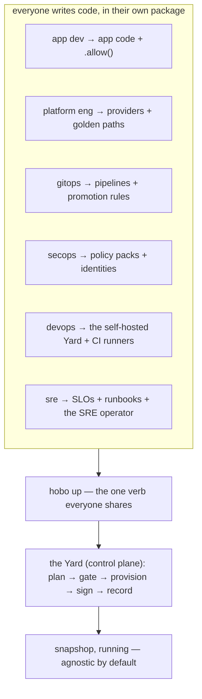

# HoBo by Role: One App, Six Workflows (Ideal-State Walkthrough)

> **What this is.** A role-organized tour of HoBo as if it were fully built. We carry **one app — `snapshop`, a photo storefront** — through the whole lifecycle, but each Part is written for the person who actually does that work: the **app developer**, the **platform engineer**, **GitOps**, **SecOps**, **DevOps**, and the **SRE**. Find your row in the table below and start there; the app is shared, the loops are yours.
>
> **Companion to [`worked-example.md`](./worked-example.md#plan-19).** That doc is the compressed narrative. This one is the role-by-role superset, authored in **Infrastructure-from-Code** mode (resources declared inline with `.allow()`, [Plan 21](./authoring-resources-wiring.md#plan-21)); it lowers to the same Manifest IR.

## The whole platform in one screen

HoBo's bet: **the only command an app developer runs is `hobo up`.** Everything else — providers, golden paths, delivery, policy, the control plane, on-call response — is **code that other roles write once**, not commands anyone types repeatedly.



### The CLI, in full

There is no sprawl to learn. Lifecycle is **one verb**; the rest is a fast inner loop and read-only inspection.

| Command | What it does |
|---|---|
| **`hobo up`** | Build + plan + provision + deploy whatever's in this dir. Subsumes deploy/promote/rollback via flags: `--camp <c>`, `--to <rev>`, `--rollback`. **This is the whole deploy story.** |
| **`hobo down`** | Tear it down. |
| `hobo dev` | Run locally on `runtime-local` (no cloud), hot-reload + replay. |
| `hobo new <name> [-t <template>]` | Scaffold an app. |
| `hobo login` | Get your SVID (OIDC); no keys pasted, ever. |
| `hobo plan` | Dry-run: the plan + cost + warnings `up` would apply. (read-only) |
| `hobo inspect` / `hobo logs` | Read projections / live streams. (read-only) |

That's it. **Crew, flags, experiments, training, deltas, providers, policy — none of these are CLI verbs.** They're SDK code you write and the dashboard/MCP you observe. If you ever find yourself wanting a `hobo <noun> <verb>`, the answer is almost always "write it in code and `hobo up`."

### Namespaces — layers don't leak

```ts
import { api, kv, bucket, queue, topic, flag, experiment, slo } from "@hobo/sdk";        // resources you declare
import { workflow, step, actor }                                  from "@hobo/runtime";  // durable execution
import { command, view, projection }                              from "@hobo/data";     // CQRS read/write model
import { emit, subscribe, saga }                                  from "@hobo/events";   // messaging + choreography
import { yard, camp, junction, defineResource }                   from "@hobo/cloud";    // control-plane / platform SDK
import { azure } from "@hobo/provider-azure";                                            // a provider adapter
import { pulumi } from "@hobo/iac-pulumi";                                               // an IaC adapter
```

### Who does what (jump to your Part)

| Part | Role | Your loop | Your files | Your command |
|---|---|---|---|---|
| **1** | **App developer** | write code → see it run | `app.ts`, `feed.ts`, `cart.ts` | `hobo dev` → `hobo up` |
| **2** | **Platform engineer** | register providers, set golden paths | `platform/yard.ts`, `platform/resources.ts` | `hobo up ./platform` |
| **3** | **GitOps** | declare delivery; git is the trigger | `delivery/pipelines.ts`, flags/experiments | `git push` (CI runs `hobo up`) |
| **4** | **SecOps** | policy + identity as code | `security/policy.ts`, `.allow()` scopes | gates enforce on every `up` |
| **5** | **DevOps** | run the control plane + CI fabric | `platform/yard.ts`, `platform/runners.ts` | `hobo up ./platform` |
| **6** | **SRE** | SLOs, runbooks, the SRE operator | `ops/slos.ts`, `ops/runbooks.ts`, `ops/crew.ts` | observe; `hobo inspect` |

---

# Part 1 — App developer: write code, `hobo up`

**Your promise:** you never pick a cloud, write a Dockerfile, touch IAM, or learn a deploy tool. You write TypeScript and run two commands.

## 1.1 — Sixty seconds to a live URL

```bash
npx hobo up
#   building component (jco) ............... ok
#   no camp set -> ephemeral managed preview (24h TTL)
#   plan ✓  provision ✓  deploy ✓
#   live: https://wandering-otter-7f3.preview.hobo.dev
```

No account, no cloud, no config — a real (ephemeral) URL. Install the toolchain when you want to stay:

```bash
curl -fsSL https://get.hobo.dev | sh     # hobo + @hobo/{sdk,runtime,cli}
hobo new snapshop -t api && cd snapshop
hobo dev                                 # localhost:4000, hot-reload, replay, local inspector
```

## 1.2 — An API, then storage, with zero infra ceremony

You declare resources **inline** and grant capabilities with `.allow()`. One `.allow()` becomes three things — an IAM policy, a WASM capability link, and the scope of any token brokered to your code — so least-privilege is the default, not a chore.

```ts
// app.ts
import { api, kv, bucket } from "@hobo/sdk";
import { z } from "zod";

const catalog = kv("catalog").allow("get", "set");        // 1 line → IAM + capability + token scope
const images  = bucket("images").allow("read", "write");
const Photo   = z.object({ id: z.string().min(1), title: z.string().min(1), bytes: z.string().optional() });

export const app = api("main");

app.post("/photos", async (ctx) => {
  const p = Photo.parse(await ctx.json());                // 400 on bad input, automatically
  if (p.bytes) await images.write(`${p.id}.jpg`, p.bytes);
  await catalog.set(p.id, { id: p.id, title: p.title });
  ctx.json({ ok: true, id: p.id });
});

app.get("/photos/:id", async (ctx) => ctx.json(await catalog.get(ctx.params.id) ?? { error: "not found" }));
```

`hobo dev` runs this against a local Postgres/object-store with hot reload; `hobo up` ships it. You never named a provider — that's Part 2's job, and it already happened.

## 1.3 — Durability without a queue to operate

Image processing shouldn't lose work on a crash. A durable `"use workflow"` orchestrates retried, memoized `step`s; a single-writer `actor` keeps a cart consistent under concurrency:

```ts
// pipeline.ts
import { workflow, step } from "@hobo/runtime";
import { bucket, kv } from "@hobo/sdk";

const images = bucket("images").allow("read", "write");
const catalog = kv("catalog").allow("get", "set");

export const processImage = workflow("processImage", async (id: string) => {
  const full  = await step("resize",    () => resize(id));
  const thumb = await step("thumbnail", () => makeThumb(full));   // memoized; never re-runs on replay
  await step("publish", async () => { await images.write(`${id}.thumb.jpg`, thumb); await catalog.set(id, { ...(await catalog.get(id)), published: true }); });
});
```

```ts
// cart.ts
import { actor } from "@hobo/runtime";       // durable execution
import { saga }  from "@hobo/events";        // choreography lives in the events namespace, not runtime

export const Cart = actor("cart", {
  state: { items: [] as string[] },
  add(s, photo: string) { s.items.push(photo); },
  items(s) { return s.items; },
});

export const checkout = saga("checkout", {
  async run(ctx, userId: string) {
    const items = await Cart.of(userId).items();
    await ctx.do("reserve", () => reserve(items), () => release(items));   // compensation on failure
    await ctx.do("charge",  () => charge(userId), () => refund(userId));
  },
});
```

`hobo inspect run --last` shows the timeline; kill and restart `hobo dev` and the run **replays to the same state**. Durability is proven before any cloud.

## 1.4 — Domain data is event-sourced (and lives in its own namespace)

The default write is a **command on an aggregate emitting an event**; the default read is a **projection-backed view**. This is the **data plane** — `@hobo/data` for CQRS, `@hobo/events` for messaging — deliberately *not* `@hobo/runtime`:

```ts
// orders.ts
import { command, view } from "@hobo/data";          // CQRS, not runtime
import { emit }          from "@hobo/events";        // messaging, not runtime

export const placeOrder = command("Order.Place", { key: (i: PlaceOrder) => i.id }, (input, ctx) => {
  if (ctx.state.status) throw new Conflict("order exists");
  ctx.emit("OrderPlaced", { id: input.id, total: input.total });
});

export async function myOrders(userId: string) {
  "use query";
  return view("orders").where({ userId, status: "placed" }).order("createdAt").paginate({ limit: 20 });
}
```

You never chose a database or a query language; a platform/data engineer maps the `orders` projection onto a backend (Part 2). You name `view("orders")`, never a table.

## 1.5 — Trainable methods: a directive, not a framework

Some functions should improve themselves from real traffic. Mark one **`"use trainable"`** — the same ergonomics as `"use workflow"`, the spirit of Microsoft Trace's decorated methods — and attach three groundings (intent, contract, rubric). The optimizer owns the body; you own the guardrails:

```ts
// feed.ts
import { z } from "zod";

/**
 * @intent   Order photos to maximize dwell WITHOUT burying brand-new sellers.
 * @contract input RankInput; output Photo[]; invariant out.length === input.candidates.length; forbidden out[0].nsfw
 * @rubric   dwellLift >= 0.80, newSellerShare >= 0.75, latencyP95 >= 0.90
 */
export async function rankFeed(input: RankInput): Promise<Photo[]> {
  "use trainable";                                              // AI-rewritable semantic function
  return [...input.candidates].sort((a, b) => b.likes - a.likes);   // your baseline / fallback
}
```

Ship it with `hobo up`. It can't improve until real traffic accrues; then the optimizer captures traces, runs candidates on a shadow lane, and a candidate is promoted **only if it clears the rubric** — gated, signed, reversible. You watch candidates and confidence intervals in the dashboard; the live app picks up the promoted version on the next `hobo up`. **No `hobo train` command exists** — it's a property of your code, not a CLI ritual.

## 1.6 — Ship

```bash
hobo up                  # to your default camp
#   plan ✓ (resolves catalog→managed KV, images→object store, picks region, prints cost)
#   provision ✓  deploy ✓   live: https://snapshop.prod.hobo.dev
```

That is the entire app-developer surface: **write code, `hobo up`.** Everything that made that one command safe and multi-cloud is the next five Parts.

---

# Part 2 — Platform engineer: register providers, pave golden paths

**Your promise:** app devs never pick infrastructure because **you** decided how each abstract resource is realized, per environment, once. You build the control plane (the Yard) and **register providers in code** — there is no `hobo registry add`; **a provider must be registered before any Camp can bind to it.**

## 2.1 — The cloud SDK: build a Yard and register providers

`@hobo/cloud` is the SDK for the control plane. Registration is a programmatic, audited, signed act — not a CLI side effect:

```ts
// platform/yard.ts — your self-hosted control plane.
import { yard, camp } from "@hobo/cloud";
import { azure } from "@hobo/provider-azure";
import { cloudflare } from "@hobo/provider-cloudflare";
import { pulumi } from "@hobo/iac-pulumi";
import { postgresRuntime } from "@hobo/runtime-postgres";

export default yard("acme", {
  identity:  { trustDomain: "acme.yard" },       // issues every SVID (workloads, agents, CI)
  iac:       pulumi(),                            // IaC port; OpenTofu/Crossplane/CDKTF are drop-ins
  executors: { isolation: "firecracker" },        // sandboxed appliers/builders
})
  // ── register providers BEFORE any Camp can use them. This is the step that does not exist in the CLI. ──
  .register(azure({
    subscription: process.env.AZ_SUB,
    oidc: { federate: "acme.yard" },             // keyless: the Yard's OIDC is trusted by Azure; no secrets stored
  }))
  .register(cloudflare({ accountId: process.env.CF_ACCT, oidc: { federate: "acme.yard" } }))
  .setup(
    camp("prod-azure",   { provider: "azure",      runtime: postgresRuntime() }),
    camp("staging-cf",   { provider: "cloudflare", runtime: postgresRuntime() }),
  );
```

```bash
hobo up ./platform       # brings the Yard up; registered providers are now bindable by Camps
```

`.register(provider)` reads the provider's **Capability Manifest** (`/.well-known/capability-manifest/` — ports, regions, and an `auth.json` that declares keyless OIDC federation, [Plan 6](./ai-native-agent-auth.md#plan-06)), verifies its signature, and records `provider.Registered`. From this point, an app dev writing `camp("prod-azure", { provider: "azure" })` works **because you registered Azure** — they never see the wiring.

> **A provider that doesn't exist yet?** Generate one, then register it the same way:
> ```ts
> import { generateProvider } from "@hobo/cloud";
> const nicheEu = await generateProvider("https://niche-eu-cloud.example.com/docs"); // scaffold→LLM-fill→sandbox-conformance→sign
> yard("acme", { /* … */ }).register(nicheEu);                                       // a signed plugin, registered in code
> ```
> Air-gapped? `registry.import(signedBundle)` mirrors a signed offline bundle in-boundary — same trust checks, zero egress ([Plan 25](./platform-engineering.md#plan-25)).

## 2.2 — Camps, Yards, Junctions — the real shapes

App devs see thin Camps; you see the full mapping API. A Camp maps one Bindle onto one provider, with three levels of control (resolution order: `bindings` → `tiers` → `defaultProvider`, [Plan 2](./sdk-api.md#plan-02)):

```ts
// platform/camps.ts
import { camp } from "@hobo/cloud";
import { azure } from "@hobo/provider-azure";
import { aws } from "@hobo/provider-aws";
import { cloudflare } from "@hobo/provider-cloudflare";
import { postgresRuntime } from "@hobo/runtime-postgres";

export const prodAzure = camp("prod-azure", {
  runtime: postgresRuntime({ url: process.env.DATABASE_URL }),
  defaultProvider: azure({ region: "eastus" }),          // (a) whole-app: "host it on Azure, figure it out"
  tiers:    { edge: cloudflare.workers() },              // (b) per-tier: storefront on the edge
  bindings: { "snapshop.db": azure.cosmos({ consistency: "session" }) },   // (c) per-boundary pin
});
```

A **Yard** groups Camps under one provider and runs the control plane; a **Junction** federates Yards across clouds as peers (no shared state):

```ts
// platform/topology.ts
import { yard, junction } from "@hobo/cloud";
import { prodAzure, stagingCf } from "./camps";
import euYard from "./yard-eu";                          // a second self-hosted Yard, EU residency

export const azureYard = yard("acme-azure").setup(prodAzure, stagingCf);
export default junction("acme").add(azureYard, euYard); // federate trust + signed policy + registry; no shared state
```

`hobo up ./platform` realizes whatever this graph contains — one Camp, a multi-Camp Yard, or a cross-cloud Junction — with the same verb.

## 2.3 — Golden paths: Resource Definitions + Matching

This is the heart of platform DX: app devs say *what* (`a database`), you say *how*, **differently per environment**, once. The same app gets managed-HA Postgres in prod and a cheap container in preview — with no app edit, and an audit of every choice:

```ts
// platform/resources.ts
import { defineResource } from "@hobo/cloud";
import { aws } from "@hobo/provider-aws";

defineResource({ type: "database", engine: "postgres", class: "ha",
  provider: aws, iac: "pulumi", with: aws.rds({ multiAz: true }),
  match: { envType: "production" } });                    // prod → managed HA

defineResource({ type: "database", engine: "postgres",
  with: { container: "postgres:16" },
  match: { envType: "ephemeral" } });                     // preview → cheap in-cluster
```

```bash
hobo plan --camp preview
#   match.Decided  database → postgres(container)  [envType=ephemeral wins; HA rejected: env mismatch]
```

Matching is **deterministic and recorded** (`match.Decided` with score + rejected candidates, [Plan 25](./platform-engineering.md#plan-25)), so "why did preview get the cheap DB?" is always answerable. Bundle definitions + policy + dashboards into signed **Resource Packs** to ship a whole golden path to other teams.

---

# Part 3 — GitOps: git is the trigger, `hobo up` is the engine

**Your promise:** every change to production is a git commit that flows through one gated path. You don't click deploy; you merge, and CI runs the same `hobo up` a developer runs locally.

## 3.1 — CI is not a new tool — it's `hobo up` with an OIDC token

```yaml
# .github/workflows/hobo.yml — same verbs as local; keyless via OIDC, zero stored secrets.
name: hobo
on: [pull_request, push]
permissions: { id-token: write, contents: read }     # OIDC → the Yard's token broker
jobs:
  gate:
    runs-on: ubuntu-latest
    steps:
      - uses: actions/checkout@v4
      - run: npx hobo plan --camp staging   # PR: post the plan + cost (read-only)
  ship:
    if: github.ref == 'refs/heads/main'
    needs: gate
    runs-on: ubuntu-latest
    steps:
      - run: npx hobo up --camp staging     # merge to main → staging
```

The deploy gate (contracts, policy, evals, conformance, cost, signed artifact, golden suite) runs **inside `hobo up`** — there's no separate verify step to forget. A skew or policy violation blocks the `up` with a precise, machine-readable reason.

## 3.2 — Promotion is moving a pointer

There is no `promote` verb. Promoting staging → prod is bringing prod up to a known-good revision:

```yaml
  promote:
    if: github.ref == 'refs/heads/main'
    needs: ship
    runs-on: ubuntu-latest
    steps:
      - run: npx hobo up --camp prod --to ${{ github.sha }}   # same artifact, gated again for prod
```

If prod consumers can't take the new event shape, the `up` blocks (`can-deploy` runs inside it) and tells you the fix (dual-publish window / deploy-order / shim). The same `--to <rev>` is your rollback (`--rollback` for last-good).

## 3.3 — Progressive delivery is declared, not commanded

Flags, canaries, and experiments are **the Harness** — three legs you write as code, never CLI verbs. A canary is *delivery*; a flag toggles *behavior*; an experiment *measures*:

```ts
// delivery/checkout.ts
import { flag, experiment } from "@hobo/sdk";
import { checkoutTwoStep, checkoutOneClick } from "../src/checkout";

export const variant = flag.string("checkout-variant", {           // OpenFeature-typed
  default: "control",
  targeting: { split: { control: 0.5, oneClick: 0.5 }, stickyBy: "viewerId" },
});

export const checkout1click = experiment("checkout-1click", {
  assignBy: variant,
  expose: { metric: "conversion", guardrail: "refund-rate", attribute: { on: "order.Completed", joinKey: "viewerId", window: "7d" } },
  analyze: "bayesian",
});

export const handler = (ctx) =>
  (ctx.flags.eval(variant) === "oneClick" ? checkoutOneClick : checkoutTwoStep)(ctx);
```

```ts
// delivery/rollout.ts — canary policy as code; auto-rollback on SLO burn.
import { rollout } from "@hobo/sdk";
export const apiRollout = rollout("api", { strategy: "canary", steps: ["10%", "50%", "100%"], rollbackOn: "slo:checkout.latency" });
```

You `hobo up` this like anything else. Results, exposures, and winners show up in the dashboard and via MCP; the winning variant promotes through the **same gate** as a deploy and the app adopts it on the next `up`. Every flip is a `flag.Changed` event — a full "who flipped what, when, for whom" audit standalone flag tools lack.

---

# Part 4 — SecOps: trust as code, secrets never typed

**Your promise:** identity, least-privilege, and policy are **code that gates every deploy and every runtime call** — and there are no static secrets anywhere to leak.

## 4.1 — Identity is issued, never configured

Every workload, CI job, and AI agent is a **named SVID principal** issued by the Yard's Identity service (`spiffe://acme.yard/<tenant>/<name>`). Provider access is **brokered**: an SVID is exchanged for a short-lived, resource-scoped provider token via OIDC federation (the `auth.json` you saw in Part 2). Nobody pastes a cloud key — `token.Granted → Used → Revoked` is the audit trail.

## 4.2 — `.allow()` is the least-privilege surface

The app dev's `bucket("images").allow("read","write")` is also *your* control point: it's the **only** capability that resource gets, enforced three ways (IAM, WASM capability link, token scope), deny-by-default. A handler that wasn't granted `delete` cannot delete — at the policy layer, the capability layer, and the IAM layer simultaneously.

## 4.3 — Policy packs gate the whole lifecycle

Policy is typed code (no Rego to learn; OPA/Cedar are optional engines). Rules carry **effects** (`allow`/`deny`/`warn`/`mutate`/`require-approval`) and **obligations** ("allowed, but you must…"), and they fire across phases — author, plan, apply, runtime, promote:

```ts
// security/policy.ts
import { policyPack, rule } from "@hobo/cloud";

export default policyPack("acme-baseline", { mandatory: true }, [          // mandatory = a deny-ceiling
  rule("prod-deletes-need-approval", { phase: "apply", when: { env: "production", action: "resource.delete" }, effect: "require-approval" }),
  rule("public-endpoints-need-auth", { phase: "plan",  when: { exposes: "public" }, effect: "mutate", add: "auth-middleware" }),
  rule("eu-data-stays-in-eu",        { phase: "apply", when: { dataClass: "pii", region: "!eu" }, effect: "deny" }),
  rule("model-change-needs-shadow",  { phase: "promote", when: { kind: "trainable" }, effect: "require-approval", obligation: "shadow-eval" }),
]);
```

`hobo up ./platform` distributes the pack; a **mandatory** rule is a deny-ceiling a lower scope can only tighten, never widen (the AWS-SCP property). Built-in RBAC roles (Org-Admin, Security-Admin, Platform-Engineer, Deployer, Operator-Supervisor, Auditor) bind via SSO/SCIM, with separation-of-duties (the author of a policy can't approve it; the opener of a prod Delta isn't its promoter). Every decision is a replayable `policy.Decided` event, OCSF-exported.

## 4.4 — Secrets and supply chain

Secrets are **brokered references**, never values in env or files; the secret broker exposes `read-metadata`/`rotate`, never a grantable "read the value." Every artifact (provider plugin, build, deploy) is **signed + attested** (SLSA provenance), and a generated provider is only as trusted as the conformance suite it passed — the signed report is part of its Registry record.

---

# Part 5 — DevOps: run the control plane and the CI fabric

**Your promise:** "self-host = hosted." The same Yard SDK that backs the managed offering is what you run, on your own infra, with an honest bootstrap and no laptop-magic.

## 5.1 — Bootstrap the Yard (the chicken-and-egg, told honestly)

The Yard is itself a HoBo Bindle (dogfood). Standing it up is two phases — a disposable seed brings up the real thing, then retires:

```bash
hobo up ./platform --seed          # phase 1: a disposable LOCAL seed Yard (sqlite). NOT "your cloud" yet.
hobo up ./platform --camp host-azure
#   phase 2: the seed self-deploys @hobo/cloud to real infra
#   provisioning Planner · Orchestrator · Identity(SVID issuer) · Registry · Executors(Firecracker) · EventStore
#   Firecracker runs on HOST VMs, not your laptop
#   seed used YOUR `hobo login` SVID once (audited: identity.SeedTokenUsed)
#   HANDOVER: real Identity becomes sole broker → seed credential retired → seed discarded
#   self-hosted Yard live: https://yard.acme.internal
```

The `platform/yard.ts` from Part 2 *is* the input — identity, IaC, executors, registered providers, Camps. Air-gapped installs run the whole control plane in-boundary with zero egress (signed offline bundles in, internal CA, in-boundary KMS + models).

## 5.2 — The CI fabric: cost-routed runners

Where CI runs is itself a registered, cost-routed decision — burn free credits first, keep private builds in-boundary:

```ts
// platform/runners.ts
import { dispatcher, runner } from "@hobo/cloud";
export default dispatcher({ objective: "min-cost" }, [
  runner.selfHosted({ behind: "relay" }),       // your Executors, reachable via the outbound Relay (no inbound ports)
  runner.github(), runner.depot(), runner.blacksmith(),
]);
```

`hobo up ./platform` registers them; the Dispatcher picks per job and records `dispatch.Decided`. CI is the same `hobo up` gate, dispatched cost-aware — not a bespoke pipeline tool.

## 5.3 — Fleet visibility

Everything DevOps needs is a **projection over the event log** — the dashboard's fleet view (project × environment), or `hobo inspect`/`hobo logs` for scripting. No view has privileged state, so it can never disagree with the audit log. There's no `hobo fleet` verb; there's a dashboard and `inspect`.

---

# Part 6 — SRE: SLOs, runbooks, and an AI on-call that's governed

**Your promise:** reliability is code and the event log. You declare objectives and responses; an autonomous SRE operator diagnoses and proposes fixes; every action is gated and replayable.

## 6.1 — SLOs and observability as code

```ts
// ops/slos.ts
import { slo } from "@hobo/sdk";
export const checkoutLatency = slo("checkout.latency", { objective: "p95 < 250ms", window: "30d", burnAlert: "2x" });
export const photosAvail     = slo("photos.availability", { objective: "99.9%", window: "30d" });
```

You **read** reliability — burn rate, incidents, drift, cost, the "march of the 9s" availability estimate — in the dashboard or via `hobo inspect`; you never operate a metrics stack. SLO burn is also a *policy input*: a burning budget can freeze risky deploys via a `can-deploy` dimension.

## 6.2 — Runbooks as code

A runbook is a trigger → diagnosis (read-only MCP queries) → gated, blast-radius-bounded fixes. Versioned and signed like a Resource Pack:

```ts
// ops/runbooks.ts
import { runbook } from "@hobo/cloud";
export default runbook("high-5xx-on-api", {
  on: { alert: "api.5xx-burst", severity: ">=SEV2" },
  diagnose: ["logs api", "drift api", "slo checkout.latency"],
  fix: [
    { when: "provider-degraded", do: "failover", camp: "staging-cf", gate: "auto" },     // low-risk, reversible
    { when: "capacity-exhausted", do: "scale", to: { min: 6 },        gate: "auto" },
    { when: "unknown",            do: "escalate", to: "on-call" },                         // page a human
  ],
});
```

## 6.3 — The SRE operator: autonomous, but on a leash

The Crew is **code**, not a `hobo crew` command. Each operator is an `agent()` that's part of your control-plane program — a named SVID principal with a scoped policy, event-sourced, MCP-surfaced, **read/diagnose autonomous, every write gated**:

```ts
// ops/crew.ts
import { agent } from "@hobo/cloud";
export const sre = agent("sre", {
  model: "anthropic/claude-haiku-4.5",
  instructions: "Diagnose from projections; classify; auto-fix only if low-risk, reversible, in-budget.",
  policy: { destroy: "require-approval", spendCapUsd: 50 },        // the documented core; reads are free
  runbooks: ["high-5xx-on-api"],
});
```

`hobo up ./platform` commissions it. When `checkout.latency` burns, it opens one correlated Incident, classifies (`provider-degraded`), and — for a **prod** write — **proposes** a canary failover that waits for your approval in the dashboard/MCP; a low-risk reversible fix it applies as an auto-rolling-back canary. A SEV it can't classify **escalates** to on-call with a deadline. The incident's event stream *is* its blameless postmortem, and a failed remediation becomes a permanent regression test. You direct a governed crew; you don't hand prod to a bot.

---

# The payoff: one app, six clean loops

snapshop is provider-agnostic application code that **never changed** as it moved laptop → Azure → Cloudflare → a self-hosted, federated, multi-cloud platform. What changed was the code each role owns, in its own package, applied with the one verb everyone shares.

| Role | Reads | Writes | Runs | Never touches |
|---|---|---|---|---|
| **App developer** | `hobo inspect` | `app.ts`, `feed.ts` (`"use trainable"`), `cart.ts` | `hobo dev`, `hobo up` | clouds, IAM, YAML, deploy tools |
| **Platform engineer** | `match.Decided` | `platform/yard.ts` (`.register`), `resources.ts` (golden paths) | `hobo up ./platform` | app business logic |
| **GitOps** | plan + cost on PRs | `delivery/pipelines.ts`, flags/experiments | `git push` → CI `hobo up` | manual deploys |
| **SecOps** | `policy.Decided` (OCSF) | `security/policy.ts`, `.allow()` scopes | gates on every `up` | static secrets |
| **DevOps** | fleet projections | `platform/yard.ts`, `runners.ts` | `hobo up ./platform --seed` | laptop-as-control-plane |
| **SRE** | SLO/incident projections | `ops/slos.ts`, `runbooks.ts`, `crew.ts` | observe; approve gated fixes | a metrics stack to babysit |

**Agnostic by default, optimizable on demand, AI-native throughout, fully auditable — and every role's primary loop is one command or one commit.**

### Where to go next

- The compressed end-to-end: [`worked-example.md`](./worked-example.md#plan-19).
- SDK layers & topology: [`sdk-api.md`](./sdk-api.md#plan-02). Authoring & `.allow()`: [`authoring-resources-wiring.md`](./authoring-resources-wiring.md#plan-21).
- Control plane, providers, IaC: [`control-plane.md`](./control-plane.md#plan-04). Platform engineering & Matching: [`platform-engineering.md`](./platform-engineering.md#plan-25).
- Contracts, policy & the Harness: [`contracts-policy-flags.md`](./contracts-policy-flags.md#plan-29). The Crew & SRE: [`operators-sre.md`](./operators-sre.md#plan-40).
- Identity, agents & end-user auth: [`ai-native-agent-auth.md`](./ai-native-agent-auth.md#plan-06).
