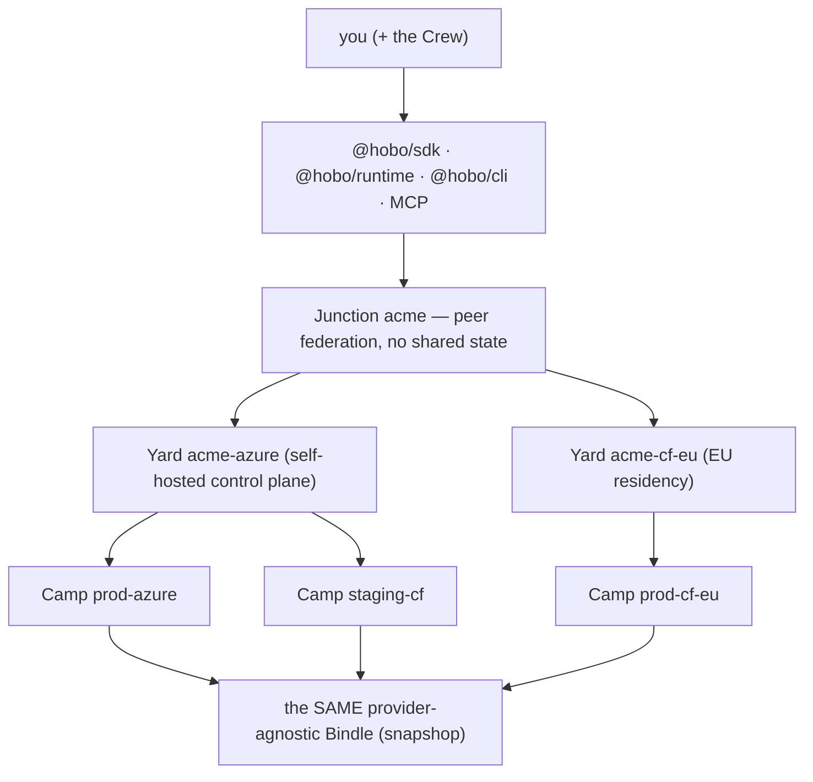
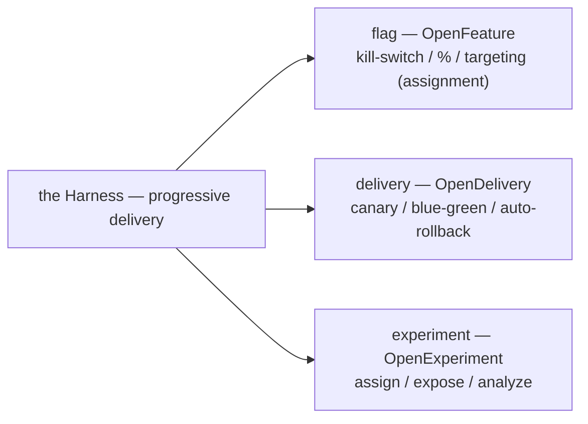
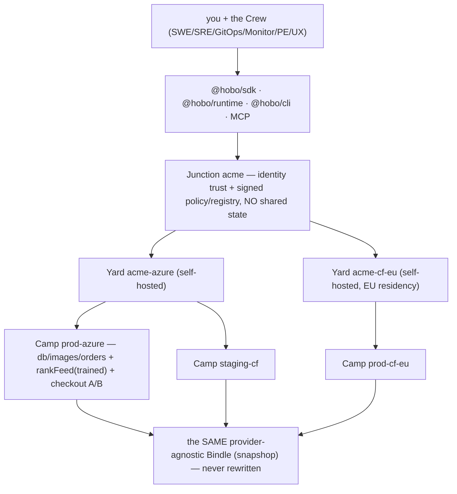

# End-to-End Walkthrough: Building snapshop (Ideal State)

> **What this is.** A single, top-to-bottom journey through HoBo as if it were fully built. You build one app — **snapshop**, a photo storefront — and carry it from `npx hobo up` on a laptop to a multi-cloud, A/B-tested, self-optimizing system run by a governed crew of AI operators. Every step shows the **script you run** and the **code you write**.
>
> **Relationship to [`worked-example.md`](./worked-example.md#plan-19).** That doc is the canonical, compressed narrative seed. This one is its **instructional superset**: same app, slower pace, every feature exercised. It is authored in the **Infrastructure-from-Code (IfC) default mode** — resources declared inline with `.allow()` ([Plan 21](./authoring-resources-wiring.md#plan-21)) — where `worked-example.md` uses the advanced `bindle()`/`camp()` mode. **Both lower to the same Manifest IR**, so nothing here contradicts it.
>
> **Reading the code.** Lines marked **⟂** use *ideal-state syntax not yet pinned by an ADR* (HoBo Code's concrete grammar, multivariate `flag()`, the `experiment()` object literal, and a few convenience subcommands). They lower to documented concepts; treat them as "this is the DX we're designing toward." Everything unmarked traces to a design doc.
>
> **One CLI note up front.** This doc uses the consolidated two-verb surface from [Plan 7](./developer-experience.md#plan-07): **`hobo up`** brings a topology up (it subsumes deploy / promote / rollback / yard-bootstrap) and **`hobo down`** tears it down. You will see `hobo deploy` and `hobo yard up` in `worked-example.md`, `README.md`, and the ADRs — those are the pre-consolidation spelling of `hobo up`.

---

## The one idea, reused everywhere

HoBo has many primitives but **one rhythm**, and every section below is a re-skin of it:

> **declare intent → measure against a rubric → gate the promotion → sign provenance → keep a rollback token.**

A deploy, a trainable function, and an A/B experiment are the *same shape*: you say what you want, HoBo measures it against the running world, a gate decides, the result is signed, and there is always a way back. Learn it once in §7 and the back half of the doc costs almost nothing.

### How to read this walkthrough

- **Just-in-time:** no primitive appears before the growing app makes you want it. The pain precedes the feature.
- **One carried artifact:** every snippet edits the *same* files. The provider-agnostic part of the app is **never rewritten** as it moves laptop → Azure → Cloudflare. That invariance is HoBo's whole thesis.
- **The brakes are the point:** every autonomous action is shown both *working* and *being refused* — a canary that aborts, a gate that blocks, a Delta a human rejects, a training candidate that loses on its confidence interval. Believability comes from the gate saying no.
- **Same surface for humans and agents:** every command here has an MCP tool ([Plan 6](./ai-native-agent-auth.md#plan-06)); an agent does exactly what you do, with the same identity, tokens, events, and gates.

### Two acts

| | Act I — **You are a developer** | Act II — **You run the platform** |
|---|---|---|
| Where | a HoBo-managed Yard | your own **self-hosted** Yard |
| You do | build, deploy, monitor, optimize, A/B test | self-host, wire CI, commission the Crew, federate clouds |
| Sections | §1–§13 | §14–§18 |

The promotion from "solo dev" to "platform owner" is **earned by a real event** (a teammate is hired; EU customers force data-residency; traffic outgrows the managed preview), announced at the Act break, not by a section header.

### §0 — The diagram you'll have earned

By the finale, snapshop looks like this. Skim it now; we re-show it fully annotated at the end.



And the journey on one screen — each line is a section you're about to live:

```bash
npx hobo up                       # §1  a live URL, no account            (Act I)
hobo new snapshop -t api          # §2  the app, running locally
hobo up --camp prod-azure         # §7  snapshop on a real cloud
hobo up --camp staging-cf         # §11 the SAME bindle, a second cloud
flag() + experiment()             # §12-13 A/B + experiments that grade themselves
hobo up ./yard --camp host-azure  # §14 your own self-hosted control plane (Act II)
hobo crew apply                   # §16 a governed crew of AI operators
hobo up ./junction                # §18 many clouds, one trust fabric
```

---

# Act I — You are a developer

## §1 — Sixty seconds to a live URL — *installing HoBo*

The most honest wow HoBo has: an **anonymous deploy** with no login, no cloud account, no config. From any directory:

```bash
npx hobo up
#   building component (jco) ............... ok
#   no --camp given -> ephemeral managed preview Camp (runtime-postgres, 24h TTL)
#   DeployRequested -> Planned -> Provisioning -> Provisioned -> Deployed
#   live (expires in 24h): https://wandering-otter-7f3.preview.hobo.dev
curl -s https://wandering-otter-7f3.preview.hobo.dev/health     # {"ok":true}
```

That URL is a *real* managed preview, not localhost — truthfully ephemeral, owned by nobody yet (`hobo claim` later binds it to an account, preserving its state and URL, [Plan 7](./developer-experience.md#plan-07)). Liked it? Install the toolchain for real work:

```bash
curl -fsSL https://get.hobo.dev | sh     # installs hobo + @hobo/{sdk,runtime,cli}
hobo doctor
#   hobo 1.0    node 22.x                         ok
#   wasm toolchain (jco / @hobo/componentize)     ok
#   runtime-local (sqlite)                        ok
#   identity: anonymous  (run 'hobo login' when you want a durable account)
```

The entire app behind that first URL is one file, running on `@hobo/runtime-local`:

```ts
// app.ts
import { api } from "@hobo/sdk";

export const app = api("main");
app.get("/health", (ctx) => ctx.json({ ok: true }));
```

> Login is deliberately deferred until §7, where you first want durability on a real cloud. The agnostic, no-account path *is* the default path ([Plan 7 DX principles](./developer-experience.md#plan-07)).

## §2 — The empty dir that already runs — *writing an app in TypeScript*

Scaffold the real project and feel the inner loop:

```bash
hobo new snapshop -t api && cd snapshop     # writes bindle.ts, app.ts, hobo.toml
hobo dev
#   runtime-local (sqlite)   hot-reload on
#   http://localhost:4000    inspector http://localhost:4000/_inspect
curl -s localhost:4000/photos -d '{"id":"p1","title":"sunrise"}'
#   {"ok":true,"id":"p1"}   (in-memory for now — we make it durable in §4)
```

snapshop starts as a single route over an in-memory `Map` — **deliberately fragile**, so the durability pain two sections from now is something you *feel*, not something we assert:

```ts
// app.ts — snapshop, v0. Dies on restart, on purpose.
import { api } from "@hobo/sdk";

const mem = new Map<string, unknown>();          // fragile: gone when the process bounces
export const app = api("main");

app.post("/photos", async (ctx) => {
  const { id, title } = await ctx.json();
  mem.set(id, { id, title, createdAt: Date.now() });
  ctx.json({ ok: true, id });
});
```

`hobo dev` hot-reloads handlers, persists run events to `.hobo/` so runs survive restarts, and serves a local inspector (browse kv/sql/buckets, replay runs) — the Nitric-style local dashboard from [Plan 7](./developer-experience.md#plan-07). Codegen runs *in* the watch loop, so editor types stay live with no build step.

## §3 — Routes, validation, and who's calling — *writing an API*

Grow the single route into a typed HTTP surface with validation. The API is `wasi:http` behind the scenes ([Plan 21](./authoring-resources-wiring.md#plan-21)); you just attach handlers:

```ts
// app.ts — typed endpoints; still zero infrastructure.
import { api } from "@hobo/sdk";
import { z } from "zod";

const Photo = z.object({ id: z.string().min(1), title: z.string().min(1) });
const mem = new Map<string, z.infer<typeof Photo>>();

export const app = api("main");

app.post("/photos", async (ctx) => {
  const p = Photo.parse(await ctx.json());        // 400 on failure, automatically
  mem.set(p.id, p);
  ctx.json({ ok: true, id: p.id });
});

app.get("/photos/:id", (ctx) => {
  const p = mem.get(ctx.params.id);
  ctx.json(p ?? { error: "not found" }, p ? 200 : 404);
});
```

```bash
hobo dev
curl -s localhost:4000/photos/p1                 # {"id":"p1","title":"sunrise"}
curl -s localhost:4000/photos -d '{"title":""}'  # 400 {"error":"id required, title non-empty"}
hobo inspect run --watch                          # live request/handler timeline in the terminal
```

**Who's calling?** Carts and per-user feeds will need identity, so meet `ctx.user` now. In `hobo dev`, the `auth` port is satisfied by a **contract-asserted dev principal** — a fixture matching the auth contract, *no real IdP* ([dev auth bypass](./contracts-policy-flags.md#plan-29), [Plan 6 §end-user](./ai-native-agent-auth.md#plan-06)). The *same* `auth` contract is enforced at `hobo can-deploy`, so dev and prod can't drift:

```ts
app.get("/me/photos", async (ctx) => {
  const userId = ctx.user.id;                     // dev: a fixture; prod: a real OIDC subject
  ctx.json({ userId, photos: [] });
});
```

```bash
hobo dev --as alice                               # override the dev principal's claims per session
curl -s localhost:4000/me/photos                  # {"userId":"alice","photos":[]}
```

## §4 — It needs to remember things — *Infrastructure-from-Code*

Replace the fragile `Map` with **inline resources**. You don't write YAML or call a cloud — you declare a `kv` and a `bucket` and grant capabilities with `.allow()`. HoBo **collects** the resources by *running* the component:

```ts
// app.ts — resources declared inline, unconditionally, at module scope.
import { api, kv, bucket } from "@hobo/sdk";
import { z } from "zod";

const catalog = kv("catalog").allow("get", "set");        // 1 line -> IAM + WASM cap + token scope
const images  = bucket("images").allow("read", "write");
const Photo = z.object({ id: z.string().min(1), title: z.string().min(1), bytes: z.string().optional() });

export const app = api("main");

app.post("/photos", async (ctx) => {
  const p = Photo.parse(await ctx.json());
  if (p.bytes) await images.write(`${p.id}.jpg`, p.bytes);    // bucket cap: write
  await catalog.set(p.id, { id: p.id, title: p.title });      // kv cap: set
  ctx.json({ ok: true, id: p.id });
});
```

One `.allow(...)` drives **three effects at once** ([Plan 21](./authoring-resources-wiring.md#plan-21)): the IAM policy on the real resource, the WASM capability link (`wasi:keyvalue`, `wasi:blobstore`), and the scope an agent's brokered token will carry — least-privilege by construction.

```bash
hobo plan
#   collecting resources (executing component)...
#   + kv      catalog   caps[get,set]     -> runtime-local (sqlite)
#   + bucket  images    caps[read,write]  -> runtime-local (fs)
#   each .allow() wired 3 ways: IAM policy | WASM cap link | agent-token scope (deny-by-default)
#
#   WARNING  bucket("thumbs") is declared inside an 'if (FEATURE_THUMBS)' branch and was NOT
#            reached during collection. Declare resources unconditionally, or gate with
#            kv(...).when(flag).⟂  See: hide-behind-conditional.
hobo dev
curl -s localhost:4000/photos -d '{"id":"p1","title":"sunrise"}'
hobo dev:restart && curl -s localhost:4000/photos/p1   # survives the bounce. it is real now.
```

> **The IfC seam, shown honestly.** "Infrastructure falls out of code" is a real mechanism with a real edge: because resources are collected by *execution*, one hidden behind a conditional won't be seen. `hobo plan` warns, and `.when(flag)`**⟂** is the escape hatch for genuinely conditional resources. (Static analysis supplements run-to-collect, [ADR-0069](./adr/01-architecture-core.md#adr-0069).)

## §5 — Don't lose the upload — *durable workflows*

Image processing can crash mid-way. Make it crash-proof with a durable `"use workflow"` orchestrating retried, **memoized** `step()`s ([Plan 2](./sdk-api.md#plan-02)):

```ts
// pipeline.ts — a durable workflow survives crashes; steps are retried + memoized.
import { step } from "@hobo/runtime";
import { bucket, kv } from "@hobo/sdk";

const images  = bucket("images").allow("read", "write");
const catalog = kv("catalog").allow("get", "set");

export async function processImage(id: string) {
  "use workflow";                                              // deterministic + replayable
  const full  = await step("resize",    () => resize(id));
  const thumb = await step("thumbnail", () => makeThumb(full));  // memoized: never re-runs on replay
  await step("publish", async () => {
    await images.write(`${id}.thumb.jpg`, thumb);
    await catalog.set(id, { ...(await catalog.get(id)), published: true });
  });
}
```

```bash
hobo dev
curl -s localhost:4000/photos -d '{"id":"p2","title":"dunes","bytes":"<...>"}'
hobo inspect run --last
#   workflow processImage(p2)
#     step resize      ok (142ms)
#     step thumbnail   retry 1 -> ok (210ms)   <- crashed mid-run; replayed from memoized resize
#     step publish     ok (38ms)
#   workflow Completed  (deterministic replay verified)
```

Kill `hobo dev` mid-run and restart it: the workflow **replays to the same state** from `.hobo/`. Durability is proven before any cloud exists.

## §6 — One cart, always consistent — *actors & sagas*

Two requests hitting one user's cart is a race; a checkout that charges but fails to ship is a money bug. HoBo's answer is a durable single-writer **grain** (`actor()`) and a **choreography saga** with compensation ([Plan 2](./sdk-api.md#plan-02)):

```ts
// cart.ts — a grain is a durable, single-writer actor: no races on one user's cart.
import { actor, saga } from "@hobo/runtime";
import { queue } from "@hobo/sdk";

const orders = queue("orders").allow("enqueue");

export const Cart = actor("cart", {
  state: { items: [] as string[] },
  add(s, photo: string) { s.items.push(photo); },
  items(s) { return s.items; },
});

export const checkout = saga("checkout", {
  async run(ctx, userId: string) {
    const items = await Cart.of(userId).items();
    await ctx.do("reserveInventory", () => reserve(items),  () => release(items)); // + compensation
    await ctx.do("chargePayment",    () => charge(userId), () => refund(userId));
    await orders.enqueue({ userId, items });
  },
});
```

```bash
hobo dev
curl -s localhost:4000/cart/u1/add -d '{"photo":"p1"}'   # serialized through the Cart grain
curl -s localhost:4000/checkout/u1 -X POST
hobo inspect run --last
#   saga checkout(u1)
#     reserveInventory   ok
#     chargePayment      FAILED (card declined)
#     -> compensate releaseInventory  ok
#   saga Compensated  (no partial state left behind)
```

The declined card is the point: the saga's **compensation actually fires** and leaves no partial state. Partial-failure safety is demonstrated, not asserted.

## §6.5 — How orders are *really* stored — *the event-sourced data plane*

The `catalog.set(...)` calls above are the **escape-hatch** form of writing data ([Plan 32](./data-plane.md#plan-32)). The default, and what the rest of the platform assumes, is **event-sourced**: a command runs inside an aggregate and emits an event; reads come from **projections** a data architect maps onto any backend. You write domain logic; you never name a table:

```ts
// orders.ts — WRITE: a command runs inside the Order aggregate (an actor; ADR-0053).
import { command, view } from "@hobo/runtime";

export const placeOrder = command("Order.Place", { key: (i: PlaceOrder) => i.id }, (input, ctx) => {
  if (ctx.state.status) throw new Conflict("order exists");   // invariant vs the write-model fold
  ctx.emit("OrderPlaced", { id: input.id, total: input.total });
});

// READ: a reactive, projection-backed view — no table, no SQL, backend-neutral by logical name.
export async function myOrders(userId: string) {
  "use query";
  return view("orders").where({ userId, status: "placed" }).order("createdAt").paginate({ limit: 20 });
}
```

This matters in two sections: **monitoring** (§8) is "everything is a projection," and **promotion** (§11) can refuse a deploy whose new event shape would break a consumer. The `orders` projection's sink (relational in prod, log-backed in preview) is chosen by a platform engineer exactly like a Resource Definition (§16), recorded in a `match.Decided` event.

## §7 — Now it needs a home — *cloud providers, Camps, and the rhythm*

snapshop should outlive the preview. Time to log in, add a real provider, and ship. This is where the **declare → measure → gate → sign → rollback** rhythm first appears in full.

```bash
hobo login                                  # now you want durability: mints your operator SVID (OIDC)
hobo registry add azure                     # crawls /.well-known/capability-manifest, verifies signature
#   azure  signed  ports: database objectStore compute queue   auth-flows: oidc-federation
hobo registry search database --provider azure
#   azure:postgres-flexible (managed, ha, vector)   azure:cosmos (session/strong)
```

A **Camp** is the provider-specific target — canonical id `<env>-<provider>` ([ADR-0026](./adr/01-architecture-core.md#adr-0026)). It maps the agnostic Bindle onto one provider and supplies the durable Runtime. **This is the only new file; `app.ts`, `pipeline.ts`, `cart.ts` are untouched:**

```ts
// camps/prod-azure.ts — the Bindle is agnostic; the Camp is the provider-specific target.
import { camp } from "@hobo/sdk";
import { azure } from "@hobo/provider-azure";

export default camp("prod-azure", {           // canonical id: <env>-<provider>
  provider: azure({ region: "eastus" }),
  // runtime omitted -> the Camp supplies the durable Runtime (runtime-postgres on azure)
});
```

```bash
hobo plan   --camp prod-azure   # resolves catalog->Cosmos(KV) images->Blob orders->ServiceBus; prints COST
hobo up     --camp prod-azure   # provision-then-deploy, one convergence
#   DeployRequested -> Planned -> Provisioning -> Provisioned -> Deployed
#   live: https://snapshop.prod-azure.hobo.dev
#   credential: SVID -> OIDC -> Azure STS, TTL 1h, brokered per-Executor — NO static secret anywhere
```

Under the hood ([Plan 4](./control-plane.md#plan-04)): the Gateway emits `deployment.Requested`, the Planner emits `Planned`, ResourceActors provision in DAG order via the Pulumi Automation API inside Firecracker Executors holding short-lived tokens **brokered from your SVID** — the *sign + audit* leg of the rhythm. Every step is an event; `hobo up --to <rev>` / `--rollback` is the *keep-a-rollback* leg.

> **A provider that doesn't exist yet?** Point HoBo at its docs and it generates one. `hobo generate https://niche-eu-cloud.example.com/docs` runs the generation pipeline (scaffold → LLM-fill → sandbox-validate against `@hobo/conformance` → repair → certify + sign) and publishes a signed plugin to the Registry ([Plan 6](./ai-native-agent-auth.md#plan-06)/[Plan 23](./generated-stack.md#plan-23)). The Capability Manifest at `/.well-known/capability-manifest/` (`capabilities.json`, `auth.json`, `cost.json`, `signs.md`, signature) is the standard that makes both `registry add` and `generate` possible with zero developer effort.

## §8 — Is it healthy? — *monitoring*

Everything HoBo shows you is a **projection over the event log** ([Plan 7](./developer-experience.md#plan-07)) — the dashboard and the CLI read the same projections, and neither sits on the running app's request path. Ask "is it okay?":

```bash
hobo inspect run <id>           # full provision+deploy timeline; every event + every token grant
hobo logs --camp prod-azure --tail
hobo slo --camp prod-azure⟂
#   checkout.latency  p95  98ms / 250ms budget    97% budget remaining
#   photos.availability     99.98% / 99.9%         healthy
hobo cost --camp prod-azure⟂    # MeteringView: plan-time estimate vs actual, by Bindle/Camp
#   estimate $214/mo   actual (mtd) $61   on track
```

SLOs are **measured as code** (OpenSLO, [ADR-0045](./adr/02-identity-security.md#adr-0045)); burn rate is a policy input that can later freeze risky deploys. Synthetic probes run health checks from multiple regions — built-in here; in Act II the **Endpoint Monitor** operator owns them. Cost is a first-class projection (`MeteringView`, [Plan 5](./reliability-observability-cost.md#plan-05)), which is why `hobo plan` printed a number in §7.

```ts
// slo.ts — SLOs declared as code, projected from the event stream.⟂
import { slo } from "@hobo/sdk";

export const checkoutLatency = slo("checkout.latency", {
  objective: "p95 < 250ms",
  window: "30d",
  budgetBurnAlert: "2x",          // page when burning budget at 2x
});
```

## §9 — Let the AI make it better — *trainable implementations*

snapshop ranks its feed with a hand-written sort. Mark it **trainable** and HoBo will continuously rewrite it — prompt and code — from *real* execution, promoting a new version only when it provably wins. A trainable method needs three groundings ([Plan 23](./generated-stack.md#plan-23)): an `@intent`, a typed **Contract** (I/O + invariants + forbidden outputs), and a **Rubric** (a flat scorer→threshold map). *(This is the same pattern as the docs' canonical `classifyTicket`; here it stays inside the snapshop story.)*

```ts
// feed.ts — an ordinary function plus three groundings; the optimizer owns the body.
import { training } from "@hobo/runtime";
import { z } from "zod";

export const rankFeed = training(
  /** @intent Order photos to maximize dwell WITHOUT burying brand-new sellers. */
  async (input: { viewerId: string; candidates: Photo[] }) => {
    "use training";
    return [...input.candidates].sort((a, b) => b.likes - a.likes);   // seed body + fallback
  },
  {
    contract: {
      input:  z.object({ viewerId: z.string(), candidates: z.array(Photo) }),
      output: z.array(Photo),
      invariants: [(out, { input }) => out.length === input.candidates.length],
      forbidden:  [(out) => out[0]?.nsfw === true],
    },
    rubric: { dwellLift: 0.80, newSellerShare: 0.75, latencyP95: 0.90 },   // scorer -> threshold
  },
);
```

Ship it normally — it **cannot improve until real traffic accrues**. The `training-engine` port captures OTel/OpenInference traces + live-evals, runs candidates on an **isolated shadow lane** against shadowed real traffic (so experiments never touch baseline state, [boundary modes, ADR-0076](./adr/02-identity-security.md#adr-0076)), and only a candidate that clears the rubric is promotable:

```bash
hobo up --camp prod-azure          # ship; let real traffic accrue for a few days
hobo train status rankFeed⟂
#   champion  v1 (hand-written)   dwellLift 0.71   newSeller 0.74   100% traffic
#   rejected  v2  dwellLift 0.78 (CI ±0.06 overlaps champion)        not promotable
#   rejected  v5  newSeller 0.69 < 0.75 threshold                    blocked by rubric
#   candidate v6  dwellLift 0.86 (CI ±0.03)  newSeller 0.79          10% shadow, 1,240 traces
#   gate: conformance PASS | eval thresholds PASS | policy: promote.semantic.prod -> REQUIRE-APPROVAL
hobo train diff rankFeed --candidate v6⟂     # signed provenance: model, frozen prompt, seed, traces
hobo promote-impl rankFeed --to v6           # all gates pass -> region-scoped AST edit + signed provenance
#   promoted. rollback token rb_9f3a (champion v1 retained in shadow)
```

The rejected candidates with **confidence intervals** are the honesty: the win is statistical, gated, signed, and reversible — declare → measure → gate → sign → rollback, again. (`hobo train …` is **⟂** sugar; `hobo promote-impl` is the documented base verb, [Plan 7](./developer-experience.md#plan-07).)

## §10 — Same app, said twice — *writing with HoBo Code*

HoBo Code is a small, declarative **sibling front-end** to the TypeScript SDK ([Plan 21](./authoring-resources-wiring.md#plan-21)): built to be cheap for an AI to generate, train on, and optimize. It is two-level — **L1** declares the topology/behavior *shape*, **L2** is generated SDK stubs you fill — and it lowers to the **same Manifest IR** as the TypeScript, so the two are mechanically round-trippable.

```text
# feed.hobo — the AI-optimal declarative front-end. L1 shape; the body is a generated stub you fill.⟂
training rankFeed(viewer: String, candidates: [Photo]) -> [Photo] {
  intent   "order photos to maximize dwell without burying new sellers"
  contract {
    invariant out.length == candidates.length
    forbidden out[0].nsfw
  }
  rubric { dwellLift 0.80  newSellerShare 0.75  latencyP95 0.90 }
}
```

```bash
hobo fmt --to hobocode feed.ts > feed.hobo⟂          # mechanical lowering to the same Manifest IR
hobo fmt --to ts feed.hobo > feed.roundtrip.ts⟂
hobo verify --ir-equal feed.ts feed.roundtrip.ts⟂
#   Manifest IR identical (source differs only in comments/formatting)   PASS
```

> **⟂ HoBo Code's concrete grammar is not yet pinned by an ADR.** The surface above is illustrative of the documented *properties* (small, regular, declarative, deterministic, round-trippable, same Manifest IR); the exact tokens are design-toward, not law.

---

## The Harness — how a change reaches users safely

> **Deploy ≠ release.** A canary shifts traffic between *deployed versions*; a flag toggles *behavior inside a running version*. The next three sections are the three legs of one subsystem — **the Harness** ([ADR-0083](./adr/02-identity-security.md#adr-0083)) — with OpenTelemetry under all of them:



The deploy gate (`hobo verify` / `can-deploy`, §7/§11) decides *whether* to ship; the Harness decides *how it rolls out*. `flag` is OpenFeature (a real standard); `delivery` and `experiment` are HoBo-shaped ports. Keep them distinct: **a canary is delivery, an A/B test is measurement.**

## §11 — A second cloud, the same Bindle — *promoting environments*

Prove cloud-agnosticism for real: add a Cloudflare Camp and promote a known-good revision. The Bindle and `src/` do not change — only a new Camp file appears:

```ts
// camps/staging-cf.ts — second provider, zero app changes.
import { camp } from "@hobo/sdk";
import { cloudflare } from "@hobo/provider-cloudflare";

export default camp("staging-cf", {
  provider: cloudflare(),   // catalog->KV, images->R2, orders->Queues — resolved by capability port
});
```

```bash
git status --short
#   A  camps/staging-cf.ts          <- the ONLY change. bindle.ts/app.ts/pipeline.ts untouched.
hobo registry add cloudflare
hobo up --camp staging-cf            # the SAME unchanged app, now on Cloudflare (runtime-cloudflare)

# Promote staging's revision to prod. Promotion is `hobo up --to <rev>` (move the Camp pointer).
hobo up --camp prod-azure --to $(hobo rev --camp staging-cf --last)⟂
#   gate can-deploy --target prod-azure:
#   BLOCKED  api@1.8.0 publishes order.created v3 (removed tenantId),
#            but worker@1.4.2 (running in prod) consumes v2 which requires tenantId.
#   fixes:   1) dual-publish tenantId for a 14d window   2) deploy worker first   3) add a shim
hobo verify --target prod-azure      # after the shim lands, re-run the composite gate -> PASS
hobo up --camp prod-azure --to <rev> --strategy canary
#   canary 10% -> 50% -> 100%   SLO healthy   Deployed
```

The **refused promotion** is the believability: `can-deploy` builds a compatibility matrix of the proposed versions against what the event log says is *actually running* ([Plan 29](./contracts-policy-flags.md#plan-29)), blocks the skew with a machine-readable reason, and only lets the canary proceed once it's green.

## §12 — Which checkout wins? — *A/B testing*

Run two checkout variants live. **`flag()` does assignment; `experiment()` does measurement** — different resources, and the canary from §11 stays out of it. The documented flag surface is OpenFeature-typed (`flag.boolean/string/number/object`, evaluated via `ctx.flags.eval()` / `useFlag()`, [Plan 29](./contracts-policy-flags.md#plan-29)); a multivariate %-split for assignment is shown as a **⟂** extension of OpenFeature's percentage-targeting:

```ts
// checkout.experiment.ts — flag() assigns; experiment() measures. They are different resources.
import { flag, experiment } from "@hobo/sdk";
import { checkoutTwoStep, checkoutOneClick } from "./checkout";

// assignment — a %-split, sticky per viewer.⟂ (lowers to an OpenFeature %-targeted flag)
export const variant = flag.string("checkout-variant", {
  default: "control",
  targeting: { split: { control: 0.5, oneClick: 0.5 }, stickyBy: "viewerId" },  // ⟂
});

// measurement — assign by the flag, watch a metric, guard a guardrail.
export const checkout1click = experiment("checkout-1click", {   // ⟂ object shape (port verbs: assign/expose/analyze)
  assignBy: variant,
  expose: { metric: "conversion", guardrail: "refund-rate" },
  analyze: "bayesian",
});

// in the handler: pick the implementation by the flag's assignment
export const handler = (ctx) =>
  (ctx.flags.eval(variant) === "oneClick" ? checkoutOneClick : checkoutTwoStep)(ctx);
```

```bash
hobo up --camp prod-azure
hobo flag ls --camp prod-azure
#   checkout-variant  string  control 50% / oneClick 50%  sticky(viewerId)
hobo experiment status checkout-1click⟂
#   variant   exposures  conv%   95%CI
#   control      8,412    3.1%   ±0.4
#   oneClick     8,377    4.4%   ±0.4   leading, intervals separated
#   guardrail refund-rate: flat (held)   p95: within budget
```

Every flip is a `flag.Changed` event ("who flipped what, when, for whom"), a prod kill-switch can require approval or carry an auto-revert-on-SLO-burn obligation, and evaluation is **in-process and deterministic** so it's safe inside a reactive query ([Plan 29](./contracts-policy-flags.md#plan-29)).

## §13 — Experiments that grade themselves — *writing experiments*

The experiment leg measures *whether the change was good*, then feeds the winner back through the **same gate** as deploys and training. The subtlety that makes it honest is **delayed-outcome attribution** — conversion happens later than assignment, so you join the order event back to the assignment over a window:

```ts
// checkout.experiment.ts — outcome attribution made explicit; winner seeds the training loop.
export const checkout1click = experiment("checkout-1click", {   // ⟂ object shape
  assignBy: variant,
  expose: {
    metric: "conversion",
    attribute: { on: "order.Completed", joinKey: "viewerId", window: "7d" },  // delayed outcome join
    guardrail: "refund-rate",
  },
  analyze: "bayesian",
  onWinner: { promoteTo: "training", gate: "promote.semantic.prod" },          // ⟂ in-spirit: close the loop
});
```

```bash
hobo experiment analyze checkout-1click⟂
#   winner: oneClick  (P(best)=0.962, guardrail held, p95 ok)
#   note: conversion attributed via order.Completed joined to assignment, windowed 7d
#   onWinner -> promote.semantic.prod : AWAITING APPROVAL
hobo experiment promote checkout-1click --winner oneClick --approve⟂
#   oneClick -> 100% | control retired | provenance signed | rollback rb_c14
#   seed staged for the training loop: checkout copy can now self-optimize further
```

Assignment and analysis run on the same **sandbox-lane** substrate as §9's training candidates — isolated lanes against shadowed real traffic, lane events excluded from baseline contracts and training data ([ADR-0076](./adr/02-identity-security.md#adr-0076)). The `experiment()` object literal and `onWinner → training` are **⟂** (the port verbs `assign`/`expose`/`analyze` and events `experiment.Assigned/Exposed/Concluded` are documented; the TS shape is design-toward).

---

# Act II — You run the platform

snapshop took off. A teammate just joined, EU customers now need their data to **stay in-region**, and Black-Friday traffic is straining the managed preview tier. It's time to **own the platform**: a self-hosted control plane, CI, a crew of operators, and a second cloud. Everything below uses the exact same SDK, identity, events, and gates you already know — you're just on your own Yard now.

## §14 — I want my own cloud — *self-hosting the Yard + the IaC provider*

The Yard is HoBo's control plane, and **it is itself a HoBo Bindle** (dogfood). Bootstrapping is honestly **two-phase**: a disposable local seed brings up the real Yard, then retires.

```bash
# Phase 1: a disposable LOCAL seed Yard (sqlite). It exists ONLY to deploy the real Yard.
hobo up ./yard --seed
#   seed Yard up (runtime-local). this is NOT 'your cloud' yet.
# Phase 2: the seed self-deploys @hobo/cloud (the Yard Bindle) to real infra.
hobo up ./yard --camp host-azure
#   provisioning Planner, Orchestrator, Identity(SVID issuer), Registry, Executors(Firecracker), EventStore
#   note: Firecracker Executors run on the HOST (azure VMs), not your laptop
#   seed used YOUR operator SVID from 'hobo login' (audited: identity.SeedTokenUsed)
#   importing seed event log -> real Yard ; HANDOVER: real Identity becomes sole broker ; seed credential retired
#   self-hosted Yard live: https://yard.acme.internal
```

The control plane is a program; the **IaC provider** is chosen per Camp, behind the `IacProvider` port ([Plan 4](./control-plane.md#plan-04)) — Pulumi by default, with Crossplane / OpenTofu / CDKTF as alternatives:

```ts
// yard/yard.ts — the control plane is a HoBo program. IaC provider chosen HERE, per Camp.
import { yard, camp } from "@hobo/sdk";
import { azure } from "@hobo/provider-azure";
import { pulumi } from "@hobo/iac-pulumi";              // primary IaC port
import { postgresRuntime } from "@hobo/runtime-postgres";

export default yard("acme-azure", {
  identity:  { trustDomain: "acme.yard" },              // issues every future SVID
  iac:       pulumi(),                                  // Pulumi Automation API drives provisioning
  executors: { isolation: "firecracker" },
}).setup(
  camp("host-azure", { provider: azure({ region: "eastus" }), runtime: postgresRuntime() }),
);
```

The same self-deploy runs **fully in-boundary with zero egress** for an air-gapped install — signed offline bundles in, trust roots and models stay in-boundary ([Plan 4](./control-plane.md#plan-04)).

## §15 — Wiring the pipeline — *setting up CI*

CI is not a separate tool — it's the **same `hobo verify` / `hobo up` gates** you run locally, dispatched in your pipeline. Generate a workflow:

```bash
hobo ci init github > .github/workflows/hobo.yml⟂   # generates a workflow against this repo
git add .github && git commit -m "ci: hobo plan/verify/up gates"
```

```yaml
# .github/workflows/hobo.yml — CI uses the SAME verbs you run locally; keyless via OIDC.
name: hobo
on: [pull_request, push]
permissions: { id-token: write, contents: read }      # OIDC -> Yard token broker, NO static secrets
jobs:
  gate:
    runs-on: ubuntu-latest
    steps:
      - uses: actions/checkout@v4
      - run: npx hobo verify --target prod-azure        # the single composite Gatekeeper
      - run: npx hobo plan --camp prod-azure --comment   # PR-time plan + cost preview as a comment
  ship:
    if: github.ref == 'refs/heads/main'
    needs: gate
    runs-on: ubuntu-latest
    steps:
      - run: npx hobo up --camp staging-cf
      - run: npx hobo up --camp prod-azure --to ${{ github.sha }} --require-approval
```

The composite **Gatekeeper** is one decision requiring all of: contracts compatible, policy allows, evals pass, conformance satisfied, within cost budget, artifact signed, golden suite passes ([Plan 29](./contracts-policy-flags.md#plan-29)). And *where* CI runs is itself cost-routed: the **Dispatcher** ([ADR-0071](./adr/01-architecture-core.md#adr-0071)) picks among registered runners (your self-hosted Executors behind the Relay, GitHub, Blacksmith, Depot) to burn free credits first, recording a `dispatch.Decided` event — CI is the same gate, dispatched cost-aware, not a bespoke pipeline tool.

## §16 — The Crew arrives — *agent operators + Resource Definitions*

HoBo ships a built-in **Crew**: autonomous Yard operators, each a named SVID principal under per-agent policy, event-sourced, MCP-surfaced, sandboxed under enforced AI governance, **human-in-the-loop for writes** ([Plan 40](./operators-sre.md#plan-40)). Commission them with the job each is about to do:

```ts
// crew/crew.ts — each operator is agent() + identity + per-agent policy.
import { agent } from "@hobo/runtime";
import { z } from "zod";
import { implementTool, healTool, promoteTool, renderUiTool } from "./tools";

// SWE = Claude Code: implement / refactor / repair business + message code behind ports.
export const swe = agent("swe", {
  model: "anthropic/claude-opus-4.8",
  instructions: "Author Bindles + runtime code. Prefer IfC + .allow(). Open gated Deltas.",
  policy: { destroy: "require-approval", spendCapUsd: 0 },            // documented core
  // ⟂ extended policy (design-toward): { liveFix:{auto:"low-risk", requireApprovalIn:["prod"], maxBlastRadius:"1 resource"} }
  tools: { implement: { input: z.object({ intent: z.string() }), execute: implementTool } },
});

export const sre = agent("sre", {
  model: "anthropic/claude-haiku-4.5",
  instructions: "Diagnose from projections; classify; auto-fix only if low-risk + reversible + in-budget.",
  policy: { destroy: "require-approval", spendCapUsd: 50 },
  tools: { heal: { input: z.object({ incident: z.string() }), execute: healTool } },
});

export const gitops = agent("gitops", {
  model: "anthropic/claude-haiku-4.5",
  policy: { destroy: "require-approval", spendCapUsd: 200 },          // promotes only on green can-deploy
  tools: { promote: { input: z.object({ from: z.string(), to: z.string() }), execute: promoteTool } },
});

export const endpointMonitor  = agent("endpoint-monitor",  { model: "anthropic/claude-haiku-4.5",  policy: { destroy: "deny",            spendCapUsd: 10 }, tools: {} });
export const platformEngineer = agent("platform-engineer", { model: "anthropic/claude-opus-4.8",   policy: { destroy: "require-approval", spendCapUsd: 0  }, tools: {} });
export const uxDesigner       = agent("ux-designer",       { model: "anthropic/claude-sonnet-4.6", policy: { destroy: "require-approval", spendCapUsd: 20 }, tools: { generateUi: { input: z.object({ from: z.string() }), execute: renderUiTool } } });

export default [swe, sre, gitops, endpointMonitor, platformEngineer, uxDesigner];
```

```bash
hobo crew apply -f crew/crew.ts⟂
hobo crew ls⟂
#   OPERATOR            PRINCIPAL (SVID)                                  WRITES
#   swe                 spiffe://acme.yard/acme/agent/swe                 prod -> require-approval
#   sre                 spiffe://acme.yard/acme/agent/sre                 low-risk auto / prod require-approval
#   gitops              spiffe://acme.yard/acme/agent/gitops              promote -> require can-deploy green
#   endpoint-monitor    spiffe://acme.yard/acme/agent/endpoint-monitor    read-only
#   platform-engineer   spiffe://acme.yard/acme/agent/platform-engineer   propose-only
#   ux-designer         spiffe://acme.yard/acme/agent/ux-designer         design.md gate
```

**The Platform Engineer's real job** is **Resource Definitions + Matching** — the reason snapshop's `db` never named infra. The PE authors a rule; the *same* Bindle then resolves differently per environment, and every choice is recorded so "why did preview get the cheap DB?" is answerable:

```ts
// platform/resource-defs.ts — authored by the Platform Engineer (human or the operator).
import { defineResource } from "@hobo/sdk/platform";
import { aws } from "@hobo/provider-aws";

defineResource({ type: "database", engine: "postgres", class: "ha",
  provider: aws, driver: "terraform", with: aws.rds({ multiAz: true }),
  match: { envType: "production" } });               // prod -> managed HA
defineResource({ type: "database", engine: "postgres",
  driver: "container", with: { image: "postgres:16" },
  match: { envType: "ephemeral" } });                // preview -> cheap in-cluster
```

```bash
hobo crew dispatch platform-engineer --intent "cheap DB for ephemeral, HA for prod"⟂
hobo plan --camp preview
#   match.Decided  database -> postgres(container)  [envType=ephemeral wins, score 0.92; HA rejected: envType mismatch]
```

Matching is **deterministic and recorded** (`match.Decided` with score + rejected candidates, [Plan 25](./platform-engineering.md#plan-25)) — provider-agnosticism grounded in a mechanism, not asserted.

## §17 — The Crew at work — *operators in action*

Hand the SWE a feature over MCP and watch the AI authoring loop — scaffold → LLM-fill → sandbox-validate (conformance + replay) → repair → certify — produce a **reviewable Delta**. The loop is bounded, and it's allowed to fail:

```bash
hobo crew dispatch swe --intent "Add POST /photos/:id/like that increments a like counter"⟂
#   swe scaffold -> LLM-fill -> sandbox-validate(conformance+replay) -> repair(1/3) -> repair(2/3) -> repair bound HIT
#   swe: could not satisfy 'no double-count on retry'; opened a Delta WITH the failing replay trace
hobo delta review --latest⟂                # you read the diff + the failing trace
hobo delta reject --latest --note "make the increment idempotent via the request id"⟂
hobo crew dispatch swe --intent "redo with idempotent increment"⟂ && hobo delta approve --latest⟂
```

The redo lands the code you actually wanted — written by the operator, approved by you at the gate:

```ts
// src/likes.ts — the Delta the SWE landed after your rejection forced idempotency.
import { kv } from "@hobo/sdk";
const catalog = kv("catalog").allow("get", "set");
const seen    = kv("like-reqs").allow("get", "set");     // dedupe store the SWE added on your note

export async function like(photoId: string, requestId: string) {
  if (await seen.get(requestId)) return;                 // idempotent: no double-count on retry
  await seen.set(requestId, true);
  const p = await catalog.get(photoId);
  await catalog.set(photoId, { ...p, likes: (p.likes ?? 0) + 1 });
}
```

The **bounded repair loop hitting its bound and bailing**, plus the human **rejecting** then approving, is what turns "I handed prod to a bot" into "I directed a governed crew." Meanwhile the SRE runs the same way — an SLO burn opens one correlated Incident, it classifies, and a **prod** fix is *proposed*, not applied:

```bash
hobo crew inbox⟂
#   sre: checkout.latency burning 3x -> Incident(SEV2) -> classified provider-degraded(db)
#        proposes: canary failover db -> staging-cf, auto-rollback on regression
#        policy: prod write -> REQUIRE-APPROVAL   [approve] [reject]
```

Read/diagnose is autonomous; mutations ride the policy plane (auto for low-risk reversible fixes, require-approval in prod), and the incident's event stream *is* its postmortem ([Plan 40](./operators-sre.md#plan-40)). The **UX Designer** renders UI from `design.md` via the `ui-render` port (UI scaffolding gated by the design system) — note it does **not** generate your product UI ([ADR-0064](./adr/07-portability-extensibility.md#adr-0064)).

## §18 — Many clouds, one trust fabric — *Junctions*

EU customers must stay in-region, so snapshop now spans two **self-hosted Yards**. A **Junction** federates them as **peers** — sharing identity trust, signed policy packs, and signed registry bundles, with **no shared state** ([ADR-0043](./adr/07-portability-extensibility.md#adr-0043)). Each Yard keeps its own event log and data residency:

```ts
// junction/junction.ts — cross-cloud PEER federation. Trust + signed bundles, never shared state.
import { junction } from "@hobo/sdk";
import azureYard from "../yard/yard";          // acme-azure  (US)
import euYard    from "../yard/yard-eu";       // acme-cf-eu  (EU residency)

export default junction("acme").add(azureYard, euYard);
```

```bash
hobo up ./yard --camp host-cf-eu     # a second self-hosted Yard, EU residency
hobo up ./junction
hobo junction status acme
#   peers: acme-azure (US), acme-cf-eu (EU)
#   federated: identity trust (SVID), signed policy packs, signed registry bundles
#   shared state: NONE   (each Yard keeps its own event log + residency)
```

A multi-cloud / hybrid app *is* several Yards under one Junction — the ordinary shape of a cross-provider deployment, not an edge case. The Junction wires trust and brokers federated requests but never reaches into a Yard's state.

Here is the §0 diagram again, now fully earned:



---

## What this proves

A single, untouched application description — `bindle.ts` + `src/` — ran on a laptop, shipped to one cloud, split across two, was A/B-tested and continuously self-optimized, then industrialized onto a self-hosted, federated, agent-operated platform. The provider-agnostic Bindle was **never rewritten**; only Camps, a Yard, and a Junction were added around it. Every deploy, training promotion, experiment, and operator action followed the same rhythm — **declare → measure → gate → sign → rollback** — and is a replayable event.

**Agnostic by default, optimizable on demand, AI-native throughout, fully auditable.** That is HoBo, lived end to end.

---

### Where to go next

- The compressed canonical version of this journey: [`worked-example.md`](./worked-example.md#plan-19).
- The SDK's four layers in depth: [`sdk-api.md`](./sdk-api.md#plan-02).
- Authoring, `.allow()`, manifests, and HoBo Code: [`authoring-resources-wiring.md`](./authoring-resources-wiring.md#plan-21).
- The Harness, contracts, policy, and flags: [`contracts-policy-flags.md`](./contracts-policy-flags.md#plan-29).
- The Crew and SRE incident model: [`operators-sre.md`](./operators-sre.md#plan-40).
- The control plane, providers, and IaC adapters: [`control-plane.md`](./control-plane.md#plan-04).
