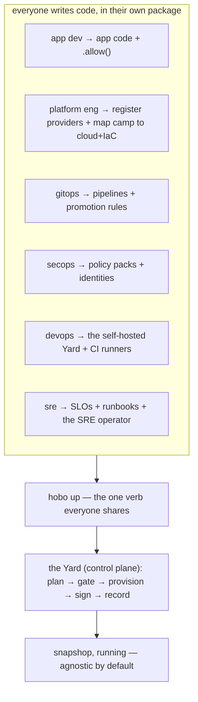

# HoBo by Role: One App, Six Workflows (Ideal-State Walkthrough)

> **What this is.** A role-organized tour of HoBo as if it were fully built. We carry **one app — `snapshop`, a photo storefront** — through the whole lifecycle, but each Part is written for the person who actually does that work: the **app developer**, the **platform engineer**, **GitOps**, **SecOps**, **DevOps**, and the **SRE**. Find your row in the table below and start there; the app is shared, the loops are yours.
>
> **Companion to [`worked-example.md`](./worked-example.md#plan-19).** That doc is the compressed narrative. This one is the role-by-role superset, authored in **Infrastructure-from-Code** mode (resources declared inline with `.allow()`, [Plan 21](./authoring-resources-wiring.md#plan-21)); it lowers to the same Manifest IR.

## The whole platform in one screen

HoBo's bet: **the only command an app developer runs is `hobo up`.** Everything else — providers, golden paths, delivery, policy, the control plane, on-call response — is **code that other roles write once**, not commands anyone types repeatedly.



### The CLI, in full

There is no sprawl to learn. Lifecycle is **one verb**; the rest is a fast inner loop and read-only inspection.

| Command | What it does |
|---|---|
| **`hobo up`** | Build + plan + provision + deploy whatever's in this dir. Subsumes deploy/promote/rollback via flags: `--camp <c>`, `--to <rev>`, `--rollback`. **This is the whole deploy story.** |
| **`hobo down`** | Tear it down. |
| `hobo dev` | Run locally on `runtime-local` (no cloud), hot-reload + replay. |
| `hobo new <name> [-t <template>]` | Scaffold an app. |
| `hobo login` | Get your SVID (OIDC); no keys pasted, ever. |
| `hobo plan` | Dry-run: the plan + cost + warnings `up` would apply. (read-only) |
| `hobo inspect` / `hobo logs` | Read projections / live streams. (read-only) |

That's it. **Crew, flags, experiments, training, deltas, providers, policy — none of these are CLI verbs.** They're SDK code you write and the dashboard/MCP you observe. If you ever find yourself wanting a `hobo <noun> <verb>`, the answer is almost always "write it in code and `hobo up`."

### Namespaces — layers don't leak

```ts
import { api, kv, bucket, queue, topic, flag, experiment, slo } from "@hobo/bindles";    // app resources you declare
import { workflow, step, actor }                                  from "@hobo/runtime";  // durable execution
import { command, view, projection }                              from "@hobo/data";     // CQRS read/write model
import { emit, subscribe, saga }                                  from "@hobo/events";   // messaging + choreography
import { camp } from "@hobo/camps";
import { yard } from "@hobo/yards";
import { junction } from "@hobo/junctions";        // one namespace per scope
import { defineResource }                   from "@hobo/sdk";  // operator SDK: configure & self-host the cloud
import { azure } from "@hobo/provider-azure";                                            // a provider adapter
import { pulumi } from "@hobo/iac-pulumi";                                               // an IaC adapter
```

### Who does what (jump to your Part)

| Part | Role | Your loop | Your files | Your command |
|---|---|---|---|---|
| **1** | **App developer** | write code → see it run | `app.ts`, `feed.ts`, `cart.ts` | `hobo dev` → `hobo up` |
| **2** | **Platform engineer** | map each Camp to a cloud + IaC; override only when needed | `platform/yard.ts`, `platform/resources.ts` | `hobo up ./platform` |
| **3** | **GitOps** | declare delivery + PR previews; git is the trigger | `delivery/pipelines.ts`, flags/experiments | `git push` (CI runs `hobo up`) |
| **4** | **SecOps** | policy + identity as code | `security/policy.ts`, `.allow()` scopes | gates enforce on every `up` |
| **5** | **DevOps** | run the control plane + CI fabric | `platform/yard.ts`, `platform/runners.ts` | `hobo up ./platform` |
| **6** | **SRE** | SLOs, runbooks, the SRE operator | `ops/slos.ts`, `ops/runbooks.ts`, `ops/crew.ts` | observe; `hobo inspect` |

### The repo, by role

One repository; each role owns a folder; everything lowers to one Manifest IR and ships with the one verb. This is the whole map — every file the six Parts touch, in one place:

```text
snapshop/                       # one repo, one Manifest IR, one verb (hobo up)
├─ src/                         # ── App developer ───────────  loop: hobo dev → hobo up
│  ├─ app.ts                    #   api + resources (.allow)
│  ├─ pipeline.ts               #   "use workflow" + steps
│  ├─ cart.ts                   #   actor + checkout saga
│  ├─ orders.ts                 #   command/view  (@hobo/data)
│  ├─ feed.ts feed.training.ts  #   "use trainable" + its typed groundings
│  └─ cart.test.ts              #   vitest; boundaries auto-mocked
├─ platform/                    # ── Platform eng / DevOps ───  loop: hobo up ./platform
│  ├─ yard.ts                   #   control plane + .register(provider)
│  ├─ camps.ts  topology.ts     #   Camps, Yards, Junctions
│  ├─ resources.ts              #   OPTIONAL overrides (golden paths)
│  └─ runners.ts                #   cost-routed CI fabric
├─ delivery/                    # ── GitOps ──────────────────  loop: git push → CI hobo up
│  └─ checkout.ts  rollout.ts   #   flags, experiments, canary policy
├─ security/                    # ── SecOps ──────────────────  loop: gates on every up
│  └─ policy.ts  waivers.ts     #   policy packs, break-glass
├─ ops/                         # ── SRE ─────────────────────  loop: observe; approve gated fixes
│  ├─ slos.ts  runbooks.ts      #   objectives, runbooks
│  ├─ crew.ts                   #   the governed SRE operator
│  └─ chaos.ts                  #   reliability experiments
└─ .github/workflows/hobo.yml   #   CI = the same `hobo up`, keyless via OIDC
```

Nothing here is HoBo-specific scaffolding — no `Dockerfile`, no `*.tf`, no `k8s/`, no per-cloud YAML. The infrastructure is *implied by the code* in each folder and realized by **Matching** against the provider's built-in Resource Definitions (Part 2).

---

# Part 0 — Before anyone deploys: a HoBo cloud must exist

`hobo up` always deploys **through a HoBo cloud** — a control plane (a Yard). That cloud has to exist *first*; nobody deploys into a vacuum. There are exactly two ways to have one:

1. **Use the hosted HoBo cloud.** HoBo runs a managed control plane and exposes a **pre-approved catalog** of providers, Camps, and side-loaded Bindles ([ADR-0062](./adr/07-portability-extensibility.md#adr-0062)). An app dev's first `hobo up` (Part 1) lands here — the `*.preview.hobo.dev` ephemeral preview **is** the hosted cloud **inferring a Camp** for your Bindle and approving it by policy. Zero platform setup, because HoBo already self-hosted the cloud, **approved its default providers** (the pre-approved catalog), and **enabled auto-approval** for inferred previews — so the happy path is ready.
2. **Self-host your own.** For your org's infrastructure, a **platform engineer goes first**: they run the operator SDK (`@hobo/sdk`) self-hosted *somewhere* to stand up a Yard (Part 2 builds it, Part 5 bootstraps it onto real infra), then **approve a set of default providers** and decide how inferred Camps get approved — **enable auto-approval** or write a **policy that passes** ([ADR-0074](./adr/02-identity-security.md#adr-0074)); it's **off by default**. With defaults approved *and* inferred-Camp approval turned on, the cloud **infers a Camp** for each Bindle and deploys it zero-config, so app devs `hobo up` exactly as in Part 1, pointed at your cloud. **Until the cloud exists, has approved defaults, and has inferred-Camp approval enabled, there's no happy path to deploy through.**

So the real order of operations is **platform-engineer-first**: a cloud is **self-hosted, its default providers approved, and inferred-Camp approval enabled** (Part 2 → Part 5), *then* app devs deploy through it (Part 1) on **inferred Camps approved by that policy**. The role Parts below can be read in any order, but this dependency is real — the hosted cloud just hides it by keeping a platform engineer (HoBo's) on the other side, defaults approved and auto-approval on.

---

# Part 1 — App developer: write code, `hobo up`

**Your promise:** you never pick a cloud, write a Dockerfile, touch IAM, or learn a deploy tool. You write TypeScript and run two commands.

## 1.1 — Sixty seconds to a live URL

```bash
npx hobo up
#   building component (jco) ............... ok
#   no camp set -> ephemeral managed preview (24h TTL)
#   plan ✓  provision ✓  deploy ✓
#   live: https://wandering-otter-7f3.preview.hobo.dev
```

No account, no cloud, no config — a real (ephemeral) URL. Install the toolchain when you want to stay:

```bash
curl -fsSL https://get.hobo.dev | sh     # hobo + @hobo/{sdk,runtime,cli}
hobo new snapshop -t api && cd snapshop
hobo dev                                 # localhost:4000, hot-reload, replay, local inspector
```

## 1.2 — An API, then storage, with zero infra ceremony

You declare resources **inline** — and you **don't hand-grant capabilities.** HoBo **infers each resource's permissions from how your code uses it** (the methods it actually calls) and bakes the least-privilege set into the manifest, where one inferred grant becomes three things — an IAM policy, a WASM capability link, and the scope of any token brokered to your code. Least-privilege is the *automatic default*, not a chore. You write `.allow()` only to **narrow** below what you use (assert a tighter contract) — never to switch a permission *on*.

```ts
// app.ts
import { api, kv, bucket } from "@hobo/bindles";
import { z } from "zod";

const catalog = kv("catalog");        // no .allow() — permissions inferred from use below → allow:[get,set]
const images  = bucket("images");     // inferred from images.read()/.write() → allow:[read,write]
const Photo   = z.object({ id: z.string().min(1), title: z.string().min(1), bytes: z.string().optional() });

export const app = api("main");

app.post("/photos", async (ctx) => {
  const p = Photo.parse(await ctx.json());                // 400 on bad input, automatically
  if (p.bytes) await images.write(`${p.id}.jpg`, p.bytes);
  await catalog.set(p.id, { id: p.id, title: p.title });
  ctx.json({ ok: true, id: p.id });
});

app.get("/photos/:id", async (ctx) => ctx.json(await catalog.get(ctx.params.id) ?? { error: "not found" }));
```

`hobo dev` runs this against a local Postgres/object-store with hot reload; `hobo up` ships it. You never named a provider — that's Part 2's job, and it already happened: on the hosted cloud, or on the Yard your platform engineer self-hosted (see Part 0).

**What `hobo up` builds first is a manifest — generated from your code, not written by you.** A resource-collection pass runs your component, captures every resource, and **infers each one's permissions from how the code uses it** — recording the least-privilege `allow` set into a provider-agnostic IR (you wrote no `.allow()`). It names *abstract capabilities* — a kv, a bucket, an api — and **never a cloud**. This generated artifact is the entire contract handed to Part 2:

```jsonc
// snapshop.manifest.json — generated; schema hobo.manifest/v1
{ "resources": {
    "catalog": { "type": "kv.v1",     "port": "wasi:keyvalue",  "allow": ["get","set"] },
    "images":  { "type": "bucket.v1", "port": "wasi:blobstore", "allow": ["read","write"] },
    "main":    { "type": "api.v1",    "port": "wasi:http",
                 "links": [ { "import": "wasi:keyvalue",  "to": "catalog" },
                            { "import": "wasi:blobstore", "to": "images"  } ] } } }
```

Nothing in here is Azure or AWS; nothing is a SKU. *How* each capability becomes real infrastructure is decided next — by **Matching** against mappings the provider ships, which you, the app dev, never see.

## 1.3 — Durability without a queue to operate

Image processing shouldn't lose work on a crash. A durable `"use workflow"` orchestrates retried, memoized `step`s; a single-writer `actor` keeps a cart consistent under concurrency:

```ts
// pipeline.ts
import { workflow, step } from "@hobo/runtime";
import { bucket, kv } from "@hobo/bindles";

const images = bucket("images");     // permissions inferred from usage
const catalog = kv("catalog");

export const processImage = workflow("processImage", async (id: string) => {
  const full  = await step("resize",    () => resize(id));
  const thumb = await step("thumbnail", () => makeThumb(full));   // memoized; never re-runs on replay
  await step("publish", async () => { await images.write(`${id}.thumb.jpg`, thumb); await catalog.set(id, { ...(await catalog.get(id)), published: true }); });
});
```

```ts
// cart.ts
import { actor } from "@hobo/runtime";       // durable execution
import { saga }  from "@hobo/events";        // choreography lives in the events namespace, not runtime

export const Cart = actor("cart", {
  state: { items: [] as string[] },
  add(s, photo: string) { s.items.push(photo); },
  items(s) { return s.items; },
});

export const checkout = saga("checkout", {
  async run(ctx, userId: string) {
    const items = await Cart.of(userId).items();
    await ctx.do("reserve", () => reserve(items), () => release(items));   // compensation on failure
    await ctx.do("charge",  () => charge(userId), () => refund(userId));
  },
});
```

`hobo inspect run --last` shows the timeline; kill and restart `hobo dev` and the run **replays to the same state**. Durability is proven before any cloud.

## 1.4 — Domain data is event-sourced (and lives in its own namespace)

The default write is a **command on an aggregate emitting an event**; the default read is a **projection-backed view**. This is the **data plane** — `@hobo/data` for CQRS, `@hobo/events` for messaging — deliberately *not* `@hobo/runtime`:

```ts
// orders.ts
import { command, view } from "@hobo/data";          // CQRS, not runtime
import { emit }          from "@hobo/events";        // messaging, not runtime

export const placeOrder = command("Order.Place", { key: (i: PlaceOrder) => i.id }, (input, ctx) => {
  if (ctx.state.status) throw new Conflict("order exists");
  ctx.emit("OrderPlaced", { id: input.id, total: input.total });
});

export async function myOrders(userId: string) {
  "use query";
  return view("orders").where({ userId, status: "placed" }).order("createdAt").paginate({ limit: 20 });
}
```

You never chose a database or a query language; a platform/data engineer maps the `orders` projection onto a backend (Part 2). You name `view("orders")`, never a table.

**Evolving the data is a versioned, gated change — not a migration ticket.** Add a field and you've authored a new contract version; the gate runs the same `can-deploy` check it runs for events, so an incompatible change is caught at `hobo up`, never at 2 a.m. in prod. The shape is always *expand → migrate → contract*: ship the additive change, let the projection **rebuild from the log** (the read model is event-sourced — disposable and regenerable), then retire the old shape once nothing reads it. You never hand-write `ALTER TABLE` against live data or sequence a migration by hand — you change the type, and the platform makes the rollout safe.

## 1.5 — Test the way it runs; read a refusal

You don't stand up infrastructure to test. Every boundary carries a contract, so HoBo **auto-mocks** the ones a test doesn't exercise — your code runs against contract-true fakes, in your normal test runner:

```ts
// cart.test.ts — vitest; boundaries auto-mocked from their contracts, zero infra.
import { test, expect } from "vitest";
import { harness } from "@hobo/test";
import { checkout } from "./cart";

test("a declined card leaves no partial state", async () => {
  const h = harness(checkout, { charge: () => { throw new CardDeclined(); } });  // override one boundary
  await h.run("u1");
  expect(h.events).toContainEqual({ type: "InventoryReleased", userId: "u1" });  // compensation fired
});
```

When you ship, the **gate is part of `hobo up`** — there's no separate verify tool, and a refusal is precise and actionable:

```bash
hobo up --camp prod
#   gate: can-deploy ✗
#   BLOCKED  api@1.8.0 publishes order.created v3 (dropped tenantId),
#            but worker@1.4.2 (running in prod) still consumes tenantId.
#   fix:     dual-publish tenantId for one migration window, OR deploy worker first.
#   nothing was provisioned — a blocked gate is a no-op, prod is untouched.
```

Fix it forward and the same `up` proceeds. Deploys never half-apply.

## 1.6 — Trainable methods: a directive, plus typed groundings

Some functions should improve themselves from real traffic. Mark one **`"use trainable"`** — the same ergonomics as `"use workflow"`, the spirit of Microsoft Trace's decorated methods:

```ts
// feed.ts — the method itself: a directive marks it AI-rewritable.
export async function rankFeed(input: RankInput): Promise<Photo[]> {
  "use trainable";                                              // the optimizer owns this body
  return [...input.candidates].sort((a, b) => b.likes - a.likes);   // your baseline / fallback
}
```

The groundings the optimizer needs aren't magic comments — they're a **typed registration** next to the function (intent, a contract, a rubric):

```ts
// feed.training.ts
import { trainable } from "@hobo/bindles";
import { z } from "zod";
import { rankFeed } from "./feed";

export default trainable(rankFeed, {
  intent:   "Order photos to maximize dwell without burying brand-new sellers.",
  contract: {
    input: RankInput, output: z.array(Photo),
    invariants: [(out, { candidates }) => out.length === candidates.length],
    forbidden:  [(out) => out[0]?.nsfw === true],
  },
  rubric:   { dwellLift: 0.80, newSellerShare: 0.75, latencyP95: 0.90 },   // scorer → threshold
});
```

Ship with `hobo up`. It can't improve until real traffic accrues; then the optimizer captures traces, runs candidates on a shadow lane, and promotes one **only if it clears the rubric** — gated, signed, reversible. You watch candidates and their confidence intervals in the dashboard; the live app adopts a promoted version on the next `hobo up`. **No standalone training command exists** — it's a property of your code.

## 1.7 — Ship

```bash
hobo up                  # to your default camp
#   plan ✓ (resolves catalog→managed KV, images→object store, picks region, prints cost)
#   provision ✓  deploy ✓   live: https://snapshop.prod.hobo.dev
```

That is the entire app-developer surface: **write code, `hobo up`.** Everything that made that one command safe and multi-cloud is the next five Parts.

---

# Part 2 — Platform engineer: map a Camp to a cloud; Matching does the rest

**You go first.** On your own infrastructure this Part is the prerequisite for all of Part 1: until this Yard exists, **you've approved default providers, and you've enabled inferred-Camp approval** (a toggle or a passing policy), there's no happy path for an app dev to `hobo up` through (the hosted HoBo cloud is the only alternative — see Part 0). Those choices are what let the cloud **infer a Camp** per Bindle and approve it without a human.

**Your promise:** app devs never pick infrastructure, and **you barely configure it.** You build the control plane (the Yard) and **register providers in code** (there is no `hobo registry add`). Registering a provider brings its **built-in mappings** — a *default Resource Definition* per capability (its `equivalence` map + `realize()`) that the package already ships — so a Camp only needs to declare *which cloud* and *which IaC*. The generated manifest from Part 1 is matched automatically; you write per-resource config **only to override a default.** And **placement itself is automatic**: with no Camp, the cloud auto-places and **rebalances** the Bindle across your registered providers (the Dispatcher, [Plan 25](./platform-engineering.md#plan-25)/[ADR-0071](./adr/01-architecture-core.md#adr-0071)). You build a **Camp / Yard / Junction only to *pin*** a cloud, region, residency, or topology auto-placement shouldn't decide — topology is an override, not a prerequisite.

## 2.1 — The operator SDK: build a Yard and register providers

`@hobo/sdk` is the operator SDK — you use it to configure and self-host the control plane. Registration is a programmatic, audited, signed act — not a CLI side effect:

```ts
// platform/yard.ts — your self-hosted control plane.
import { camp } from "@hobo/camps";
import { yard } from "@hobo/yards";
import { azure } from "@hobo/provider-azure";
import { cloudflare } from "@hobo/provider-cloudflare";
import { pulumi } from "@hobo/iac-pulumi";
import { postgresRuntime } from "@hobo/runtime-postgres";

export default yard("acme", {
  identity:  { trustDomain: "acme.yard" },       // issues every SVID (workloads, agents, CI)
  iac:       pulumi(),                            // IaC port; OpenTofu/Crossplane/CDKTF are drop-ins
  executors: { isolation: "firecracker" },        // sandboxed appliers/builders
})
  // ── register providers BEFORE any Camp can use them. This is the step that does not exist in the CLI. ──
  .register(azure({
    subscription: process.env.AZ_SUB,
    oidc: { federate: "acme.yard" },             // keyless: the Yard's OIDC is trusted by Azure; no secrets stored
  }))
  .register(cloudflare({ accountId: process.env.CF_ACCT, oidc: { federate: "acme.yard" } }))
  // ── approve which registered providers are DEFAULTS (the candidate set for inferred Camps) ──
  .approveDefaults("azure", "cloudflare")
  // inferred-Camp approval is OFF by default — opt in (or write a policy that passes); prod stays gated:
  .autoApprove({ inferredCamps: true, where: { envType: { not: "production" } } })
  .setup(                                   // OPTIONAL explicit Camps — pins/overrides, not required
    camp("prod-azure",   { provider: "azure",      runtime: postgresRuntime() }),
    camp("staging-cf",   { provider: "cloudflare", runtime: postgresRuntime() }),
  );
```

```bash
hobo up ./platform       # brings the Yard up; approved defaults + auto-approval policy make the happy path live (Camps inferred, approved by policy)
```

`.register(provider)` reads the provider's **Capability Manifest** (`/.well-known/capability-manifest/` — ports, regions, an `equivalence` map, and an `auth.json` that declares keyless OIDC federation, [Plan 6](./ai-native-agent-auth.md#plan-06)), verifies its signature, and records `provider.Registered`. Registration brings **two** things: the provider's keyless **auth**, and its **built-in Resource Definitions** — the mappings (`equivalence` + `realize()`, [Plan 4](./control-plane.md#plan-04)) that turn an abstract capability into that cloud's concrete resource and IaC program. From here, a Camp bound to Azure can realize the whole manifest **with no further config** — the app dev never sees the wiring, and neither do you. Registering a provider makes it **available**; **`.approveDefaults(...)` marks which ones an inferred Camp may use**; and **`.autoApprove(...)` decides when an inferred Camp is approved without a human** — off by default, opt-in by toggle or a policy that passes ([ADR-0074](./adr/02-identity-security.md#adr-0074)), with production typically still gated. Those choices together turn the lights on for app devs (the cloud infers a Camp per Bindle and approves it by policy). The explicit `camp(...)` calls above are optional **pins**.

> **A provider that doesn't exist yet?** Generate one, then register it the same way:
> ```ts
> import { generateProvider } from "@hobo/sdk";
> const nicheEu = await generateProvider("https://niche-eu-cloud.example.com/docs"); // scaffold→LLM-fill→sandbox-conformance→sign
> yard("acme", { /* … */ }).register(nicheEu);                                       // a signed plugin, registered in code
> ```
> Air-gapped? `registry.import(signedBundle)` mirrors a signed offline bundle in-boundary — same trust checks, zero egress ([Plan 25](./platform-engineering.md#plan-25)).

## 2.2 — A Camp is just (cloud + IaC); Matching infers the rest

This is the whole baseline Camp. It names a cloud and an IaC engine — and says nothing about `catalog`, `images`, or the api:

```ts
// platform/camps.ts
import { camp } from "@hobo/camps";
import { azure } from "@hobo/provider-azure";
import { pulumi } from "@hobo/iac-pulumi";

export const prod = camp("prod", { provider: azure(), iac: pulumi() });   // that's the entire mapping
```

`hobo up ./platform` walks the generated manifest from Part 1, and for each abstract capability **Matching selects the provider's built-in default Resource Definition** and emits concrete config, which `@hobo/iac-pulumi` realizes. You configured nothing per-resource:

```bash
hobo plan --camp prod
#   match.Decided  catalog (kv)     → azure.tableStorage   [@hobo/provider-azure default]
#   match.Decided  images  (bucket) → azure.blob           [@hobo/provider-azure default]
#   match.Decided  main    (api)    → azure.containerApp   [iac pulumi · region eastus · est $/mo …]
```

The durable runtime is just another capability matched the same way (managed Postgres on Azure) — you pin it only to override. Every choice is a recorded `match.Decided` ([Plan 25](./platform-engineering.md#plan-25)), so "why did `catalog` land on Table Storage?" is always answerable. **You never hand-write a definition for a cloud that has a package** — `@hobo/provider-azure` ships its defaults and `.register()` registered them; you author one only for something bespoke (a generated provider ships its own, above).

A **Yard** groups Camps and runs the control plane; a **Junction** federates Yards across clouds as peers (no shared state):

```ts
// platform/topology.ts
import { yard } from "@hobo/yards";
import { junction } from "@hobo/junctions";
import { prodAzure, stagingCf } from "./camps";
import euYard from "./yard-eu";                          // a second self-hosted Yard, EU residency

export const azureYard = yard("acme-azure").setup(prodAzure, stagingCf);
export default junction("acme").add(azureYard, euYard); // federate trust + signed policy + registry; no shared state
```

`hobo up ./platform` realizes whatever this graph contains — one Camp, a multi-Camp Yard, or a cross-cloud Junction — with the same verb.

## 2.3 — Junctions infer cross-cloud connectivity from Yard manifests

The inference runs one scope up, too. Just as a Bindle generates a manifest of capabilities for its Camp, **each Yard generates a manifest of its cross-boundary surface** — the endpoints/domains it exposes, and the cross-Yard links its Bindles need (folded from `bind`/`link` edges that point at a resource living in another Yard), plus residency and trust domain. You write none of it:

```jsonc
// generated per Yard — schema hobo.yard-manifest/v1
{ "yard": "acme-azure", "trustDomain": "acme.yard", "residency": "us",
  "exposes":  [ { "service": "snapshop.api",   "domain": "shop.acme.com", "visibility": "public" } ],
  "requires": [ { "from": "snapshop.api", "to": "payments.ledger@acme-aws", "via": "private" } ] }
```

A **Junction** folds its members' manifests into the cross-cloud graph and **infers the connectivity plane** — exactly as Matching realizes a resource, selecting per cross-boundary edge the providers' built-in connectivity Definitions: the **connectivity tier** (native peering → PrivateLink/PSC → WireGuard/eBPF overlay → public+mTLS, [Plan 12](./security-networking.md#plan-12)), the **`hobo:dns` rules** (cross-cloud domain routing/failover + private resolution), and the gateways. You declared only the peers:

```ts
// platform/topology.ts
export default junction("acme").add(azureYard, awsYard);   // just the members — connectivity is inferred
```

```bash
hobo plan ./platform
#   match.Decided  link snapshop.api → payments.ledger  → privatelink (azure↔aws)     [both providers' default]
#   match.Decided  dns  shop.acme.com                   → hobo:dns failover(azure,aws) [cross-cloud · ACME DNS-01]
#   junction.ConnectivityInferred  2 links · 1 domain · residency preserved
```

This stays inside the Junction's **peer** rule ([ADR-0043](./adr/07-portability-extensibility.md#adr-0043)): the Junction **computes the plan and federates each Yard its half** — the Azure Yard provisions the Azure side of the PrivateLink and its DNS records, the AWS Yard provisions its side — **no shared state, no super-controller**, each Yard realizing its own resources under its own log. A new cross-cloud dependency in app code becomes a new inferred link on the next `hobo up`; you never hand-build a VPN or hand-write a DNS record.

## 2.4 — Overrides: change one default, keep the rest inferred

Provider defaults are sensible, not mandatory. When you want a specific SKU, a different shape per environment, or a tier on the edge, override **just that** — everything else still auto-infers. An override is the same `defineResource`/`bindings`/`tiers` API, and it **wins by specificity** over the provider's default:

```ts
// platform/resources.ts — OPTIONAL. A prod-only HA Postgres golden path; preview keeps the cheap default.
import { defineResource } from "@hobo/sdk";
import { azure } from "@hobo/provider-azure";

defineResource({ type: "database", engine: "postgres", class: "ha",
  with: azure.flexiblePostgres({ ha: true }),
  match: { envType: "production" } });          // wins in prod by specificity; provider default covers everywhere else
```

```ts
// inline, per-Camp overrides — pin one boundary, split one tier; the rest is untouched.
camp("prod", { provider: azure(), iac: pulumi(),
  bindings: { "catalog": azure.cosmos({ consistency: "session" }) },   // pin: this kv → Cosmos, not Table Storage
  tiers:    { edge: cloudflare.workers() } });                          // split: the storefront tier to the edge
```

```bash
hobo plan --camp prod
#   match.Decided  database (postgres) → azure.flexiblePostgres(ha)  [definition envType=production; beats provider default]
#   match.Decided  catalog  (kv)       → azure.cosmos                [binding pins it; provider default rejected]
```

Under the hood these are the same Resource Definitions the provider supplies by default — an explicit one simply outscores the `{}` default ([Plan 25](./platform-engineering.md#plan-25)). Bundle a set of overrides + policy + dashboards into a signed **Resource Pack** to ship a whole golden path to other teams. Baseline is **zero** resource config; an override is a deliberate, audited exception — never a prerequisite. **Junction connectivity overrides the same way** — pin a hub-and-spoke topology, a specific interconnect SKU, or explicit DNS/routing, and the explicit choice wins by specificity over the inferred default.

## 2.5 — Share it: distribute and import golden topology

You don't re-author a Yard per team. Because Camps, Yards, and Junctions are plain SDK objects, you **package and publish** them — an npm package or a structured git repo that *exports* the constructed scope, signed + certified like any listing ([ADR-0062](./adr/07-portability-extensibility.md#adr-0062)):

```ts
// @acme/yard-prod — a preconfigured, signed Yard other teams import
export { default } from "./yard";   // the Yard above: providers + Camps + policy baked in
```

```bash
npm i @acme/yard-prod          # or: hobo add @acme/yard-prod  (registry, Matching-bound)
hobo up ./platform             # imports the golden Yard instead of rebuilding it
```

The same goes for a **preconfigured Camp/Junction** or a **side-loaded Bindle** (a prebuilt app component you didn't author). And a Yard — including the **hosted HoBo cloud** — can publish a **pre-approved catalog**: the curated set of providers, scopes, and packs it vouches for, which a policy pack can *require* in production ([ADR-0074](./adr/02-identity-security.md#adr-0074)). That's exactly what lets an app dev's first `hobo up` (Part 0) just work — the hosted cloud ships a pre-approved catalog so the Bindle deploys with zero platform setup.

---

# Part 3 — GitOps: git is the trigger, `hobo up` is the engine

**Your promise:** every change to production is a git commit that flows through one gated path. You don't click deploy; you merge, and CI runs the same `hobo up` a developer runs locally.

## 3.1 — CI is not a new tool — it's `hobo up` with an OIDC token

```yaml
# .github/workflows/hobo.yml — same verbs as local; keyless via OIDC, zero stored secrets.
name: hobo
on: [pull_request, push]
permissions: { id-token: write, contents: read }     # OIDC → the Yard's token broker
jobs:
  gate:
    runs-on: ubuntu-latest
    steps:
      - uses: actions/checkout@v4
      - run: npx hobo plan --camp staging   # PR: post the plan + cost (read-only)
  ship:
    if: github.ref == 'refs/heads/main'
    needs: gate
    runs-on: ubuntu-latest
    steps:
      - run: npx hobo up --camp staging     # merge to main → staging
```

The deploy gate (contracts, policy, evals, conformance, cost, signed artifact, golden suite) runs **inside `hobo up`** — there's no separate verify step to forget. A skew or policy violation blocks the `up` with a precise, machine-readable reason.

## 3.2 — Promotion is moving a pointer

There is no `promote` verb. Promoting staging → prod is bringing prod up to a known-good revision:

```yaml
  promote:
    if: github.ref == 'refs/heads/main'
    needs: ship
    runs-on: ubuntu-latest
    steps:
      - run: npx hobo up --camp prod --to ${{ github.sha }}   # same artifact, gated again for prod
```

If prod consumers can't take the new event shape, the `up` blocks (`can-deploy` runs inside it) and tells you the fix (dual-publish window / deploy-order / shim). The same `--to <rev>` is your rollback (`--rollback` for last-good).

## 3.3 — Progressive delivery is declared, not commanded

Flags, canaries, and experiments are **the Harness** — three legs you write as code, never CLI verbs. A canary is *delivery*; a flag toggles *behavior*; an experiment *measures*:

```ts
// delivery/checkout.ts
import { flag, experiment } from "@hobo/bindles";
import { checkoutTwoStep, checkoutOneClick } from "../src/checkout";

export const variant = flag.string("checkout-variant", {           // OpenFeature-typed
  default: "control",
  targeting: { split: { control: 0.5, oneClick: 0.5 }, stickyBy: "viewerId" },
});

export const checkout1click = experiment("checkout-1click", {
  assignBy: variant,
  expose: { metric: "conversion", guardrail: "refund-rate", attribute: { on: "order.Completed", joinKey: "viewerId", window: "7d" } },
  analyze: "bayesian",
});

export const handler = (ctx) =>
  (ctx.flags.eval(variant) === "oneClick" ? checkoutOneClick : checkoutTwoStep)(ctx);
```

```ts
// delivery/rollout.ts — canary policy as code; auto-rollback on SLO burn.
import { rollout } from "@hobo/bindles";
export const apiRollout = rollout("api", { strategy: "canary", steps: ["10%", "50%", "100%"], rollbackOn: "slo:checkout.latency" });
```

You `hobo up` this like anything else. Results, exposures, and winners show up in the dashboard and via MCP; the winning variant promotes through the **same gate** as a deploy and the app adopts it on the next `up`. Every flip is a `flag.Changed` event — a full "who flipped what, when, for whom" audit standalone flag tools lack.

## 3.4 — Every PR gets a real preview, then cleans itself up

A pull request opens an **ephemeral Camp** (Matching picks cheap golden-path variants, auto-TTL) and closes it on merge — preview infrastructure with no bespoke tooling, just `up`/`down` on a per-PR camp:

```yaml
  preview:
    if: github.event_name == 'pull_request'
    runs-on: ubuntu-latest
    steps:
      - run: npx hobo up   --camp pr-${{ github.event.number }}   # ephemeral; cheap variants via Matching (Part 2)
      - run: gh pr comment --body "Preview → https://pr-${{ github.event.number }}.preview.acme.dev"
  teardown:
    if: github.event.action == 'closed'
    runs-on: ubuntu-latest
    steps:
      - run: npx hobo down --camp pr-${{ github.event.number }}
```

It's the *same* app and the *same* gates as prod, mapped to throwaway infra by environment type — so "it works in preview" actually means something.

## 3.5 — Git is the desired state; drift is an event, not a 2 a.m. surprise

Because every resource's desired state is the committed graph, an out-of-band change (someone clicked in a cloud console) is detected and surfaced as **`resource.DriftDetected`**, and re-running `hobo up` is an idempotent reconcile back to git. A GitOps operator can watch for drift and open a reconcile PR for you to review — you read a diff, you don't get paged for config rot.

---

# Part 4 — SecOps: trust as code, secrets never typed

**Your promise:** identity, least-privilege, and policy are **code that gates every deploy and every runtime call** — and there are no static secrets anywhere to leak.

## 4.1 — Identity is issued, never configured

Every workload, CI job, and AI agent is a **named SVID principal** issued by the Yard's Identity service (`spiffe://acme.yard/<tenant>/<name>`). Provider access is **brokered**: an SVID is exchanged for a short-lived, resource-scoped provider token via OIDC federation (the `auth.json` you saw in Part 2). Nobody pastes a cloud key — `token.Granted → Used → Revoked` is the audit trail.

## 4.2 — Inferred least-privilege is your control surface

The app dev never hand-grants capabilities — HoBo **infers** each resource's permissions from usage and records the least-privilege set in the manifest. That inferred set is also *your* control point: it's the **only** capability that resource gets, enforced three ways (IAM, WASM capability link, token scope), deny-by-default — a handler whose code never calls `delete` is never granted `delete`, at the policy, capability, and IAM layers simultaneously. You govern it not by editing app code but with **policy-pack deny-ceilings** ([ADR-0074](./adr/02-identity-security.md#adr-0074)): *policy* (what's permitted) is declared by SecOps, **separately** from *usage* (what the app does) — a ceiling can deny a verb even where the code uses it, and an explicit `.allow()` can only narrow, never widen past the ceiling.

## 4.3 — Policy packs gate the whole lifecycle

Policy is typed code (no Rego to learn; OPA/Cedar are optional engines). Rules carry **effects** (`allow`/`deny`/`warn`/`mutate`/`require-approval`) and **obligations** ("allowed, but you must…"), and they fire across phases — author, plan, apply, runtime, promote:

```ts
// security/policy.ts
import { policyPack, rule } from "@hobo/sdk";

export default policyPack("acme-baseline", { mandatory: true }, [          // mandatory = a deny-ceiling
  rule("prod-deletes-need-approval", { phase: "apply", when: { env: "production", action: "resource.delete" }, effect: "require-approval" }),
  rule("public-endpoints-need-auth", { phase: "plan",  when: { exposes: "public" }, effect: "mutate", add: "auth-middleware" }),
  rule("eu-data-stays-in-eu",        { phase: "apply", when: { dataClass: "pii", region: "!eu" }, effect: "deny" }),
  rule("model-change-needs-shadow",  { phase: "promote", when: { kind: "trainable" }, effect: "require-approval", obligation: "shadow-eval" }),
]);
```

## 4.4 — Agents reach external apps under governed Cross-App Access

When snapshop's assistant needs to act in an *external* app on a user's behalf — file a ticket in Linear, read a doc in Confluence, call an external MCP server — it does **not** get a standing API key or a consent screen you can't see. It uses **Cross-App Access (XAA)** ([ADR-0084](./adr/02-identity-security.md#adr-0084)): your IdP brokers an **audience-bound, short-lived assertion** (ID-JAG) the target exchanges for a least-privilege token, and the grant is a `policy.Decided` *before* it's minted — `subject.delegatedBy` is the user, so "this agent may act as this user in Linear" is one of your policy-pack rules. A `mandatory` rule can **require XAA** (and refuse static keys) for any target that supports it. The full **user → agent → external-app** chain lands on `token.Granted/Used/Revoked`, so you can answer "which agent touched which external app as whom, when" — and revoke it in one place. Inbound is symmetric: snapshop is itself an **XAA resource server**, so an *external* agent (someone's Claude/Cursor) reaching snapshop is verified against your IdP and gated by the same policy + `.allow()`.

`hobo up ./platform` distributes the pack; a **mandatory** rule is a deny-ceiling a lower scope can only tighten, never widen (the AWS-SCP property). Built-in RBAC roles (Org-Admin, Security-Admin, Platform-Engineer, Deployer, Operator-Supervisor, Auditor) bind via SSO/SCIM, with separation-of-duties (the author of a policy can't approve it; the opener of a prod Delta isn't its promoter). Every decision is a replayable `policy.Decided` event, OCSF-exported.

## 4.5 — Secrets and supply chain

Secrets are **brokered references**, never values in env or files; the secret broker exposes `read-metadata`/`rotate`, never a grantable "read the value." Every artifact (provider plugin, build, deploy) is **signed + attested** (SLSA provenance) with an SBOM, and the deploy gate fails closed on a known-exploited CVE or an unsigned dependency. A generated provider is only as trusted as the conformance suite it passed — the signed report is part of its Registry record.

## 4.6 — Investigate a denial; break the glass without breaking the rules

When a gate denies, the reason is the `policy.Decided` event the `up` already printed — replayable, attributable, OCSF-exported. There's nothing to grep across five tools:

```bash
hobo up --camp prod
#   gate: policy ✗
#   DENIED  rule eu-data-stays-in-eu: 'orders' (pii) would land in us-east-1.
#   policy.Decided  pack acme-baseline@4  subject ci@acme.yard  → audit:pol_7f31
```

A legitimate exception is a **gated waiver**, not a flag someone flips — a governed, time-boxed, separation-of-duties approval recorded as an event:

```ts
// security/waivers.ts — break-glass: signed, expiring, audited.
import { waiver } from "@hobo/sdk";
export default waiver("pol_7f31", {
  reason:   "EU capacity incident; temporary US failover, approved by IR.",
  approver: "role:security-admin",     // author ≠ approver; no one self-approves (SoD)
  expires:  "2026-07-01T00:00:00Z",     // auto-revokes; no lingering exception
});
```

`hobo up` passes for the window only; `policy.WaiverApproved` / `policy.WaiverExpired` bracket exactly what was allowed, by whom, and until when — the opposite of a console click nobody can reconstruct later.

---

# Part 5 — DevOps: run the control plane and the CI fabric

**Your promise:** "self-host = hosted." The same Yard SDK that backs the managed offering is what you run, on your own infra, with an honest bootstrap and no laptop-magic.

## 5.1 — Bootstrap the Yard (the chicken-and-egg, told honestly)

The Yard is itself a HoBo Bindle (dogfood). Standing it up is two phases — a disposable seed brings up the real thing, then retires:

```bash
hobo up ./platform --seed          # phase 1: a disposable LOCAL seed Yard (sqlite). NOT "your cloud" yet.
hobo up ./platform --camp host-azure
#   phase 2: the seed self-deploys @hobo/sdk to real infra
#   provisioning Planner · Orchestrator · Identity(SVID issuer) · Registry · Executors(Firecracker) · EventStore
#   Firecracker runs on HOST VMs, not your laptop
#   seed used YOUR `hobo login` SVID once (audited: identity.SeedTokenUsed)
#   HANDOVER: real Identity becomes sole broker → seed credential retired → seed discarded
#   self-hosted Yard live: https://yard.acme.internal
```

The `platform/yard.ts` from Part 2 *is* the input — identity, IaC, executors, registered providers, Camps. Air-gapped installs run the whole control plane in-boundary with zero egress (signed offline bundles in, internal CA, in-boundary KMS + models).

## 5.2 — The CI fabric: cost-routed runners

Where CI runs is itself a registered, cost-routed decision — burn free credits first, keep private builds in-boundary:

```ts
// platform/runners.ts
import { dispatcher, runner } from "@hobo/sdk";
export default dispatcher({ objective: "min-cost" }, [
  runner.selfHosted({ behind: "relay" }),       // your Executors, reachable via the outbound Relay (no inbound ports)
  runner.github(), runner.depot(), runner.blacksmith(),
]);
```

`hobo up ./platform` registers them; the Dispatcher picks per job and records `dispatch.Decided`. CI is the same `hobo up` gate, dispatched cost-aware — not a bespoke pipeline tool.

## 5.3 — Fleet visibility

Everything DevOps needs is a **projection over the event log** — the dashboard's fleet view (project × environment), or `hobo inspect`/`hobo logs` for scripting. No view has privileged state, so it can never disagree with the audit log. There's no fleet CLI verb; there's a dashboard and `inspect`.

## 5.4 — Disaster recovery and upgrades are just `up`

The Yard is event-sourced, so recovery is **rebuild from the log**, not restore-a-snapshot-and-pray:

```bash
hobo up ./platform --restore s3://acme-backups/yard.log   # replay the control plane to its last good state
```

And the Yard is itself a Bindle, so **upgrading it is deploying it** — bump `@hobo/sdk`, run `hobo up ./platform`, and the upgrade rides the same gate + canary + rollback as any app. No bespoke control-plane updater, no maintenance-window ritual, no "which version is the cluster actually on?"

---

# Part 6 — SRE: SLOs, runbooks, and an AI on-call that's governed

**Your promise:** reliability is code and the event log. You declare objectives and responses; an autonomous SRE operator diagnoses and proposes fixes; every action is gated and replayable.

## 6.1 — SLOs and observability as code

```ts
// ops/slos.ts
import { slo } from "@hobo/bindles";
export const checkoutLatency = slo("checkout.latency", { objective: "p95 < 250ms", window: "30d", burnAlert: "2x" });
export const photosAvail     = slo("photos.availability", { objective: "99.9%", window: "30d" });
```

You **read** reliability — burn rate, incidents, drift, cost, the "march of the 9s" availability estimate — in the dashboard or via `hobo inspect`; you never operate a metrics stack. SLO burn is also a *policy input*: a burning budget can freeze risky deploys via a `can-deploy` dimension.

## 6.2 — Runbooks as code

A runbook is a trigger → diagnosis (read-only MCP queries) → gated, blast-radius-bounded fixes. Versioned and signed like a Resource Pack:

```ts
// ops/runbooks.ts
import { runbook } from "@hobo/sdk";
export default runbook("high-5xx-on-api", {
  on: { alert: "api.5xx-burst", severity: ">=SEV2" },
  diagnose: ["logs api", "drift api", "slo checkout.latency"],
  fix: [
    { when: "provider-degraded", do: "failover", camp: "staging-cf", gate: "auto" },     // low-risk, reversible
    { when: "capacity-exhausted", do: "scale", to: { min: 6 },        gate: "auto" },
    { when: "unknown",            do: "escalate", to: "on-call" },                         // page a human
  ],
});
```

## 6.3 — The SRE operator: autonomous, but on a leash

The Crew is **code**, not a CLI command. Each operator is an `agent()` that's part of your control-plane program — a named SVID principal with a scoped policy, event-sourced, MCP-surfaced, **read/diagnose autonomous, every write gated**:

```ts
// ops/crew.ts
import { agent } from "@hobo/sdk";
export const sre = agent("sre", {
  model: "anthropic/claude-haiku-4.5",
  instructions: "Diagnose from projections; classify; auto-fix only if low-risk, reversible, in-budget.",
  policy: { destroy: "require-approval", spendCapUsd: 50 },        // the documented core; reads are free
  runbooks: ["high-5xx-on-api"],
});
```

`hobo up ./platform` commissions it. A real incident reads as one legible, replayable stream — diagnosis is autonomous, the prod write waits for you:

```text
slo.BudgetBurned         checkout.latency burning 3x
incident.Opened          SEV2   (correlated alerts → ONE incident, not N pages)
crew.AgentDispatched     sre
incident.Classified      provider-degraded · db@prod-azure
crew.ActionProposed      failover db → staging-cf, canary, auto-rollback on regression
policy.Decided           prod write → REQUIRE-APPROVAL   [approve] [reject]  ← you, in dashboard/MCP
crew.ActionApplied       (after approve) canary 10% → 100%, healthy
incident.Resolved        MTTR 9m
incident.PostmortemFiled replay of incident:<id>; the failing trace → a permanent regression test
```

A SEV it can't classify **escalates** to on-call with a deadline; a low-risk reversible fix it applies itself as an auto-rolling-back canary. You direct a governed crew; you don't hand prod to a bot.

## 6.4 — Prove reliability on purpose (chaos as a test)

Reliability you didn't verify is a guess. A chaos experiment is a typed hypothesis — a steady-state invariant, an injected fault, a blast-radius bound, an abort condition — and a failed one becomes a permanent regression test, the same mechanism that turns an incident into a guardrail:

```ts
// ops/chaos.ts
import { chaos } from "@hobo/sdk";
export default chaos("db-failover-holds-checkout-slo", {
  steadyState: "slo:checkout.latency",                 // the invariant that must keep holding
  inject:      { fault: "provider-degraded", target: "db@prod-azure" },
  blastRadius: "1 camp",                               // bounded; never the whole fleet
  abortIf:     "slo:photos.availability < 99.9%",       // trip-wire: stop and roll back
});
```

It runs on a fork lane against shadowed traffic, never touching baseline state; the result is an event, and a regression is a finding you fix before a user ever sees it.

---

# The payoff: one app, six clean loops

snapshop is provider-agnostic application code that **never changed** as it moved laptop → Azure → Cloudflare → a self-hosted, federated, multi-cloud platform. What changed was the code each role owns, in its own package, applied with the one verb everyone shares.

| Role | Reads | Writes | Runs | Never touches |
|---|---|---|---|---|
| **App developer** | `hobo inspect` | `app.ts`, `feed.ts` (`"use trainable"`), `cart.ts` | `hobo dev`, `hobo up` | clouds, IAM, YAML, deploy tools |
| **Platform engineer** | `match.Decided` | `platform/yard.ts` (`.register`), `resources.ts` (overrides only) | `hobo up ./platform` | app business logic |
| **GitOps** | plan + cost + preview URL on PRs | `delivery/pipelines.ts`, flags/experiments | `git push` → CI `hobo up` | manual deploys |
| **SecOps** | `policy.Decided` (OCSF) | `security/policy.ts`, `.allow()` scopes | gates on every `up` | static secrets |
| **DevOps** | fleet projections | `platform/yard.ts`, `runners.ts` | `hobo up ./platform --seed` | laptop-as-control-plane |
| **SRE** | SLO/incident projections | `ops/slos.ts`, `runbooks.ts`, `crew.ts` | observe; approve gated fixes | a metrics stack to babysit |

**Agnostic by default, optimizable on demand, AI-native throughout, fully auditable — and every role's primary loop is one command or one commit.**

### Where to go next

- The compressed end-to-end: [`worked-example.md`](./worked-example.md#plan-19).
- SDK layers & topology: [`sdk-api.md`](./sdk-api.md#plan-02). Authoring & `.allow()`: [`authoring-resources-wiring.md`](./authoring-resources-wiring.md#plan-21).
- Control plane, providers, IaC: [`control-plane.md`](./control-plane.md#plan-04). Platform engineering & Matching: [`platform-engineering.md`](./platform-engineering.md#plan-25).
- Contracts, policy & the Harness: [`contracts-policy-flags.md`](./contracts-policy-flags.md#plan-29). The Crew & SRE: [`operators-sre.md`](./operators-sre.md#plan-40).
- Identity, agents & end-user auth: [`ai-native-agent-auth.md`](./ai-native-agent-auth.md#plan-06).
