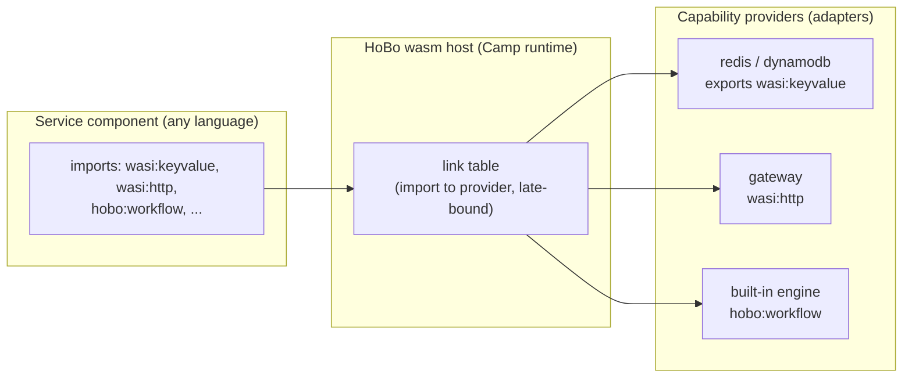

# WASM/WASI Runtime & WIT Interfaces

This capability doc consolidates Plan 20, Plan 24 of the HoBo design suite.

## Plan 20

**Plan 20 — WASM/WASI runtime (the polyglot spine)**

> **Contracts & policy (gates):** each **Camp** (via its runtime + wasm host) **declares the contract/policy enforcement modes it supports** — e.g. `record-and-verify` (local), `strict`/`enforce` (prod), `verify-at-build-observe-at-runtime` (edge) — so the Gatekeeper ([Plan 29](./contracts-policy-flags.md#plan-29)/[Plan 30](./contracts-policy-flags.md#plan-30)) knows what a target can enforce, just as a WIT interface announces its capabilities.

### Why wasm/wasi is the default
- **Any language, one artifact.** Anything that compiles to a WASI component (Rust, TinyGo, TS via jco, Python via componentize-py, C# via componentize-dotnet) is a first-class HoBo service. The SDK is TypeScript, but the *runtime contract* is language-neutral.
- **Capability security by construction.** WASI is deny-by-default with unforgeable resource handles — a component can only touch what it's been linked to. This is the runtime enforcement of `.allow()` ([Plan 21](./authoring-resources-wiring.md#plan-21)) and complements SVIDs/token scoping ([Plan 6](./ai-native-agent-auth.md#plan-06), [Plan 12](./security-networking.md#plan-12)).
- **Tiny, portable, OCI-native.** Components are small, start in ms, and distribute as **OCI artifacts** — the same registry/signing/scanning pipeline as containers.
- **Standards = ecosystem.** Because ports are WIT interfaces, HoBo can reuse existing **wasmCloud capability providers** and the broader Bytecode Alliance toolchain.

### The model: components, interfaces, providers, links
- **Service = component (default).** A HoBo service compiles to a WASI **component**. Fallback: workloads that can't compile to wasm yet (GPU/native deps) run as plain **OCI containers** through the identical OCI + wiring pipeline ([Plan 22](./authoring-resources-wiring.md#plan-22)).
- **Port = WIT interface.** A capability port is a WIT interface. Reuse the standard cloud interfaces; author `hobo:*` interfaces for what WASI doesn't cover yet:
  - **Reused:** `wasi:http`, `wasi:keyvalue`, `wasi:blobstore`, `wasi:messaging`, `wasi:sql`, `wasi:config`, `wasi:logging`, `wasi:filesystem/sockets/clocks/random`.
  - **HoBo interfaces:** `hobo:workflow` (durable workflow/step), `hobo:actor` (grains), `hobo:saga`, `hobo:agent`, and control-plane `hobo:scheduler`/`provisioning`/`observability`/`config`.
- **Provider = capability provider.** A Provider implements a WIT interface's *exports* for a backend (e.g. an S3 adapter exports `wasi:blobstore`). It has the same deploy + runtime split HoBo already uses ([Plan 3](./control-plane.md#plan-03)): `realize()` provisions infra; the runtime impl serves the interface.
- **Bind = link.** Binding a component's *import* of an interface to a provider's *export* is a **link**, late-bound at deploy/runtime (the wasmCloud model). Swapping Redis→Vault behind `wasi:keyvalue` is a link change, no recompile. Links are the concrete form of HoBo's ports/adapters escape hatch.



### WIT as the contract (example)
```wit
// hobo:workflow interface (illustrative) — HoBo-authored where WASI has no equivalent
package hobo:runtime@0.1.0;
interface workflow {
  record step-opts { retries: u32, timeout-ms: u64 }
  run-step: func(name: string, input: list<u8>, opts: step-opts) -> result<list<u8>, string>;
  sleep: func(ms: u64);
  emit: func(event-type: string, data: list<u8>) -> result<_, string>;
}
// a service component's interface contract (illustrative)
//   imports = dependencies → links; export = capability
import wasi:keyvalue/store@0.2.0;
import wasi:http/outgoing-handler@0.2.0;
import hobo:runtime/workflow@0.1.0;
export wasi:http/incoming-handler@0.2.0;     // an HTTP service
```
The TS SDK's typed clients (`ctx.bindings.db`, `step`, `workflow`) are **generated from these interfaces** (jco `guest-types`), so app code never hand-writes WIT — it gets typed TS, and the contract is standards-based underneath.

### Build pipeline (per language)
| Language | Toolchain → component |
|---|---|
| TypeScript/JS | `jco` + `componentize-js` (StarlingMonkey) |
| Rust | `cargo-component` / `wit-bindgen` |
| Go | TinyGo |
| Python | `componentize-py` |
| C#/.NET | `componentize-dotnet` (NativeAOT-LLVM) |
`@hobo/componentize` wraps these; output is a component pushed as an **OCI artifact** (`wash push`-style). `build-wasm`/`build-dagger` ([Plan 1](./architecture.md#plan-01)) produce both wasm components and the container fallback.

### Hosts & where it runs — the `component-host` port ([ADR-0031](./adr/01-architecture-core.md#adr-0031))
The thing that *executes* a component — the WASI interface impls + the link table + the component lifecycle — is itself a **`component-host` port**, and **the host is a property of a Camp** ([ADR-0026](./adr/01-architecture-core.md#adr-0026)): a Camp selects its host the same way it selects its runtime backend and infra Provider, and Camps stay heterogeneous ([ADR-0028](./adr/05-config-matching-environments.md#adr-0028)).
- **Local/built-in runtime (`runtime-local`): Wasmtime.** The canonical Component-Model engine provides the WASI impls + link table; `hobo dev` runs everything locally with capability emulation. (jco-in-Node was rejected — a second wasm semantics surface would break dev/prod parity.)
- **v1 prod default: wasm-in-container.** The portable default runs the host (Wasmtime) **inside an OCI container**, reusing the existing OCI/container pipeline ([Plan 22](./authoring-resources-wiring.md#plan-22)) — so "runs anywhere a container runs" holds with **zero new mandatory infra**, and local semantics match prod. The OCI-container *fallback* (non-wasm workloads) still runs as a normal container alongside it.
- **Opt-in host adapters (per Camp), same port + same conformance gate:** **SpinKube / containerd-wasm** (k8s-native, shim-level density), **wasmCloud lattice** (cross-host late-bound links + multi-region link migration), and **provider-native wasm targets**. Each is certified against the `component-host` conformance suite ([Plan 9](./verification.md#plan-09)) before a Camp may select it. Either way the **manifest IR** ([Plan 22](./authoring-resources-wiring.md#plan-22)) carries endpoints/links/config.
- **Async:** WASI Preview 3 brings native async; HoBo workflows/agents map onto it where available, falling back to the host's executor otherwise.

### Component-host portability ([ADR-0067](./adr/01-architecture-core.md#adr-0067))
A component proven on Wasmtime locally must behave **identically** on wasm-in-container in prod — so the `component-host` is a **conformance-gated, version-pinned portability boundary**, exactly like a provider port ([ADR-0024](./adr/07-portability-extensibility.md#adr-0024)).
- **`@hobo/conformance/component-host` suite** ([Plan 9](./verification.md#plan-09)). Any host claiming conformance must pass: **deterministic-clock trace replay** (same run → identical state across hosts, [Plan 11](./event-model.md#plan-11)), **`wasi:*` interface round-trip** (vendored/pinned interfaces behave identically), **link semantics** (imported-interface → provider-export late-binding resolves the same), and **capability-handle isolation** (deny-by-default; an un-linked capability call fails). A host may only be selected for a Camp if it passes.
- **Host version pinned in the manifest IR** ([Plan 22](./authoring-resources-wiring.md#plan-22)). A Bindle records the `component-host` kind + version it was built/certified against; a Camp whose host is incompatible fails planning with a precise reason (mirrors the `wasi:*`/runtime version policy in [ADR-0024](./adr/07-portability-extensibility.md#adr-0024) §5). Host upgrades go through an explicit, gated path with an **upcaster** where semantics change — no silent rewrite of component behavior.
- **Cross-host E2E** folded into `multi-cloud-shop` ([ADR-0024](./adr/07-portability-extensibility.md#adr-0024)): the same component runs on **Wasmtime local → wasm-in-container → (opt-in) SpinKube** with identical behavior under trace replay. Host-specific capabilities (e.g. wasmCloud lattice link-migration) are typed as **host-`.with()`** options, inert on hosts that don't offer them, and flagged by **`hobo doctor`** as host lock-in (same model as provider `.with()`).

### Security substrate
- Deny-by-default: a component gets *only* the links its `.allow()` declarations grant.
- Unforgeable handles: capabilities are passed in, never fabricated — strong multi-tenant isolation in-process, layered under the tenant/SVID model ([Plan 12](./security-networking.md#plan-12)).
- Forge-generated components/providers run in this sandbox during conformance ([Plan 23](./forge-generated-stack.md#plan-23)).

### Iteration hooks
- ~~Wasm host of record~~ — **decided ([ADR-0031](./adr/01-architecture-core.md#adr-0031)):** Wasmtime locally + a `component-host` port whose v1 prod default is wasm-in-container, with SpinKube / wasmCloud-lattice / provider-native as opt-in per-Camp adapters. Remaining: the host **conformance-suite** assertions and the wasmCloud-lattice adapter's cross-host link semantics. **Grounding/refinements** (from [`competitors/wasm-hosts`](../../competitors/wasm-hosts/README.md)): pin **`runwasi`/containerd-shim** as the mechanism for the wasm-in-container default + SpinKube adapter; pin **`wRPC` (WIT-over-RPC) over the lattice (NATS)** as the wasmCloud adapter's cross-host link transport.
- `hobo:*` WIT interface naming/versioning; how aggressively to track upstream `wasi:*` draft churn.
- Component-to-component composition (`wac`) vs runtime links for intra-app calls.
- Container-fallback runtime + when the Planner chooses it automatically (GPU/native detection).

## Plan 24

**Plan 24 — WIT interfaces reference (the canonical ports)**

> **Contracts & policy (gates):** two governance ports join the catalog — **`hobo:contract-engine`** ([Plan 29](./contracts-policy-flags.md#plan-29)) and **`hobo:policy-engine`** ([Plan 30](./contracts-policy-flags.md#plan-30)) — each with a built-in HoBo implementation and optional providers (Pact / OPA / Cedar). A port's WIT interface *is* its provider contract; this doc's interfaces are what the Gatekeeper's compatibility checks are written against.

### Conventions
- **Package/version:** `namespace:package@semver` (e.g. `wasi:keyvalue@0.2.0`, `hobo:runtime@0.1.0`). HoBo pins exact versions; upgrades go through upcasters/compat shims, never silent drift.
- **Import = dependency** (inbound port the component needs); **export = capability** (what it provides). A **link** connects an import to a provider's export, late-bound ([Plan 20](./wasm-runtime-wit.md#plan-20)).
- **`.allow()` ↔ interface:** a resource's permitted verbs ([Plan 21](./authoring-resources-wiring.md#plan-21)) select which interface's functions are linked + which IAM/token scope is granted.

### Reused WASI interfaces (don't reinvent)
| WIT interface | HoBo resource | Notes |
|---|---|---|
| `wasi:http/incoming-handler`, `.../outgoing-handler` | `api` / `service` / `web`; outbound fetch | service exports incoming-handler; outbound is an import |
| `wasi:keyvalue/store` | `kv` | `get`/`set`/`delete`/`exists` (+ batch) |
| `wasi:blobstore/blobstore` | `bucket` | object RW; presigned-URL + events extended by `hobo:blob-events` |
| `wasi:messaging` | `topic` (push) | publish/subscribe |
| `wasi:sql` | `sql` | connection + query (draft; HoBo `hobo:sql` fills gaps) |
| `wasi:config/store` | `secret`/config | config + secret access |
| `wasi:logging/logging` | `ctx.log` | structured logging |
| `wasi:filesystem`, `wasi:sockets`, `wasi:clocks`, `wasi:random`, `wasi:cli` | host primitives | granted per capability policy |

### HoBo-authored interfaces (`hobo:*`) — what WASI doesn't cover
| WIT interface | Purpose | Key functions (illustrative) |
|---|---|---|
| `hobo:runtime/workflow` | durable workflow/step | `run-step(name,input,opts)`, `sleep(ms)`, `emit(type,data)` |
| `hobo:runtime/actor` | virtual-actor (grain) state + messaging | `get-state`/`append-state`, `signal(key,msg)` |
| `hobo:runtime/saga` | choreography process manager | `on(event)`, `emit(event)`, `compensate(event)` |
| `hobo:runtime/agent` | durable AI agent | `run(messages)`, `tool(name,input)`, `token(provider,scope)` |
| `hobo:queue` | pull queue (Nitric parity) | `enqueue`, `dequeue(n)`, `complete` |
| `hobo:blob-events` | bucket notifications + presigned URLs | `on(event,prefix)`, `download-url`, `upload-url` |
| `hobo:websocket` | websocket connections | `on(connect/message/disconnect)`, `send(conn,msg)` |
| `hobo:job` | batch jobs (cpu/mem/gpu) | `handler(opts)`, `submit(input)` |
| `hobo:scheduler` | cron/interval triggers | `every(spec)`, `cron(expr)` |
| `hobo:projection` | persistence-agnostic data plane: fold event streams into a sink + query it ([Plan 39](./data-plane.md#plan-39)) | `declare(spec)`, `fold(state,event)`, `materialize`, `rebuild`, `read(query)`, `read-raw(driver-call)` (escape hatch) |
| `hobo:search` | full-text + vector + hybrid retrieval ([Plan 35](./data-plane.md#plan-35)); a projection-sink paradigm | `text-query(q,filter)` (reactive), `vector-query(vec,filter,k)`, `hybrid(q,vec,...)`, `upsert`/`delete` |
| `hobo:embed` | embedding generation behind `search` ([Plan 35](./data-plane.md#plan-35)) | `embed(text)` → vector (local model or hosted API; secretless) |
| `hobo:dns` | DNS records + custom-domain routing ([Plan 13](./security-networking.md#plan-13)/[ADR-0035](./adr/07-portability-extensibility.md#adr-0035)) | `upsert-record`, `set-routing(policy)`, `verify`, health-checked failover across Camps |
| `hobo:auth` | end-user auth: federate + verify ([Plan 36](./ai-native-agent-auth.md#plan-36)/[ADR-0038](./adr/02-identity-security.md#adr-0038)) | `verify(jwt)` → `ctx.user` claims (OIDC/JWKS/customJwt), `start-session`/`revoke-session`; thin built-in (passkey/email) for dev |
| `hobo:crypto` | app-facing cryptography with **keys the app never holds** ([Plan 31](./authoring-resources-wiring.md#plan-31)) | `encrypt`/`decrypt` (envelope), `sign`/`verify` — key handles brokered via Identity; KMS/Key Vault/Cloud KMS/in-boundary HSM behind the port |
| `hobo:notify` | app-facing communications: email/sms/push/outbound-webhook to *end-users* ([Plan 21](./authoring-resources-wiring.md#plan-21)/[ADR-0059](./adr/03-data-plane.md#adr-0059)) | `send(channel, to: PrincipalRef, template, data)` (idempotent `step`; typed WIT-record templates); shares the ADR-0045 receiver port + adapters (SES/Twilio/FCM/signed-webhook); secretless-brokered |
| `hobo:guardrail` | AI output safety checks as a gated step ([Plan 47](./governance-planes.md#plan-47)/[ADR-0061](./adr/04-governance-verification.md#adr-0061)) | `check(output, kind)` → pass/redact/block (moderation/PII/jailbreak/grounding); built-in rules default, Llama Guard/hosted/local adapters (Matching-selected, air-gap → local) |
| `hobo:feature-flag` | runtime flags, OpenFeature-compatible ([Plan 37](./contracts-policy-flags.md#plan-37)/[ADR-0044](./adr/04-governance-verification.md#adr-0044)) | `eval(flag, ctx)` (bool/string/number/object, in-process deterministic), `change`/`target`; built-in store or OpenFeature provider |
| `hobo:control/provisioning` | control-plane resource ops | `provision(spec)`, `deprovision(id)`, `refresh(id)` |
| `hobo:control/observability` | metrics/traces/logs emit | `emit-metric`, `emit-trace` |
| `hobo:control/config` | tenant/Camp config | `get`, `set` |
| `hobo:capability-manifest` | Capability Manifest capability/auth manifest | `capabilities()`, `auth()`, `cost()` ([Plan 6](./ai-native-agent-auth.md#plan-06)) |

> **`change-feed` is a capability, not a standalone port.** First defined on the `database` port ([Plan 32](./data-plane.md#plan-32)) to normalize a provider's change stream into `data.Changed`, it **generalizes to any projection sink** ([Plan 39](./data-plane.md#plan-39)): a sink that advertises `change-feed` makes its projection reactive; one that doesn't is `reactive: false`.

### Example: a service's interface contract
```wit
package hobo:examples@0.1.0;
// shop-api — the interface contract a typical service component declares
//   imports = dependencies → links; export = capability
import wasi:keyvalue/store@0.2.0;
import wasi:blobstore/blobstore@0.2.0;
import hobo:queue/queue@0.1.0;
import hobo:runtime/workflow@0.1.0;
import wasi:logging/logging@0.2.0;
export wasi:http/incoming-handler@0.2.0;
```
The SDK author never writes this by hand — declaring `kv()/bucket()/queue()` + `.allow()` and an `api`/`service` generates the interface contract; `jco` emits the typed bindings the handler code uses. These `jco guest-types` are one of the four codegen sources (with Zod, `.allow()`, and the bindle graph) that land in the checked-in `_generated/` directory ([ADR-0037](./adr/05-config-matching-environments.md#adr-0037)/[Plan 2 §Generated code](./sdk-api.md#plan-02)).

### Versioning & evolution
- Interfaces are versioned independently; the manifest IR ([Plan 22](./authoring-resources-wiring.md#plan-22)) records the exact versions a component imports/exports.
- Upstream `wasi:*` draft churn is absorbed by pinning + a compat layer; `hobo:*` interfaces follow semver with conformance suites per version ([Plan 9](./verification.md#plan-09)).
- Every interface ships a `@hobo/conformance` suite; providers/implementations must pass the version they claim — the gate for human- and Forge-authored adapters ([Plan 23](./forge-generated-stack.md#plan-23)).

### Iteration hooks
- Final `hobo:*` package names/namespacing; which `hobo:*` interfaces to upstream as `wasi:*` proposals (queue/websocket/blob-events).
- Whether intra-app calls use runtime links or build-time composition (`wac`).
- `wasi:sql` adoption vs a richer `hobo:sql` — the **migration** half is now specified in [Plan 34](./data-plane.md#plan-34) ([ADR-0032](./adr/03-data-plane.md#adr-0032)); `hobo:sql` is where the declarative-schema/diff + snapshot/export capabilities live (the connection/query surface stays `wasi:sql`).
