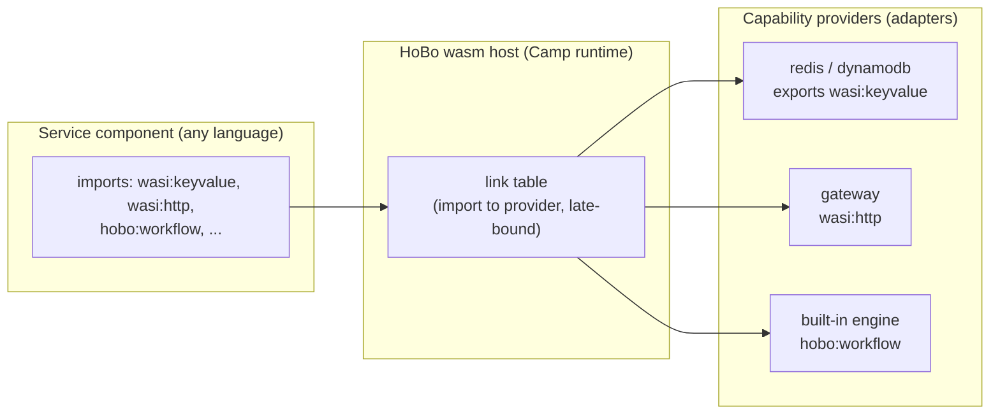

# WASM/WASI Runtime & WIT Interfaces

This capability doc covers the WASM/WASI runtime — the polyglot spine — together with the WIT interface reference that is its canonical port catalog.

Epic reference implementation: [`src/draft/epic-reference-implementations/wit-component-model-runtime-membrane`](../../src/draft/epic-reference-implementations/wit-component-model-runtime-membrane/).

## Plan 20

> **Contracts & policy (gates):** each **Camp** (via its runtime + wasm host) **declares the contract/policy enforcement modes it supports** — e.g. `record-and-verify` (local), `strict`/`enforce` (prod), `verify-at-build-observe-at-runtime` (edge) — so the Gatekeeper ([Plan 29](./contracts-policy-flags.md#plan-29)/[Plan 29](./contracts-policy-flags.md#plan-29)) knows what a target can enforce, just as a WIT interface announces its capabilities.

### Why wasm/wasi is the default
- **Any language, one artifact.** Anything that compiles to a WASI component (Rust, TinyGo, TS via jco, Python via componentize-py, C# via componentize-dotnet) is a first-class HoBo service. The SDK is TypeScript, but the *runtime contract* is language-neutral.
- **Capability security by construction.** WASI is deny-by-default with unforgeable resource handles — a component can only touch what it's been linked to. This is the runtime enforcement of `.allow()` ([Plan 21](./authoring-resources-wiring.md#plan-21)) and complements SVIDs/token scoping ([Plan 6](./ai-native-agent-auth.md#plan-06), [Plan 12](./security-networking.md#plan-12)).
- **Tiny, portable, OCI-native.** Components are small, start in ms, and distribute as **OCI artifacts** — the same registry/signing/scanning pipeline as containers.
- **Standards = ecosystem.** Because ports are WIT interfaces, HoBo can reuse existing **wasmCloud capability providers** and the broader Bytecode Alliance toolchain.

### The model: components, interfaces, providers, links
- **Service = component (default).** A HoBo service compiles to a WASI **component**. Fallback: workloads that can't compile to wasm yet (GPU/native deps) run as plain **OCI containers** through the identical OCI + wiring pipeline ([Plan 21](./authoring-resources-wiring.md#plan-21)).
- **Port = WIT interface.** A capability port is a WIT interface. Reuse the standard cloud interfaces; author `hobo:*` interfaces for what WASI doesn't cover yet:
  - **Reused:** `wasi:http`, `wasi:keyvalue`, `wasi:blobstore`, `wasi:messaging`, `wasi:sql`, `wasi:config`, `wasi:logging`, `wasi:filesystem/sockets/clocks/random`.
  - **HoBo interfaces:** `hobo:workflow` (durable workflow/step), `hobo:actor` (grains), `hobo:saga`, `hobo:agent`, and control-plane `hobo:scheduler`/`provisioning`/`observability`/`config`.
  - **Integration ports** ([ADR-0073](./adr/07-portability-extensibility.md#adr-0073)): `hobo:auth` (swappable IdPs — WorkOS/Auth0/Supabase Auth/Entra…), `hobo:artifact-repo` (npm/NuGet/PyPI/OCI… package + artifact repos), and the named operator-facing seams `hobo:issue-tracker` (JIRA/GitHub Issues/Linear) + `hobo:knowledge` (Confluence/Obsidian/Wikis) — all swappable adapters, only registered ones considered, auto-generatable.
- **Provider = capability provider.** A Provider implements a WIT interface's *exports* for a backend (e.g. an S3 adapter exports `wasi:blobstore`). It has the same deploy + runtime split HoBo already uses ([Plan 4](./control-plane.md#plan-04)): `realize()` provisions infra; the runtime impl serves the interface.
- **Bind = link.** Binding a component's *import* of an interface to a provider's *export* is a **link**, late-bound at deploy/runtime (the wasmCloud model). Swapping Redis→Vault behind `wasi:keyvalue` is a link change, no recompile. Links are the concrete form of HoBo's ports/adapters escape hatch.

### The runtime membrane = wRPC ([ADR-0069](./adr/01-architecture-core.md#adr-0069))
The transport that carries a link — an app component's *import* invoking a provider component's *export* — is **wRPC** (wasmCloud's WIT-native, transport-agnostic RPC; **NATS by default**), not plain gRPC. The same WIT contract drives **in-process, cross-process, and cross-host (lattice)** invocation, so a link resolves identically whether the provider is co-located or on another host — consistent with the `component-host` adapters ([ADR-0031](./adr/01-architecture-core.md#adr-0031)).
- **Wire generated from WIT.** There is no separate protobuf/IDL or hand-maintained schema; the wire is derived from the interface. Contrast plain gRPC, which needs a parallel `.proto` IDL kept in sync with the WIT and bespoke transport plumbing.
- **Deny-by-default routing.** wRPC only routes **linked** interfaces. An unlinked / un-`.allow()`-ed capability has no route and cannot be invoked — the membrane enforces the same capability boundary as the wasm sandbox.

### Providers are WIT components ([ADR-0069](./adr/01-architecture-core.md#adr-0069))
A **provider implements the building-block WIT interfaces directly**: a provider is a WASM component (or WIT-conformant adapter) that **exports** the building-block interfaces an app imports. There is **no Go/TS provider plugin SDK** — the contract *is* the WIT interface, and the only trust boundary is **conformance** to that interface ([Plan 9](./generated-stack.md#plan-09)). The **generation pipeline generates providers** against the WIT ([Plan 23](./generated-stack.md#plan-23)). This is the explicit departure from Nitric's per-language Go provider plugins: bind to a WIT export over wRPC, don't compile a language-specific plugin.



### WIT as the contract (example)
```wit
// hobo:workflow interface (illustrative) — HoBo-authored where WASI has no equivalent
package hobo:runtime@0.1.0;
interface workflow {
  record step-opts { retries: u32, timeout-ms: u64 }
  run-step: func(name: string, input: list<u8>, opts: step-opts) -> result<list<u8>, string>;
  sleep: func(ms: u64);
  emit: func(event-type: string, data: list<u8>) -> result<_, string>;
}
// a service component's interface contract (illustrative)
//   imports = dependencies → links; export = capability
import wasi:keyvalue/store@0.2.0;
import wasi:http/outgoing-handler@0.2.0;
import hobo:runtime/workflow@0.1.0;
export wasi:http/incoming-handler@0.2.0;     // an HTTP service
```
The TS SDK's typed clients (`ctx.bindings.db`, `step`, `workflow`) are **generated from these interfaces** (jco `guest-types`), so app code never hand-writes WIT — it gets typed TS, and the contract is standards-based underneath.

### The SDK is provided *through* WIT — `hobo:sdk` + idiom layers ([ADR-0072](./adr/01-architecture-core.md#adr-0072))
The SDK isn't just *typed from* WIT — its **own surface is a WIT contract**. A canonical **`hobo:sdk` WIT package** aggregates the runtime **primitives** (`hobo:workflow`/`hobo:actor`/`hobo:saga`/`hobo:agent` — i.e. `workflow`/`step`/`actor`/`saga`/`agent`/`command`/`subscribe` signatures) with the capability/data interfaces above. That package *is* the standard contract; its semantics are identical in every language.
- **Build *against* WIT (forward).** Each language SDK = **`wit-bindgen`/jco against `hobo:sdk`** (mechanical, low-level bindings) **+ a thin idiom layer** that adds language-native ergonomics — TS builder chains + IfC collection ([Plan 21](./authoring-resources-wiring.md#plan-21)), Rust traits/builders, Python decorators/context-managers, Go option structs — and **nothing else**. The idiom layer lowers to the same bindings + emits the same **manifest IR** ([Plan 21](./authoring-resources-wiring.md#plan-21)); it holds no cloud logic or provider behavior. Any legitimate language-control-flow behavior is enumerated in the semantics annex, not implied by the happy-path corpus. `@hobo/bindles` (TS) is the **first** idiom layer, not the contract (the npm `@hobo/sdk` is a separate package — the operator/self-host SDK).
- **Reverse compile (backward).** Tooling derives the WIT interface a component **actually** imports/exports — used to **scaffold a new language's idiom-layer skeleton** (the SWE operator's starting point, [Plan 40](./operators-sre.md#plan-40)) and for adoption/parity reports. Forward and reverse share the one `hobo:sdk` contract. ADR-0091 pins the report shape: extracted surface digest, golden-IR lowering lane, semantics-annex lane, and target-language translations for TS-only ergonomics.
- **Parity is proven, not trusted.** A **`@hobo/conformance/sdk`** suite ([Plan 9](./generated-stack.md#plan-09)) has two lanes: golden-IR lowering equivalence (identical inputs -> identical WIT calls + identical manifest IR across languages) and the semantics annex for error mapping, cancellation, async ordering, and IfC side-effect order ([ADR-0093](./adr/01-architecture-core.md#adr-0093), [HOBO-31 proof](./proofs/hobo-31-idiom-semantics/README.md)). Idiom layers may be **hand-authored or SWE-operator/AI-generated** ([Plan 23](./generated-stack.md#plan-23)/[ADR-0054](./adr/03-data-plane.md#adr-0054)); the gate is the same either way. Hobo Code ([ADR-0049](./adr/01-architecture-core.md#adr-0049)) is one more front-end over the same contract.

### Build pipeline (per language)
| Language | Toolchain → component |
|---|---|
| TypeScript/JS | `jco` + `componentize-js` (StarlingMonkey) |
| Rust | `cargo-component` / `wit-bindgen` |
| Go | TinyGo |
| Python | `componentize-py` |
| C#/.NET | `componentize-dotnet` (NativeAOT-LLVM) |
`@hobo/componentize` wraps these; output is a component pushed as an **OCI artifact** (`wash push`-style). `build-wasm`/`build-dagger` ([Plan 10](./architecture.md#plan-10)) produce both wasm components and the container fallback.

### Hosts & where it runs — the `component-host` port ([ADR-0031](./adr/01-architecture-core.md#adr-0031))
The thing that *executes* a component — the WASI interface impls + the link table + the component lifecycle — is itself a **`component-host` port**, and **the host is a property of a Camp** ([ADR-0026](./adr/01-architecture-core.md#adr-0026)): a Camp selects its host the same way it selects its runtime backend and infra Provider, and Camps stay heterogeneous ([ADR-0028](./adr/01-architecture-core.md#adr-0028)).
- **Local/built-in runtime (`runtime-local`): Wasmtime.** The canonical Component-Model engine provides the WASI impls + link table; `hobo dev` runs everything locally with capability emulation. A single wasm semantics surface keeps dev/prod parity.
- **Default: self-hosted wasmCloud.** The default host is the **wasmCloud lattice** (CNCF; hosts mesh over **NATS/JetStream**), **self-hosted** on **k8s** (`wasmcloud-operator`), **Coolify/Docker**, or **bare metal** — no managed dependency. It is the default because the lattice **speaks wRPC natively** (the membrane above) and **embeds Wasmtime** (dev/prod parity), so the whole WIT+wRPC stack is coherent; self-hosting keeps it portable across any k8s (Hetzner/k3s/Talos/AKS/EKS/GKE) or Docker host ([ADR-0031](./adr/01-architecture-core.md#adr-0031)).
- **wasm-in-container is the zero-infra floor; other hosts opt-in.** For the simplest "runs anywhere a container runs" case (and Coolify/Docker deploys), the host (Wasmtime) runs **inside an OCI container** via the existing OCI pipeline ([Plan 21](./authoring-resources-wiring.md#plan-21)) with **zero new infra** — the floor every Camp can drop to (the OCI *fallback* for non-wasm workloads runs alongside it). **SpinKube / containerd-wasm** and **provider-native wasm (Cloudflare Workers)** are opt-in per-Camp adapters, each certified against the `component-host` conformance suite ([Plan 9](./generated-stack.md#plan-09)). Either way the **manifest IR** ([Plan 21](./authoring-resources-wiring.md#plan-21)) carries endpoints/links/config.
- **Async:** WASI Preview 3 brings native async; HoBo workflows/agents map onto it where available, falling back to the host's executor otherwise.

### Component-host portability ([ADR-0031](./adr/01-architecture-core.md#adr-0031))
A component proven on Wasmtime locally must behave **equivalently with respect to the conformance suite's asserted properties** on wasm-in-container in prod (not bit-identically in *every* observable) — so the `component-host` is a **conformance-gated, version-pinned portability boundary**, exactly like a provider port ([ADR-0024](./adr/07-portability-extensibility.md#adr-0024) §3).
- **`@hobo/conformance/component-host` suite** ([Plan 9](./generated-stack.md#plan-09)). Any host claiming conformance must pass: **deterministic-clock trace replay** (same run → identical state across hosts, [Plan 11](./data-plane.md#plan-11)), **`wasi:*` interface round-trip** (vendored/pinned interfaces behave identically), **link semantics** (imported-interface → provider-export late-binding resolves the same), **capability-handle isolation** (deny-by-default; an un-linked capability call fails), and the **determinism-relevant host behaviors** — **floating-point/NaN canonicalization, fuel/epoch scheduling, and resource-limit semantics** — that would otherwise diverge silently across hosts. A host may only be selected for a Camp if it passes. Behaviors *outside* the asserted set (wall-clock scheduling jitter, host-specific partial-failure timing) are **declared non-covered divergences**, documented rather than implied-equivalent.
- **Host version pinned in the manifest IR** ([Plan 21](./authoring-resources-wiring.md#plan-21)). A Bindle records the `component-host` kind + version it was built/certified against; a Camp whose host is incompatible fails planning with a precise reason (mirrors the `wasi:*`/runtime version policy in [ADR-0024](./adr/07-portability-extensibility.md#adr-0024) §5). Host upgrades go through an explicit, gated path with an **upcaster** where semantics change — no silent rewrite of component behavior.
- **Cross-host E2E** folded into `multi-cloud-shop` ([ADR-0024](./adr/07-portability-extensibility.md#adr-0024)): the same component runs on **Wasmtime local → self-hosted wasmCloud → wasm-in-container → (opt-in) provider-native** with identical behavior under trace replay. Host-specific capabilities (e.g. wasmCloud lattice link-migration) are typed as **host-`.with()`** options, inert on hosts that don't offer them, and flagged by **`hobo doctor`** as host lock-in (same model as provider `.with()`).

### Security substrate
- Deny-by-default: a component gets *only* the links its `.allow()` declarations grant.
- Unforgeable handles: capabilities are passed in, never fabricated — strong multi-tenant isolation in-process, layered under the tenant/SVID model ([Plan 12](./security-networking.md#plan-12)).
- AI-generated components/providers run in this sandbox during conformance ([Plan 23](./generated-stack.md#plan-23)).

### The interface catalog (canonical ports)

> **Contracts & policy (gates):** two governance ports join the catalog — **`hobo:contract-engine`** ([Plan 29](./contracts-policy-flags.md#plan-29)) and **`hobo:policy-engine`** ([Plan 29](./contracts-policy-flags.md#plan-29)) — each with a built-in HoBo implementation and optional providers (Pact / OPA / Cedar). A port's WIT interface *is* its provider contract; the interfaces catalogued here are what the Gatekeeper's compatibility checks are written against.

The runtime's ports form a **Nitric-parity building-block set, each a first-class WIT interface** a provider exports and an app imports over wRPC — alongside HoBo's own durable workflow/actors, reactive materializations, auth, and AI/training. The set ([ADR-0069](./adr/01-architecture-core.md#adr-0069)):

| Building block | WIT interface |
|---|---|
| APIs / HTTP | `wasi:http/incoming-handler`, `.../outgoing-handler` |
| Schedules | `hobo:scheduler` |
| Topics & subscriptions (pub/sub) | `wasi:messaging` |
| Queues | `hobo:queue` |
| Key/value | `wasi:keyvalue/store` |
| Storage / blob | `wasi:blobstore/blobstore` (+ `hobo:blob-events`) |
| Secrets | `wasi:config/store` |
| SQL | `wasi:sql` (+ `hobo:sql`, [Plan 32](./data-plane.md#plan-32)) |
| Websockets | `wasi:websocket` **(preview)** + `hobo:websocket` (extension) ([ADR-0075](./adr/07-portability-extensibility.md#adr-0075)) |
| Durable workflow / actors | `hobo:runtime/workflow`, `hobo:runtime/actor`, `hobo:runtime/saga` |
| Reactive materializations | `hobo:projection` ([Plan 32](./data-plane.md#plan-32)) |
| Auth | `hobo:auth` ([Plan 6](./ai-native-agent-auth.md#plan-06)) |
| AI / training | `hobo:runtime/agent`, `hobo:embed`/`hobo:search` ([Plan 32](./data-plane.md#plan-32)) |

A provider exports the subset it backs; conformance to the interface is the contract (no plugin SDK, as above). Full per-interface detail in the tables below.

### Conventions
- **Package/version + stability:** `namespace:package@semver` (e.g. `wasi:keyvalue@0.2.0`, `hobo:runtime@0.1.0`). HoBo pins exact versions; upgrades go through upcasters/compat shims, never silent drift. Each interface also carries a **stability tier — `stable · preview · experimental · deprecated`** ([ADR-0075](./adr/07-portability-extensibility.md#adr-0075)): `preview` tracks an expected-but-unratified standard (e.g. `wasi:websocket@0.0.x-draft`), `experimental` is HoBo-incubated. Version + stability are recorded per import/export in the manifest IR.
- **HOBO-12 baseline:** [ADR-0085](./adr/01-architecture-core.md#adr-0085) pins the initial toolchain floor (`wasmtime@46.0.1`, `jco@1.24.3`, `wit-bindgen-cli@0.58.0`, `wrpc@0.17.0`, wasmCloud `2.4.0`) and the vendored-tree lock shape: `namespace:package/interface@semver@stability` plus a SHA-256 of the vendored WIT source. Breaking `preview` bumps require an upcaster, a new Bindle version, and a deprecation window.
- **Import = dependency** (inbound port the component needs), **export = capability** (what it provides), and a **link** late-binds an import to a provider's export — the model laid out above.
- **`.allow()` ↔ interface:** a resource's permitted verbs ([Plan 21](./authoring-resources-wiring.md#plan-21)) select which interface's functions are linked + which IAM/token scope is granted.

### Reused WASI interfaces (don't reinvent)
| WIT interface | HoBo resource | Notes |
|---|---|---|
| `wasi:http/incoming-handler`, `.../outgoing-handler` | `api` / `service` / `web`; outbound fetch | service exports incoming-handler; outbound is an import |
| `wasi:keyvalue/store` | `kv` | `get`/`set`/`delete`/`exists` (+ batch) |
| `wasi:blobstore/blobstore` | `bucket` | object RW; presigned-URL + events extended by `hobo:blob-events` |
| `wasi:messaging` | `topic` (push) | publish/subscribe |
| `wasi:sql` | `sql` | connection + query (draft; HoBo `hobo:sql` fills gaps) |
| `wasi:config/store` | `secret`/config | config + secret access |
| `wasi:logging/logging` | `ctx.log` | structured logging |
| `wasi:filesystem`, `wasi:sockets`, `wasi:clocks`, `wasi:random`, `wasi:cli` | host primitives | granted per capability policy |

### HoBo-authored interfaces (`hobo:*`) — what WASI doesn't cover
| WIT interface | Purpose | Key functions (illustrative) |
|---|---|---|
| `hobo:runtime/workflow` | durable workflow/step | `run-step(name,input,opts)`, `sleep(ms)`, `emit(type,data)` |
| `hobo:runtime/actor` | virtual-actor (grain) state + messaging | `get-state`/`append-state`, `signal(key,msg)` |
| `hobo:runtime/saga` | choreography process manager | `on(event)`, `emit(event)`, `compensate(event)` |
| `hobo:runtime/agent` | durable AI agent | `run(messages)`, `tool(name,input)`, `token(provider,scope)` |
| `hobo:queue` | pull queue (Nitric parity) | `enqueue`, `dequeue(n)`, `complete` |
| `hobo:blob-events` | bucket notifications + presigned URLs | `on(event,prefix)`, `download-url`, `upload-url` |
| `hobo:websocket` | **thin extension** over the preview `wasi:websocket` ([ADR-0075](./adr/07-portability-extensibility.md#adr-0075)) — the HoBo-specifics the bare interface won't carry | principal/`ctx.user` binding, `.allow()` verbs, **event-sourced connection lifecycle** `on(connect/message/disconnect)` |
| `hobo:job` | batch jobs (cpu/mem/gpu) | `handler(opts)`, `submit(input)` |
| `hobo:scheduler` | cron/interval triggers | `every(spec)`, `cron(expr)` |
| `hobo:projection` | persistence-agnostic data plane: fold event streams into a sink + query it ([Plan 32](./data-plane.md#plan-32)) | `declare(spec)`, `fold(state,event)`, `materialize`, `rebuild`, `read(query)`, `read-raw(driver-call)` (escape hatch) |
| `hobo:search` | full-text + vector + hybrid retrieval ([Plan 32](./data-plane.md#plan-32)); a projection-sink paradigm | `text-query(q,filter)` (reactive), `vector-query(vec,filter,k)`, `hybrid(q,vec,...)`, `upsert`/`delete` |
| `hobo:embed` | embedding generation behind `search` ([Plan 32](./data-plane.md#plan-32)) | `embed(text)` → vector (local model or hosted API; secretless) |
| `hobo:dns` | DNS records + custom-domain routing ([Plan 12](./security-networking.md#plan-12)/[ADR-0035](./adr/07-portability-extensibility.md#adr-0035)) | `upsert-record`, `set-routing(policy)`, `verify`, health-checked failover across Camps |
| `hobo:auth` | end-user auth: federate + verify ([Plan 6](./ai-native-agent-auth.md#plan-06)/[ADR-0038](./adr/02-identity-security.md#adr-0038)) | `verify(jwt)` → `ctx.user` claims (OIDC/JWKS/customJwt), `start-session`/`revoke-session`; thin built-in (passkey/email) for dev |
| `hobo:crypto` | app-facing cryptography with **keys the app never holds** ([Plan 21](./authoring-resources-wiring.md#plan-21)) | `encrypt`/`decrypt` (envelope), `sign`/`verify` — key handles brokered via Identity; KMS/Key Vault/Cloud KMS/in-boundary HSM behind the port |
| `hobo:notify` | app-facing communications: email/sms/push/outbound-webhook to *end-users* ([Plan 21](./authoring-resources-wiring.md#plan-21)/[ADR-0059](./adr/03-data-plane.md#adr-0059)) | `send(channel, to: PrincipalRef, template, data)` (idempotent `step`; typed WIT-record templates); shares the ADR-0045 receiver port + adapters (SES/Twilio/FCM/signed-webhook); secretless-brokered |
| `hobo:guardrail` | AI output safety checks as a gated step ([Plan 46](./governance-planes.md#plan-46)/[ADR-0061](./adr/02-identity-security.md#adr-0061)) | `check(output, kind)` → pass/redact/block (moderation/PII/jailbreak/grounding); built-in rules default, Llama Guard/hosted/local adapters (Matching-selected, air-gap → local) |
| `hobo:feature-flag` | runtime flags, OpenFeature-compatible — the **Harness** flags leg ([Plan 29](./contracts-policy-flags.md#plan-29)/[ADR-0044](./adr/02-identity-security.md#adr-0044)/[ADR-0083](./adr/02-identity-security.md#adr-0083)) | `eval(flag, ctx)` (bool/string/number/object, in-process deterministic), `change`/`target`; built-in store or OpenFeature provider |
| `hobo:delivery` | the **Harness** delivery leg — canary/blue-green/rollouts/promotion-policies + automated rollback ("OpenDelivery", [ADR-0083](./adr/02-identity-security.md#adr-0083)) | `start(rollout)`, `step`, `analyze` (metric/SLO analysis), `promote`, `rollback`; built-in canary+blue/green ([Plan 5](./reliability-observability-cost.md#plan-05)), adapters Argo Rollouts/Flagger/Spinnaker; traffic via the `gateway`/`domain` flip |
| `hobo:experiment` | the **Harness** experiment leg — assignment/exposure/metrics/statistical-analysis ("OpenExperiment", [ADR-0083](./adr/02-identity-security.md#adr-0083)) | `assign(unit)`, `expose`, `metric`, `analyze` (stats over OTEL + the event log); built-in default, adapters Statsig/GrowthBook/Optimizely/Eppo/Amplitude |
| `hobo:golden` | the Golden Suite runner + golden-master comparator ([ADR-0082](./adr/02-identity-security.md#adr-0082)) | `run(suite, lane)` (orchestrate the pinned checks, deterministic, against a replay/fork lane), `bless(sample)` (accept a golden-master reference); built-in runner, orchestrates existing check ports — no new check engine |
| `hobo:control/provisioning` | control-plane resource ops | `provision(spec)`, `deprovision(id)`, `refresh(id)` |
| `hobo:control/observability` | metrics/traces/logs emit | `emit-metric`, `emit-trace` |
| `hobo:control/config` | tenant/Camp config | `get`, `set` |
| `hobo:capability-manifest` | Capability Manifest capability/auth manifest | `capabilities()`, `auth()`, `cost()` ([Plan 6](./ai-native-agent-auth.md#plan-06)) |

> **`change-feed` is a capability, not a standalone port.** First defined on the `database` port ([Plan 32](./data-plane.md#plan-32)) to normalize a provider's change stream into `data.Changed`, it **generalizes to any projection sink** ([Plan 32](./data-plane.md#plan-32)): a sink that advertises `change-feed` makes its projection reactive; one that doesn't is `reactive: false`.

### A contract drawn from the catalog
Composing several of the ports above, a typical service's full interface contract reads:
```wit
package hobo:examples@0.1.0;
// shop-api — the interface contract a typical service component declares
//   imports = dependencies → links; export = capability
import wasi:keyvalue/store@0.2.0;
import wasi:blobstore/blobstore@0.2.0;
import hobo:queue/queue@0.1.0;
import hobo:runtime/workflow@0.1.0;
import wasi:logging/logging@0.2.0;
export wasi:http/incoming-handler@0.2.0;
```
The SDK author never writes this by hand — declaring `kv()/bucket()/queue()` + `.allow()` and an `api`/`service` generates the interface contract; `jco` emits the typed bindings the handler code uses. These `jco guest-types` are one of the four codegen sources (with Zod, `.allow()`, and the bindle graph) that land in the checked-in `_generated/` directory ([ADR-0037](./adr/01-architecture-core.md#adr-0037)/[Plan 2 §Generated code](./sdk-api.md#plan-02)).

### Preview `wasi:websocket` + the `hobo:websocket` extension ([ADR-0075](./adr/07-portability-extensibility.md#adr-0075))
No `wasi:websocket` is ratified — WASI standardizes per-protocol sockets-family modules independently and 0.3 adds native async — so HoBo **vendors + pins a `preview` `wasi:websocket@0.0.x-draft`** modeled on the likely-approved shape (sockets-family over `wasi:io` streams, 0.3-async-ready; server-accept via `wasi:http` connection upgrade + client-connect), and migrates via upcaster when the standard lands. `hobo:websocket` is the **thin extension** (identity, addressing, fan-out, audit) above it.

```wit
// PREVIEW — tracks the expected wasi:websocket; pinned, may change before ratification.
// Modeled on the WASI sockets-family pattern over wasi:io streams (0.3 async: list<u8> → stream<message>).
package wasi:websocket@0.0.1-draft;

interface types {
  use wasi:io/streams@0.2.0.{input-stream, output-stream};
  use wasi:io/poll@0.2.0.{pollable};

  variant message { text(string), binary(list<u8>) }     // app frames; ping/pong/close are host-handled
  record close-info { code: u16, reason: string }         // RFC 6455 codes (1000 normal, 1008 policy, …)
  enum state { connecting, open, closing, closed }
  enum error-code { connection-closed, message-too-large, would-block, protocol-error }

  resource connection {
    state: func() -> state;
    subprotocol: func() -> option<string>;                // negotiated subprotocol
    recv: func() -> result<message, close-info>;          // next message, or the close cause
    send: func(msg: message) -> result<_, error-code>;
    subscribe: func() -> pollable;                        // readiness (wasi:io poll)
    close: func(info: close-info);
  }
}

// server: a component EXPORTS this to handle upgraded connections (paired with wasi:http upgrade)
interface incoming-handler {
  use types.{connection};
  record request { path: string, headers: list<tuple<string, string>>, subprotocols: list<string> }
  variant decision { accept(option<string>), reject(u16) }   // pick a subprotocol, or reject the upgrade
  handle: func(req: request) -> decision;
  on-open: func(conn: connection);                        // per-connection handler loop
}

// client: a component IMPORTS this to dial out
interface outgoing {
  use types.{connection, error-code};
  record options { headers: list<tuple<string, string>>, subprotocols: list<string> }
  connect: func(url: string, opts: options) -> result<connection, error-code>;
}

world websocket { export incoming-handler; import outgoing; }
```

```wit
// HoBo extension — the parts the bare wasi interface won't carry: identity, addressing, fan-out, audit.
package hobo:websocket@0.1.0;
interface extension {
  use wasi:websocket/types@0.0.1-draft.{message};
  use hobo:auth/types@0.1.0.{principal-ref};

  type conn-id = string;                                   // stable, addressable id (outlives the handler scope)
  principal: func(conn: conn-id) -> option<principal-ref>; // the verified principal bound to a connection (ADR-0038)
  send-to: func(conn: conn-id, msg: message) -> result<_, string>;   // address a connection by id
  join: func(conn: conn-id, channel: string);             // room/channel membership
  leave: func(conn: conn-id, channel: string);
  broadcast: func(channel: string, msg: message);         // fan-out to a channel's members (Camp-runtime/Streamer-brokered, NOT the Yard — see below)
  // connection lifecycle is event-sourced as the ws.* family (Plan 11); deny-by-default .allow() applies
  // Fan-out runs in the data-plane Camp runtime over the Streamer port (the same path reactive pushes use,
  // Plan 32) — the Yard (control plane) is never on this request path, so broadcast keeps working when the
  // Yard is down. Conformance asserts no hobo:websocket/hobo:notify data path invokes the Yard.
}
```

The developer never writes the WIT — declaring `websocket()` generates the typed surface, and its permissions are inferred from the methods used ([ADR-0072](./adr/01-architecture-core.md#adr-0072)/[ADR-0037](./adr/01-architecture-core.md#adr-0037)):
```ts
import { websocket } from "@hobo/bindles";
const chat = websocket("chat");   // chat.accept()/.broadcast()/.subscribe() below → infers allow:[accept,broadcast,subscribe]
chat.on("open",    (c)      => { if (c.user) chat.join(c.id, `room:${c.user.tenant}`); }); // ctx.user from auth
chat.on("message", (c, msg) => chat.broadcast(`room:${c.user.tenant}`, msg));              // fan-out
```

- **Events & volume.** Connection *lifecycle* is event-sourced as the **`ws.*`** family ([Plan 11](./data-plane.md#plan-11)) — `Connected`/`Authenticated`/`Subscribed`/`Unsubscribed`/`Disconnected` — so "who connected, as whom, to which channel, and why they left" is auditable + replayable. **Per-frame messages ride the Streamer** (realtime, [Plan 11](./data-plane.md#plan-11)/[Plan 2](./sdk-api.md#plan-02)), **not** the durable log by default (avoids message-flooding the log); a policy may opt specific message types into audit.
- **Auth + authz.** A connection is **principal-bound** (`ctx.user`/SVID, [ADR-0038](./adr/02-identity-security.md#adr-0038)); `.allow()` verbs (`accept`/`connect`/`send`/`broadcast`/`subscribe`) are deny-by-default and channel/room sends are policy-gated like any other action ([Plan 29](./contracts-policy-flags.md#plan-29)).
- **Migration.** When the real `wasi:websocket` ratifies, HoBo repins it and ships an upcaster ([ADR-0024](./adr/07-portability-extensibility.md#adr-0024)); the `hobo:websocket` extension is stable across that change, so app code is unaffected.

### Versioning & evolution
- Interfaces are versioned independently **with a stability tier** (`stable · preview · experimental · deprecated`, [ADR-0075](./adr/07-portability-extensibility.md#adr-0075)); the manifest IR ([Plan 21](./authoring-resources-wiring.md#plan-21)) records the exact `interface@version@stability` a component imports/exports.
- Upstream `wasi:*` draft churn is absorbed by pinning + a compat layer; `hobo:*` interfaces follow semver with conformance suites per version ([Plan 9](./generated-stack.md#plan-09)). A `preview` interface (e.g. `wasi:websocket`) may break on a version bump — HoBo ships the upcaster + bumps the pin.
- Every interface ships a `@hobo/conformance` suite; providers/implementations must pass the version they claim — the gate for human- and auto-generated adapters ([Plan 23](./generated-stack.md#plan-23)).
- **Provider Capability Spec (static availability, [ADR-0075](./adr/07-portability-extensibility.md#adr-0075)).** A provider's **Capability Manifest** ([Plan 6](./ai-native-agent-auth.md#plan-06)/[ADR-0009](./adr/02-identity-security.md#adr-0009)) declares the exact **`interface@semver` + stability tier + conformance-suite version passed** it implements — the spec the SDK/Matching evaluate **statically (compile-time, [ADR-0033](./adr/01-architecture-core.md#adr-0033))** to answer "is this capability available?": `stable` → ok, `preview`/`experimental` → warn (pinned, may change), unavailable → error + remediation. Stability is org-governable (no preview in prod, [ADR-0074](./adr/02-identity-security.md#adr-0074)).
