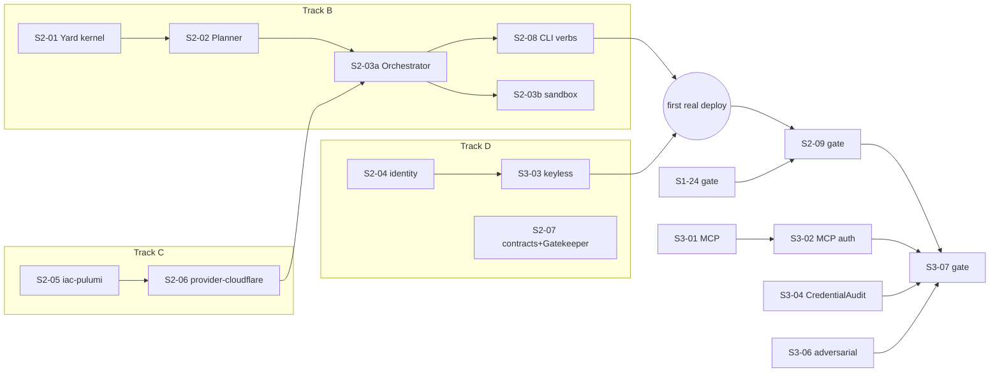

# HoBo Engineering Build Plan — scaffold to agent-operated cloud

> Baseline verified at commit `c14955f3` (2026-07-17) against the live `packages/` tree, the
> `.github/workflows/` gates, and the draft-proof promotion sources. Companion analysis:
> [`0002-public-launch-gap-analysis.md`](./0002-public-launch-gap-analysis.md) §4.1.

## 1. Why this document

[`production-build-backlog.md`](./production-build-backlog.md) carries the S1/S2/S3 work as
**skeleton micro-contracts** ("becomes actionable when its stage M0 acceptance record is Done").
This document **is** that sharpening for the remaining S1 items and all of S2/S3: per-work-item
buildable specs — target files, interfaces, events, promotion sources, tests, and runnable
acceptance — plus the dependency-ordered phase model and the three executable stage gates. Linear
stays the live tracker; this doc is the durable engineering spec the skeleton issue bodies are
updated from. The S2-00/S3-00 M0 issues should cite this document as their productionization plan.

Per [ADR-0116](../design/adr/07-portability-extensibility.md#adr-0116), this document phases the
**engineering S-surface** (build stages S1–S3); release-readiness M-phasing is out of scope here.

## 2. Verified baseline (2026-07-17)

### Built (production, tested)

| Surface | Evidence |
|---|---|
| WIT membrane | `packages/wit/wit/deps/hobo-runtime/` (workflow/step/actor/saga + agent/command/subscribe), `hobo-queue`, `hobo-scheduler`, `hobo-blob-events`; generated bindings under `packages/wit/src/generated/` |
| Durable runtime ports | `packages/runtimes/runtime-local/src/`: component host + wasmtime engine, deny-by-default `capability/link-table.ts`, in-process wRPC + wire-version, sqlite EventStore + ULID, ActorHost single-writer leases + fencing, Queue, Clock, Streamer + frame journal, `replay.ts` |
| Manifest IR | `packages/bindles/src/manifest/manifest.ts`: `hobo.manifest/v1`, `parseManifest` (parse-don't-validate), `canonicalManifestHash` (byte-stable), proto+CUE in `data-models/`, golden fixtures |
| IfC catalog | `packages/bindles/src/catalog.ts` (api/web/kv/bucket/queue/topic/secret/…), `.allow()` verb narrowing, static `compileBindleManifest` path |
| CLI shell | `packages/cli/src/shell/` (parse/registry/dispatch/render + `CANONICAL_VERBS`); implemented commands: `new`, `codegen`, `build`, `stub` |
| Conformance | `packages/conformance/src/suites/` runtime-port, component-host, capability-enforcement, sdk-parity — run against runtime-local |
| Policy | `packages/policy/src/policy-ir.ts` (`hobo.policy-ir/v1`, `policy.Decided`, effects incl. `require-approval`), agent guardrails |
| Core | EventEnvelope, Capability Manifest schema, capability grants + usage inference, DI container, `PortDescriptor` |
| Topology objects | `packages/camps/` (mapping sugar, precedence resolution), `packages/yards/` (one-provider-per-Yard invariant) |

### Holes and greenfield

| Item | Status | Evidence |
|---|---|---|
| S1-14 `@hobo/runtime` authoring surface | **Missing** | `packages/runtime/src/` contains only `training/` + `replay/` — no actors/workflow/step/`agent()`/ctx |
| S1-15 `@hobo/data` + `@hobo/events` | **Missing** | Neither package exists |
| S1-19 `hobo dev` / S1-20 `hobo collect` | **Missing / stub** | Registry stubs; no `commands/dev.ts`, no `commands/collect.ts` |
| S1-12 run-to-collect | **Partial** | Static compile exists; no collection mode, `bindle.ResourcesCollected`/`bindle.ManifestProduced` unemitted |
| S1-16 replay==live | **Partial** | Engine exists (`packages/runtime/src/replay/` incl. `assertReplayEqualsLive`); no production corpus, no upcaster case, gate runs vs draft proof |
| S1-23 failure semantics | **Partial** | Deadline carried, not enforced; no backpressure; no partial/ambiguous-failure taxonomy tests |
| S1-24 stage gate | **Not real** | `.github/workflows/s1-stage-gate.yml` runs entirely against `src/draft/technical-proofs/s1-stage-gate/`; `examples/hello-bindle` test is in-process only; no `build-s1-stage-gate-acceptance.md` |
| Entire deploy path (S2) | **Greenfield** | Zero production hits for `Planner`, `CloudProvider`, `IacProvider`, `realize(` — no `packages/cloud`, `packages/identity`, `packages/contracts`, `packages/iac/*`, no cloud `packages/providers/*` |
| Agent surface (S3) | **Greenfield** | No `packages/mcp`; keyless STS exchange, CredentialAudit projection, docs surface, adversarial hardening all unbuilt |

Note: `docs/design/stage-2-first-cloud-yard-acceptance.md` and
`docs/design/stage-3-agent-autonomy-acceptance.md` already exist — the S2/S3 gates append evidence
into them. The S1 record is the one that must be created.

## 3. Technical decisions

### D1 — First provider: Cloudflare

- **Decision:** `packages/providers/provider-cloudflare` is the S2-06 first provider. This is the
  input for S2-00's open ADR-P (first-deploy provider).
- **Rationale:** the draft proof `src/draft/projects/s2-08-provider-cloudflare/` already carries
  the Capability Manifest publication, the equivalence classes (`web/service`→Workers,
  `kv`→KV, `objectStore`→R2) and a boundary pact — only `realize()` is missing; the free tier
  makes gate runs zero-cost; seconds-scale provisioning keeps crash-resume tests fast; the Pulumi
  Cloudflare provider is mature; the equivalence classes fit hello-bindle exactly.
- **Consequence / caveat:** Cloudflare has no native OIDC→STS federation, so S3-03's keyless path
  uses **broker-minted scoped API tokens** (single vaulted root credential confined to the broker);
  true workload-identity federation lands with S4's second provider (AWS/GCP).
- **Revisit:** at S4-00, when the second provider is chosen.

### D2 — Registry is a projection, not a package, through S3

`packages/cloud/src/registry/` is a catalog **projection** over provider `capabilityManifest()`
publications, serving both the Planner (S2-02) and the `search_registry` MCP tool (S3-01).
A standalone `packages/registry` is deferred to S4, where multi-provider publishing/search is its
first real requirement. Revisit: S4-00.

### D3 — Replay corpus lives at `packages/conformance/corpus/replay/`

The conformance harness owns golden capture/replay (its S0-06 charter). The corpus is committed,
recorded from `examples/hello-bindle` via a `record` entrypoint, deterministic via Clock + ULID
seeding, and consumed by the S1-24 replay job. Revisit: if corpus size forces LFS.

### D4 — S2/S3 implementation starts immediately; only gate closure is sequential

Verified: the Planner is a **pure function** over `hobo.manifest/v1` (built) plus Capability
Manifests (schema built); the Yard kernel needs the EventStore/ActorHost/Streamer **ports** (built
in runtime-local), not `@hobo/data`; `hobo up` can consume the statically compiled manifest
(`compileBindleManifest`, built). So Tracks B/C/D/E do not wait for Track A. The only sequential
constraints are gate closures: **S2-09 is blocked on S1-24, and S3-07 on S2-09.** This corrects a
naive reading of the backlog's stage ordering — the stages order *gate closure*, not code start.

### D5 — Executor sandbox is staged

S2-03a ships a **subprocess Executor** behind the Executor port (enough for the first real deploy);
S2-03b hardens it to Firecracker (or container isolation where KVM is unavailable) **before S2-09
closes**. The port shape does not change between the two.

### D6 — Yard persistence = the existing runtime-local sqlite EventStore engine

The single-node Yard (`packages/cloud`) consumes the EventStore port with the sqlite engine that
already passes durability conformance. A distributed backend is an S6 concern behind the same port.

## 4. Build phases and parallel tracks

Five tracks run concurrently; phases are concurrency waves, not hard barriers.

- **Track A — S1 completion (SDK/local loop):** S1-14, S1-15a, S1-15b, S1-12b, S1-16, S1-19,
  S1-20, S1-23, S1-24. Off the deploy critical path (D4).
- **Track B — Yard control plane (`packages/cloud`, new):** S2-01, S2-02, S2-03a, S2-03b, S2-08, S2-09.
- **Track C — Provider + IaC:** S2-05, S2-06. Highest promotion leverage; starts day 1.
- **Track D — Identity + governance:** S2-04, S2-07 → S3-02, S3-03, S3-04. Starts day 1.
- **Track E — MCP/agent surface:** S3-01 early (needs only the CLI dispatch layer), then S3-02,
  S3-05, S3-06, S3-07.

| Phase | Parallel items | Milestone |
|---|---|---|
| **P0** | S2-05 · S2-04, S2-07 · S2-01, S2-02 (vs proof capability-manifest fixture) · S1-14, S1-15a, S1-12b, S1-23 · S2-00 M0 record (this doc feeds it) | `iac-pulumi` passes backend conformance against a local backend |
| **P1** | S2-06 · S2-03a · S1-15b, S1-16, S1-19 · S3-01 skeleton + parity test | Planner emits the golden hello-bindle DAG; `realize()` emits a real Pulumi program |
| **P2** | S2-08, S2-03b · S1-20, S1-24 re-point · S3-03 | **First real cloud deploy:** `hobo login && hobo plan && hobo up` → hello-bindle live on Cloudflare; `hobo down` tears down clean |
| **P3** | S2-09 gate · S3-04 · S3-02 | S2 gate green (mocked crash-resume rehearsal in CI + live release lane) |
| **P4** | S3-05, S3-06, S3-07 | **Agent deploys via MCP**, brokered tokens only, full audit trail |



**Critical path to first cloud deploy:** S2-05 → S2-06 → S2-03a (S2-01/S2-02 feeding in parallel)
→ S2-08 → live smoke. Track A never appears on it.
**Critical path to agent-via-MCP:** the above → S2-09 → S3-02 + S3-03 → S3-07.

## 5. Work-item specifications

Format per item:

```text
### <Key> — <Title>
Package/New files | Implements | Events | Promotes
Tests (repo norms: protobuf-first + CUE in package-local data-models/, parse-don't-validate
constructors, PACT at every boundary, architecture:guard inward-only deps)
Done when: <runnable command + observable assertion>
```

### Track A — finish S1

#### S1-14 — `@hobo/runtime` authoring surface

- **Package/files:** `packages/runtime/src/{actor.ts, workflow.ts, step.ts, agent.ts, ctx.ts, index.ts}`,
  lowering onto the existing `hobo:runtime` bindings in `packages/wit`; uses ActorHost
  leases/fencing + Clock + EventStore ports.
- **Implements:** actors/grains, `workflow`/`step`, `agent()`, typed `ctx` (state, timers, streams).
- **Events:** `run.Started/StepScheduled/StepCompleted/StepFailed/Suspended/Completed/Failed`,
  `actor.Activated/StateAppended/Passivated`.
- **Promotes:** `src/draft/epic-proofs/sdk-authoring-ifc-bindles/` runtime-authoring slices.
- **Tests:** durable-workflow kill/restart test using the existing replay engine
  (`packages/runtime/src/replay/`); PACT pin on the authoring surface; extend the sdk-parity suite.
- **Done when:** an `examples/` durable workflow survives a runtime-local restart and resumes from
  the event log in a CI test.

#### S1-15a — `@hobo/data` fold kernel (new `packages/data/`)

- **Implements:** `defineAggregate` (write-model fold + invariant check + optimistic append under
  `seq`; aggregate = actor via ActorHost lease+fencing), `defineProjection` (read-model fold,
  rebuild-from-zero; snapshots never a source of truth), chained pure upcasters `vN→vN+1`, poison
  events → `*.Quarantined`. `data-models/` proto+CUE for fold/snapshot records.
- **Promotes:** data-plane epic pacts `eventstore-append-boundary`, `projection-sink-boundary`
  (`src/draft/epic-proofs/data-plane-event-sourcing-cqrs-reactivity/contracts/pacts/`).
- **Done when:** command → aggregate → event → queryable projection round-trips; projection
  rebuild-from-zero equals live state; a guard test asserts no direct read-model mutation.

#### S1-15b — `@hobo/events` (new `packages/events/`)

- **Implements:** `emit`/`subscribe` over the Streamer port, saga choreography helper
  (`saga.Started/StepEmitted/Compensated/Completed`), reads-your-writes via `seq` (Reactor
  materializations).
- **Promotes:** data-plane pact `subscription-gateway-boundary`.
- **Done when:** a cross-aggregate saga fixture completes and compensates on a seeded failure.

#### S1-12b — run-to-collect collection engine

- **Package/files:** `packages/bindles/src/collect/` + a runtime-local collection mode.
- **Events:** `bindle.ResourcesCollected`, `bindle.ManifestProduced`.
- **Invariant:** collected output must `canonicalManifestHash`-equal the static
  `compileBindleManifest` path.
- **Done when:** hello-bindle's collected manifest equals its golden fixture across two runs.

#### S1-16 — replay==live production corpus

- **Files:** corpus at `packages/conformance/corpus/replay/` (D3), recorded from
  `examples/hello-bindle` via a `record` entrypoint; at least one upcaster round-trip case; wire
  `assertReplayEqualsLive` to the corpus as a CI lane.
- **Done when:** the replay lane runs against production packages and byte-compares green (NFR-011).

#### S1-19 — `hobo dev`

- **Files:** `packages/cli/src/commands/dev.ts` (fill the existing registry stub): boot the
  runtime-local Camp, collect (S1-12b), link, hot-reload on change, live-tail via Streamer; zero
  network, zero credentials.
- **Done when:** an egress-blocked container job serves hello-bindle within 60 s cold (NFR-002).

#### S1-20 — `hobo collect`

- **Files:** `packages/cli/src/commands/collect.ts` (`build` already exists): print/emit the
  manifest IR; `--check` against the golden fixture.
- **Done when:** green on hello-bindle in CI against the golden fixture.

#### S1-23 — membrane failure semantics

- **Files:** runtime-local: enforce carried deadlines at every link boundary (each link a timeout
  boundary), membrane backpressure, typed partial/ambiguous-failure taxonomy (proto+CUE in
  runtime-local `data-models/`).
- **Done when:** adversarial conformance cases (slow provider, mid-call crash, saturated queue)
  fail closed with the taxonomy's typed errors.

#### S1-24 — stage gate re-point — see §6.

### Track B — Yard control plane (new `packages/cloud/`)

#### S2-01 — Yard kernel: Gateway + Event Store + projections

- **Files:** `packages/cloud/src/{gateway/, store/, projections/, registry/}`.
- **Implements:** Gateway ingress (authn/z, commands → events, serves read models; stateless);
  EventStore via the core port with the runtime-local sqlite engine (D6); projections including
  the **Registry catalog projection** (Capability Manifest snapshots, D2).
- **Events:** the control-plane catalog — `match.Decided`, `deployment.Planned/Deployed/PlanRejected`,
  `resource.Planning/Provisioned/DriftDetected`, `exec.Output/Diff/Succeeded` — proto+CUE in
  `packages/cloud/data-models/`.
- **Promotes:** the 12 pacts + event catalog in
  `src/draft/epic-proofs/control-plane-planner-matching-orchestrator/`.
- **Done when:** a deploy command round-trips to a queryable projection and the projection rebuilds
  identically from the log.

#### S2-02 — Planner + Matching

- **Files:** `packages/cloud/src/planner/`.
- **Implements:** pure `plan(bindle, config, registry) → DeploymentPlan` with the six steps of
  [`control-plane.md`](../design/control-plane.md): lower IR → `ResourceIntent`; bind-edge DAG;
  Resource-Definition context-matching emitting `match.Decided`; `Capability.satisfies(req) →
  full | partial(missing) | none` negotiation; region/colocation; min-cost objective ranking with
  stable tiebreak → `ResourcePlan{name, port, provider, options, deps, strategy}`. Content-addressed
  plan hash in `deployment.Planned`; `deployment.PlanRejected` carries a machine-readable,
  remediation-bearing reason.
- **Done when:** hello-bindle's manifest yields the golden DeploymentPlan DAG byte-stably, and a
  rejection carries machine-readable remediation.

#### S2-03a — Orchestrator + ResourceActors + subprocess Executor

- **Implements:** ResourceActor FSM (`Pending→Planning→Provisioning→Provisioned→(Updating|Destroying)
  →Destroyed`, `Failed→Compensating`); reconcile = desired(`ResourcePlan`) + observed
  (`IacProvider.refresh`) → diff (`preview`) → dispatch `IacProgram` to Executor → `exec.Succeeded`
  → `resource.Provisioned`; choreographed compensation in reverse-dependency order; Executor as a
  typed port with a **subprocess** implementation first (D5).
- **Promotes:** `src/draft/epic-proofs/deployment-strategy-saga-orchestrator/` crash-resume fixture;
  `local-container-provider` pact from `src/draft/epic-proofs/providers-iac-build-adapters/` for the
  CI rehearsal lane.
- **Done when:** SIGKILL mid-deploy + restart resumes the saga to `Deployed` by replay in the
  mocked lane.

#### S2-03b — Executor sandbox hardening

- **Implements:** Firecracker (or container-isolated fallback where KVM is absent) behind the same
  Executor port; scoped credentials injected per-execution from the broker; `exec.Output`/`exec.Diff`
  streamed.
- **Done when:** sandbox conformance passes (no ambient credentials, no network beyond provider
  endpoints); evidence feeds S2-09.

#### S2-08 — CLI cloud verbs

- **Files:** fill the `login/plan/up/down` registry stubs over a Gateway client;
  `plan` renders the DeploymentPlan diff (human + JSON envelope).
- **Promotes:** CLI/Gateway boundary pacts from `src/draft/epic-proofs/cli-mcp-developer-experience/`.
- **Done when:** plan→up→down cycle green against the Yard in the mocked lane, PACT verified on
  both sides.

#### S2-09 — stage gate — see §6.

### Track C — Provider + IaC

#### S2-05 — `packages/iac/iac-pulumi/` (new)

- **Implements:** the `IacProvider` port — `preview(program)→Diff`, `apply→Outputs`, `destroy`,
  `refresh→DriftReport`.
- **Promotes (nearly whole):** `src/draft/technical-proofs/s2-06-iac-pulumi-automation-adapter/` —
  per-resource stacks keyed `tenant/deployment/resource` locked via the resource's ActorHost lease,
  preview→apply divergence guard, partial-apply compensation, `outputsToBindings()`,
  `validateIacProgram()`, and the `runIacBackendConformance` suite. Swap the simulated engine for
  the real Pulumi **Automation API pinned 3.130.0**.
- **Done when:** the IaC conformance suite is green against a local file backend in CI, and the
  divergence guard fires on seeded drift.

#### S2-06 — `packages/providers/provider-cloudflare/` (new; D1)

- **Implements:** the `CloudProvider` port — `realize(plan: ResourcePlan) → {iac: IacProgram,
  build?: BuildSpec}` emitting Pulumi Cloudflare programs, `capabilityManifest()`, `client(port,
  outputs)`.
- **Promotes:** `src/draft/projects/s2-08-provider-cloudflare/` (Capability Manifest publication,
  equivalence classes web→Workers / kv→KV / objectStore→R2, boundary pact, hello-bindle plan).
- **Tests:** provider-conformance-gate + realize-emission pacts
  (`src/draft/epic-proofs/providers-iac-build-adapters/`); golden `IacProgram` per port.
- **Done when:** hello-bindle's golden plan realizes to a previewable Pulumi program; live
  apply/destroy runs clean in the release lane.

### Track D — Identity + governance

#### S2-04 — `packages/identity/` (new)

- **Promotes:** `src/draft/projects/s3-02-hobo-identity/` — `IdentityService` (workload attestation
  → JWT-SVID issuance, JWKS, TTL 900 s / renewal grace 300 s, scope-narrowing-only rotation),
  `identity.Issued/Rotated` events with never-compact `CREDENTIAL_AUDIT_RETENTION`.
- **Adds:** the token-broker skeleton — the broker holds the single vaulted Cloudflare root
  credential and mints per-deploy scoped, TTL'd API tokens; `token.Granted/Used/Revoked` events.
- **Done when:** an Executor receives a brokered scoped token for its apply; a secret-scan
  assertion shows no static secret outside the broker.

#### S2-07 — `packages/contracts/` (new) + Gatekeeper

- **Implements:** Contract IR + `can-deploy` compatibility engine; Gatekeeper composes contract +
  the existing Policy IR (`packages/policy`) + obligation + cost-quota engines at the deploy
  decision point.
- **Promotes:** the 9 pacts in `src/draft/epic-proofs/contracts-policy-governance/`
  (gatekeeper-policy/contract/obligation/cost-quota engines).
- **Done when:** a seeded unsafe change is denied with an explainable, machine-readable reason
  (FR-050/051/052, NFR-017); the permissive default pack still records `policy.Decided` on every
  deploy — governed-by-default without blocking P2's first deploy.

#### S3-03 — keyless end-to-end

- **Implements:** the broker → provider path per the `provider-sts` pact
  (`src/draft/epic-proofs/identity-auth-secrets-cross-app-access-xaa/`). For Cloudflare (D1):
  broker-minted scoped tokens count as brokered; the bounded static key is confined to the broker
  vault; brokered-ratio metric ≥ 99% (NFR-005).
- **Done when:** a full deploy completes with zero static provider keys in any environment or
  process outside the broker; a token past TTL is rejected.

#### S3-04 — CredentialAudit projection

- **Files:** `packages/cloud/src/projections/credential-audit.ts` over `identity.*` / `token.*` /
  `session.*`; retention-floor enforcement — never compacted (NFR-018).
- **Done when:** grant/use/revoke are visible and correlated by `correlationId`; a retention test
  shows pre-floor events still present after compaction runs.

### Track E — MCP / agent surface

#### S3-01 — `packages/mcp/` (new)

- **Implements:** MCP server over the **same dispatch layer** as the CLI (`CANONICAL_VERBS`
  registry). Tools: `list_bindles`, `get_bindle`, `plan`, `deploy`, `promote`, `rollback`,
  `destroy`, `inspect_run`, `tail_logs`, `search_registry` (reads the S2-01 registry projection),
  `request_token`, `get_drift`, `heal`.
- **Tests:** NFR-004 parity — generated tool surface == CLI verb surface (lift the
  `mcp-control-surface` pact from the cli-mcp epic).
- **Done when:** the parity test is green and a scripted client completes plan→up on the mocked Yard.

#### S3-02 — MCP auth: SVID + per-tool capability scoping

- **Implements:** deny-by-default per-tool scopes on the SVID model; the **inert-tool-output
  invariant** ([ADR-0023](../design/adr/02-identity-security.md#adr-0023)): tool results are data
  and can never schedule/authorize/widen a follow-up call beyond the agent's existing grant.
- **Done when:** an unscoped tool call yields a typed denial plus an audited `token.*` event; the
  inert-output property test is green.

#### S3-05 — agent docs surface

- **Implements:** `llms.txt` / `llms-full.txt` / `docs.json` generated from the CLI/MCP registry
  (single source, drift-gated like `codegen --check`); npx onboarding path (NFR-015).
- **Done when:** a fresh scripted agent self-serves from `docs.json` to a green `hobo dev`.

#### S3-06 — adversarial hardening

- **Implements:** prompt-injection corpus (`packages/mcp/test/corpus/`) failing closed;
  per-principal / per-tenant rate limits + quotas with backpressure at the Gateway (NFR-019).
- **Done when:** a flooding principal is throttled with a typed error while a control principal is
  unaffected; every corpus case fails closed.

#### S3-07 — stage gate — see §6.

## 6. The three executable gates

### S1-24 — re-point `s1-stage-gate.yml` at production

Edit the existing workflow, keeping its four-job shape:

1. **conformance** — runtime-port + component-host + sdk-parity suites from `packages/conformance`
   against `packages/runtimes/runtime-local` (paths change from the draft proof to production).
2. **offline** — `docker run --network=none`: `hobo dev` on `examples/hello-bindle`, assert serving
   within 60 s cold.
3. **replay** — the D3 corpus lane: rebuild-from-zero byte-equals live, including the upcaster case.
4. **record** — writes **`docs/design/build-s1-stage-gate-acceptance.md`** (new; mirrors the S0
   record) mapping each Stage-0/1 criterion → CI job + run URL. Required check on `main`.

### S2-09 — new `.github/workflows/s2-stage-gate.yml`

Two lanes (per the repo's no-live-E2E-in-CI testing policy):

- **rehearsal** (CI, mocked): Yard + local-container-provider + Pulumi local backend; the script
  deploys the reference Bindle, SIGKILLs the Yard mid-`Provisioning`, restarts it, and asserts
  resume → `Deployed` via replay; a second case asserts the Gatekeeper blocks a seeded
  contract-violating change with a machine-readable reason.
- **live** (`workflow_dispatch`, environment-protected, broker-issued Cloudflare token, guaranteed
  teardown step): the same script against the real cloud.

Evidence: both lanes append run records to the existing
[`stage-2-first-cloud-yard-acceptance.md`](../design/stage-2-first-cloud-yard-acceptance.md).

### S3-07 — new `.github/workflows/s3-stage-gate.yml`

- **agent-e2e** (rehearsal + live variants): a deterministic scripted agent harness (not an LLM)
  drives a deploy exclusively through MCP tools and asserts: (a) secret-scan + broker metric —
  zero static provider creds, ≥ 99% brokered; (b) the CredentialAudit projection shows the full
  grant→use→revoke trail for the run's `correlationId`; (c) a seeded `deployment.PlanRejected`
  with remediation → the harness self-corrects by following the remediation field and redeploys.
- **adversarial**: the S3-06 injection corpus fail-closed + throttling cases, gate-required.

Evidence: appended to the existing
[`stage-3-agent-autonomy-acceptance.md`](../design/stage-3-agent-autonomy-acceptance.md).

## 7. Traceability and repo integration

- **Backlog mapping:** item keys here are the backlog's keys; splits are sub-issues under the
  existing skeletons (S1-15a/b under S1-15, S2-03a/b under S2-03, S1-12b under S1-12) so the
  backlog's key space and its Linear import record stay intact.
- **Linear:** update the existing skeleton issues' bodies (paced single-writer, one `save_issue`
  at a time) replacing the "Skeleton slice…" blockquote with the sharpened spec block from §5 —
  exactly the sharpening the stage M0 pattern prescribes. S2-00/S3-00 get a body pointer to this
  document as their productionization plan. No new top-level issues.
- **Verification (this doc):** `pnpm run docs:okf`, `pnpm run lint:docs`, `pnpm run docs:freshness`,
  `pnpm run docs:coverage`. `architecture:guard` is unaffected (no `packages/` or `src/` changes).
