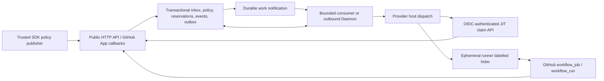

# HoBo CI hosting and SDK policy plan

Status: Vercel hosting selected by the user, with lowest verified total cost and
temporary execution as priorities. Hosting implementation and provisioning are
separate work. Policy and storage API names below remain proposed.
Research date: 2026-10-26, America/Chicago.
Repository baseline: `4e2e7ca2c0360224e3beb1a982834e80495bb3d8` (#1596).

## Selected decision

HoBo CI needs an independently available control service before a workflow can
use `runs-on: hobo`. The previous delivery supplies a deployable relay and local
execution evidence. It does not provision a public HoBo service, DNS, a GitHub
App, provider accounts, or their credentials.

The user selected the Vercel option that serves a public relay. Build the managed
service on Vercel Functions, optionally organized as a backend Service, with a
transactional database and durable work delivery. The existing persistent
container remains a self-hosted adapter and a regression reference; it is not an
intermediate deployment prerequisite. Ship the SDK configuration and durable
controller boundaries as part of this Vercel implementation. Add a Vercel Daemon
only for continuous polling that cannot be handled conveniently by bounded
consumers. Do not build every hosting adapter in the first release.

This separates two decisions: where the controller runs, and which providers
supply CI machines. A controller on Vercel can route jobs to GitHub, Blacksmith,
Depot, WarpBuild, and Kubernetes. Controller hosting need not change when a
provider's free allocation or budget runs out. The default decision minimizes
projected total incremental cost after applicable free allocations, subject to
the account's constraints and current evidence.

## Existing code and missing product behavior

| Area | Implemented | Remaining work |
| --- | --- | --- |
| Workflow routing | Signed queued-job intake, reservations, pinned host dispatch, OIDC/JIT claims and settlement | Public service deployment and operator onboarding that establish this dependency before switching workflows |
| Durability | Local SQLite journal, process `flock`, recovery, backup and restore | Portable transactional state boundary for managed runtimes; shared ownership fencing and persistent inbox/outbox |
| Scheduling | Five-second process timer, host discovery and reconciliation | Durable work delivery and recovery of deliveries the process never received |
| Configuration | Generated account contracts, typed `getPolicy`/`putPolicy`, ETag/CAS | SDK authoring, policy compilation, safe apply/diff/explain and managed authentication |
| Budget signals | Station bridge consumes Broker threshold/recovery facts and persists ordering | Separate desired enablement, budget eligibility, observed health, and usage state |
| Providers | Offer records and existing runner-provider capability/dispatch adapters | Station Connection binding, account setup status, fresh entitlement/price inventory, and an explicit supported runner-host capability |
| Deployment | Compose and Kubernetes persistent singleton assets | Managed bootstrap, stable origin, secret/identity provisioning, delivery repair and operational status |

Concrete implementation anchors:

- [`main.ts`](../../../packages/ci-gh-actions/src/main.ts) requires a public HTTPS
  origin, secret files, a local database and a partition lock.
- [`LeaseStore`](../../../packages/ci/src/store.ts) directly uses `node:sqlite`;
  [`service.ts`](../../../packages/ci-gh-actions/src/service.ts) combines Node
  HTTP with process timers. Neither is a stateless hosting adapter.
- [`client.ts`](../../../packages/ci-gh-actions/src/client.ts) already provides
  an account-scoped policy API. Extend it rather than create a second remote API.
- [`ci-routing.ts`](../../../packages/stations/src/ci-routing.ts) already connects
  Broker budget facts to CI eligibility.
- [`hobo-ci-host.yml`](../../../packages/ci-gh-actions/templates/hobo-ci-host.yml)
  starts a runner on a selected provider. It does not host the relay.
- [`StationConnectionResolver`](../../../packages/stations/src/connector-context.ts),
  [`connectionRef`](../../../packages/bindles/src/connection.ts), existing
  `@hobo/sdk` policy helpers and `@hobo/dispatcher` are reuse points.

## Hosting options

| Option | Can receive GitHub calls? | State and scheduling | Assessment |
| --- | --- | --- | --- |
| Current container on a VM or persistent container service | Yes, with stable TLS ingress | Existing SQLite volume and one active owner | Existing self-hosted alternative; not the selected managed host; no automatic HA claim |
| Existing Kubernetes deployment | Yes, through Ingress/Gateway | PVC, one replica, `Recreate` | Supported current packaging; updates can interrupt intake, so missed-delivery recovery is required |
| Vercel Functions/Services with external database and durable consumers | Yes | Transactional database plus durable inbox/outbox, queue and scheduled repair | Selected managed target; requires state/HTTP/worker adapters |
| Same Vercel architecture plus Daemon | HTTP remains in Functions/Services | Daemon polls shared durable work, database owns authority | Useful for continuous pollers, including a future scale-set listener; not required for every webhook-driven task |
| Vercel Daemon alone | No inbound HTTP/TCP in current beta | Ephemeral disk; old/new instances can overlap | Reject for the current relay |
| Vercel container Function with local SQLite and timers | Yes | Local state/process lifetime is not durable authority | Reject; container packaging does not turn Functions into persistent hosts |
| Cloudflare Worker plus SQLite-backed Durable Object per account/partition | Yes, through Worker ingress | Durable actor storage and alarms; explicit transaction boundaries | Strong alternative matching actor semantics, but requires runtime/storage/crypto adapters |
| Managed HTTP containers such as Cloud Run/ECS, backed by transactional storage | Yes | External store and explicit worker wakeups | Viable adapter family; do not assume container-local disk or idle CPU provides durable scheduling |
| GitHub workflow that deploys the independent service | The deployed service does | Hosting platform owns state after deployment | Useful bootstrap/update mechanism on already available runners |
| Relay started inside the queued `hobo` job | No, before runner assignment | No process can start yet | Reject: circular dependency |
| Separate finite GitHub job plus a relay tunnel | Temporarily | Finite job, temporary endpoint/disk unless separately provisioned | Development/diagnostics only; not the managed controller |
| Temporary Vercel deployment / Vercel Drop | Limited; see below | Anonymous expiry and isolated-preview state require separate handling | Evaluate for isolated tests; not the durable production webhook entry point |
| Outbound GitHub runner scale-set listener | Job demand arrives by long polling | Still needs independent compute, durable policy/ledger and worker ownership | Credible future alternative to webhook-based demand; not a relay-free hosting solution |

Vercel's current official Daemon documentation is decisive: public beta,
production deployments only, fixed instance counts, no inbound HTTP/TCP, no
persistent local storage, no service-binding/rewrite target, and no Daemons in
`vercel dev`. Use Docker locally for a Daemon. A rollout can overlap old/new
workers; configuring one instance does not establish a distributed lock.

Vercel Services organize multiple HTTP applications and shared deployment/routing.
Container Functions remain request-driven and stateless. Neither removes the
need for transactional budget state. Vercel Workflows can orchestrate durable
multi-step work, but cannot make a provider launch with an ambiguous response
safe to repeat. Use existing lease state and reconciliation for that boundary.

GitHub's official `actions/scaleset` client is a Go public-preview API client
for custom autoscalers, with outgoing demand polling and JIT registration. It
does not require adopting all of ARC/Kubernetes. Evaluate this after the existing
protocol is hosted; do not rewrite runner provisioning and hosting together.

## Managed service shape



The Vercel layout puts webhook, policy, onboarding and JIT endpoints in HTTP
Functions/Services. The database is the authority for every reservation and
transition. Initially use bounded queue consumers and an independent scheduled
repair pass. Add a Daemon for sustained polling only when measurement or the
chosen provider/listener protocol requires it. The Daemon receives outbound
access to the same database/queue, not inbound service bindings.

### Lowest-cost operation and temporary deployments

Keep a stable production HTTPS entry point in an event-driven Function. GitHub
can reach it when the first job is queued, without a continuously running relay
VM. Vercel documents no Function CPU or memory charges between requests; this
does not make the database, queues, scheduled repair, network, hosting plan or
CI provider free. Vercel may keep a warm instance internally, so do not equate
the absence of idle charges with a guarantee that all processes disappear.
Run bounded consumers only when work arrives or repair is due. Start a separate
ephemeral provider host per reservation and release it only after shutdown is
confirmed. Persist policy, spending and uncertain reservations across runs.

Choose controller resources from verified account-specific total costs, including
plan eligibility, idle database/storage minimums, queue operations, Function
invocations/memory/CPU, scheduled repair, egress and setup. Compare a recurring
Daemon against event-driven Functions only with measured workload and actual
prices. No universal cheapest hosting tier is assumed, and personal/free usage
must satisfy the provider's terms. A production service cannot replace this with
an isolated per-run state database: overlapping jobs must share one authoritative
budget and lease ledger.

Vercel Drop is a browser upload workflow. Anonymous Drop supports only static
sites; signed-in framework drops create a normal production deployment. The
`vercel deploy --temporary` anonymous CLI mode expires, but Vercel documents that
it is unavailable in CI and linked project directories. Neither provides an
automatic per-CI-run hosted backend with a stable GitHub App webhook URL.

Support isolated temporary **test** deployments when an authenticated Vercel
project/API and its plan permit them. An independent bootstrap runner creates a
preview with its own test App/webhook URL, credentials, account binding and
isolated test state, verifies reachability, runs contract/act tests and removes
it after confirmed completion. Give cleanup an expiry and an orphan sweep; never
delete a shared production endpoint or ledger, overwrite the production App
webhook, or reuse another tenant's data. Run-scoped preview deployment is
optional and must be measured against the cost of using the existing on-demand
production endpoint; it is not presented as guaranteed cheaper or supported by
anonymous Drop/`--temporary` in CI. Actual Vercel/provider execution remains a
separately verified integration result, not a consequence of mock tests.

Deliver a `@hobo/ci-vercel` hosting adapter inside the monorepo. Keep the existing
webhook/JIT paths (`/github/webhooks`, `/v1/leases/:id/jit`) and existing account
read/onboarding paths. Introduce a versioned desired-policy write API rather than
claim compatibility for the legacy full-account write, as described below. Preserve
raw request bytes for GitHub HMAC verification and `Cache-Control: no-store` for
control/JIT responses. Bind OIDC audience to the stable production relay origin.

Use Vercel-managed HTTPS and a stable production project alias initially; a
custom domain is optional. The GitHub-facing production routes must be reachable
without interactive Vercel deployment protection. Their GitHub signatures, OIDC
verification and account authorization remain mandatory. A protected repair/cron
endpoint verifies its own platform identity before doing work.

Keep database and Functions colocated where supported, use pooled connections,
and test overlapping deployments against shared durable state. Preview
deployments use isolated credentials/state and contract-backed provider servers;
they must not consume production jobs. An optional Daemon is production-only in
the current beta, so previews/local testing must not assume that it exists.

Require a dependable minute-level repair trigger and, with dependencies healthy,
target recovery of a lost outbox wakeup or missed webhook within five minutes.
Vercel Cron on Pro/Enterprise supports this schedule; Hobby Cron runs only daily
with hour-level precision and cannot meet this target. This is a limit of that
Cron implementation, not a technical requirement that all relay hosting use Pro.

Investigate a Hobby-compatible scheduler based on delayed Vercel Queues messages
or an outbound polling Daemon. A recurring message chain needs independently
seeded recovery and monitoring: a failed successor publish, message expiration,
worker quota or stopped Daemon must not silently end repairs. The Hobby Daemon
has a five-active-CPU-hour monthly quota and stops when exhausted. Accept another
scheduler only after testing its availability, quotas, independent recovery and
ability to meet the same target; otherwise fail readiness with a clear reason.
Vercel's Hobby plan is restricted to personal, non-commercial use; verify plan
terms separately for the intended managed service.

Persist `dueAt`, delivery-scan cursors and bounded continuation progress; every
invocation claims a bounded batch, and overlapping invocations are safe. A stale
repair heartbeat or overdue work triggers an alert. A prolonged dependency outage
is surfaced as an incident, not counted as meeting the recovery target. The
deployment planner rejects a scheduler that cannot support the selected target.

Operator hosting intent should also be SDK-authored. For example, a proposed
`defineCiService` in `@hobo/ci-vercel` would reference a database Connection,
Vercel queue and App secret bindings, set `workers: 'queue-functions'`, and
attach the compiled policy publisher. These are references to provisioned
resources, not plaintext values or assumed successful provisioning. A Vercel
deployment plan must show the missing bindings and infrastructure changes before
apply; declaring this object alone cannot create a working GitHub App.

Use a transactional relational database adapter, with PostgreSQL as the initial
managed-store candidate. Select/provision the concrete integration only in the
implementation/deployment phase. Do not substitute Blob, a read-mostly config
store, or unrelated remote KV writes for atomic budget reservation transactions.
Keep local SQLite as the default self-hosted adapter, following HoBo's existing
durable event/effect/fencing contracts where practical.

Provision one HoBo-owned GitHub App for the managed product. Its registration
callbacks, installation/repository mapping, webhook subscription, secret rotation
and tenant authorization are real service responsibilities. Customers install
that App and connect existing provider accounts through Station-owned Connections.
The managed service supplies the relay origin automatically. Self-hosted operators
use the same contracts with their own App, origin and deployment binding.

Managed SDK authorization uses HoBo identity: an authenticated administrator
selects an account/Station they administer and receives a short-lived, scoped
service credential or workload-identity exchange. The service verifies subject,
issuer, audience, expiry, revocation and account membership on every operation.
Credential refresh must preserve that scope; revoking account membership removes
write authority. There is no managed requirement to hand-edit a token-hash file.

Link a GitHub installation through a server-issued, expiring, single-use state
bound to that HoBo identity/account/Station. The callback verifies installation
identity through the App and verifies the installing administrator's authority
over the repository/organization through the authorized GitHub identity flow.
An installation ID supplied in request JSON is not proof of ownership. Persist
one authorized owner and reject cross-account linking, callback replay and
installation transfer without the explicit ownership migration protocol. GitHub
App registration, HoBo login and provider Connection authorization are distinct
flows with separately tested callback contracts.

Never run customer CI commands in the API, ledger worker, or credential-bearing
controller Daemon. Those components provision isolated provider hosts.

## SDK policy and provider configuration

Provide three separate SDK surfaces:

1. Authoring: declare desired CI pools, Connection references, budgets and routing.
2. Publishing: compile, diff, apply with expected revision, inspect status and
   explain an admission decision through the existing account client.
3. Hosting: declare controller deployment, durable store, wakeups and secret/identity
   bindings. Hosting configuration belongs to operators, not every workflow.

The following is proposed API design, not exports available in the current SDK.
Exact names must follow the existing `@hobo/sdk` declaration conventions.

```ts
import { connectionRef } from '@hobo/bindles';
import { defineCiPolicy } from '@hobo/ci'; // proposed

export default defineCiPolicy({
  accountId: 'acme',
  pool: { label: 'hobo', os: 'linux', architecture: 'x64' },
  providers: [
    { id: 'github', kind: 'github', connection: connectionRef('github-ci') },
    { id: 'blacksmith', kind: 'blacksmith', connection: connectionRef('blacksmith-ci') },
    { id: 'depot', kind: 'depot', connection: connectionRef('depot-ci') },
    { id: 'warpbuild', kind: 'warpbuild', connection: connectionRef('warpbuild-ci') },
    { id: 'k8s', kind: 'kubernetes', connection: connectionRef('ci-cluster') },
  ],
  budget: { scope: 'ci-account', currency: 'USD', limit: '100.00', period: 'calendar-month', timeZone: 'UTC' },
  routing: {
    strategy: 'lowest-total-incremental-cost',
    equalCostTieBreak: 'applicable-free-allocation',
    unknownAllocation: 'zero',
    noEligibleProvider: 'queue',
  },
  thresholds: [
    { fraction: 0.8, allow: ['depot', 'k8s'] },
    { fraction: 1, allow: ['k8s'] },
  ],
});
```

Provider declarations resolve to compatible machine offers through the Connection
and capability registry. An operator may explicitly select a SKU/host label;
omitting one must invoke a defined compatible-class choice, not invent a label.
Initial scope is the currently supported homogeneous Linux x64 trusted pool.
Broader OS/architecture/privilege classes require explicit pool declarations.

The compiler emits versioned protobuf policy data with CUE constraints and a
content digest, pinned to account/Station/Rail provenance. Decimal USD strings
lower exactly to microdollars. Network-free compilation is deterministic;
it validates schema, reference syntax, rule consistency and declared pool classes.
Connection existence, ownership, authorization and actual supply are checked by
authenticated resolve/apply. Offline resolution may use an explicitly supplied
content-addressed Station snapshot, with that version checked again at apply;
compilation cannot discover live Connections without such an input.

Policy authoring must compose existing policy ceilings and the Dispatcher; it
must not introduce another independent decision engine. Mandatory parent/platform
deny rules and declared policy ceilings cannot be weakened by CI policy. Extend
generated contracts before adding implementation.

Hard financial guarantees in the initial ledger apply to the CI account and its
provider/entitlement reservations. Broker threshold events are eventually delivered
eligibility signals; they do not atomically enforce a shared spend ceiling across
CI and other resource classes. If a policy requests a hard shared parent budget,
admission must obtain an authoritative parent reservation or a preallocated CI
escrow grant that the parent authority already deducted from its shared allowance.
CI reserves within that grant, settles actual usage, and returns only confirmed
unused funds; uncertain work retains its grant. Replays cannot allocate it twice.
Without this supported parent-budget binding, reject a hard shared-budget policy
instead of silently treating threshold events as strict global enforcement.

Separate desired configuration from observations:

| Desired, authored data | Observed or runtime-owned data |
| --- | --- |
| Provider Connections, enabled/paused intent, allowed machine classes, budget ceilings, strategy, threshold profiles | Connection health, effective price, remaining entitlement, spend snapshots, active reservations, signal cycles, actual job attribution, circuit breakers |

Enforce this separation on the server, not only in the SDK. Introduce a generated
desired-policy payload at `/v2/accounts/self/policy` and separate authorized usage
observation and Broker-signal commands. Tenant policy publishing cannot mutate
spend, balances, signal cycles or lease records. Observation publishers and signal
consumers have distinct privileges and retain the monotonic watermark checks.

The managed Vercel service rejects legacy full-`Account` policy PUT requests with
an explicit upgrade-required response. Extend the typed client with desired-policy
apply and a documented migration; retain compatible existing reads, onboarding
and lease/JIT paths. The self-hosted v1 adapter remains a separate supported
compatibility surface, not a bypass reachable on the managed service. Migrate
existing managed policy/observations once, preserving their revisions and usage
history; never initialize observed values from new policy defaults. Include
direct legacy-client attempts to reset spend or overwrite signals in the contract
suite. New managed clients do not receive observation-publisher authority.

Publishing unchanged policy must preserve spend, signals and leases. Applying
new policy atomically updates intent and computes effective eligibility:

`operatorEnabled && budgetAllowed && connectionReady && capabilitiesMatch && evidenceFresh && capacityAvailable`

The current bridge writes `offer.enabled`; a future declarative reconciler must
separate these predicates before it can safely own desired state. A budget
recovery must never reactivate an operator-paused or unhealthy provider. Existing
revision checks and signal watermarks remain enforced. An empty routing profile
pauses new admissions. Already reserved hosts retain their bounded commitments;
do not promise that pausing prevents every already registered idle runner from
receiving a job.

An example threshold that permits Kubernetes at 100% does not bypass the account
budget. It can run only if its verified incremental charge fits the remaining
ceiling, including a legitimately zero incremental-cost offer. Otherwise queue
or fail according to the explicit policy. Provider selection never waives a cap.

Keep Dagger and Cloudflare command executors as sibling execution backends. Their
presence does not imply that they can host an official GitHub Actions runner.
They may share economic policy contracts only where their capabilities match.
CI runner placement and HTTP traffic routing may consume the same HoBo budget
facts, but remain different resource classes with different execution semantics.

## Provider realization and usage evidence

Reuse Station Connection ownership and existing runner adapters. Add narrow
provider operations for readiness/capabilities, offer and entitlement observation,
dispatch/provision, status, and confirmed shutdown. Dispatch credentials are
short-lived and acquired through the Connection/token broker; never serialize
App keys or provider tokens into an SDK policy or reviewed repository file.

Each resolved offer needs account identity, supported execution/pool class, an
all-in billing quote, observation time, freshness bound, allocation expiry/reset,
and evidence source. An entitlement bucket needs a period and scope: provider
account, applicable SKU/architecture, unit and remaining balance. Shared free
minutes/credits across SKUs must share one reservation bucket rather than appear
as a complete free balance on every offer. Current one-offer-per-provider-account
ownership is conservative; relaxing it requires this shared-bucket ledger first.

The user's latest preference is to choose the cheapest compatible provider.
Compute each offer's projected total incremental bill **after** applying its
verified free allocation, then select the lowest amount; use available free
allocation and its expiration as tie-breakers. An entirely free job naturally
wins over a paid job. A partly free provider does not take precedence over a
cheaper all-paid provider: these are unsplittable jobs and strict use-every-free-
minute-first can otherwise increase the actual bill. A user who explicitly wants
strict free-first behavior may select it as a separate future policy.

For example, a 10-minute host with one free minute and a 1,000-microdollar rate
costs 9,000 microdollars; an all-paid host at 100 microdollars costs 1,000.
Choose the latter. Include setup/runtime/cleanup, rounding, provider/platform
fees and explicitly charged extras. A cheap per-minute machine
with different capabilities is not an interchangeable offer. Unknown allowances
are zero; stale evidence disables its unsupported free claim. If billing data is
unavailable, require an explicitly supported conservative quote or queue.

Support API-backed observations where the provider exposes an authoritative
boundary. Otherwise use an authenticated, expiring operator observation with
clear provenance; do not claim automatic account discovery. Marketing free tiers
are not account entitlements. Monthly rollover is an explicit journaled state
transition, with cross-period reservations handled conservatively; it is not
implemented by resetting spent fields on deployment or copying a new seed file.

The current host-workflow bridge is a realization strategy. Vendor labels alone
do not prove support for a nested JIT runner. Enable a provider only with its
supported host capability and tested lifecycle contract; record actual vendor
compatibility separately from local simulations. Add native provisioning only
where a provider exposes and authorizes the necessary API. A future adapter must
not pretend that changing a queued GitHub job's `runs-on` is an API operation.

GitHub assigns jobs to matching idle runners. A shared `hobo` pool is not a
per-job binding to the host that its webhook caused us to reserve. Preserve the
existing actual-assignment accounting. Arbitrary per-workflow provider/privilege
rules require enforceable pool/group/repository isolation or additional routing
labels; do not promise them under one indistinguishable label.

## Rubber-duck walkthrough

1. An operator deploys the controller using an existing runner, local SDK tooling,
   or another independent platform bootstrap. This path does not use `hobo`.
2. The public HTTP service, database, durable wakeups and App are verified. A
   stable origin and installation mapping exist before customer jobs depend on it.
3. An account administrator connects providers in HoBo, authors SDK policy, and
   applies its compiled manifest. Status explains missing capabilities/credentials
   or stale allocation evidence instead of reporting configuration-only readiness.
4. Repository onboarding installs and pins the reviewed host workflow/bootstrap.
   The service verifies trust, scope, provider supply and a testable connection.
5. A workflow queues a `hobo` job. GitHub sends the signed event to the public
   endpoint. The endpoint validates the envelope and commits an authenticated
   inbox entry before returning success, with a target p95 below two seconds.
6. A worker verifies current GitHub job/repository authority, selects eligible
   supply and atomically reserves cost/free allowance with the current policy
   revision, then stages dispatch intent/outbox. No provider network I/O occurs
   inside that transaction.
7. The worker dispatches the pinned provider host. The host obtains a JIT config
   through the public claim API and runs one ephemeral `hobo` runner. GitHub
   assigns a queued eligible job; the original workflow stays in GitHub.
8. Completion, cleanup confirmation and usage observation settle the reservation.
   Broker signals or SDK edits affect future admission, with existing reservations
   retained until their outcome is known.
9. After an outage, a scheduled repair scans durable pending work and GitHub
   failed deliveries/queued jobs. It recovers demand even when the original event
   never reached the relay. Budget-queued work has an explicit maximum age and
   visible reason before GitHub's own queue expiry.

GitHub requires webhook responses within ten seconds and does not automatically
redeliver failures. Current known-lease recovery is insufficient for a first
event missed during an outage. Delivery repair and trusted queued-job discovery
are required; do not infer that GitHub retries automatically.

## Adversarial kill log and safeguards

| Attack or failure | Decision/safeguard |
| --- | --- |
| Original CI action starts the relay it is waiting for | Kill; independent bootstrap and stable public service |
| Daemon receives the webhook or persists the budget in local SQLite | Kill under current Vercel limits |
| One configured Daemon instance is treated as a distributed lock | Kill; database transactional claims, owner epochs and fencing survive rollout overlap |
| HTTP 202 is returned before durable intake | Kill; commit inbox before success; unavailable store returns failure and delivery repair catches it |
| DB commits but queue notification is lost | Transactional outbox plus periodic recovery; queue is a wakeup, not the ledger authority |
| Queue redelivery launches or bills twice | Durable idempotency keys and atomic state transitions; queue retention-window dedupe alone is insufficient |
| Provider accepted launch but response was lost | Keep `uncertain`; discover/reconcile before any retry or release; never promise exactly-once external launches |
| Budget recovery overrides an operator pause | Split desired enablement from budget/health/capability predicates |
| New policy overwrites spend or signal watermarks | Field ownership, CAS, compiler data separation and idempotent apply |
| Legacy full-account policy request bypasses the new SDK | Managed v2 desired-policy writes, separately privileged observations/signals, and explicit rejection of legacy PUT |
| Delayed Broker signal is mistaken for an atomic cross-resource cap | Authoritative parent reservation/escrow for a hard shared cap; otherwise explicitly scoped CI caps and signal-driven eligibility |
| Daily cron leaves lost demand undiscovered until GitHub cancels it | Required minute-level scheduler, persisted scan progress, five-minute healthy-dependency repair target and alerts |
| Same provider free balance copied across multiple machine offers | One shared entitlement bucket and atomic allocation reservations |
| Repository PR changes executable policy to read control-service secrets | Compile trusted/reviewed policy outside credential-bearing controller; accept parsed data manifests, never import arbitrary customer TypeScript in the relay |
| No provider can run, but HTTP readiness remains green | Separate service readiness from account supply readiness; status and queue-age alerts explain blocked jobs |
| A free-hosting quota stops the controller | Separate controller operating budget/alerts from runner allocations; do not make the controller terminate itself when its managed CI budget crosses a threshold |
| Restore or provider outage causes premature budget release | Retain ambiguous reservations; restore fences and external reconciliation remain mandatory |

## YAGNI pass

Keep one policy compiler, existing account API, existing Dispatcher and one
durable command protocol. Keep the current SQLite deployment useful. Implement
one managed hosting adapter after the portability seam, not a generic orchestration
framework or every vendor's VM API. Prefer bounded consumers to a Daemon when
there is no continuous polling requirement. Defer a new dashboard, scale-set
rewrite, arbitrary per-job routing under a shared label, and cross-tenant credit
pooling. Add only the provider observations and capabilities needed to make the
first supported pool operational.

## Delivery sequence and gates

| Slice | Concrete output | Acceptance |
| --- | --- | --- |
| 1. Authoring/ownership | Generated desired-policy/provider-binding contracts, CUE fixtures, SDK compiler and managed v2 desired/observed API separation | Deterministic offline compile; authenticated resolution rejects unknown/foreign Connections; dry-run diff; apply preserves spend/watermarks/leases/pauses; direct legacy PUT cannot reset runtime facts; unsupported hard parent-budget binding is rejected |
| 2. Durable controller seam | Async atomic CI state commands, standard Request/Response adapter, bounded worker; retain Node/SQLite adapters | Run the same routing/replay/CAS/lease suite against adapters; no network inside transactions; staged effects recover after every crash cut |
| 3. Delivery resilience | Durable signed inbox, outbox, idempotent worker claims, minute-level repair with persisted due times/cursors, and account status | Faults fire around commit/ACK/dispatch; missed first webhook/lost outbox wakeup recover within five simulated minutes with dependencies available; repeated/delayed repair and old/new workers do not double-reserve or blindly relaunch |
| 4. Vercel relay adapter | `@hobo/ci-vercel`, HTTP routes, transactional store adapter, Vercel Queues consumers and authenticated scheduled repair | Local production-shaped HTTP + real transactional store + independent workers; kill/restart and deployment-overlap tests; no local SQLite or interval authority inside Functions |
| 5. Provider connection realization | Station bindings, readiness/capability checks, fresh quotes/entitlements, explicit verified bridge support | Contract tests for GitHub/Blacksmith/Depot/WarpBuild/Kubernetes; zero-cost allocations win, partial-free versus cheaper fully paid chooses the lower total; shared credit buckets, stale/unknown evidence, fees, period reset, provider/account ceilings and shutdown uncertainty |
| 6. Account/repository experience | HoBo identity-to-account/Station authorization, scoped SDK credential exchange/refresh/revocation, verified installation linking, provider Connection setup and reviewed repository activation | Cross-account/revoked credentials, scope-widening refresh attempts and replayed callbacks fail; valid scoped refresh succeeds; valid admin can publish without token-file edits; explain provider/free balance/reserved cost/policy version; unsupported supply cannot activate silently |
| 7. Managed Vercel release recipe | SDK host declaration, stable production origin, real App/identity/secret bindings, supported scheduler capability and independent deployment bootstrap | Show/apply a concrete deployment plan; unsupported scheduler rejected, Hobby-compatible alternatives tested; contract/fault/act suites pass in the Vercel-shaped harness; document schema migration, rollback and optional Daemon beta constraints |
| 8. Temporary test deployment | Optional authenticated per-run preview deployment and isolated test account/App, with independently bootstrapped cleanup | Concurrent run isolation; cleanup after confirmed completion; expired/orphan sweep; shared production alias and ledger remain untouched; explicit proof of actual Vercel behavior separate from contracts |

Vercel is the first new managed adapter. Slices 1–3 and provider realization stay
shared with the existing self-hosted container; do not fork their policy engines.
Cloudflare's adapter and the scale-set demand source remain subsequent projects
unless measured requirements change the selected scope. The release does not
require a separately operated VM or Kubernetes relay.

Default acceptance remains within the HoBo monorepo: GitHub App/provider Pact
contracts, generated protobuf/CUE fixtures, real local transaction/storage tests,
fault-injected independent HTTP/worker processes and actual act execution. The
local ingress and worker must stay alive independently of the act workflow.
Do not start a hidden relay in the original job's test setup and call that a
production bootstrap test. No live provider accounts or other repositories are
required for this design/contract phase. Live operational verification remains
a separately recorded result when an authorized installation exists.

Proposed operational targets: webhook ACK p95 under two seconds and always
within GitHub's ten-second limit; accepted demand durably retained under process
termination; expired queue work surfaced before GitHub's 24-hour self-hosted
queue limit; budget and free allocation never intentionally overcommitted across
concurrent workers within each authoritative budget scope. Hard shared parent
caps require the reservation/escrow integration above, not asynchronous signals.
Set provider-specific launch-latency targets after measuring
their host startup. Define backup/recovery objectives per chosen state adapter.

Draft-cascade footprint for implementation: technical proofs for atomic remote
reservation/outbox and independent-host bootstrap; API/DX experience proofs for
SDK compile/apply/explain and repository readiness; one epic aggregating provider
swap, lowest-cost accounting, outage repair and actual local original-job execution.
Name commands/events and their replay/read projections in each implementation
contract rather than adding an unversioned config object to Station metadata.

## Sources and confidence

Repository conclusions come from the baseline source paths above and separate
read-only architecture and adversarial reviews. Platform conclusions use official
documentation; no hosting account or provider resource was accessed/provisioned.

- [Vercel Daemons](https://vercel.com/docs/daemons),
  [limits](https://vercel.com/docs/daemons/limits), and
  [Functions, containers and Daemons](https://vercel.com/kb/guide/vercel-functions-containers-daemons)
  establish the HTTP/durability split and rollout behavior.
- [Vercel Queues](https://vercel.com/docs/queues) documents at-least-once delivery
  and push/poll consumers; queue delivery does not supply transactionality with
  an external database.
- [Vercel Functions pricing](https://vercel.com/docs/functions/usage-and-pricing)
  describes billing while serving work and no CPU/memory charges between requests.
  [Vercel Drop](https://vercel.com/docs/drop) and the
  [temporary deploy CLI](https://vercel.com/docs/cli/deploy) establish the static,
  account and CI limitations of those deployment modes.
- [Vercel Cron limits](https://vercel.com/docs/cron-jobs/usage-and-pricing) establish
  once-daily, hour-precision Hobby Cron versus minute-level Pro/Enterprise Cron;
  other schedulers must independently satisfy the repair target.
- [Vercel Hobby terms](https://vercel.com/docs/limits/fair-use-guidelines) restrict
  Hobby to personal, non-commercial use; commercial service deployment requires
  an eligible plan under Vercel's terms.
- [Cloudflare Durable Objects storage](https://developers.cloudflare.com/durable-objects/api/sqlite-storage-api/)
  and [Durable Objects](https://developers.cloudflare.com/durable-objects/concepts/what-are-durable-objects/)
  establish transactional actor storage; an `await` around external I/O is not
  an atomic SQL transaction.
- [GitHub webhook best practices](https://docs.github.com/en/webhooks/using-webhooks/best-practices-for-using-webhooks)
  and [failed deliveries](https://docs.github.com/en/webhooks/using-webhooks/handling-failed-webhook-deliveries)
  establish the ten-second response requirement and absence of automatic retry.
- [GitHub self-hosted runners](https://docs.github.com/en/actions/reference/runners/self-hosted-runners)
  and [Actions limits](https://docs.github.com/en/actions/reference/limits)
  describe label matching and queue limits.
- [Official scale-set client](https://github.com/actions/scaleset) documents the
  alternative outgoing listener and ephemeral runner lifecycle; it is public preview.

Provider marketing pages were reviewed only to check that labels/prices/free
tiers are product-specific. No advertised free balance or generic Linux capability
was promoted into a connected-account entitlement or nested-runner support claim.
