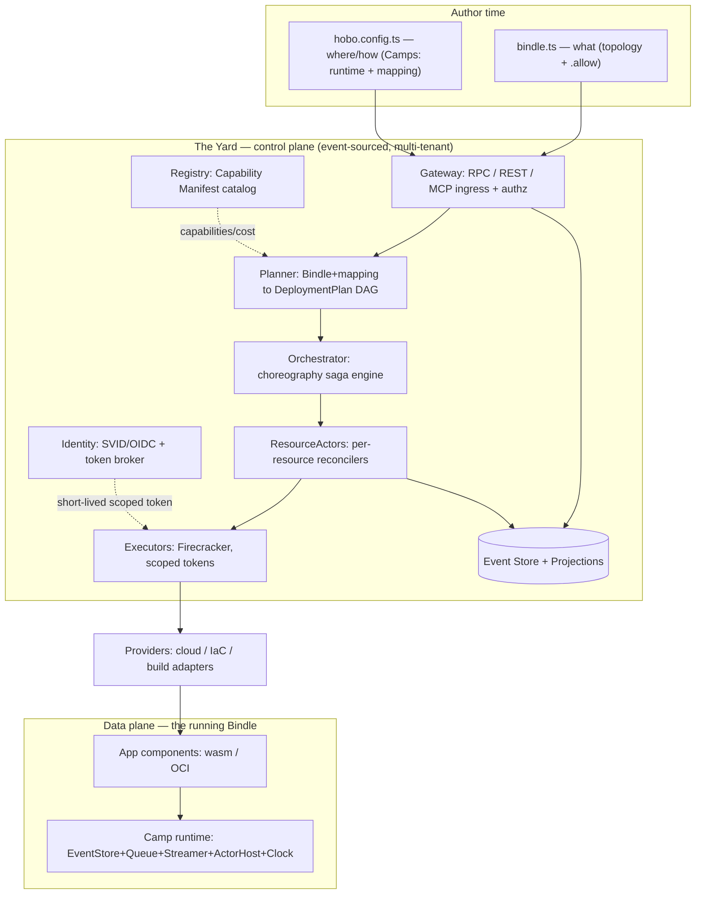

# HoBo — Technical Requirements Document (TRD)

> Part of the [HoBo Requirements Suite](./README.md). **How** — in requirements terms: the architecture, per-subsystem technical requirements (`TR-NNN`), interfaces, cross-cutting NFR realization, verification strategy, and the authoritative **[traceability matrix](#traceability-matrix)** linking [BRD](./BRD.md) `BR` → [PRD](./PRD.md) `FR`/`NFR` → `TR` → design doc. This document states *requirements on the implementation*; design depth lives in [`docs/design`](../design/README.md).

## 1. Document control

| Field | Value |
|---|---|
| Title | HoBo Technical Requirements Document |
| Version | 0.1 (Draft for review) |
| Date | 2026-06-20 |
| Status | Draft |
| Owner (Accountable) | Engineering lead |
| Authors | Engineering + Platform + SRE |
| Reviewers | Product, Security, Founders |
| Related | [BRD](./BRD.md), [PRD](./PRD.md), [10 Architecture](../design/10-architecture-overview.md), [01 Monorepo](../design/01-monorepo.md), [04 Control plane](../design/04-control-plane.md), [09 Verification](../design/09-verification-open-questions.md), [11 Event model](../design/11-event-model.md), [18 ADR log](../design/18-adr-log.md) |

### 1.1 RACI (technical decisions)
| Activity | Eng | Platform | Security | SRE | Product |
|---|---|---|---|---|---|
| Architecture & subsystem TRs | **A/R** | C | C | C | I |
| Interfaces (WIT/CLI/MCP/API) | **A/R** | C | C | I | C |
| Security/multi-tenancy TRs | A | C | **R** | C | I |
| Reliability/SLO TRs | A | C | C | **R** | C |
| Verification strategy | **A/R** | C | C | C | I |

### 1.2 Sign-off
| Role | Name | Decision | Date |
|---|---|---|---|
| Engineering lead | _TBD_ | ☐ Approve ☐ Changes | |
| Security lead | _TBD_ | ☐ Approve ☐ Changes | |
| SRE lead | _TBD_ | ☐ Approve ☐ Changes | |

## 2. Scope & system context
HoBo comprises (a) an **SDK** (author + runtime) compiled to portable components, (b) **the Yard** — an event-sourced, actor-based control plane and the cross-provider/hybrid scope, and (c) **adapters** (runtime backends, Providers, IaC, Build) behind ports. The **control plane** decides what infra should exist and makes it exist; the **data plane** is the running Bindle in a **Camp** (which provides the durable runtime), never on the Yard's critical path ([10-architecture-overview.md](../design/10-architecture-overview.md)). Scopes nest `Yard ⊃ Camp ⊃ Bindle` ([ADR-0026](../design/adr/ADR-0026-scope-model-yard-camp-bindle.md)). This TRD specifies technical requirements on these subsystems and how they satisfy the PRD.

## 3. Architecture overview
Control plane vs data plane, author→deploy→run ([10](../design/10-architecture-overview.md)/[04](../design/04-control-plane.md)):

**Layering invariant** ([01-monorepo.md](../design/01-monorepo.md)): dependencies point **inward only** — `apps → adapters → sdk/runtime → core`; adapters depend only on `@hobo/core` port interfaces, so the agnostic core never leaks provider detail (enforces NFR-001).

## 4. Component breakdown (`@hobo/*`)
From [01-monorepo.md](../design/01-monorepo.md): **core** (`@hobo/core`, `@hobo/wit`, `@hobo/sdk`, `@hobo/runtime`); **control plane** (`@hobo/cli`, `@hobo/cloud` = the Yard, `@hobo/registry`, `@hobo/identity`, `@hobo/mcp`); **runtime backends** (`runtime-local` built-in, `runtime-postgres`/`-temporal`/`-restate`/`-cloudflare`); **Providers** (`provider-aws`/`-azure`/`-gcp`/`-cloudflare`/`-fly`/`-kubernetes`); **IaC** (`iac-pulumi` primary, `-cdktf`/`-crossplane`/`-opentofu`); **Build** (`build-wasm`, `-dagger`/`-packer`/`-firecracker`); **governance** (`@hobo/conformance`, `@hobo/contracts`, `@hobo/policy`, `@hobo/evals`, `@hobo/training`, optional `provider-pact`/`-opa`/`-cedar`).

## 5. Technical requirements (`TR-NNN`)

### 5.1 SDK & compile (IfC) ([02](../design/02-sdk-api.md), [20](../design/20-wasm-wasi-runtime.md), [21](../design/21-resources-catalog.md), [22](../design/22-wiring-manifest.md))
| ID | Requirement | Verified by |
|---|---|---|
| **TR-001** | `@hobo/sdk` exposes the resource catalog + `bindle()`; resources declare `.allow()` verbs inline (IfC). | IfC-collection test ([09](../design/09-verification-open-questions.md)) |
| **TR-002** | `hobo collect` runs the component to emit a **Manifest IR** (resources + links + endpoints + env). | Manifest matches fixture ([09](../design/09-verification-open-questions.md)) |
| **TR-003** | Services compile to **wasm components** (jco/componentize) with **OCI-container fallback**. | Build test; component runs on the local Camp (`runtime-local`) ([20](../design/20-wasm-wasi-runtime.md)) |
| **TR-004** | `.allow(v)` produces exactly one **{IAM scope + wasm capability link + brokered-token scope}** triple; a missing verb is denied on all three. | `.allow()` triple test ([09](../design/09-verification-open-questions.md)) |
| **TR-005** | `.with(provider.option(...))` is per-provider-typed and inert for non-resolved providers. | Multi-provider resolve test ([09](../design/09-verification-open-questions.md)) |
| **TR-006** | The build enforces the **layering invariant** via a dependency-graph lint (e.g. `depcheck`/`madge`): no agnostic package imports a provider/iac/build package and no adapter imports another adapter; CI blocks on violation. | dep-graph lint gate ([ADR-0024](../design/adr/ADR-0024-portability-conformance-guarantee.md), [01](../design/01-monorepo.md)) |

> **"Unedited" (portability definition, [ADR-0024](../design/adr/ADR-0024-portability-conformance-guarantee.md)):** across cloud targets, `bindle.ts` and application `src/` are **byte-identical**; only `hobo.config.ts` and CLI/env parameters may change. The `multi-cloud-shop` E2E proves it by deploying an unchanged `bindle.ts` to ≥2 providers and asserting identical resolved topology + bindings.

### 5.2 Camp runtime — durable runtime ports ([02](../design/02-sdk-api.md), [24](../design/24-wit-interfaces-reference.md))
| ID | Requirement | Verified by |
|---|---|---|
| **TR-010** | Define the **runtime ports** — EventStore, Queue, Streamer, ActorHost, Clock — as WIT interfaces; ship a built-in engine (`runtime-local`, SQLite/fs). | Per-runtime-port conformance ([09](../design/09-verification-open-questions.md)) |
| **TR-011** | Runtime primitives `step`/`workflow`/`actor`/`saga`/`agent`/`sleep`/`cron`/hooks/streams with memoized steps + auto idempotency keys. | hello-bindle exercises all; replay==live |
| **TR-012** | Runtime backends are swappable per Camp (`runtime-postgres`/`-temporal`/`-restate`/`-cloudflare`) with no app-code change. | An example runs unchanged on **≥2 runtime backends** (e.g. `runtime-local` + `runtime-postgres`) with only a runtime override; lifecycle identical (replay==live) ([24](../design/24-wit-interfaces-reference.md)) |
| **TR-013** | **Version policy:** Pulumi Automation API / WASI-WIT / MCP are pinned to exact versions; runtime-port versions are recorded in the Manifest IR and immutable for a Bindle version; upgrades go through a gated `hobo upgrade` path with a compat/upgrade test; a version mismatch fails planning with a precise reason. | upstream-upgrade compat test; version-mismatch reject test ([ADR-0024](../design/adr/ADR-0024-portability-conformance-guarantee.md); open ADR-P/Q11 [09](../design/09-verification-open-questions.md)) |

### 5.3 The Yard control plane ([04](../design/04-control-plane.md))
| ID | Requirement | Verified by |
|---|---|---|
| **TR-020** | **Gateway** authenticates principal (human OIDC / agent SVID), authorizes ABAC `(principal,tenant,port,resource,action)`, turns requests into **commands**; reads served from projections only. | Authz tests ([12](../design/12-security-multitenancy.md)) |
| **TR-021** | **Planner** is a **pure function** Bindle+mapping → DeploymentPlan DAG; records selection rationale on `deployment.Planned`. | Unit-testable without cloud ([09](../design/09-verification-open-questions.md)) |
| **TR-022** | **Orchestrator** runs choreography sagas; one **ResourceActor** grain per resource reconciles desired↔actual via the resolved IaC adapter; cross-resource ordering by dependency DAG + events (no central coordinator). | Crash-resume + compensation tests ([05](../design/05-reliability-ha.md)) |
| **TR-023** | **Executors** run IaC/builds in **Firecracker microVMs** with **no ambient creds** and a single injected scoped token; output streams as `exec.*` events. | Executor egress test ([12](../design/12-security-multitenancy.md)) |
| **TR-024** | The Yard is **itself a Bindle**; `hobo yard up [--restore <log>]` bootstraps/rebuilds it (self-host = hosted). | Bootstrap + DR replay test ([04](../design/04-control-plane.md)/[05](../design/05-reliability-ha.md)) |

### 5.4 Event model & CQRS ([11](../design/11-event-model.md))
| ID | Requirement | Verified by |
|---|---|---|
| **TR-030** | A single **append-only event log** is the source of truth for both planes; reads are projections (CQRS). | Projection rebuild==live ([09](../design/09-verification-open-questions.md)) |
| **TR-031** | Appends are **conditional on expected `seq`** (OCC) and **dedup on `idempotencyKey`** → exactly-once *effects* over at-least-once delivery. | Idempotent-dedup conformance ([05](../design/05-reliability-ha.md)) |
| **TR-032** | Schema evolution via **upcasters**; old events replay through them. | Upcaster replay test ([11](../design/11-event-model.md)) |
| **TR-033** | Every durable run satisfies **`replay == live state`** (hard invariant, NFR-011). | Determinism test ([09](../design/09-verification-open-questions.md)) |

### 5.5 Providers / IaC / Build ([03](../design/03-providers-iac.md))
| ID | Requirement | Verified by |
|---|---|---|
| **TR-040** | `CloudProvider`/`IacProvider`/`BuildProvider` are swappable ports; a cloud provider composes IaC + build. | Per-capability conformance ([09](../design/09-verification-open-questions.md)) |
| **TR-041** | **Pulumi Automation API** is the primary IaC mechanism (embedded, no CLI shell-out); Crossplane/OpenTofu/CDKTF are alternates. | Provider deploy test ([ADR-0006](../design/adr/README.md)) |
| **TR-042** | **Per-resource IaC stacks** by default (blast-radius isolation + clean compensation). | Compensation rollback test ([05](../design/05-reliability-ha.md)) |
| **TR-043** | ≥2 cloud providers implement the capability ports for the reference app at v1. | `multi-cloud-shop` E2E (NFR-001) |

### 5.6 Identity, credentials & token broker ([06](../design/06-ai-native-agent-auth.md), [12](../design/12-security-multitenancy.md))
| ID | Requirement | Verified by |
|---|---|---|
| **TR-050** | **Identity** issues short-lived **SVIDs** (SPIFFE-style) to agents/workloads and acts as an OIDC provider. | Token issuance test ([09](../design/09-verification-open-questions.md)) |
| **TR-051** | **Token broker** exchanges an SVID for a resource-scoped provider token (OIDC federation preferred; OAuth-OBO for human delegation). The **API-key legacy escape hatch** is opt-in, carries a **max TTL with enforced rotation**, and is fully audited. | Zero-secret deploy test (NFR-005); key-past-TTL-rejected test ([ADR-0023](../design/adr/ADR-0023-security-posture-commitments.md)) |
| **TR-052** | Every credential event (`token.Granted/Used/Revoked`) is logged and replayable; audit streams are retained for a defined minimum and never compacted. | Credential-audit + retention-floor test ([06](../design/06-ai-native-agent-auth.md), NFR-018) |
| **TR-053** | **Confused-deputy default-deny:** before issuing any scoped token, the policy engine checks `{principal, tenant, resource, action}`; cross-tenant issuance is denied unless explicitly delegated. | Agent-with-tenant-1-SVID requests tenant-2 token → denied before `token.Granted` ([ADR-0023](../design/adr/ADR-0023-security-posture-commitments.md)) |
| **TR-054** | **Config/secret resolution (secretless-first):** `config()`/`secretRef()`/`env()` declarations resolve to **references per Camp** at use-time via the ladder — bound resource (brokered token, no secret) → provider secret store (brokered token) → bounded static fallback (TTL ≤7d, [ADR-0023](../design/adr/ADR-0023-security-posture-commitments.md)). Values never persist in the Bindle/Camp config/event log; reads emit `config.Resolved`(ref+Camp)/`secret.Accessed`/`secret.Unavailable` and are redacted **at capture** (incl. training trajectories). `hobo doctor` checks cross-Camp ref parity. | secretless-resolve + redaction + drift test ([Plan 31](../design/31-config-secretless-secrets.md)/[ADR-0027](../design/adr/ADR-0027-secretless-config-and-secrets.md)) |

### 5.7 Registry & Capability Manifest ([06](../design/06-ai-native-agent-auth.md))
| ID | Requirement | Verified by |
|---|---|---|
| **TR-060** | Providers publish **Capability Manifest** (`index/signs/capabilities/auth/cost.json`) at `/.well-known/capability-manifest/`; the **Registry** indexes + serves capability search. | Discovery test (FR-031) |
| **TR-061** | The Registry **refuses unsigned/unverified plugins**; consumers pin versions + require a trust level. | Unsigned-plugin-refused test ([12](../design/12-security-multitenancy.md)) |

### 5.8 MCP control surface ([06](../design/06-ai-native-agent-auth.md), [15](../design/15-cli-dx.md))
| ID | Requirement | Verified by |
|---|---|---|
| **TR-070** | `@hobo/mcp` exposes every CLI/SDK capability as an MCP tool (`plan`/`deploy`/`promote`/`rollback`/`inspect_run`/`tail_logs`/`request_token`/`get_drift`/`heal`/…) with the same identity/authz model. | Surface-parity + agent E2E (NFR-004) |
| **TR-071** | The Gateway and MCP surface enforce **per-principal (SVID/OIDC) and per-tenant rate limits + quotas** with backpressure; excess returns a typed throttle error. | Flooding-agent-throttled test (NFR-019, [ADR-0023](../design/adr/ADR-0023-security-posture-commitments.md)) |

### 5.9 Forge & conformance trust boundary ([06](../design/06-ai-native-agent-auth.md), [09](../design/09-verification-open-questions.md), [23](../design/23-stubbable-ai-implementations.md))
| ID | Requirement | Verified by |
|---|---|---|
| **TR-080** | `@hobo/conformance` provides an executable contract suite **per WIT interface**; an adapter may only claim a port it passes; CI blocks otherwise. | Conformance gate in CI ([09](../design/09-verification-open-questions.md)) |
| **TR-081** | **Forge** generates a candidate provider/impl, runs conformance **sandboxed with no egress**, signs + attaches SLSA-style provenance, publishes on pass. | `hobo forge` certification test ([06](../design/06-ai-native-agent-auth.md)) |
| **TR-082** | `stub()` records calls as events; AI implement-to-trace asserts conformance-green **and** reproduces recorded traces; **live-fix** routes through the gated canary/auto-rollback saga. | Stub/replay + gated live-fix test ([09](../design/09-verification-open-questions.md)) |
| **TR-083** | **Forge generation is injection-hardened:** source docs/OpenAPI are scanned/sanitized before generation; the signed provenance includes a scrub report; conformance runs with **no egress** (hard requirement, not default). | Seeded-malicious-docs test produces a scrub report; egress attempt during conformance fails ([ADR-0023](../design/adr/ADR-0023-security-posture-commitments.md), [12](../design/12-security-multitenancy.md)) |
| **TR-084** | **`"use training"` methods** are optimized by a `training-engine` **WIT port** (built-in OPTO default; **Microsoft Agent Lightning / Trace optional INTERNAL providers, not on the SDK surface**). Runtime emits OTel/**OpenInference** trajectories; **live-evals** attach the reward; trained candidates pass the **same** conformance + eval + policy gate as Forge impls. | Training-loop test: trajectory captured → candidate proposed → promoted only via the gate; swapping the engine is config-only ([ADR-0025](../design/adr/ADR-0025-use-training-directive-and-training-engine.md), [23](../design/23-stubbable-ai-implementations.md)) |

### 5.10 Contracts, policy, evals & Gatekeeper ([29](../design/29-contracts-compatibility.md), [30](../design/30-policy-plane.md))
| ID | Requirement | Verified by |
|---|---|---|
| **TR-090** | `contract-engine` + `policy-engine` are **WIT ports** with built-in defaults (typed TS); Pact/OPA/Cedar are optional providers. | Per-engine conformance ([ADR-0015](../design/adr/README.md)) |
| **TR-091** | **`can-deploy`** checks producer/consumer version skew against what the event log says runs per environment; emits `compat.GatePassed/Failed`. | Compatibility test ([09](../design/09-verification-open-questions.md)) |
| **TR-092** | Policy decisions carry **obligations** realized as durable effects/sagas, tracked `ObligationCreated→Satisfied`; an unmet obligation blocks. | Policy-decision + obligation test ([30](../design/30-policy-plane.md)) |
| **TR-093** | A single **Gatekeeper** (`hobo verify`) composes contracts + policy + evals + conformance + cost into one event-sourced decision at Delta→Set/promote. | `hobo verify` composite test ([ADR-0016](../design/adr/README.md)) |

### 5.11 Platform-engineering: definitions, matching, deltas, packs ([25](../design/25-resource-definitions-matching.md)–[27](../design/27-drivers-packs-profiles.md))
| ID | Requirement | Verified by |
|---|---|---|
| **TR-100** | **Resource Definitions + Matching** select how a port is realized per context; the winning definition + score recorded as `match.Decided`. | Matching test ([09](../design/09-verification-open-questions.md)) |
| **TR-101** | Environments are **Deployment Sets** with mutable **Deltas** (draft→promote); reconcile is **incremental** (only changed nodes). | Delta→Set test ([26](../design/26-environments-deltas.md)) |
| **TR-102** | **Resource Packs** bundle definitions and are installable (marketplace); Drivers (`terraform`/`template`/`container`/`custom-webhook`) have conformance suites. | Pack + Driver conformance ([27](../design/27-drivers-packs-profiles.md)) |

### 5.12 Cross-cutting: security & multi-tenancy ([12](../design/12-security-multitenancy.md))
| ID | Requirement | Verified by |
|---|---|---|
| **TR-110** | Tenant is the hard isolation boundary across **five** dimensions: data (namespaced/encrypted streams), compute (partitioned Executor pools), credentials (tenant-scoped SVIDs/tokens), network (tenant-scoped mTLS domains), and **wasm capability** (deny-by-default unforgeable handles). | Cross-tenant tests incl. an **explicit denial scenario**: a component linked only to tenant A's resource calling tenant B's resource fails with a *capability-denied* (not generic-auth) error ([09](../design/09-verification-open-questions.md)) |
| **TR-111** | **No static secrets:** bindings resolve to secret refs; per-run sensitive payloads encrypted with a per-run key. **Envelope encryption at rest** for event streams is available across **all** runtime backends (default for new tenants; opt-in where a backend lacks native support, gap documented). Decryption requires log-read **and** explicit authorization (run-owner / `decrypt:run`); log access ≠ payload access. | Encryption-across-runtimes + unauthorized-decrypt-denied test ([ADR-0023](../design/adr/ADR-0023-security-posture-commitments.md), [12](../design/12-security-multitenancy.md)) |
| **TR-112** | **Supply chain:** plugins signed w/ SLSA-style provenance + conformance report; images by digest + scanned; all published artifacts (SDK, CLI, providers, implementations, base images) carry **CycloneDX SBOMs**; CI **blocks publishing on CVSS ≥ 7.0** (documented waiver path). | Signing + SBOM-present + vuln-gate test ([12](../design/12-security-multitenancy.md)) |
| **TR-113** | **Data residency:** a tenant can constrain regions; the Planner rejects residency violations at plan time. | Residency rejection test ([03](../design/03-providers-iac.md)) |

### 5.13 Cross-cutting: networking ([13](../design/13-networking-connectivity.md))
| ID | Requirement | Verified by |
|---|---|---|
| **TR-120** | Connectivity is derived from `bind` edges; the Planner selects a **tier** (same-region private → cross-region → cross-provider private → overlay mesh → public+mTLS) and may be overridden via `.with(...)`. | Connectivity-tier test ([09](../design/09-verification-open-questions.md)) |
| **TR-121** | **mTLS-by-default** between services, keyed by workload SVIDs; certs issued/rotated by Identity (zero-trust); apps don't manage them. | Cross-provider mTLS test (build stage 4) |
| **TR-122** | The **HoBo Relay** provides an outbound-only (no inbound) reverse tunnel for private-network targets. | Private-target deploy test ([28](../design/28-relay-gitops-pipelines.md)) |

### 5.14 Cross-cutting: observability ([14](../design/14-observability.md))
| ID | Requirement | Verified by |
|---|---|---|
| **TR-130** | OTel logs/traces/metrics emitted for control + data planes; the event log backs the audit/timeline; dashboard reads projections only. | Trace-present test ([14](../design/14-observability.md)) |

### 5.15 Cross-cutting: reliability/HA ([05](../design/05-reliability-ha.md))
| ID | Requirement | Verified by |
|---|---|---|
| **TR-140** | Single-writer **leases + fencing tokens** per grain; stale-owner appends rejected; failover = lease TTL + tail replay (<30 s). | Partition/fencing test ([05](../design/05-reliability-ha.md)) |
| **TR-141** | Saga **compensation** in reverse-topological order past a configurable no-go threshold; compensations idempotent; escalate to `needs-human` rather than loop. | Compensation test |
| **TR-142** | Control-plane HA: quorum/replicated log (built-in engine ships a small Raft; `runtime-*` backends delegate to their store); stateless tier scales horizontally; bounded-staleness reads labeled. | HA/availability test (99.9%/99.95%) |
| **TR-143** | DR = replay: `hobo yard up --restore` rebuilds projections + actors; RPO ~0/≤5 s, RTO <15 min. | DR replay test (NFR-010) |
| **TR-144** | Deployment strategies (`recreate`/`blue-green`/`canary`/`progressive`) are parameterized sagas with event-sourced gates + auto-rollback. | Canary auto-rollback test |

### 5.16 Cross-cutting: cost ([16](../design/16-cost-finops.md))
| ID | Requirement | Verified by |
|---|---|---|
| **TR-150** | Providers publish `cost.json`; the Planner estimates plan-time cost (incl. egress per connectivity tier); estimate within ±20% of a fixture. | Cost fixture test (NFR-012) |
| **TR-151** | Budgets/caps are policy gates; spend over cap → obligation/approval; showback attributable per tenant/Bindle/Camp/resource from the log. | Budget-breach test |

### 5.17 Operator Agents, the generated infrastructure stack & patchability ([40](../design/40-operator-agents.md)–[43](../design/43-patchability-extensibility.md))
| ID | Requirement | Verified by |
|---|---|---|
| **TR-160** | Operator Agents are Yard services on the agent-principal model (SVID + per-agent policy + spend caps), event-sourced runs, MCP tools; writes ride `policy.Decided` (auto / canary / require-approval); reasoning engine behind a port (optional externals e.g. HolmesGPT). *(Roster: SRE/Endpoint Monitor/GitOps/Platform Engineer — no UX Designer, [ADR-0064](../design/adr/ADR-0064-scope-ai-native-meta-cloud.md).)* | Crew dispatch + gated-remediation test ([40](../design/40-operator-agents.md)/FR-080) |
| **TR-161** | The generated infrastructure stack shares one generation loop, one conformance/policy/eval trust boundary, and one persistence mechanism (region-scoped AST + provenance, ADR-0048) across data/business/message/intelligence; drift-gated by `hobo codegen --check`. | Cross-layer regeneration + drift-gate test ([41](../design/41-generated-stack.md)/FR-081) |
| ~~**TR-162**~~ | **App-UI generation — REMOVED (out of scope, [ADR-0064](../design/adr/ADR-0064-scope-ai-native-meta-cloud.md)).** The `ui-render` port and `Design.md` are dropped; generating the developer's product UI is app-build-out, not meta-cloud infrastructure ([Plan 42 tombstone](../design/42-ui-layer-generation.md)). | — |
| **TR-163** | Patchability: every engine/adapter behind a WIT port is swappable; derivatives ship as signed, conformance-certified Packs/plugins, Matching-selected; persisted patches are round-trippable + provenance-pinned; conformance is the trust bridge (shared with portability). | Custom-engine plugin + persisted-patch round-trip test ([43](../design/43-patchability-extensibility.md)/FR-083) |
| **TR-164** | Continuous security scanning re-runs vuln/SBOM/drift on running Sets; findings raise `policy.Decided`, remediation is the gated live-fix loop, findings export as OCSF ([ADR-0046](../design/adr/ADR-0046-boundary-standards-cloudevents-ocsf-otlp.md)). | Live-CVE → policy-decision + gated-remediation test ([12](../design/12-security-multitenancy.md)/FR-084) |

## 6. Interfaces & APIs
- **WIT ports** ([24](../design/24-wit-interfaces-reference.md)): the canonical contracts (runtime ports + provider capability ports + `contract-engine`/`policy-engine`/`training-engine`). `hobo:*` WIT interfaces reuse `wasi:*` where possible; versioning tracked as an open item ([09](../design/09-verification-open-questions.md) Q11).
- **CLI** ([15](../design/15-cli-dx.md)): the `hobo …` command set (FR-010/013).
- **MCP** ([06](../design/06-ai-native-agent-auth.md)): tool-per-capability surface (TR-070).
- **Gateway command/event API** ([04](../design/04-control-plane.md)): commands (`Deploy`/`Promote`/`Rollback`/`Destroy`/`RegisterProvider`/`RequestToken`/…); the only side effect is appending events.

## 7. Technology stack & dependencies
TypeScript/Node (core + Yard); WASI/Component Model + WIT + jco (components); Pulumi Automation API (IaC); SPIFFE/OIDC (identity); Firecracker (executor isolation); SQLite (built-in runtime) / Postgres / Temporal / Restate / Cloudflare DO (runtime backends); MCP (agent surface). Upstream churn is isolated behind ports ([BRD R-5](./BRD.md#15-risk-register)).

## 8. Deployment & self-host topology
Self-host = single-tenant (whole Yard = one trust domain); hosted = multi-tenant on the same code ([04](../design/04-control-plane.md)/[12](../design/12-security-multitenancy.md)). Bootstrapping: local seed (the local Camp, `runtime-local`) → self-deploy `@hobo/cloud` to a real target Camp → handover imports the seed's log for provenance (TR-024).

## 9. Test & verification strategy ([09](../design/09-verification-open-questions.md))
Pyramid: **unit** (pure Planner/upcasters) → **conformance** per port (the trust boundary, `@hobo/conformance`) → **integration** (SDK + built-in runtime + local provider) → **E2E** (Yard + one real cloud, gated) → **determinism/replay** (`replay == live`). New gate tests: matching, Delta→Set, compatibility (`can-deploy`), policy-decision, eval-gate, stub/replay, IfC-collection. `hobo verify` composes contracts + policy + evals + conformance + cost (TR-093).

## 10. Technical risks & open decisions
Inherits [BRD risks](./BRD.md#15-risk-register). The requirements review/hardening pass closed several gaps via [ADR-0023](../design/adr/ADR-0023-security-posture-commitments.md) (security posture) and [ADR-0024](../design/adr/ADR-0024-portability-conformance-guarantee.md) (portability guarantee) — including a v1 version-pinning default (TR-013) for the otherwise-open `hobo:*` versioning question. Open ADR-P items ([18-adr-log](../design/18-adr-log.md)) this TRD must eventually close:
- **ADR-P1** built-in-engine consensus (own Raft vs delegate) — affects TR-142.
- **ADR-P2** overlay-mesh tech — affects TR-120.
- **ADR-P4** default Planner objective (cost vs latency) — affects TR-021/TR-150; **TRD stance:** ship a documented default (cost-aware with colocation) that is **per-tenant configurable**, decision deferred to ADR-P4 ratification.
- **ADR-P5** `"use workflow"` transform depth — affects TR-011.
Plus [09](../design/09-verification-open-questions.md) open questions (wasm host of record, `hobo:*` versioning, IfC fidelity for non-TS, live-fix auto threshold, first-deploy provider at build stage 2).

## Traceability matrix
Authoritative **BR → FR/NFR → TR** mapping ([ADR-0018](../design/adr/ADR-0018-requirements-structure-and-traceability.md)). Every BR has ≥1 FR/NFR; every FR/NFR has ≥1 TR.

| BR | FR / NFR | TR | Proven by (design + test) |
|---|---|---|---|
| BR-001 author once | FR-001, FR-002, FR-003, FR-010, FR-011; NFR-002, NFR-003, NFR-015, NFR-016, NFR-017 | TR-001..003, TR-011 | hello-bindle; IfC-collection; `hobo dev` timing; explain-failure UX; WCAG audit |
| BR-002 N clouds, unedited | FR-004, FR-005, FR-006, FR-014, FR-030, FR-032; NFR-001, NFR-020 | TR-005, TR-006, TR-012, TR-040, TR-043, TR-021 | `multi-cloud-shop` E2E; resolve test; dep-graph lint |
| BR-003 optimize on demand | FR-005, FR-014 | TR-005 | provider-options + lock-in-lint test |
| BR-004 agents first-class | FR-020, FR-021, FR-031, FR-080, FR-081, FR-082; NFR-004, NFR-017 | TR-070, TR-050, TR-060, TR-160, TR-161, TR-162 | MCP surface-parity; agent E2E; registry discovery; Crew dispatch; generated-stack regeneration; UI-gen |
| BR (patchability) | FR-083 | TR-163 | custom-engine plugin + persisted-patch round-trip (conformance-bridged; sibling to BR-002 portability) |
| BR-005 zero secrets | FR-002, FR-014, FR-015, FR-023, FR-084; NFR-005 | TR-004, TR-051, TR-052, TR-054, TR-164 | zero-secret deploy; `token.*` audit; key-TTL; secretless config resolution; live security scan + gated remediation |
| BR-006 auditable/replayable | FR-003, FR-071; NFR-008, NFR-011, NFR-014, NFR-018, NFR-021 | TR-030..033, TR-052, TR-130 | projection-rebuild; determinism; OTel/OpenInference; retention floor |
| BR-007 self-hostable + reliable | FR-010, FR-012; NFR-009, NFR-010, NFR-013, NFR-019 | TR-024, TR-071, TR-140..144 | bootstrap; DR replay; fencing; rate-limit; canary auto-rollback |
| BR-008 no community bottleneck | FR-040, FR-041, FR-042, FR-043; NFR-007, NFR-021 | TR-080..084 | `hobo forge`; stub/replay; sandbox no-egress; injection scrub; `use training` loop |
| BR-009 cost first-class | FR-070; NFR-012 | TR-150, TR-151 | cost fixture; budget-breach |
| BR-010 governance | FR-013, FR-050, FR-051, FR-052, FR-060, FR-061, FR-062 | TR-090..093, TR-100, TR-101, TR-102, TR-113 | can-deploy; policy/obligation; matching; pack install; residency |
| BR-011 safe autonomy | FR-022, FR-042, FR-051; NFR-019 | TR-053, TR-071, TR-082, TR-092 | confused-deputy deny; rate-limit; policy-gate; spend-cap; gated live-fix |
| (security spine) | NFR-006, NFR-007, NFR-018, NFR-019, NFR-020 | TR-006, TR-013, TR-023, TR-053, TR-071, TR-083, TR-110, TR-111, TR-112, TR-121 | tenant isolation; executor egress; mTLS; layering lint; version pin; rate-limit |

> The matrix shows **representative** TRs per BR; every `TR-NNN` carries its own verification in [§5](#5-technical-requirements-tr-nnn). Rows for BR-001/002/004/006/007/008/011 and the security spine were extended in the requirements hardening pass ([ADR-0023](../design/adr/ADR-0023-security-posture-commitments.md)/[ADR-0024](../design/adr/ADR-0024-portability-conformance-guarantee.md); see [`plans/README.md`](../../plans/README.md)).

## 11. References
[10 Architecture](../design/10-architecture-overview.md) · [04 Control plane](../design/04-control-plane.md) · [11 Event model](../design/11-event-model.md) · [05 Reliability](../design/05-reliability-ha.md) · [12 Security](../design/12-security-multitenancy.md) · [13 Networking](../design/13-networking-connectivity.md) · [09 Verification](../design/09-verification-open-questions.md) · [24 WIT interfaces](../design/24-wit-interfaces-reference.md) · [BRD](./BRD.md) · [PRD](./PRD.md) · [ADR index](../design/adr/README.md).
