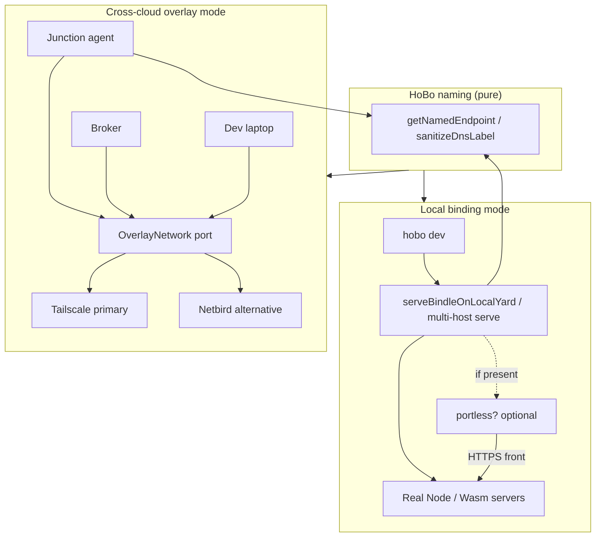
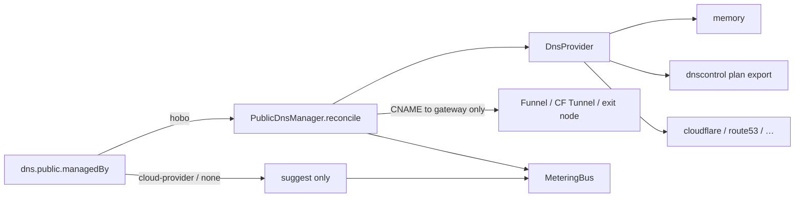
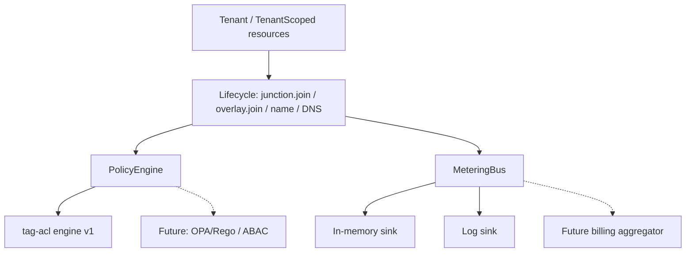
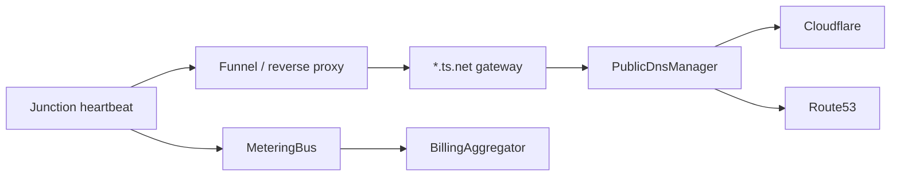
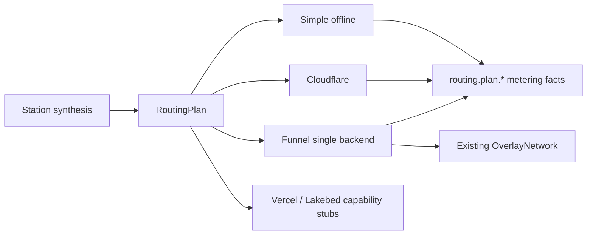
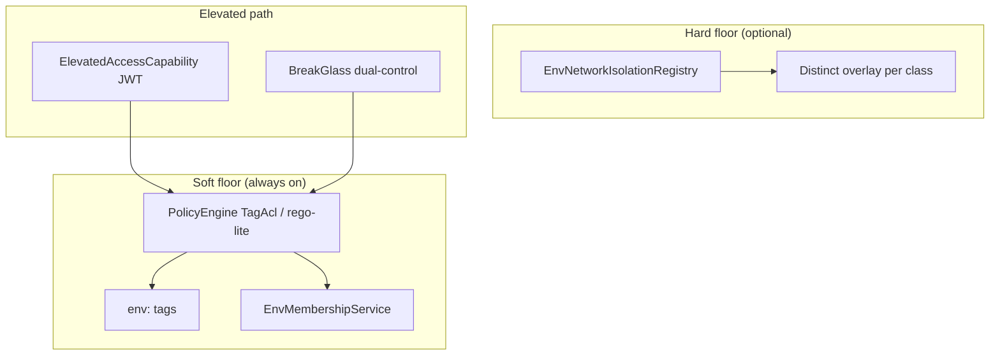

# @hobo/connectivity — Architecture

## Goals

- One hierarchical, **DNS-valid** naming function for local + overlay + public.
- Soft multi-tenancy (tenant IDs + PolicyEngine) as the default isolation model.
- Metering hooks on lifecycle paths so billing is an aggregator, not a rewrite.
- Graceful local DevX: portless optional; offline port-based path unchanged.

## Binding modes

## Pluggable DNS

**Rule:** public records never target raw overlay IPs.

## Multi-tenant, policy, metering

### How full SaaS builds on this

| Concern | Foundation today | Next phase |
|---------|------------------|------------|
| Tenants | `Tenant`, `TenantId`, `tenantContextFromEnv` | Org membership, invites, SSO |
| Isolation | Soft **and** hard (`TenantIsolationRegistry`: dedicated overlay + control-plane partitions) | Multi-process shard routing / separate clusters |
| Policy | Tag ACL + OPA HTTP/CLI + **rego-lite** JSON documents | Per-tenant OPA bundle distribution |
| Billing | Aggregator + **durable ledger** + Stripe PaymentIntent REST | Tax, dunning, hosted checkout UX |
| DNS | Cloudflare + Route53 (**SigV4**), Tailscale **API** MagicDNS, Netbird management DNS, heartbeat dynamic DNS | Multi-region failover automation |
| Credentials | Real **ES256 DPoP** + audience-bound **JWT-SVID** | SPIRE Workload API fetch drop-in |

## Package layout

- Ports live in `@hobo/core` (`naming`, `tenant`, `policy-engine`, `metering`, `dns`, `overlay`, extended `BindingSource`).
- Implementations live here so adapters and the composition root (`@hobo/hobo`) stay free of hard Tailscale/DNS SDK deps.
- Local serve paths call `attachNamedEndpoints` and expose results on `BareMetalServeResult` / `DevServeResult`.

## Parse, don't validate

Untrusted inputs at package boundaries are parse, don't validate: DNS labels, tenant ids, and overlay peer descriptors are parsed once into derived domain types (`NamedEndpoint`, `TenantId`, lease ids) before policy or metering. Downstream code receives those derived domain types rather than re-checking raw strings. Secretless connector options are similarly parsed into a frozen `SecretlessLease` public view — credential material is closed over internally and is never part of the derived public type.

## Event architecture

- **Command** — join overlay / register named endpoint / open secretless lease / renew lease / close lease / reconcile public DNS.
- **Event** — lifecycle facts (join, name registration, lease opened/renewed/closed, DNS reconciled) with refs and endpoints only — never credentials.
- **Actor** — Junction agent / connectivity host / secretless connector aggregate apply events in order.
- **Event store** — accepted facts append to the platform event store (credential-adjacent leases share never-compact security-audit retention when joined to `secret.Accessed` / `token.*`).
- **Materialized view / projection** — named-endpoint inventory, active leases, metering aggregates.
- **Snapshot** — in-memory lease maps and endpoint registries are the snapshot of those projections.
- **Read store** — `listLeases`, `getNamedEndpoint`, metering sinks serve the read store without replaying the raw event log.

## Traffic routing intent

TrafficRouting coordinates backend-selection intent only. `OverlayNetwork`,
Funnel, and `PublicDnsManager` retain connectivity and exposure ownership.
Partial realization is an explicit result, never a silent feature drop.

## Secretless connector (ADR-0027 + ADR-0130)

Residual classical credentials (Postgres, generic TCP) are mediated: the workload dials only a stable **named endpoint**; the connector holds short-lived material closed over, performs the handshake, and shuttles bytes. Public lease objects never expose `credentialMaterial`. Preferred path remains identity federation; mediation is for protocols that cannot be pure keyless.

## Environment network isolation (ADR-0133)

Modules under `src/env-isolation/`: types, membership, grants, elevated-capability, registry, compose, policy-pack, local-airgap, evaluate. Junction agents require `config.env` and refuse cross-env federation by default. Compose with `TenantIsolationRegistry` via `assertComposedIsolation` (harder axis wins).
