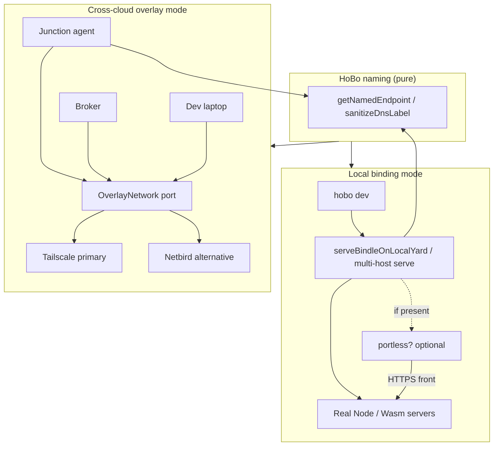
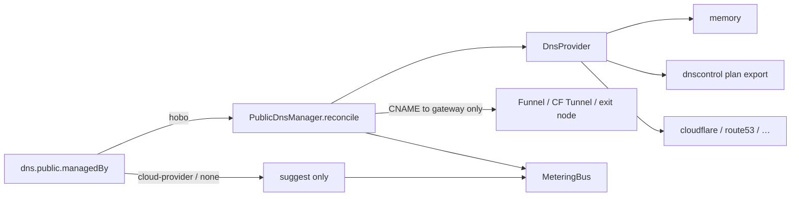
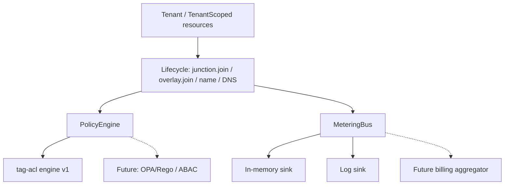
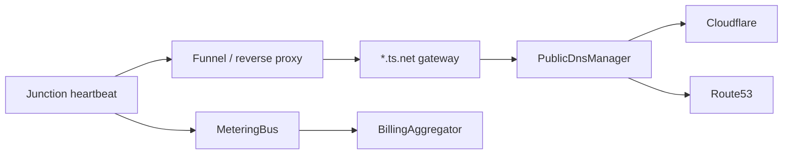

# @hobo/connectivity — Architecture

## Goals

- One hierarchical, **DNS-valid** naming function for local + overlay + public.
- Soft multi-tenancy (tenant IDs + PolicyEngine) as the default isolation model.
- Metering hooks on lifecycle paths so billing is an aggregator, not a rewrite.
- Graceful local DevX: portless optional; offline port-based path unchanged.

## Binding modes

## Pluggable DNS

**Rule:** public records never target raw overlay IPs.

## Multi-tenant, policy, metering

### How full SaaS builds on this

| Concern | Foundation today | Next phase |
|---------|------------------|------------|
| Tenants | `Tenant`, `TenantId`, `tenantContextFromEnv` | Org membership, invites, SSO |
| Isolation | Soft **and** hard (`TenantIsolationRegistry`: dedicated overlay + control-plane partitions) | Multi-process shard routing / separate clusters |
| Policy | Tag ACL + OPA HTTP/CLI + **rego-lite** JSON documents | Per-tenant OPA bundle distribution |
| Billing | Aggregator + **durable ledger** + Stripe PaymentIntent REST | Tax, dunning, hosted checkout UX |
| DNS | Cloudflare + Route53 (**SigV4**), Tailscale **API** MagicDNS, Netbird management DNS, heartbeat dynamic DNS | Multi-region failover automation |
| Credentials | Real **ES256 DPoP** + audience-bound **JWT-SVID** | SPIRE Workload API fetch drop-in |

## Package layout

- Ports live in `@hobo/core` (`naming`, `tenant`, `policy-engine`, `metering`, `dns`, `overlay`, extended `BindingSource`).
- Implementations live here so adapters and the composition root (`@hobo/hobo`) stay free of hard Tailscale/DNS SDK deps.
- Local serve paths call `attachNamedEndpoints` and expose results on `BareMetalServeResult` / `DevServeResult`.
