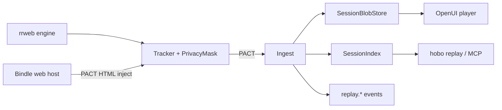

# @hobo/replay — Architecture Evidence

Session Replay is a **Station-composed capability** (ADR-0137), not a new control-plane noun.
Parse, don't validate: untrusted metadata becomes **derived domain types** via
`parseSessionRecord` / `parsePrivacyPolicy` / `parseSessionCorrelation`.

## Schema and constraints

- Protobuf: [`data-models/replay.proto`](./data-models/replay.proto)
- CUE: [`data-models/replay.cue`](./data-models/replay.cue)
- PACT inventory: [`contracts/pact-inventory.md`](./contracts/pact-inventory.md)
- HTTP accessibility surface: `createReplayHttpSurface` (all boundaries, including internal)

## Parse, don't validate

Tracker/ingest and CLI payloads cross parser constructors once. Downstream storage,
player, and access policy receive frozen derived domain types (`SessionRecord`,
`PrivacyPolicy`, `SessionCorrelation`, `RecordingChunk`), never raw DTOs.

## Event architecture

- **Command** — `startRecording`, `ingestChunk`, `endSession`, `linkError`, `applyRetention`, `openSession` (capability-gated).
- **Events** — `replay.Started`, `replay.ChunkIngested`, `replay.Ended`, `replay.ErrorLinked`, `replay.RetentionApplied`, `replay.Accessed`, `replay.Disabled`, `replay.Metered`.
- **Actor** — Station-local `ReplayService` owns the session aggregate per `sessionId`.
- **Event store** — control-plane event store holds lifecycle metadata + blob refs only (never full rrweb streams).
- **Materialized view / projection** — `SessionIndex` folds chunk meta into list/get query models.
- **Snapshot** — `SessionRecord` is the projection snapshot (status, bytes, correlation).
- **Read store** — dual-fixture FS/memory (local) or object-storage port (production via Junctions).

## Boundaries (PACT — internal and external)

Every edge below is inventoried, has a `*.pact.json`, and is verified against the
live HTTP surface (`test/pacts/provider-verify.pact.test.ts`).

| Edge | Pact |
|---|---|
| Tracker → ingest | `replay-tracker-ingest.pact.json` |
| Player → session index | `replay-player-store.pact.json` |
| Tracker → privacy | `replay-privacy.pact.json` |
| Tracker → policy | `replay-policy.pact.json` |
| Player → access/PAM | `replay-access.pact.json` |
| Service → retention | `replay-retention.pact.json` |
| Service → metering | `replay-metering.pact.json` |
| Evidence → service | `replay-evidence.pact.json` |
| Tracker → correlation | `replay-correlation.pact.json` |
| Service → event log | `replay-events.pact.json` |
| Ingest → blob store | `replay-blob-store.pact.json` |
| Bindle host → HTML inject | `replay-bindle-host.pact.json` |
| CLI/MCP → service | `replay-cli-service.pact.json` |

## Layering

No second event bus or secret store. Compose Stations, Trails (`replay.retention`),
Harness flags, continuous identity PrincipalRef, PAM elevated view, FinOps metering.
