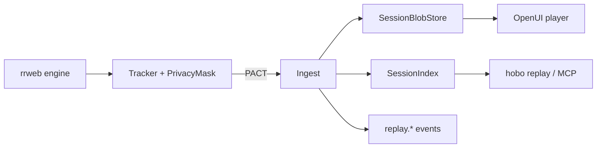

# @hobo/replay — Architecture Evidence

Session Replay is a **Station-composed capability** (ADR-0137), not a new control-plane noun.
Parse, don't validate: untrusted metadata becomes **derived domain types** via
`parseSessionRecord` / `parsePrivacyPolicy` / `parseSessionCorrelation`.

## Schema and constraints

- Protobuf: [`data-models/replay.proto`](./data-models/replay.proto)
- CUE: [`data-models/replay.cue`](./data-models/replay.cue)
- PACT: [`contracts/pacts/`](./contracts/pacts/)

## Parse, don't validate

Tracker/ingest and CLI payloads cross parser constructors once. Downstream storage,
player, and access policy receive frozen derived domain types (`SessionRecord`,
`PrivacyPolicy`, `SessionCorrelation`, `RecordingChunk`), never raw DTOs.

## Event architecture

- **Command** — `startRecording`, `ingestChunk`, `endSession`, `linkError`, `applyRetention`, `openSession` (capability-gated).
- **Events** — `replay.Started`, `replay.ChunkIngested`, `replay.Ended`, `replay.ErrorLinked`, `replay.RetentionApplied`, `replay.Accessed`, `replay.Disabled`, `replay.Metered`.
- **Actor** — Station-local `ReplayService` owns the session aggregate per `sessionId`.
- **Event store** — control-plane event store holds lifecycle metadata + blob refs only (never full rrweb streams).
- **Materialized view / projection** — `SessionIndex` folds chunk meta into list/get query models.
- **Snapshot** — `SessionRecord` is the projection snapshot (status, bytes, correlation).
- **Read store** — dual-fixture FS/memory (local) or object-storage port (production via Junctions).

## Layering

No second event bus or secret store. Compose Stations, Trails (`replay.retention`),
Harness flags, continuous identity PrincipalRef, PAM elevated view, FinOps metering.
