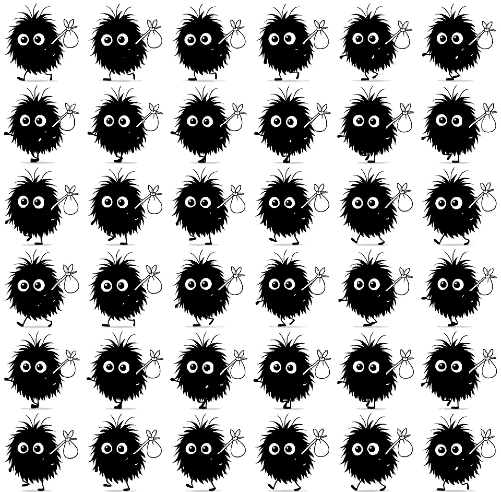

# review-export Review

Review page for a stitched frame sheet. Frames: `36`. Cell: `160x157`. Layout: `6x6`. FPS: `20`.

## Review Assets

### Preview GIF

Looped preview at runtime cell size.

[Open file](preview-36f-160x157.gif)

### Runtime Spritesheet

Transparent spritesheet intended for runtime use.

[Open file](../spritesheet-160x157-6x6.png)

### Upscaled Preview GIF

Nearest-neighbor enlarged preview for easier inspection.

[Open file](preview-36f-160x157-x2.gif)

### Upscaled Spritesheet

Nearest-neighbor enlarged spritesheet for review.

[Open file](spritesheet-160x157-6x6-x2.png)

### Source Map

Mapping from output frame slots to source frames.

[Open file](../source-map.txt)

### Sheet Metadata

Machine-readable frame normalization metadata.

[Open file](../sheet-frame-metadata.json)
