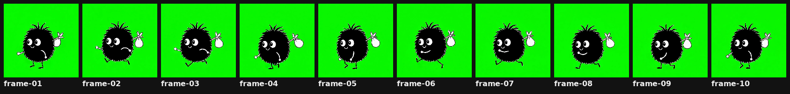
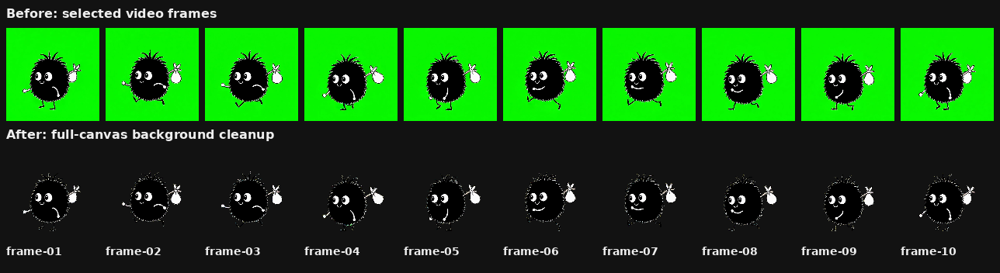
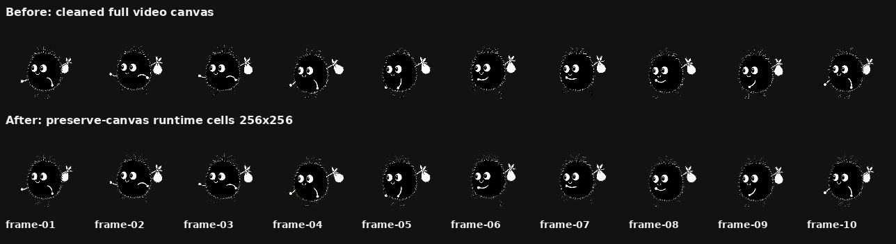
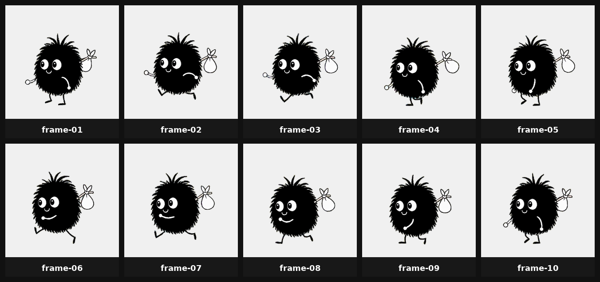

# walk-w-video-v2 Review

Quick review page for the `w` facing `walk` animation. Mode: `video`. Frames: `10`. FPS: `20`.

## Notes

- Video selection: `auto-cycle-window-nonduplicate`, 10 selected from 49 extracted frames.
- Selected frame map: frame-01.png <- frame-0005.png, frame-02.png <- frame-0008.png, frame-03.png <- frame-0011.png, frame-04.png <- frame-0014.png, frame-05.png <- frame-0017.png, frame-06.png <- frame-0020.png, frame-07.png <- frame-0023.png, frame-08.png <- frame-0026.png, frame-09.png <- frame-0029.png, frame-10.png <- frame-0032.png

## Review Assets

### Selected Frame Contact Sheet

Raw selected video frames before cleanup.

[Open file](selected-contact.png)

### Selected Frame GIF

Raw selected frames looped for quick motion review.

[Open file](selected-preview.gif)

### Comparison 01: Selected To Canvas-Cleaned

Before/after comparison for selected video frames to full-canvas background cleanup. Review image size: `1288x352`.

[Open file](compare-01-selected-to-canvas-cleaned.png)

### Comparison 02: Canvas-Cleaned To Runtime

Before/after comparison for preserve-canvas placement into fixed runtime cells. Review image size: `1288x352`.

[Open file](compare-02-canvas-cleaned-to-runtime.png)

### Normalized Contact Sheet

Preserve-canvas video frames scaled into fixed runtime cells without per-frame foreground height normalization or baseline recentering.

[Open file](contact.png)

### Normalized Preview GIF

Final runtime-cell animation preview.

[Open file](preview.gif)

### Runtime Spritesheet

Game-facing transparent spritesheet export. Image size: `1280x512`.

[Open file](../export/spritesheet.png)

### Runtime Preview GIF

Copy of the final preview GIF bundled with the export. GIF canvas: `256x256`.

[Open file](../export/preview.gif)

### Export Manifest

Machine-readable export metadata.

[Open file](../export/manifest.json)

### Baseline Report

Baseline and center audit from the final spritesheet.

[Open file](../export/baseline-report.json)
