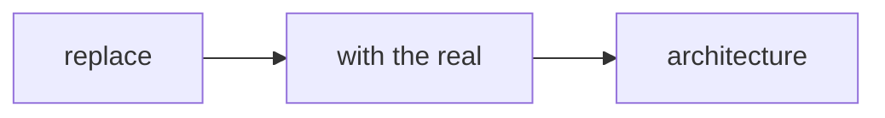

# __TITLE__

__One-paragraph statement of what this exp proof proves and for whom.__

## Architecture

## Audience model

__Persona, context, goals, constraints, prior knowledge, accessibility needs, risk, success measures.__

## Friction inventory

__Every point of friction with a measurable spec.__

## Experience artifacts (per type — gate-enforced)

- `ux`: `assets/` with REAL visuals (SVG/PNG wireframes, mockups, screenshots)
- `dx`: pseudo-code + protobuf + CUE + mermaid diagrams
- `cx`: journey maps/scripts (`assets/*.md` or `journeys/`)
- `ax`: MCP transcripts / tool schemas / llms.txt fixtures (`assets/` or `transcripts/`)
- `api`: interface declarations + type tests (`type-tests/`) + example consumers

## Validation

- `pnpm --prefix <this package> test`
- `pnpm run draft:artifacts -- --base=HEAD~1` (artifact gate)
- `pnpm agent:check -- --staged` before committing
