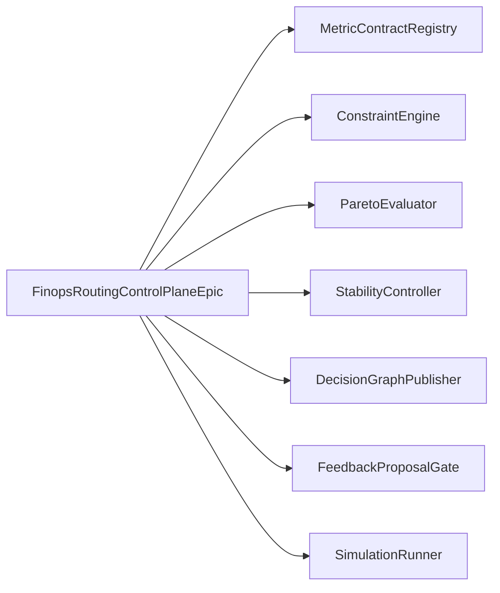

# Architecture

The FinOps budget routing control-plane proof composes one event-sourced router
loop around existing HoBo FinOps evidence:

1. Provider-neutral `ResourceIntent` enters a parser boundary.
2. Abstract candidates are generated without provider, SKU, region, account, or
   backend API details.
3. Hard constraints remove invalid candidates before policy, metrics, or
   preference weights run.
4. Budget policy classifies candidates as allow, deny, approval-required, or
   transform-required.
5. Metric contracts produce comparable vectors only for still-eligible
   candidates.
6. Pareto selection removes dominated candidates before preference weights apply.
7. Stability policy can override a preferred reroute when recent history shows
   unsafe churn.
8. A `DecisionGraph`, `RoutingDecision`, backend-neutral `ActionPlan`, and
   feedback proposal events are emitted for replay and explanation.

## Persona Map

| Persona | Goal | Reference slice |
|---|---|---|
| Application developer | Preview placement and understand why | `standards-first-intent-routing` |
| Platform engineer | Govern metric semantics without custom DSL drift | `governed-metric-routing` |
| FinOps lead | Keep cost, budget, and allocation signals decision-safe | `constraint-first-selection` |
| SRE operator | Avoid noisy reroutes and preserve rollback/freeze controls | `stability-controlled-feedback` |

## Boundary Map

All providers in the diagram are mocked in memory. Terraform, Pulumi,
Crossplane, and Kubernetes appear only as adapter fixture labels below the
`ExecutionAdapterPort` boundary; no routing intelligence is implemented there.

## Contract Strategy

- Protobuf records in `architecture/finops_budget_routing_control_plane.proto`
  define the contract family.
- CUE constraints in `architecture/finops_budget_routing_control_plane.cue`
  capture provider-neutrality, metric-tier, stability, and feedback invariants.
- Pact-style fixtures under `contracts/pacts/` name each consumer boundary.
- Consumer tests verify the simulation advertises every provider named by the
  Pact fixtures.

## Drift Controls

- Provider-specific core fields fail closed at parse time.
- Raw telemetry user metrics and arbitrary formulas fail closed.
- Hard constraints execute before metrics and preferences.
- Dominated candidates cannot be selected by weights.
- Cooldown windows, minimum improvement thresholds, migration penalties, and
  flip limits can preserve the current placement.
- Feedback emits proposals only; metric and policy state remain unchanged until
  separately approved.

## Guardrail Evidence

Parse, don't validate: incoming intents, metric contracts, Pact fixtures, and
scenario records cross parser boundaries before the epic simulation uses them.
The parsed domain types are `ResourceIntent`, `MetricContract`,
`RoutingCandidate`, `DecisionGraph`, `RoutingDecision`, `ActionPlan`, and
`FeedbackProposal`. Core functions accept those parsed domain types, not raw
DTOs with repeated boolean checks.

Event architecture: router actors consume `routing.Commanded`,
`metrics.Proposed`, and `feedback.Observed` commands, then append routing,
action, and feedback events to an in-memory event-store. DX, OpsX, and FinX
views are materialized views and projections over the same `DecisionGraph`.
Current snapshots represent the latest read model, and historical snapshots are
retained in an in-memory read store. Deterministic replay from the event-store
produces the same `RoutingDecision`, `DecisionGraph`, and `ActionPlan`.
