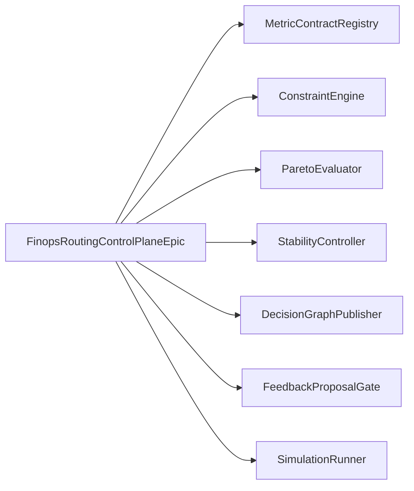

# Architecture

The FinOps budget routing control-plane proof composes one event-sourced router
loop around existing HoBo FinOps evidence:

1. Provider-neutral `ResourceIntent` enters a parser boundary.
2. Abstract candidates are generated without provider, SKU, region, account, or
   backend API details.
3. Hard constraints remove invalid candidates before policy, metrics, or
   preference weights run.
4. Budget policy classifies candidates as allow, deny, approval-required, or
   transform-required.
5. Metric contracts produce comparable vectors only for still-eligible
   candidates.
6. Pareto selection removes dominated candidates before preference weights apply.
7. Stability policy can override a preferred reroute when recent history shows
   unsafe churn.
8. A `DecisionGraph`, `RoutingDecision`, backend-neutral `ActionPlan`, and
   feedback proposal events are emitted for replay and explanation.

## Persona Map

| Persona | Goal | Reference slice |
|---|---|---|
| Application developer | Preview placement and understand why | `standards-first-intent-routing` |
| Platform engineer | Govern metric semantics without custom DSL drift | `governed-metric-routing` |
| FinOps lead | Keep cost, budget, and allocation signals decision-safe | `constraint-first-selection` |
| SRE operator | Avoid noisy reroutes and preserve rollback/freeze controls | `stability-controlled-feedback` |

## Boundary Map

All providers in the diagram are mocked in memory. Terraform, Pulumi,
Crossplane, and Kubernetes appear only as adapter fixture labels below the
`ExecutionAdapterPort` boundary; no routing intelligence is implemented there.

## Contract Strategy

- Canonical Protobuf records in `data-models/finops_budget_routing_control_plane.proto`
  generate the input records in `src/_generated/`. The historical `architecture/`
  files mirror the canonical schema exactly; a test rejects drift.
- CUE constraints and valid/invalid record fixtures in `data-models/` capture
  the same protobuf JSON input shape. Runtime parsers enforce the stronger
  relational invariants, including unique IDs, dependency cycles and digests.
- Pact-style fixtures under `contracts/pacts/` name each consumer boundary.
- Consumer tests verify the simulation advertises every provider named by the
  Pact fixtures.

## Drift Controls

- Provider-specific core fields fail closed at parse time.
- Raw telemetry user metrics and arbitrary formulas fail closed.
- Hard constraints execute before metrics and preferences.
- Dominated candidates cannot be selected by weights.
- Cooldown windows, minimum improvement thresholds, migration penalties, and
  flip limits can preserve the current placement.
- Feedback emits proposals only; metric and policy state remain unchanged until
  separately approved.

## Guardrail Evidence

Parse, don't validate: incoming intents, metric contracts, Pact fixtures, and
scenario records cross parser boundaries before the epic simulation uses them.
The parsed domain types are `ResourceIntent`, `MetricContract`,
`RoutingCandidate`, `DecisionGraph`, `RoutingDecision`, `ActionPlan`, and
`FeedbackProposal`. Core functions accept those parsed domain types, not raw
DTOs with repeated boolean checks.

Event architecture: the pure evaluator returns routing facts with event IDs,
time and sequence derived from the pinned input. It does not append to a durable
store or execute a provider. DX, OpsX, and FinX proof surfaces read the same
`DecisionGraph`; the simulation holds these results in memory. Re-evaluating
identical pinned inputs reproduces the decision, graph and action proposal.
The production hosting supervisor owns durable command ingestion, atomic
financial reservation, effect dispatch, reconciliation, observed rollback,
source retirement and settlement. The proof declares those boundaries using
the existing ADR-0136 effects/resilience contracts instead of claiming that a
fixture proves external effects.

The production command handler is hosted by a routing **actor**. Its durable
**event store** commits decision events and staged effects before adapter I/O;
materialized views are **projections** of those facts. The actor's current
**snapshot** and historical **read store** are owned by that supervisor. This
epic deliberately supplies pinned snapshots and returns pure projection values;
it does not claim to instantiate the production actor or durable read store.
