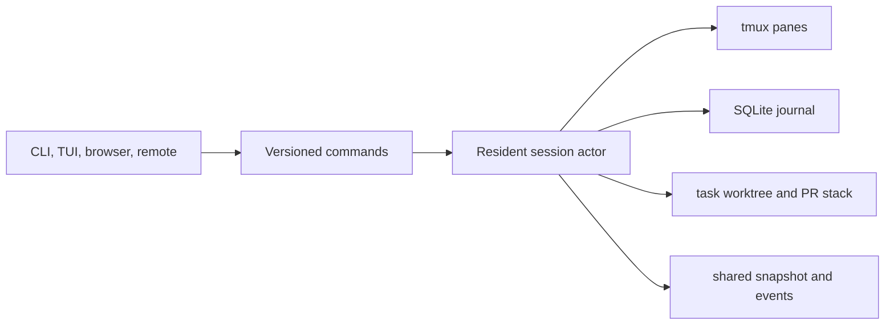

# HoBo Code resident session orchestration

This epic proof composes the canonical session contract with the existing HoBo Code harness experience. It proves that one task branch/worktree can expose all lifecycle commands through one client-neutral boundary.

## Architecture

## Acceptance

- The command suite includes session, pane, agent, checkpoint, Git, and stacked-PR lifecycle operations.
- Detach and reattach are explicit operations and never imply session shutdown.
- Every client consumes the same snapshot contract.
