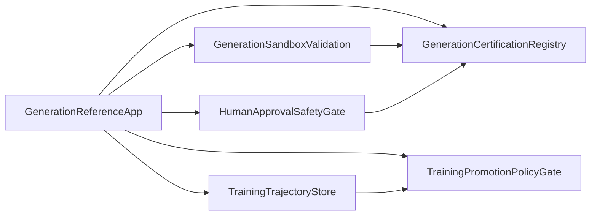

# Reference Architecture

## Overview

The epic is represented as one reference service with three vertical slices:

1. Cold-start generation certifies a database provider.
2. Training/eval promotion improves a `use training` method.
3. Live-fix and cross-layer propagation keep generated regions gated and synchronized.

The architecture keeps the Generation epic inside the common reference implementation root and avoids product runtime changes. Each boundary is mocked and covered by a Pact decision.

## Service Boundary Map

## Boundary Decisions

| Boundary | Decision | Rationale |
|---|---|---|
| GenerationSandboxValidation | Consumer tested with mocked provider | The reference proves no-egress validation and trace replay without a live sandbox service. |
| GenerationCertificationRegistry | Consumer tested with mocked provider | The reference publishes signed certification events in memory. |
| TrainingTrajectoryStore | Consumer tested with mocked provider | The reference captures OpenInference trajectories and privacy filters payloads locally. |
| TrainingPromotionPolicyGate | Consumer tested with mocked provider | The reference composes evals, poisoning guard, and champion/challenger logic locally. |
| HumanApprovalSafetyGate | Consumer tested with mocked provider | The reference proves fail-closed prod/high-risk approval semantics without a live hook. |

## Scope Review

Kept:

- Contract-first generation with WIT/conformance as the hard boundary.
- Sanitized untrusted material and post-conformance safety rejection.
- Bounded repair with explicit `gen.NeedsHuman` on non-convergence.
- Training-engine port, OpenInference trajectory capture, live eval rewards, poisoning guard, privacy model, and champion/challenger promotion.
- Live-fix gating and generated-stack propagation as one approval-bound flow.

Discarded:

- Any live provider calls, live registries, live telemetry backends, or production approval hooks.
- Blind copying of POC internals outside their exported contract APIs.
- Automatic production promotion for generated or trained candidates.

Deferred:

- Provider-side Pact verification against production services.
- UI for approval hooks and operator dashboards.
- Integration with real sandbox/Registry/trajectory-store deployments.
