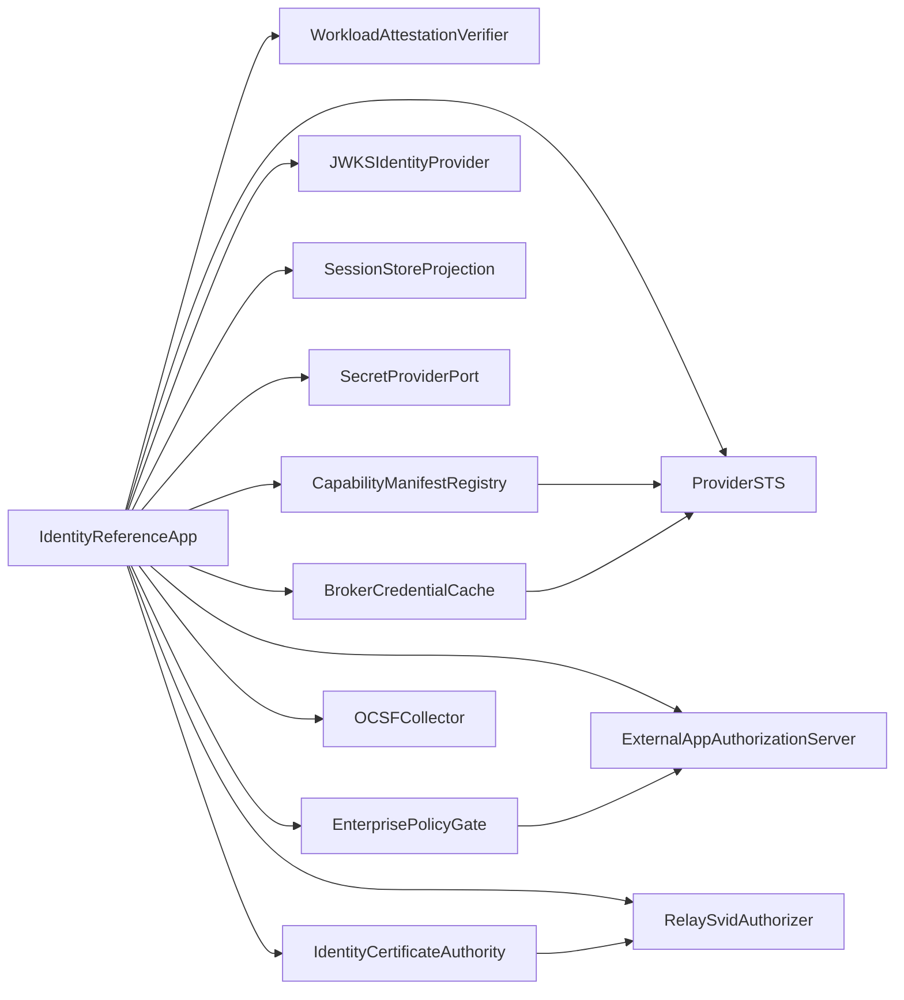

# Reference Architecture

## Overview

The epic is represented as one Identity reference service with four vertical slices:

1. Workload credential ladder issues attested SVIDs and brokers scoped provider credentials.
2. App-user auth and secretless config verify `ctx.user`, enforce tenancy/RBAC, and resolve config without stored plaintext.
3. Cross-App Access delegates user-to-agent-to-target access through ID-JAG and policy pre-mint checks.
4. Identity governance and observation preserve bootstrap trust, bounded availability, service-to-service mTLS, Relay attach, and OCSF audit export.

The implementation is isolated under the common epic reference implementation root. It does not change production runtime, SDK, provider, networking, or policy code.

## Service Boundary Map

## Boundary Decisions

| Boundary | Decision | Rationale |
|---|---|---|
| WorkloadAttestationVerifier | Consumer tested with mocked provider | The reference proves host-signed measurement binding without a production executor or host-key service. |
| CapabilityManifestRegistry | Consumer tested with mocked provider | `auth.json` is consumed from a signed deterministic fixture. |
| ProviderSTS | Consumer tested with mocked provider | OIDC federation and provider token narrowing are exercised without live cloud APIs. |
| JWKSIdentityProvider | Consumer tested with mocked provider | `hobo:auth` verifies against fixture JWKS and rejects wrong issuers. |
| SessionStoreProjection | Consumer tested with mocked provider | Event-sourced revocation is replayed locally. |
| SecretProviderPort | Consumer tested with mocked provider | Secret values stay reference-wrapped and redacted. |
| EnterprisePolicyGate | Consumer tested with mocked provider | XAA pre-mint and break-glass policy decisions are fail-closed. |
| ExternalAppAuthorizationServer | Consumer tested with mocked provider | ID-JAG redemption is modeled without a target SaaS dependency. |
| IdentityCertificateAuthority | Consumer tested with mocked provider | X.509-SVID issuance/rotation is certificate-shaped, not a TLS stack. |
| RelaySvidAuthorizer | Consumer tested with mocked provider | Relay attach consumes SVID identity without opening a network tunnel. |
| BrokerCredentialCache | Consumer tested with mocked provider | HA renewal grace is bounded by signed leases and cannot widen scope. |
| OCSFCollector | Consumer tested with mocked provider | SIEM export validates one-way redacted projection only. |

## Scope Review

Kept:

- JWT-SVID and X.509-SVID formats, stable Yard issuer/JWKS, KMS-rooted genesis custody, and attestation-derived tenant binding.
- Keyless-first broker flow: signed provider `auth.json`, OIDC federation, provider token narrowing, no plaintext token or secret persistence.
- `hobo:auth` consumer contract, dev/prod contract equivalence, JWKS verify path, RBAC role resolution, and event-sourced session revocation.
- XAA ID-JAG wire contract, runtime `crossApp()` broker backing, inferred scope ceiling, pre-mint policy, inbound resource-server validation, and replay/confused-deputy guards.
- Secretless config ladder, bounded static-key escape hatch denial, broker HA renewal grace, genesis/break-glass audit, and OCSF projection.

Discarded:

- Live provider STS, IdP, KMS/HSM, SCIM, SIEM, Relay, TLS, or secret-store calls.
- Workload-supplied tenancy, roles, renewal grace, or delegation facts.
- Static key fallback as a happy path. It remains modeled only as an explicitly bounded last resort.
- Cross-epic implementation of SDK authoring, provider adapters, policy engine internals, data-plane networking tiers, or production Relay transport.

Deferred:

- Provider-side Pact verification against real Identity, Registry, STS, IdP, policy, SIEM, and Relay services.
- UI/operator surfaces for identity recovery, SIEM subscription management, and live policy remediation.
- Production cryptography, certificate signing, OAuth server integration, KMS custody, and high-availability deployment mechanics.
