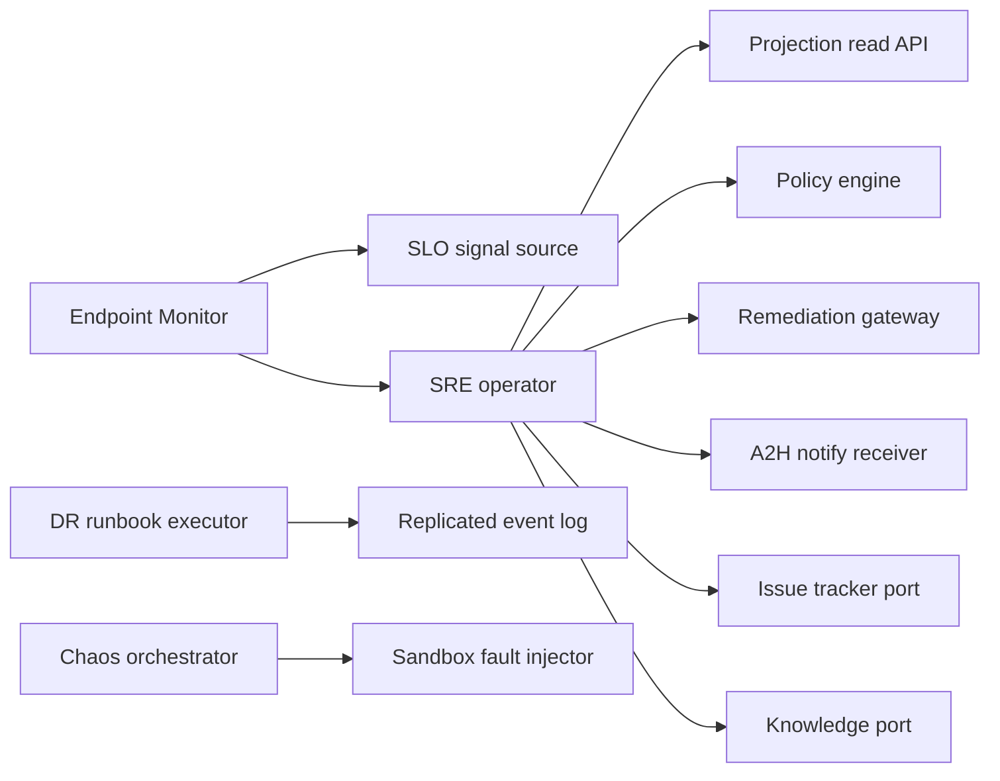

# Operators & SRE Crew Architecture

## Persona outcome

The SRE operator is a built-in Crew principal that reads observability and projection data, classifies incidents, proposes bounded remediations, and routes unsafe writes through policy and human obligations. The reference implementation keeps this as an event-sourced vertical slice rather than a production service.

## Boundary map

Every arrow has a contract fixture and a mock in the simulation. Missing production providers are treated as provider-unavailable contract decisions, not omitted boundaries.

## Design decisions preserved from POCs

- Incident lifecycle is a single event-sourced aggregate, not independent per-alert pages.
- Crew facts stay in `crew.*`; domain facts remain in `incident.*`, `policy.Decided`, `liveFix.*`, `runbook.*`, `chaos.*`, and DR event families.
- Write actions always pass through the policy boundary.
- Production and ambiguous changes require approval or handoff.
- Runaway remediation and self-causation fail closed.
- DR failover cannot shift traffic until fencing, RPO honesty, and replay proof are present.
- Issue tracker and knowledge systems are ports, not baked-in integrations.

## Deferred production work

- Real policy provider verification.
- Runtime ActorHost wiring for incident and runbook aggregates.
- Real MCP tools for operator console approval.
- PagerDuty/OpsGenie/Slack receiver adapters.
- Real live-fix gateway, chaos fault injector, and replicated event-log providers.
- HolmesGPT or StackStorm adapter conformance.
