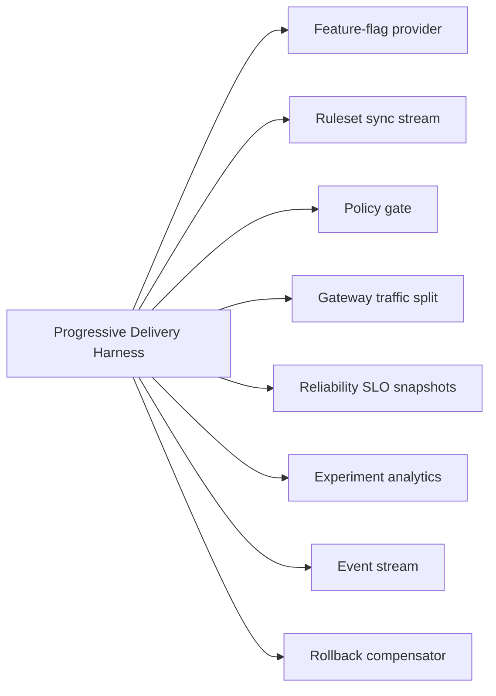

# Progressive Delivery Harness Architecture

## Roles

| Persona | Goal | Reference behavior |
|---|---|---|
| Platform operator | Release a deployed change without unsafe traffic exposure | Canary traffic advances only when policy and SLO gates pass. |
| App operator | Control runtime behavior without redeploying | Feature flags evaluate deterministically from `ruleset@seq` and fail safe when stale. |
| Growth engineer | Measure release impact without p-hacking | Experiment analysis refuses underpowered or unscheduled conclusions. |
| SecOps reviewer | Keep risky release-affecting actions governed | Flag flips and rollback obligations pass through policy decisions. |

## Boundary Map

All providers in this reference are mocked and verified with Pact-style consumer contracts.

## Vertical Slices

| Slice | Behavior | Negative proof |
|---|---|---|
| Flag leg | Evaluates `checkout-v2` from a fresh ruleset and records `flag.Evaluated` | Stale ruleset returns default and holds release. |
| Delivery leg | Starts rollout, applies 10/50/100 traffic splits, promotes on healthy SLO windows | Non-converged observed traffic escalates to `needs-human`. |
| SLO gate | Reads pinned SLO snapshots and maps verdicts to promote/hold/rollback | SLO burn creates auto-revert obligation and rollback. |
| Experiment leg | Assigns, exposes, and concludes only when sample and schedule are valid | Underpowered favorable look returns `do-not-conclude`. |
| Rollback leg | Resets traffic and satisfies obligation on successful compensation | Failed compensation emits `rollout.NeedsHuman` and escalates obligation. |

## Contract Decisions

- Pact files live in `contracts/pacts/`.
- The inventory in `contracts/pact-inventory.md` names every boundary.
- Provider verification is performed against deterministic mock providers because real policy, gateway, SLO, and vendor systems are outside this draft reference.
- Missing real providers are documented as mocked-provider decisions, not omitted boundaries.

## POC Synthesis

The lower-level POCs remain as evidence. This reference keeps their durable behaviors and drops accidental implementation details:

- WIT and port vocabulary becomes an in-process reference API.
- Event families become one audit stream.
- PACT-style contracts become JSON pact fixtures verified by `tests/harness-reference.test.ts`.
- Vendor adapters and live services are represented only by consumer contracts and mocks.
