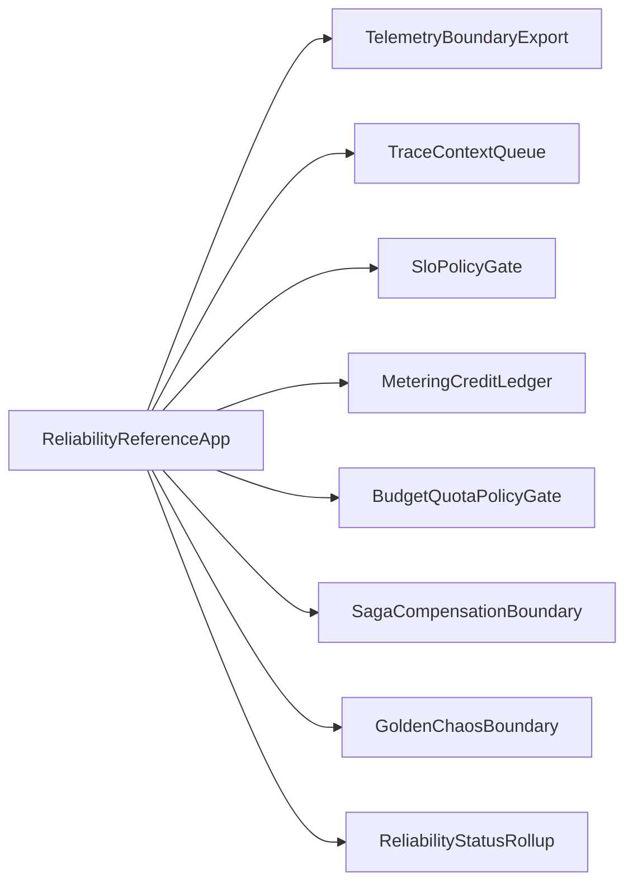

# Architecture

The Reliability, Observability & Cost reference implementation composes four slices around one event-sourced operating model:

1. Telemetry, trace context, SLO computation, rollback analysis, and SLO gaming guard feed an SRE rollback decision.
2. Metering, credit headroom, quota policy, showback, shared-cost attribution, runaway-spend breaking, and observability cost shedding feed FinOps control.
3. Failure taxonomy, choreography saga, compensation engine, and Run Inspector feed incident recovery.
4. Golden Suite chaos verification and SLA rollup feed reliability status.

## Persona Map

| Persona | Goal | Reference slice |
|---|---|---|
| SRE on-call | Know when to rollback, why, and whether the signal is fresh | `telemetry-slo-gate` |
| FinOps lead | Bound spend while preserving availability | `finops-budget-guard` |
| Incident commander | Explain and recover partial deploy failures | `saga-compensation-recovery` |
| SRE on-call | Trust Golden Suite, chaos, and status evidence | `golden-chaos-status-rollup` |

## Boundary Map

Every provider in the diagram is mocked in memory. The reference implementation proves consumer expectations and architecture shape, not provider deployment.

## Contract Strategy

Contracts stay consumer-focused:

- Each boundary has one Pact fixture under `contracts/pacts/`.
- `contracts/consumer/reliability-boundaries.test.mjs` verifies the simulation advertises every provider named by Pact fixtures.
- Provider verification is documented as unavailable until production services exist.

## Drift Controls

- Stale or missing SLI data returns `no-data` and prevents optimistic green status.
- Malformed trace context is regenerated and marked with `traceRepair`.
- Missing quota context denies spend-incurring actions.
- Stale saga leases fail before duplicate side effects.
- Chaos blast-radius leaks abort before status can remain green.
