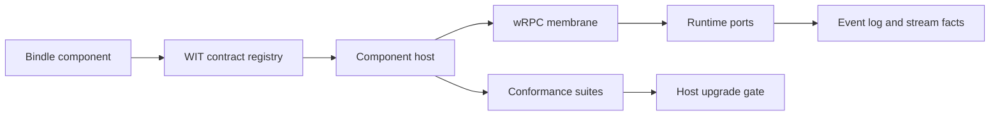

# WIT Runtime Membrane Architecture

The epic-level reference architecture treats the runtime membrane as four cooperating planes:

- **Contract plane:** WIT pins, vendored WASI interfaces, `hobo:sdk` aggregate world, websocket preview surfaces, and manifest host pins.
- **Host plane:** runtime-local component host, wasm-in-container floor, adapter certification, host-version upgrade gates, and fuel/epoch execution limits.
- **Link plane:** wRPC in-process and lattice transports, deadline propagation, wire-version negotiation, bounded backpressure, and ambiguous-failure reconciliation.
- **Runtime-port plane:** EventStore, ActorHost, Queue/Clock, Streamer, capability grants, websocket fan-out, and runtime-port conformance.

## Service Boundary Map

| Boundary | Consumer | Provider | Role |
|---|---|---|---|
| WIT contract registry | Runtime reference app | WIT/version lock provider | Pins interface identity before host/link decisions. |
| Component host lifecycle | Runtime reference app | Component host adapter | Instantiates components and releases leases. |
| wRPC link transport | Runtime reference app | Link transport provider | Routes WIT calls across in-process or lattice links. |
| Runtime EventStore | Runtime workflow | EventStore runtime port | Appends and replays durable facts. |
| ActorHost | Runtime workflow | ActorHost runtime port | Enforces single-writer state mutation. |
| Queue and Clock | Runtime workflow | Queue/Clock runtime ports | Handles at-least-once work and deterministic timers. |
| Streamer and websocket | Runtime workflow | Streamer runtime port | Delivers run frames and websocket fan-out without Yard data path. |
| Capability grant gate | Component host | Capability linker | Denies unlinked or uninferred grants. |
| Conformance and upgrade gate | Runtime operator | Conformance suite provider | Certifies host/runtime-port behavior before selection or upgrade. |

## Deferred

Real Wasmtime, wasmCloud, NATS/JetStream, container runtime, Queue/EventStore providers, gateway transport, and cloud-provider adapters stay mocked. Provider verification is documented as unavailable until those providers exist outside draft POCs.
