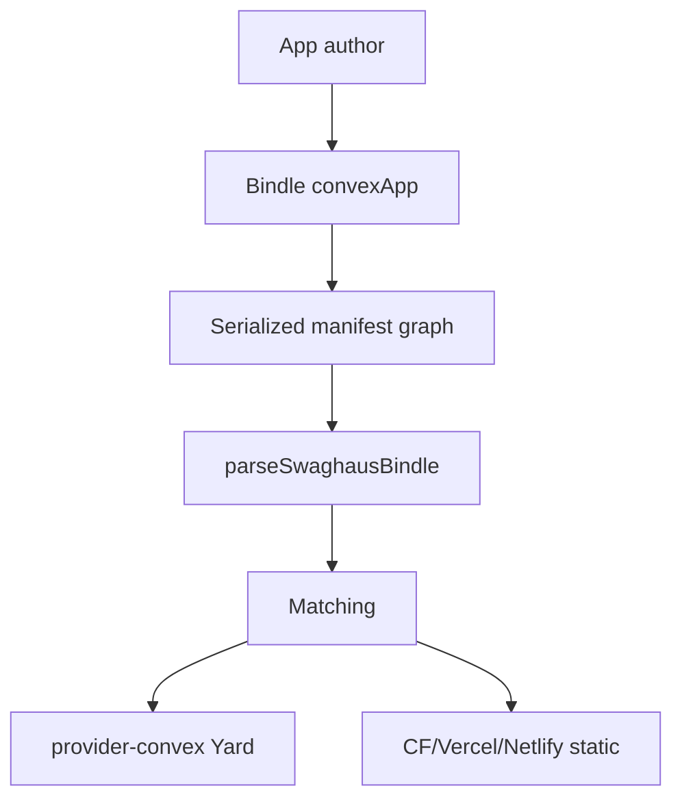

# Convex Swaghaus Bindle Authoring DX

Developer experience for packaging JamesCowling/swaghaus as a provider-neutral
HoBo Bindle: `b.web(convexApp(root))` + `b.data()` + WorkOS `b.external`.

## Pseudo-code

```
bindle(b => {
  backend = b.data()
  auth = b.external({ endpoints: { workos: "https://api.workos.com" } })
  web = b.web(convexApp("examples/convex-swaghaus")).dependsOn(backend, auth)
  return { backend, auth, web }
})
```

## Architecture



## Contracts

- `architecture/bindle.proto` — `SwaghausBindleShape`, `BindleResourceRef`,
  `EnvDependency`, and the `BindleResourceKind` / `EnvRouting` enums.
- `architecture/bindle.cue` — the invariants: resource names are DNS labels,
  the web root is repo-relative with no `..` escape, the framework is `convex`,
  the graph holds exactly one web Kit plus at least one data and one external
  resource, no resource depends on itself, each required env name is routed
  once, WorkOS names must route `external`, `VITE_CONVEX_URL` must route
  `data`, `CONVEX_DEPLOY_KEY` must route `env`, and `#AuthoringTransitions`
  fixes the `drafted → parsed → matched | refused` moves.
- `data-models/proof.cue` — `#ProofRoot` pins the example tree under
  `examples/`.
- `architecture/pacts/bindle.pact.json` — the convexApp annotation interaction.

## Parse, don't validate

The untrusted input of this experience is the **Bindle manifest graph** — the
serialized `bindle(...)` definition an author, template, or agent hands to the
control plane. `src/parse.ts` is the one place it stops being plain JSON:
`parseSwaghausBindle` returns the parsed derived type `SwaghausBindlePlan` over
branded `ConvexAppRoot`, `ResourceName`, and `EnvName` values, and
`src/authoring.ts` (the real authoring path: draft → serialize → parse) accepts
only that plan.

The parser refuses rather than repairs, which is where the DX friction actually
gets removed — the author learns at the boundary, with a remediation sentence:

- a **provider pin** on any Bindle resource (annotations must be `hobo`-scoped;
  vendor options belong at Camp/Yard scope so the PortabilityReport can score
  them, ADR-0024/ADR-0144);
- **plaintext secret material** in an annotation config — secrets ride a Camp
  `secretRef` or `b.external()` only (ADR-0027);
- a missing/duplicated web Kit, or one without the `convexApp(root)` marker;
- a web Kit that does not depend on both the data backend and the WorkOS
  external;
- a web root that escapes the repo (also checked through the real
  `resolveConvexRoot` guard when a repo root is known);
- an env name with **no declared Bindle routing** — nothing is silently
  defaulted to a plain env var.

## Event architecture

This proof is an **authoring-side slice**: it appends no events and owns no
stream. The manifest it parses is the input to the control-plane flow that
does, so the families below are the real ones in `packages/cloud/src/events.ts`
(asserted by `test/bindle.test.ts`, which fails if this section names a fact the
catalog does not export).

- **Command** — `DeployCommand`, handled by `deploy()` in
  `packages/cloud/src/gateway/gateway.ts`: it authorizes the actor and appends
  facts; the parsed plan's manifest is what its `bindleHash` covers.
- **Events** — on the deployment stream: `deployment.Requested` (carrying the
  bindle hash of this authored manifest), then `match.Decided` per resource as
  Matching resolves the neutral `data` / `external` / `web` kinds to a Yard, and
  `deployment.Planned` or `deployment.PlanRejected` — a refusal this parser
  raises at authoring time is the same class of failure, moved earlier and made
  free.
- **Actor** — the Planner/Orchestrator pair in `packages/cloud/src/planner/`
  and `packages/cloud/src/orchestrator/`; per-resource work runs in
  `ResourceActor`, which consumes commands and emits facts rather than mutating
  read models.
- **Event store** — the Yard kernel's append-only `EventStore` port
  (`@hobo/core`), durably backed by the SQLite journal in
  `@hobo/storage-sqlite`.
- **Materialized view / projection** — `deploymentViewProjection` folds the
  match rationale and saga graph; `topologyViewProjection` folds the resource
  topology this Bindle describes (`packages/cloud/src/projections/`).
- **Snapshot / read store** — projections rebuild from zero, current-state
  reads come from journal snapshots (`saveSnapshot` / `loadSnapshot`), and that
  same SQLite journal is the read store the dashboard and CLI query. This proof
  persists nothing.

## Friction addressed

- No fake `hobo/convex-*` images
- WorkOS + deploy key fail-closed with Camp remediation
- Discoverable env via `discoverConvexEnv`, and every discovered name carries
  its Bindle routing instead of a bare `env` default
- Provider pins and pasted credentials fail at the authoring boundary, not in
  a later plan rejection

## Validation

- `pnpm --prefix src/draft/exp-proofs/dx/convex-swaghaus-bindle test`
