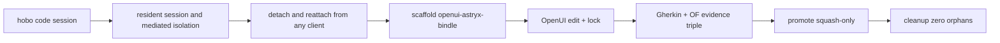

# hobo-code-harness-experience

**Experience type:** dx (developer)  
**ADR:** [ADR-0139](../../../../docs/design/adr/03-data-plane.md#adr-0139)

## Persona & friction

**Persona:** App developer / agent operator writing a HoBo Bindle with agents.

**Friction eliminated:**

1. Agents writing freely into the canonical tree (sandbox purity).
2. Agent processes disappearing when the launching client exits.
3. No shared session identity across CLI, TUI, and remote clients.
4. No high-value starting template with OpenFeature-linked Gherkin.
5. No visual lock-in source of truth for subsequent codegen.
6. Orphan worktrees after agent runs.

## Flow (mermaid)



## Exercise

```bash
pnpm exec turbo run test --filter ./src/draft/exp-proofs/dx/hobo-code-harness-experience
node --import tsx examples/usage.ts
```

## Acceptance mapped

| Criterion | Proof |
|---|---|
| Isolation + cleanup | `runHoboCodeHarnessExperience().isolationClean` |
| Scaffolding template | `templateOk` |
| Visual lock-in | `visualOk` |
| Evidence triple | `evidenceOk` |
