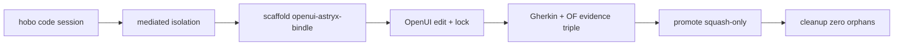

# hobo-code-harness-experience

**Experience type:** dx (developer)  
**ADR:** [ADR-0139](../../../../docs/design/adr/03-data-plane.md#adr-0139)

## Persona & friction

**Persona:** App developer / agent operator writing a HoBo Bindle with agents.

**Friction eliminated:**

1. Agents writing freely into the canonical tree (sandbox purity).
2. No high-value starting template with OpenFeature-linked Gherkin.
3. No visual lock-in source of truth for subsequent codegen.
4. Orphan worktrees after agent runs.

## Flow (mermaid)



## Exercise

```bash
pnpm exec turbo run test --filter ./src/draft/exp-proofs/dx/hobo-code-harness-experience
node --import tsx examples/usage.ts
```

## Acceptance mapped

| Criterion | Proof |
|---|---|
| Isolation + cleanup | `runHoboCodeHarnessExperience().isolationClean` |
| Scaffolding template | `templateOk` |
| Visual lock-in | `visualOk` |
| Evidence triple | `evidenceOk` |
