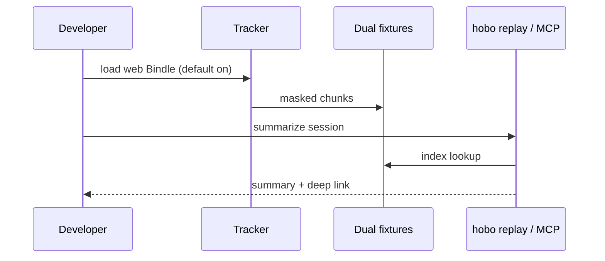

# Session Replay local path (DX proof)

**Audience:** app developers and coding agents debugging web Bindles on a local Station.

**Friction removed:** zero-config local capture → dual-fixture store → CLI/MCP summarize/open without cloud object storage or AGPL OpenReplay stack.

## Journey

1. Accept template defaults (or call `createReplayService({ memory: true })`).
2. Session records under default privacy masks.
3. `hobo replay list|summarize|open` (MCP parity) returns agent-usable summaries + OpenUI player descriptor.
4. `HOBO_REPLAY=0` disables cleanly.

## Evidence

- Unit/contract tests in `@hobo/replay`
- This package: end-to-end dual-fixture experience + evidence pack
- Production: [ADR-0137](../../../../docs/design/adr/03-data-plane.md#adr-0137)
