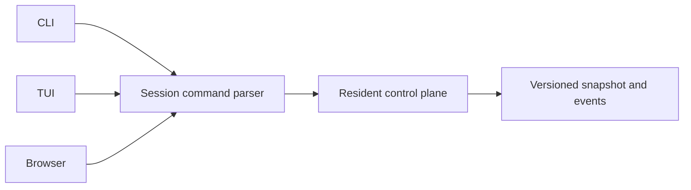

# Agent session control-plane contract

This proof pins one versioned protobuf/CUE/Pact command boundary for resident `hobo-code` sessions. Every client uses the same parsed commands and durable snapshots; tmux, Git, and agent harnesses remain implementation details behind the boundary.

## Architecture

## Evidence

- `packages/code/data-models/code_harness.proto` is the canonical wire schema.
- `packages/code/data-models/code_harness.cue` pins cross-field constraints.
- `packages/code/contracts/pacts/code-harness-boundary.pact.json` executes the HTTP consumer/provider seam.
- `examples/` and `bench/` exercise the production parser.

## Validation

- `pnpm --prefix src/draft/technical-proofs/agent-session-control-plane-contract test`
- `pnpm run draft:artifacts -- --staged`
