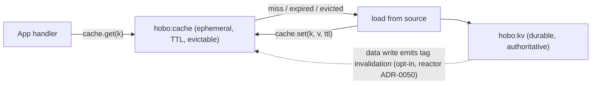

# Cache port (`hobo:cache`) vs durable `kv` — ADR-0118 catalog contract

Pins [ADR-0118](../../../../docs/design/adr/03-data-plane.md#adr-0118): the app-facing
`cache(name)` catalog port (`hobo:cache`) is a **distinct contract** from the durable
`kv(name)` / `wasi:keyvalue` store. A cache is **ephemeral, TTL-first, evictable, and never
a source of truth**; a durable kv is **authoritative**. Folding one into the other (the prior
"data/caching (`data`/`kv`)" catalog note) was both a catalog gap and a latent parity
overclaim. This proof makes the difference executable.

## Architecture

## Evidence

- `examples/usage.ts` — executed usage example (gate-enforced): cold miss → recompute →
  hit; TTL expiry → miss → recompute; eviction → miss → recompute; flush leaves `kv`
  authoritative; a cold key is a `MISS`, never an error.
- `src/cache-contract.ts` — the pinned surface (`SimCache`, `SimDurableKv`, `cacheAside`)
  on a deterministic logical clock (no wall-clock, no real timers).
- `bench/cache-contract.bench.ts` — hot-path bench (numbers advisory; must execute).
- `notebook.ipynb` — walkthrough of the cache-vs-kv contract.

## Validation

- `NODE_OPTIONS="" node --import tsx examples/usage.ts`
- `pnpm run draft:artifacts -- --base=HEAD~1` (artifact gate)
