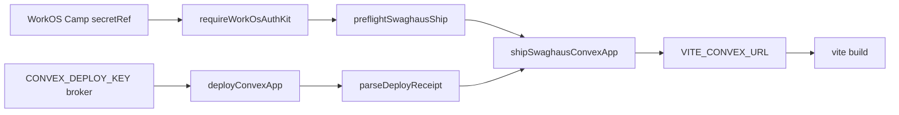

# Convex Swaghaus Deploy Adapter

Proves the thin `@hobo/provider-convex` deploy executor + WorkOS AuthKit
fail-closed preflight used to ship real JamesCowling/swaghaus (ADR-0144).

## Architecture

## Contracts

- `architecture/deploy_adapter.proto` — wire shapes for the executor boundary:
  `DeployPreflight`, `ConvexDeployRequest`, `ConvexDeployReceipt`,
  `ImpedanceFindingRecord`, and the `DeployMode` / `ImpedanceSeverity` enums.
- `architecture/deploy_adapter.cue` — the invariants behind those shapes:
  deployment names are DNS labels, Cloud URLs are `https://<name>.convex.cloud`,
  self-hosted URLs are absolute and never a `convex.cloud` host, app roots are
  repo-relative with no `..` escape, `live` holds only when nothing is missing
  and the mode is not `mock`, `mocked` agrees with `mode == "mock"`, a
  non-mock request carries a deploy key or self-host URL + admin key, `block`
  severity belongs to `paradigm-mismatch` alone, and `#ShipTransitions` fixes
  the allowed `requested → preflighted → deploying → deployed | refused` moves.
- `architecture/pacts/deploy_adapter.pact.json` — the executor interaction.

## Parse, don't validate

`src/parse.ts` is the proof's single parser boundary. Three untrusted inputs
cross it on the real call path in `src/ship.ts`:

1. the `deployConvexApp` response — in the Cloud and self-hosted lanes its
   `deploymentUrl` is scraped out of `convex deploy` stdout, so it is provider
   text, not a HoBo value;
2. the ambient environment behind the WorkOS AuthKit + deploy-credential
   preflight (names only — no material is read, returned, or logged);
3. `convexImpedanceFindings` output, which planners consume as evidence.

Each becomes a parsed derived type — `DeployRequest`, `DeployReceipt`,
`ShipPreflight`, `ImpedanceRecord` — built from the branded values
`ConvexAppRoot`, `DeploymentName`, `DeploymentUrl`, and `EnvName`. Those
constructors apply the CUE constraints above, so `shipSwaghausConvexApp`, the
tests, and the example accept only refined domain types; an unparsed provider
response is unrepresentable past `src/parse.ts`, and refusal is a thrown
`ConvexDeployParseError` rather than a coerced value.

## Event architecture

This proof is a **pure adapter slice**: it appends no events itself, and it
owns no stream. It sits inside a control-plane flow that does, so the families
below are the real ones in `packages/cloud/src/events.ts` (asserted by
`test/deploy-adapter.test.ts`, which fails if this section names a fact the
catalog does not export) — none are invented for this proof.

- **Command** — `DeployCommand`, handled by `deploy()` in
  `packages/cloud/src/gateway/gateway.ts`. That handler authorizes, then its
  only side effect is appending facts.
- **Events** — the owning aggregate is the deployment stream
  (`deploymentStreamId(deploymentId)`): `deployment.Requested`,
  `match.Decided`, `deployment.Planned`, then per resource
  `resource.Provisioning`, `resource.Provisioned` (whose `outputs` carry the
  `VITE_CONVEX_URL` this proof's parsed receipt supplies) or `resource.Failed`,
  and finally `deployment.Deployed` or `deployment.RolledBack`. The brokered
  deploy key shows up as `token.Granted` / `token.Used` / `token.Revoked`
  credential-audit facts — refs only, never material.
- **Actor** — `ResourceActor`
  (`packages/cloud/src/orchestrator/resource-actor.ts`) drives the
  per-resource FSM and calls an executor like this one; the Orchestrator
  serializes it under a lease/fence. This proof provides the executor step and
  keeps it pure with respect to the log.
- **Event store** — the Yard kernel's append-only `EventStore` port
  (`@hobo/core`), durably backed by the SQLite journal in
  `@hobo/storage-sqlite` (one partition, one writer, stream-head CAS).
- **Materialized view / projection** — `deploymentViewProjection` and
  `topologyViewProjection` (`packages/cloud/src/projections/`) fold those facts
  into the saga graph and topology read models; `credentialAuditProjection`
  folds the grant → use → revoke trail. The deployment URL parsed here is what
  those views publish.
- **Snapshot / read store** — projections are rebuildable from zero (the log is
  authoritative); current-state reads come from journal snapshots
  (`saveSnapshot` / `loadSnapshot` in `@hobo/storage-sqlite`), and the same
  SQLite journal is the read store the control-plane surfaces query. This proof
  persists nothing: it holds no stream, writes no snapshot, and its tests drive
  the executor through an injected spawn runner.

## Evidence

- `examples/` — executed fail-closed refusal, mock ship, self-hosted ship,
  refused receipt, parsed impedance findings
- `bench/` — impedance findings + receipt-parse bench
- `test/` — parse-boundary refusals, ship lifecycle, event-family truthfulness
- `notebook.ipynb` — walkthrough

## Validation

- `pnpm --prefix src/draft/technical-proofs/convex-swaghaus-deploy-adapter test`
