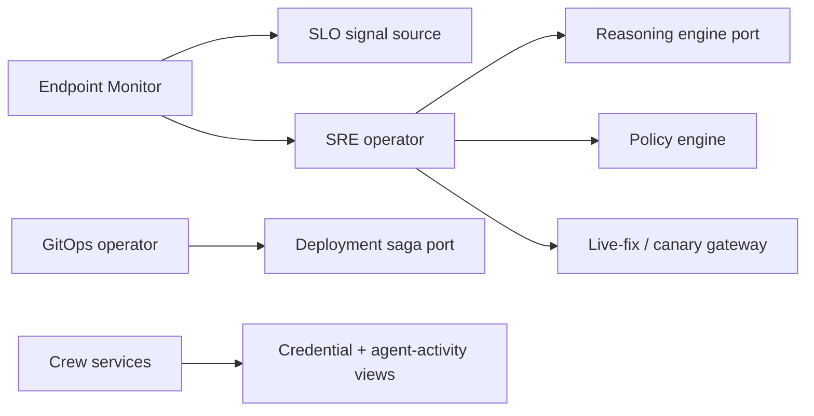

# S6-09 Operator Crew Yard Services Architecture

## Persona outcome

Each Crew member (SRE, Endpoint Monitor, GitOps, Platform Engineer) runs as an
event-sourced Yard service principal with its own SVID and per-agent policy.
Reads are autonomous; writes pass through the policy plane and AI-governance
sandbox.

## Boundary map

All boundaries are mocked in this draft proof; Pact fixtures pin consumer
expectations for promotion into `packages/sdk` and `packages/agent-skills`.

## Guardrail evidence

Parse, don't validate: scenario commands, remediation envelopes, and principal
records cross a parser boundary into derived domain types (`CrewPrincipal`,
`SloBreachSignal`, `RemediationPlan`). Core functions accept only those parsed
types.

Event architecture: each operator run is an **actor** that handles **command**
handlers (`DispatchOperator`, `ProposeRemediation`, `ApplyRemediation`) and
emits **events** into an in-memory **event store**. **Materialized views** /
**projections** (`CredentialAuditView`, `AgentActivityView`) fold the stream;
the accepted audit record is the current **snapshot**, and historical snapshots
persist in a **read store** so dashboard and MCP surfaces query projections
rather than raw provider internals.

## Deferred production work

- Wire actors into the Yard ActorHost runtime.
- Connect S6-03 deployment-strategy sagas for canary/rollback.
- Enforce S6-08 AI-governance guardrails against real model outputs.
- Promote Pact fixtures to provider verification.
