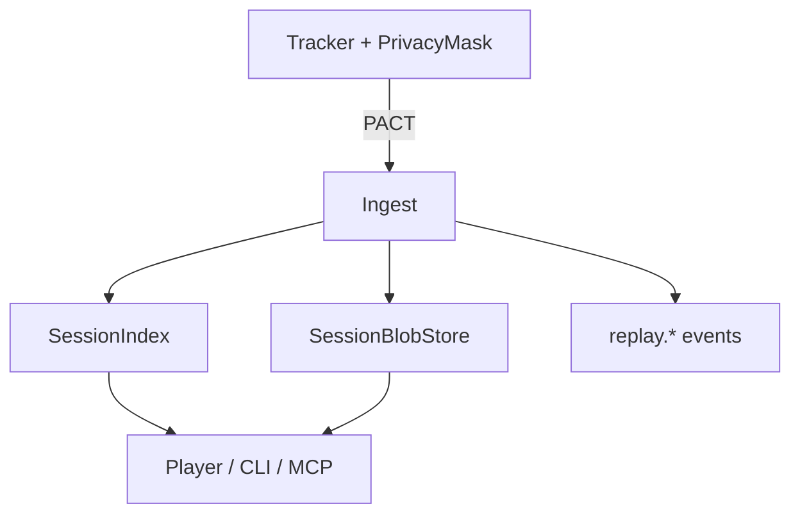

# Session Replay contracts (technical proof)

Pins the wire contracts and dual-fixture path for **Session Replay** ([ADR-0137](../../../../docs/design/adr/03-data-plane.md#adr-0137)).

Parse, don't validate: fixtures exercise `parseSessionRecord` and related constructors so invalid
metadata never becomes a **derived domain type** beyond the boundary.

## Event architecture

| Concern | Evidence |
|---|---|
| Command | start/ingest/end under dual fixtures |
| Events | `replay.*` lifecycle |
| Actor | ReplayService session aggregate |
| Event store | metadata-only lifecycle facts |
| Materialized view / projection | SessionIndex |
| Snapshot | SessionRecord |
| Read store | dual-fixture memory/FS |

## What is proven

- Protobuf + CUE shapes for PrivacyPolicy, SessionCorrelation, RecordingChunk, SessionRecord
- PACT tracker→ingest and player→store boundaries
- Heavy blobs are content-addressed; lifecycle events never embed rrweb streams
- Dual-fixture offline path

Production package: `@hobo/replay`.
